# AG8: props, plants and signs

Every M6 prop kind in 4 to 12 variants per district style, 15 plant species, and a sign for
every M11 sign slot; the full entry is in [`docs/assetgen_milestones.md`](../../assetgen_milestones.md).

```bash
.venv/bin/python -m assetgen props out/<city> --sheets out/<city>/sheets
```

## Variant sheets

One per district style (`sheets/sheet_<style>.jpg`): every prop kind's variants in a row,
then sample signs of the style (facade lightbox, panel and neon, blade lightbox and neon,
neon band, roof billboard). `sheet_plants.jpg`: the 15 species, one row each.

| Neon | Old |
|---|---|
| 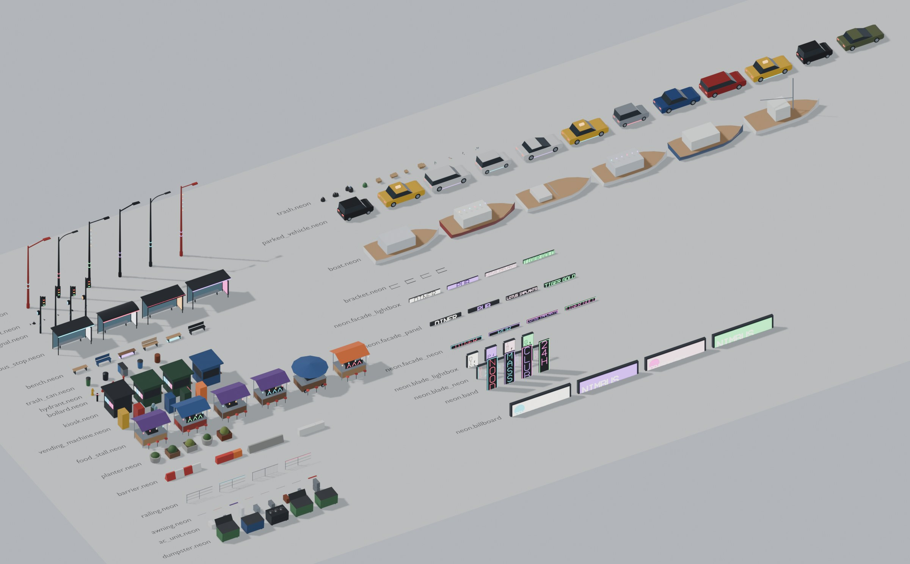 | 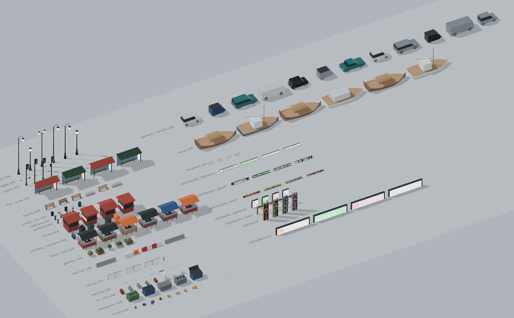 |

| Sleek | Civic |
|---|---|
| 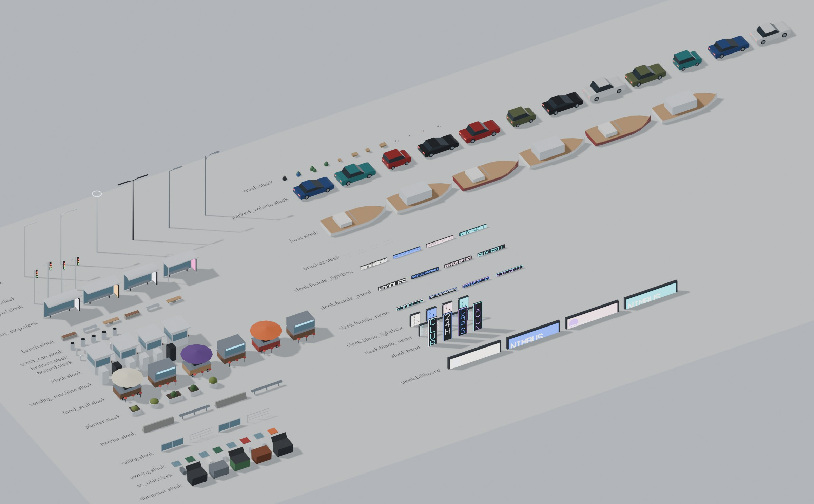 | 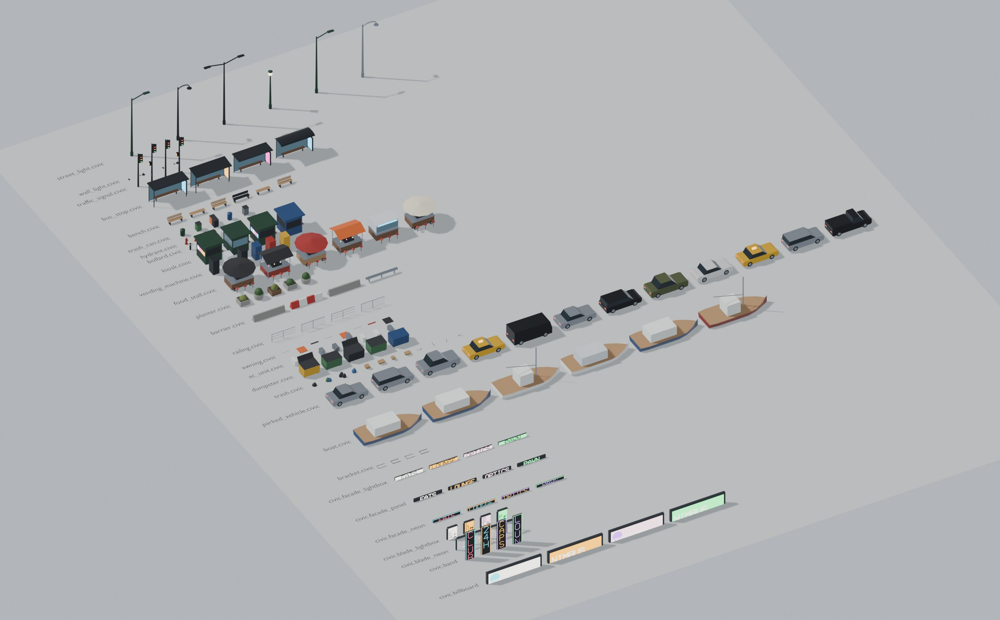 |

| Heavy | Plants |
|---|---|
| 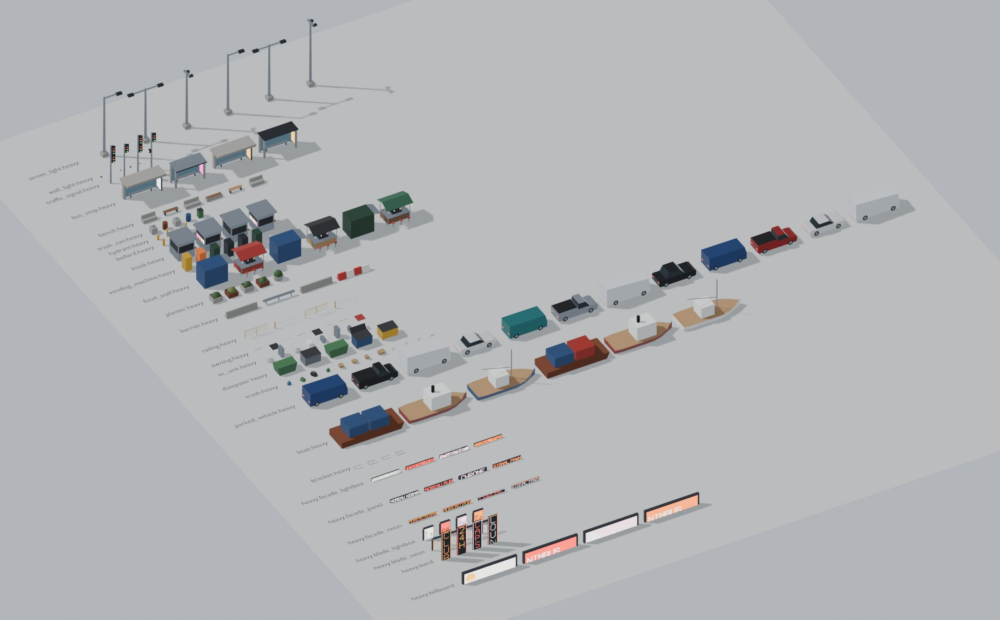 | 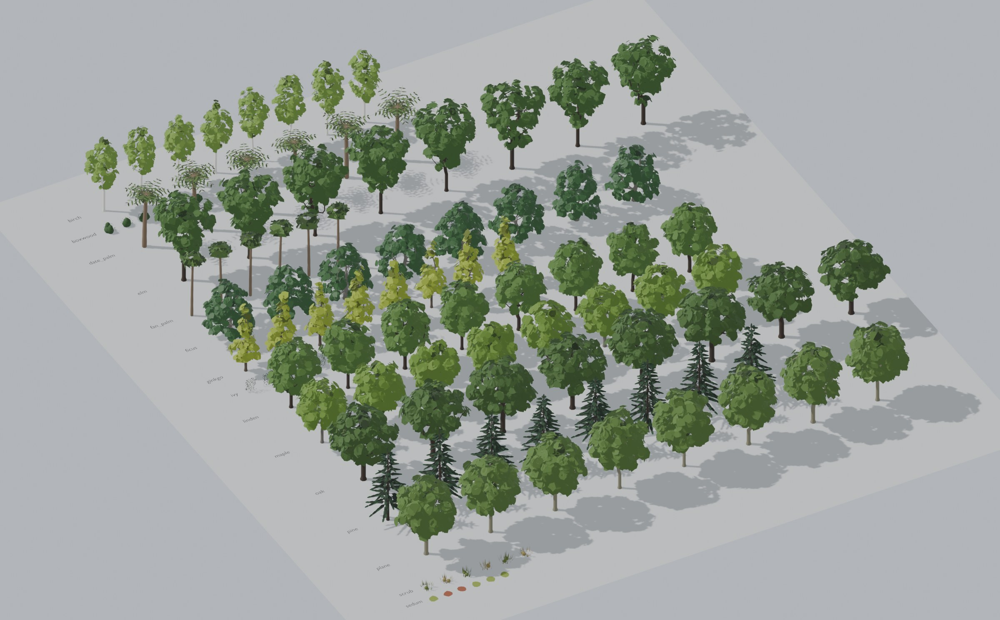 |

`sheets/sheet_neon_8k.jpg` is the neon sheet at 8K for the root README.

## Vesper Bay

AG1's shells, AG7's streets and AG8's props, plants and signs over the blockout (Blender 5.2,
EEVEE; `assetgen/blender/props_preview.py`).

| Neon Strand at night | Street 2 |
|---|---|
| 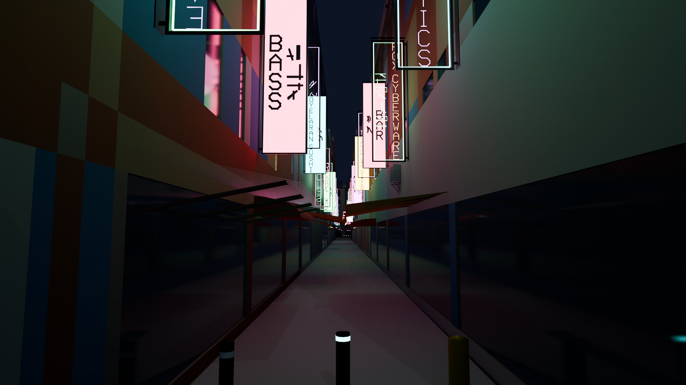 | 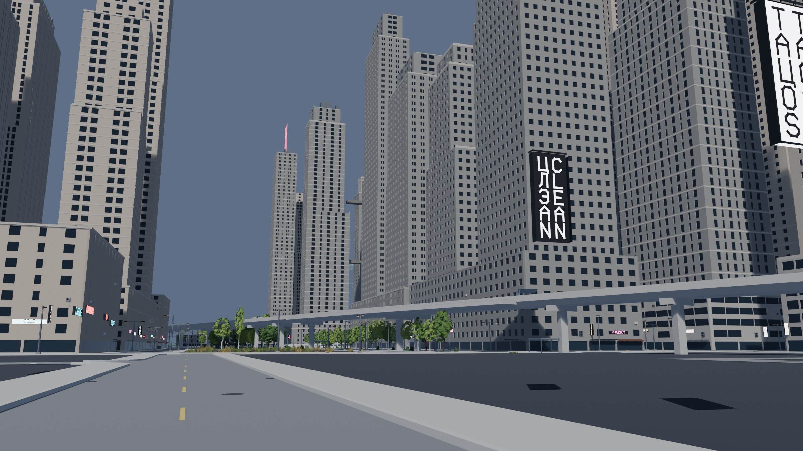 |

| Street 1 | Street 3 |
|---|---|
| 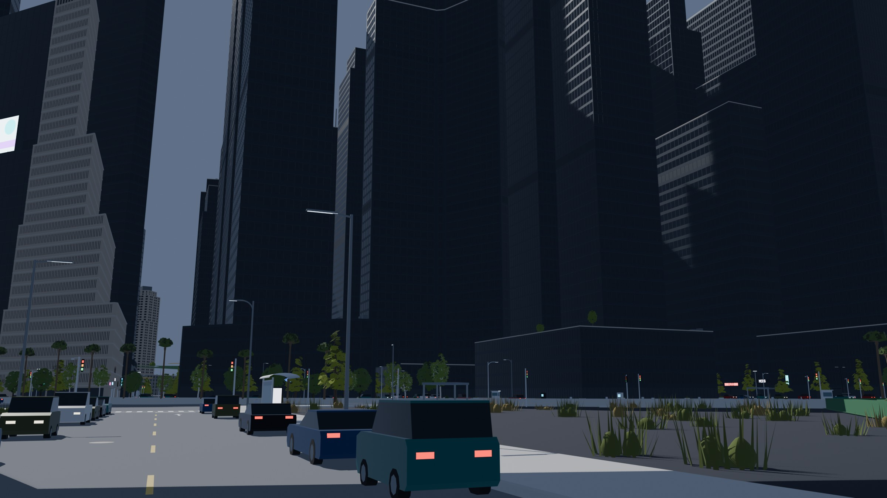 | 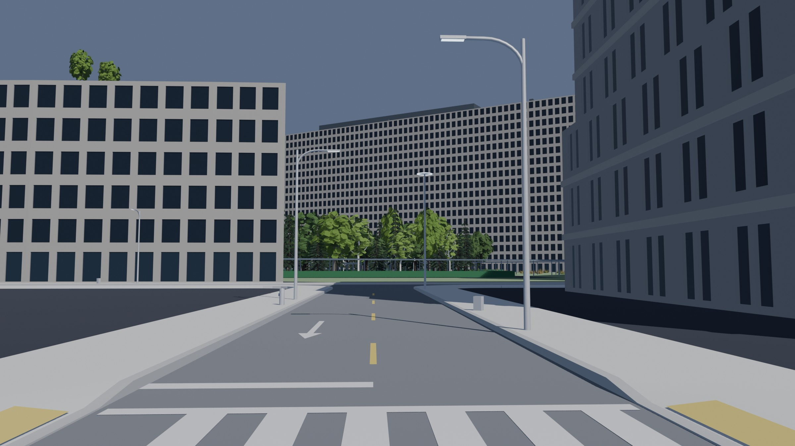 |

| Street 4 | Street 5 |
|---|---|
| 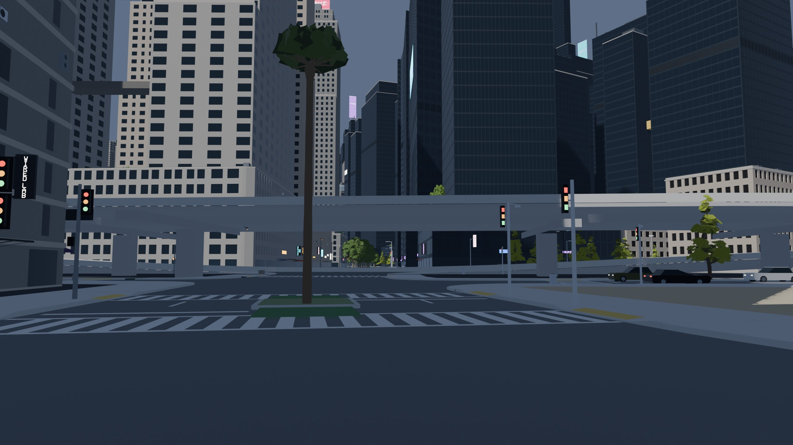 | 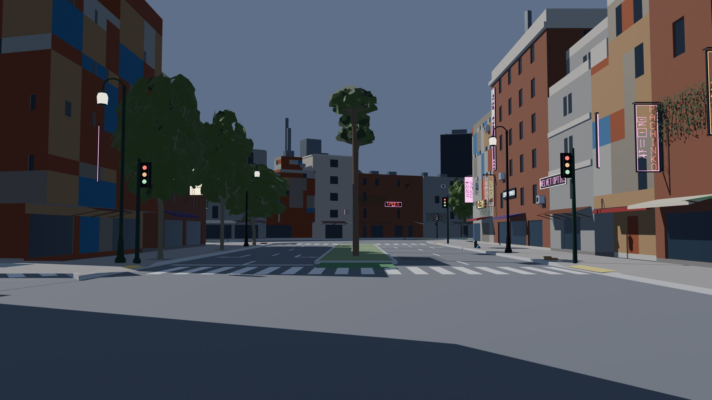 |

The street views are the blockout's street cameras; `neon_strand_night_8k.jpg` is the night
view at 8K.

## Cragmouth

On the hilly sample every prop and plant stands on the ground at its point, and what hangs
on a building on the building's base (its shell's floor).

| Crown Heights, a park on the slope | Lantern Steps |
|---|---|
| 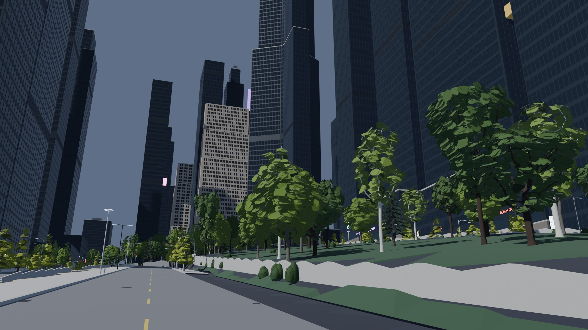 | 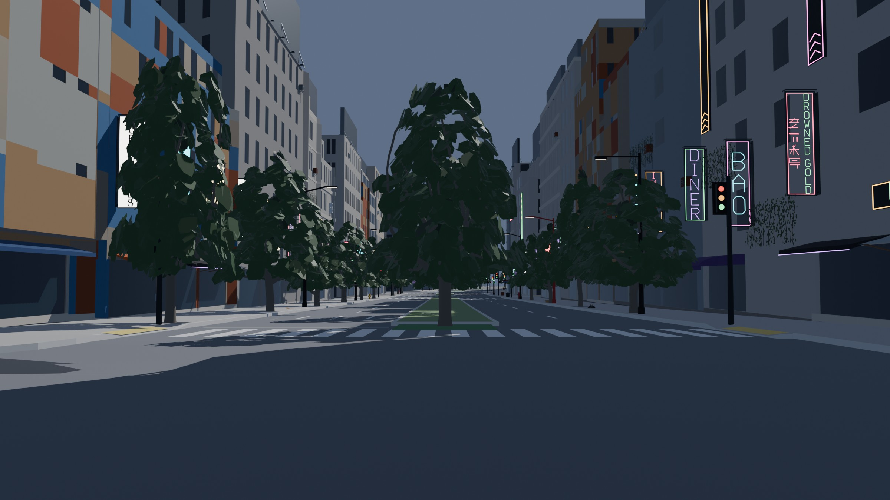 |

## Textured (on AG6)

The props, plants and signs with AG6's library and sign pages (leaf cards, bark, painted
metal, sign faces showing their page cells): [`textures/`](textures/README.md).

| Neon Strand at night | Tree-lined avenue |
|---|---|
| 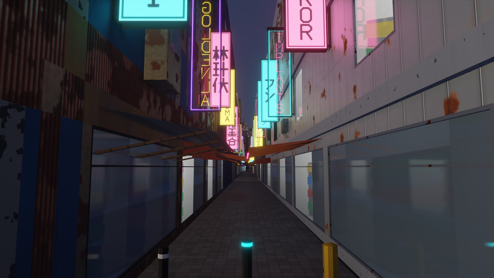 | 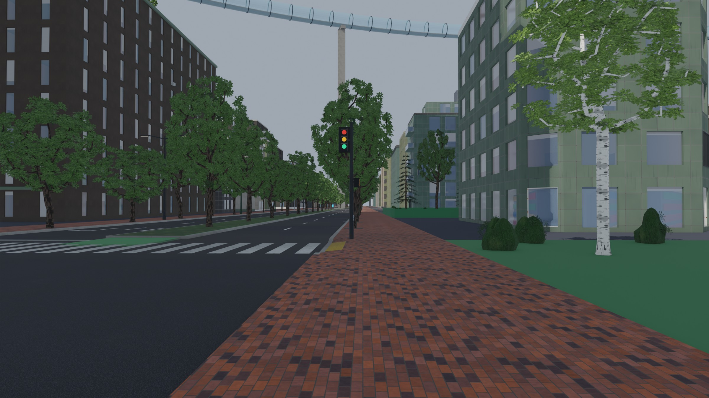 |

## Samples

Each city's `props_report.txt` and `.json` are in its folder (main's specs, Greyhook
reshaped, 3 workers on the shared Mac, the props stage alone; before AG6, whose page cells
took the signs from 5.9 M to 1.2 M unique triangles in Vesper Bay, counts in
[`textures/`](textures/README.md)):

| City | Variants | Instances | Signs | Exact props | Unique triangles | Drawn triangles | Disk | Time |
|---|---|---|---|---|---|---|---|---|
| Vesper Bay | 723 | 90,048 | 15,448 | 1,902 | 7.37 M | 79.0 M | 400 MB | 18 s |
| Saltreach Free Port | 685 | 52,999 | 7,632 | 919 | 3.53 M | 41.6 M | 189 MB | 16 s |
| Delta Megacity | 715 | 92,928 | 14,983 | 1,620 | 5.98 M | 81.4 M | 342 MB | 30 s |
| Nexus City | 723 | 99,579 | 17,456 | 1,852 | 7.55 M | 97.7 M | 422 MB | 55 s |
| Greyhook | 715 | 48,162 | 8,183 | 471 | 3.68 M | 56.2 M | 209 MB | 23 s |
| Vesper Bay Pinned | 723 | 90,187 | 16,209 | 2,356 | 8.01 M | 98.5 M | 433 MB | 107 s |
| Vesper Bay Stacks | 723 | 90,742 | 16,219 | 2,337 | 8.02 M | 96.9 M | 432 MB | 48 s |
| Cragmouth | 693 | 105,364 | 19,694 | 2,462 | 8.88 M | 119.7 M | 489 MB | 37 s |
| Vesper Bay Decks | 723 | 98,688 | 17,249 | 1,948 | 7.96 M | 82.0 M | 434 MB | 96 s |

Every props check passes in every city.
