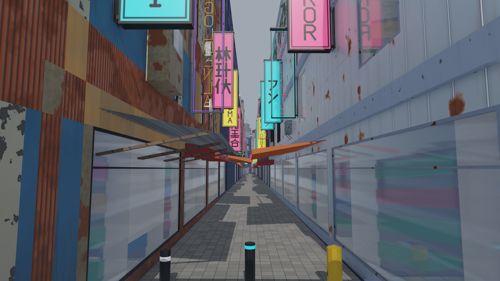
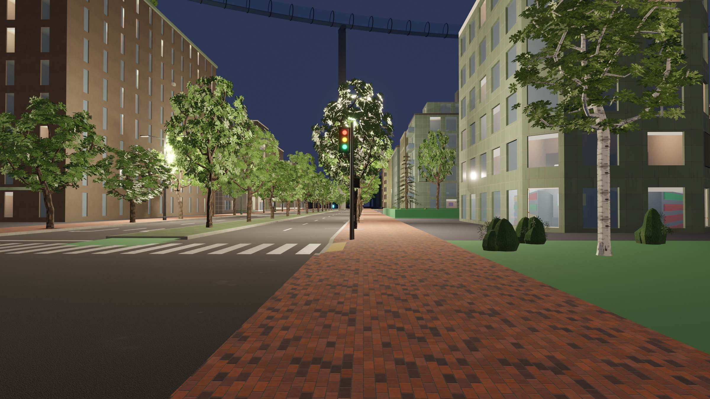
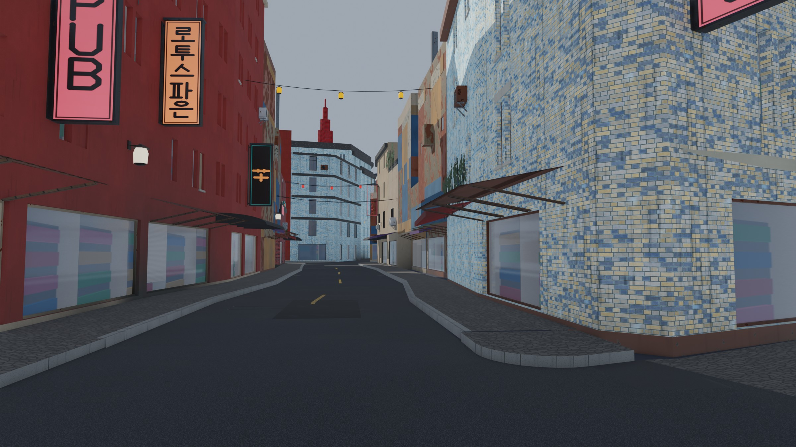
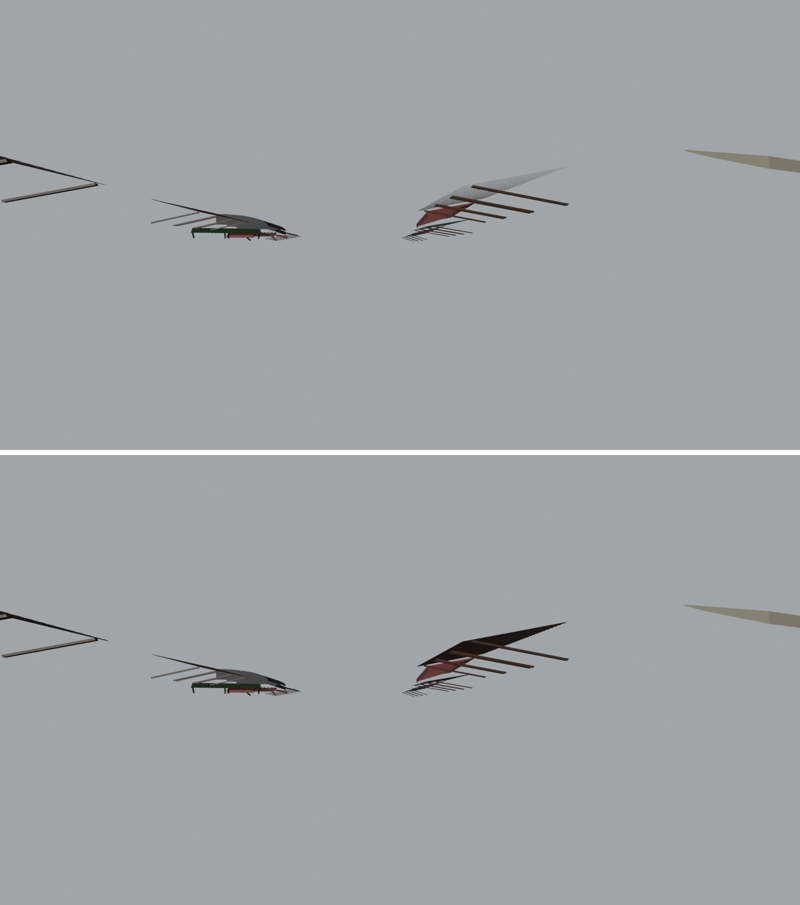

# AG8 on AG6: textured props, plants and signs

AG8's props, plants and signs with AG6's library and sign pages, in Vesper Bay (Blender 5.2,
EEVEE, `assetgen materials preview` with custom cameras; the full entry is AG8's "On AG6"
in [`docs/assetgen_milestones.md`](../../../assetgen_milestones.md)).

```bash
.venv/bin/python -m assetgen build out/<city> --workers 3
.venv/bin/python -m assetgen materials preview out/<city> [--night]
```

| Neon Strand by day | Neon Strand at night |
|---|---|
|  |  |

| Tree-lined avenue by day | Tree-lined avenue at night |
|---|---|
|  |  |

- **One sign path**: lightboxes, LED panels and blade boxes show their AG6 page cell (the
  same text and brand as `signs.json`); neon blade signs and channel letters spell it in
  AG6's strokes, the neon read mirrored from the back as on a real skeleton sign.
- **Props**: painted, galvanized and rusty metal, plastic, car paint, tarp awnings, concrete,
  each tinted by its slot's color.
- **Plants**: bark by species (furrowed plates, birch with lenticels, ringed palms); leaf
  clumps as two crossed alpha-cut cards showing a leaf tile (broad, lobed, fan, needle,
  small), tinted per species; shrubs with leaf clumps over a solid body.

## Awnings seen from below

A shopfront street in Old Town (`--eye 877.6 -1232 1.6 --target 880.6 -1200 3.4`, lens 22,
2400 px) after the fix: corrugated and tiled awnings show their undersides from the street.
Before it, a canvas drawn once facing up was a back face from below, and the one-sided
masters (Unreal, and AG8's Blender preview) culled it, leaving the frame.



The same awnings alone, back faces culled as in Unreal (Blender Workbench): main above,
the fix below; the corrugated sheets on the right show only their frame on main.



## Cameras

Cameras (`--eye ... --target ...`, lens 22, 2400 px): Neon Strand from
(-767.3, 1032.7, 2.3) to (-717.0, 989.4, 8.5); the avenue from (1015, 927.5, 1.7) to
(1250, 932, 5).

Samples (3 workers, the props stage; every check passes, texel density included):

| City | Variants | Instances | Signs (meshes) | Unique triangles (signs) | Drawn triangles | Disk |
|---|---|---|---|---|---|---|
| Vesper Bay | 723 | 90,048 | 15,448 (8,056) | 2.48 M (1.20 M) | 49.4 M | 136 MB |
| Greyhook | 715 | 48,162 | 8,183 (4,358) | 1.34 M (0.61 M) | 40.4 M | 77 MB |
