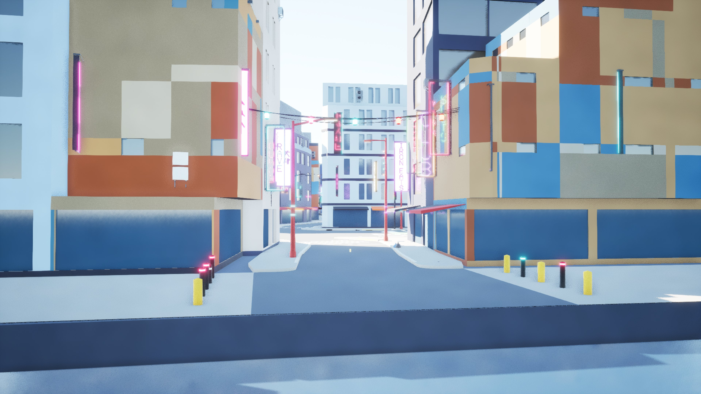
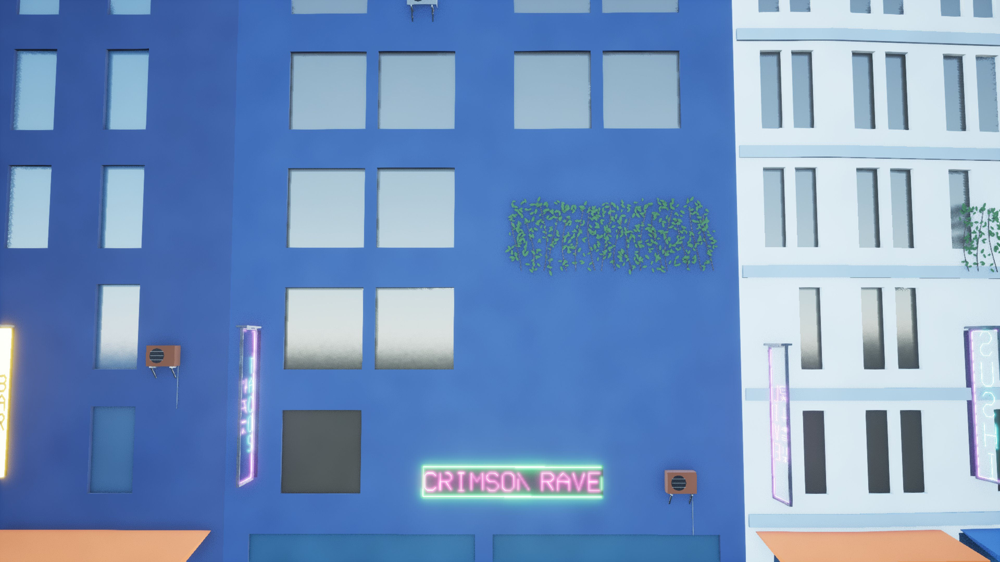
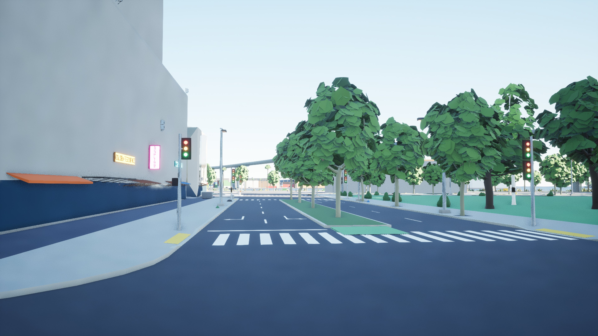
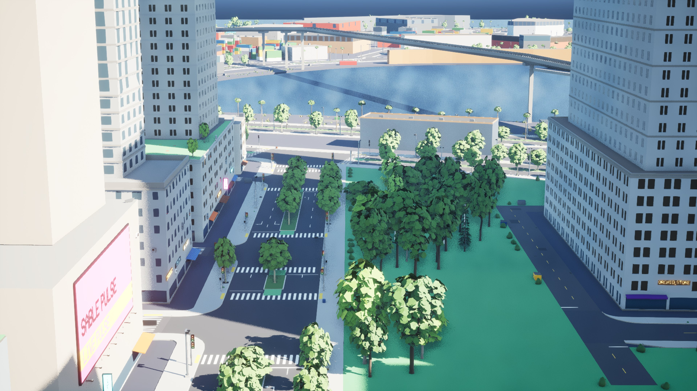
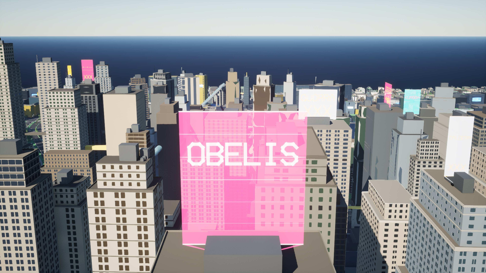
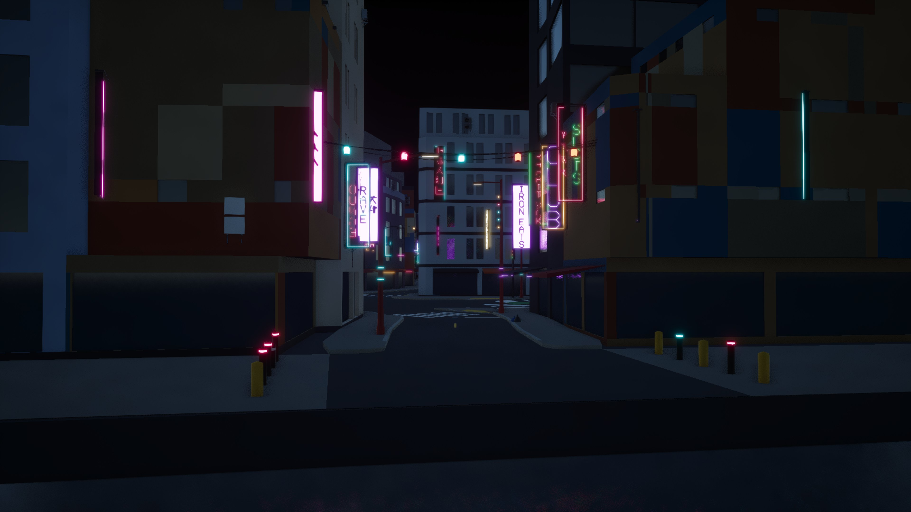
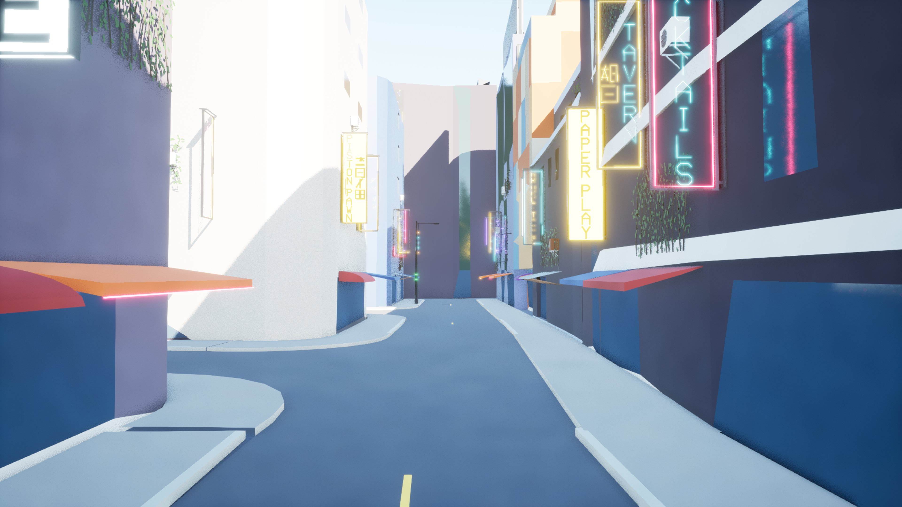
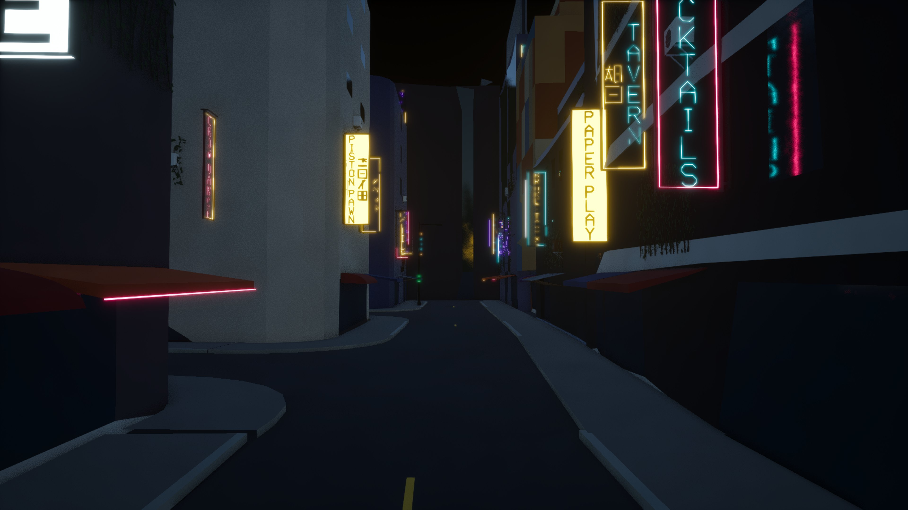
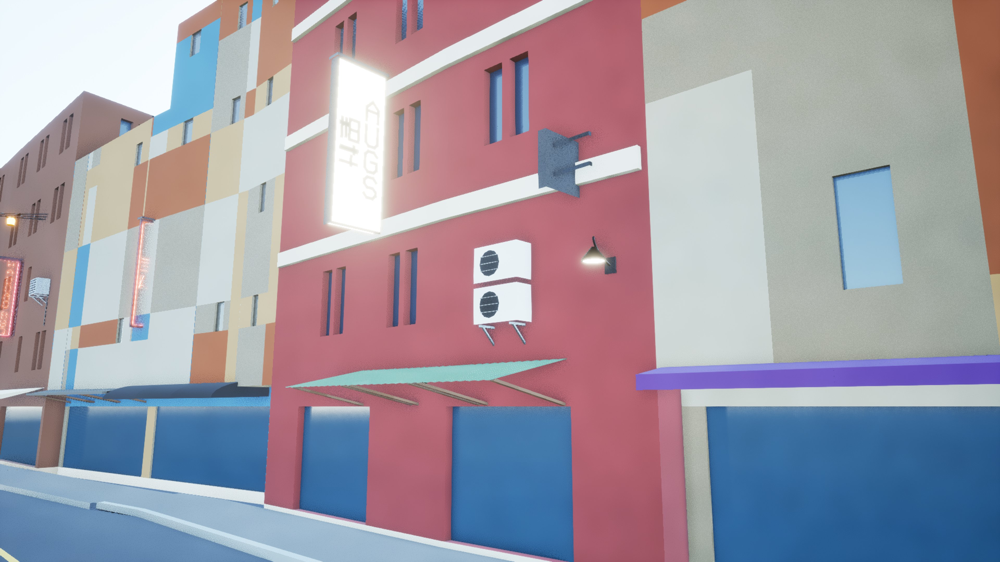
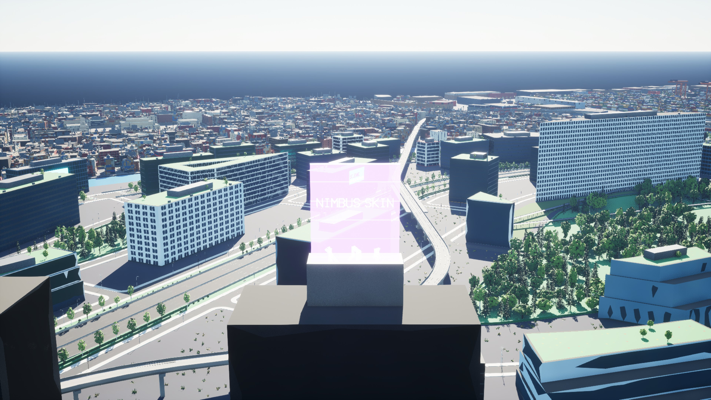

# AG8 in Unreal: props, plants and signs

The Unreal check of AG8 (`docs/assetgen_milestones.md`, AG8): Greyhook and Vesper Bay built
from main, imported with their shells, streets, props, plants and signs into a new throwaway
project, imported again, read back from the level in the editor and checked in
play-in-editor, with shots of the props. All runs on the M4 Mac, UE 5.8, one editor of this
check at a time, in a project of its own (`--new-project`), on a Mac shared with other
sessions' builds.

```bash
.venv/bin/python -m citygen build docs/progress/M1a2/peninsula_city/city_spec.json out/greyhook --blockout
.venv/bin/python -m assetgen build out/greyhook
.venv/bin/python -m citygen unreal out/greyhook ~/UnrealTest/UnrealTest.uproject --new-project
.venv/bin/python -m citygen unreal out/greyhook ~/UnrealTest/UnrealTest.uproject --check --shots out/greyhook/shots \
    --view props_shopping_street -939.2 -411.7 3.0 -989.0 -407.7 4.0
```

## Imports

| City | Import | Actors | Stage 2 | Time |
|---|---|---|---|---|
| Greyhook | first, blockout and stage 2 at once | 25,837 created | 24,918 stage 2 actors over 5,250 blockout actors (all 1,578 of M15's prop and plant prototype actors among them); 19,295 meshes from 489 packs; 33 LOD chains (29 holo-ads, 4 sky tube glass) | 785 s (stage 2 meshes 314 s, actors 215 s, prune 65 s, save 29 s) |
| | again | nothing changed, 0 packages saved, the same digests | | 69 s |
| Vesper Bay | first, blockout and stage 2 at once | 46,354 created | 45,269 stage 2 actors over 9,328 blockout actors; 38,764 meshes from 599 packs; 56 LOD chains (50 holo-ads) | 1,818 s (stage 2 meshes 762 s, actors 574 s, prune 103 s, save 54 s) |
| | again | nothing changed, 0 packages saved, the same digests | | 74 s |

Most of a first import is stage 2's meshes. In Vesper Bay's editor log, 31,932 Nanite builds
took 1,042 s summed over the build threads (the 5,793 shells 925 s, the 15,337 sign meshes
96 s), inside 762 s of wall time; Greyhook's log has 8,984 (139 s, the 8,303 sign meshes 91
s; its shells' builds are not in the log). The family packs hold every style's variants and
Interchange imports a whole pack, so a first import builds the variants a city does not
place and prunes them (Greyhook 299, Vesper Bay 200); an import of an unchanged build imports
no pack.

## What the level holds

Read back from the level in the editor (`<city>/results.json`, `level`):

| Point | Greyhook | Vesper Bay |
|---|---|---|
| HISM instance counts per kind and species | equal to `props_report.txt` for all 20 kinds and 14 species: 48,162 (awning 15,835, AC unit 3,586, street light 3,102, ... boxwood 4,157, sedum 3,133, ivy 2,912, ...) | equal for all 20 kinds and 15 species: 90,048 (awning 29,330, AC unit 7,468, ... ivy 16,399, boxwood 4,682, ...) |
| M15 prototype instancers left | none of 1,578 (1,451 replaced by variant instancers, 31 by exact props' actors under the same key, 84 sign prototypes by the shop signs' `replaces`, 12 highway barriers by `drop`) | none |
| Keys doubled or missing | none | none |
| Placement | every instance where the manifest puts it (0.00 m worst); every prop, plant and AC unit at its model position (0.00 m in plan and height); awning segments along their wall (up to 4.3 m from the awning's middle) and brackets 0.3 m behind their unit, as AG8 lays them | the same (0.00 m) |
| Plants | 100 plant meshes, all Nanite with `NaniteShapePreservation.VOXELIZE`; 3,714 instancers without collision (fixed here) | 108 meshes, all `VOXELIZE`; 4,502 instancers without collision |
| Holo-ads | 29 LOD chains of 3 (screen sizes 1.0, 0.3, 0.08; 72 to 180, then 54 to 162, then 2 triangles), Nanite off, on `M_CgHolo` (translucent, two-sided, emissive 3) | 50, the same |
| Emissive | neon on `M_CgNeon` (emissive 8), lamps, lit faces and lightboxes on `M_CgEmissive` (4); 135 material instances for props and signs | the same; 148 instances |
| Signs | 8,212 actors (7,119 shop signs, 724 billboards, 311 neon bands, 29 holo-ads as projector and image), Nanite on but the holo images, no collision | 15,498 actors (13,203 shop signs, 1,536 billboards, 659 neon bands, 50 holo-ads) |
| Collision | prop variants complex; plants, signs, cables, scaffolding and gates none | the same |

## Check

| City | Streaming | Traces down | Roofs | Facades | Walk |
|---|---|---|---|---|---|
| Greyhook, first check after the import | 1,374 of 25,837 at the start, 763 after a teleport | 346 of 507: failed | 36 of 36 | 35 of 36 | 130 m |
| Greyhook, the check now | 1,374 at the start, 4,270 after a teleport | 507 of 507 (building 251) | 36 of 36 | 36 of 36 | 134 m, all frames on the ground |
| Vesper Bay, first check | stopped by an error in the streaming step (below) | | | | |
| Vesper Bay, the check now | 1,291 of 46,354 at the start, 3,931 after a teleport | 507 of 507 (building 228) | 36 of 36 | 36 of 36 | 253 m, all frames on the ground |

Two faults of the check, both fixed:

- **Traces before collision.** Greyhook's first play session after its import traced before
  the streamed cells' collision was in place: the streaming query reported the cells
  activated and the actor count was steady, yet traces fell through the street pieces. A
  diagnostic session that waited 5 s more after the same settle hit 507 of 507. A trace down
  that misses is now tried again for up to 30 s (`TRACE_RETRY_S`), and the hits that came
  only then are reported as late (0 in both runs above).
- **Actors gone after the teleport.** The streaming step counted the stage 2 actors among
  those loaded at the start after teleporting away, when Vesper Bay's start cells had
  already streamed out (`ObjectInstance is null`); it counts them before the teleport now
  (the play-ready exporter, merged meanwhile, made the same fix; the runs above had this
  check's).

## Shots

3840 px, by day the check's renders. Greyhook:

| A shopping street | Facade AC units, neon and ivy |
|---|---|
|  |  |

| Avenue trees, near | The same trees from 250 m |
|---|---|
|  |  |

| A holo-ad over a tower roof | The shopping street at night |
|---|---|
|  |  |

Vesper Bay:

| The Neon Strand | The Neon Strand at night |
|---|---|
|  |  |

| A wall light, AC units on brackets, a blade sign | A holo-ad |
|---|---|
|  |  |

The night shots are the same views with the sun below the horizon, the sky light at 0.2 and a
manual exposure (a transient post-process volume in a scratch script; nothing in the level or
the exporter changed): lighting is stage 3's. Also in the folders: Greyhook's trees from
600 m, wall lights by a viaduct, the blockout's street views and the whole city; Vesper Bay's
Old Town street, AC units and the whole city.

## The list

- **HISM counts per kind** match `props_report.txt` exactly, in both cities.
- **No M15 prototype instancer** where AG8 has an entry: none left at all.
- **Plants** Nanite with `Voxelize`; they read full near, at 250 m and from 600 m (the
  canopies stay round and dense, no thinning or holes).
- **Holo-ads** translucent (the city shows through), with their 3-LOD chain.
- **Neon and lightbox faces** emissive (8 and 4); at night they, the cable lanterns, the lamp
  heads and the bollard rings are what lights the street.
- **AC units and wall lights** on their walls (at their model positions; brackets where the
  brief finds a gap; Greyhook's 27 wall lights are all M6's deck mounts by its viaducts).
- **Awnings and signs** face the street (the awnings AG8 turns 180 degrees are turned so their
  wall is on the side their mesh expects).
- **Nothing missing, doubled or floating**: every manifest actor and instancer is in the level
  once, every instance at its model position.
- **`--check`**: traces and walk pass in both cities, with the two fixes above.

## Fixes

- **Plants had collision** (importer): a part's `collision: {"none": true}` reached its mesh
  record but not its instanced actor, so the plant HISMs kept the actor's default profile
  over meshes the importer gives complex collision: the player and traces would stop on tree
  crowns, ivy and shrubs. `stage2` now marks such an instancer `no_collision` (in its hash, so
  an import over an earlier one updates them) and the importer sets its HISM to
  `NoCollision`, as it does for actors.
- **The check's traces down** are tried again for up to 30 s after a miss (above).
- **`test_stage2_from_assetgen`** expects the exact props' keys (their actor changes class
  from M15's instancer to a static mesh actor) as deleted and created, as `manifest_changes`
  counts them since the play-ready exporter.

## Open

- **AG6**: textures for bark, leaves (alpha cards would make the clumps' big flat leaves read
  as foliage; near, the birches and planes show their flat polygons), painted metal, sign
  faces, billboard and holo-ad content; all flat colors now.
- **AG8 or later**: the family packs could hold only the variants a city places (a first
  import builds and prunes the rest); quantized sign packs would halve the largest files.
- **Stage 3**: no light at the lamps and signs yet (emissive only).
