# AT1: streets at night (atmosgen)

Stage 3's second milestone (`docs/atmosgen_scope.md` section 13): the streets lit by night as
a lighting engineer would light them, checked before Unreal, and rendered in Unreal from the
level itself. Built on the Windows PC (RTX 4070 Ti, 32 GB), 2026-11-10, on main after AT0
(#185). AT0's report (`docs/progress/AT0/README.md`) set the starting point: tiles as data
actors with a pooled live set, the junctions lit, the cobra heads brought down, the play
features' lamps and washes retired, their pools kept as the far tier.

## What AT1 built

| Part | Where | What |
|---|---|---|
| Photometric classes | `atmosgen/presets.py` `PHOTOMETRY` | cobra head, post top, wall pack, high mast, highway, soffit, tunnel, platform; each light's profile Unreal's own (a spot flat to its inner cone, falling as $t^2$ to its outer; a point all round; a face by its cosine and barn doors; the engine's reach window), so the check and the runtime agree |
| Street and wall lights | `plan.lamps` | M6's lamps by class at their heads: cobra heads 1200 cd to 62 degrees (AT0: 6000 cd in 45), post tops 600 cd, wall packs 420 cd |
| Junctions | `plan.signals`, `plan.corners` | a mast arm light on every traffic signal reaching into its junction; corner poles where the check finds a junction dark (at its legs' sidewalk ends and its crosswalks' ends, else its outline's corners; the one leaving fewest points dark first, at most 6) |
| Roads M6 leaves unlit | `plan.roads`, `plan.alleys` | highway and ramp columns every 42 m (a twin arm in a median, else staggered), service roads, posts every 16 m on pedestrian streets and promenades, posts on footbridges, wall packs along alleys (closer in lighter moods) |
| Structures | `plan.decks`, `plan.tunnels`, `plan.stations` | AG10's soffit lights under M14's decks (at AG10's own fixtures), AG7's road tunnel wall strips and underpass ceiling strips, platform downlights in elevated and underground stations |
| Fill | `plan.fill` | a light at the darkest point of each walkway or road the check still finds dark (a wall pack, a curb post, a road-edge pole), a round at a time |
| Shop spill, signs | `plan.spill`, `plan.signs` | as AT0 placed them (AT2 takes the signs further) |
| The lux check and map | `atmosgen/lux.py` | every walkway and lane every 2 m by class, occlusion against masses and deck slabs, targets by class (scope 8), per city and per district; `checks.lux` in the plan; `atmosgen plan` exits 1 and the exporter leaves a failed plan out; `preview_lux.png` with occlusion |
| What a light hangs on | `Light.mount` | the city's own fixture, or a pole, mast arm, wall pack or canopy downlight asked of stage 2 (`emitters.py`'s third ask, assetgen scope 4.6) |
| Exporter | `citygen/unreal_atmos.py`, `ue/import_city.py`, `ue/CityGenAtmos` | layer 3 of the manifest: the controller and a data actor per 128 m cell placed by the import, the cells registering with the controller as they stream; no more `-CityGenAtmosPlan`; the play features' spot lamps and washes gone, their pools the far tier |

## The plans and the lux check

`atmosgen plan` on AG16's builds (an empty spec: `neon_rain`, checked at 23:00), every city
passing (sidewalk 10 lx average and 2 lx minimum, crosswalk 10 and 2, carriageway 7 and 1,
under a deck 5 and 1, alley 2 and 0.5 and never dark; at most 5% of a class's points under its
minimum over the city, 15% in a district):

| City | Lights | Sidewalk avg / under min | Crosswalk | Carriageway | Alley | Under a deck | Junctions dark before corners | Fill lights | On asked fixtures | Check |
|---|---|---|---|---|---|---|---|---|---|---|
| Delta Megacity | 53,559 | 26.6 / 1.0% | 26.0 / 1.4% | 16.2 / 0.5% | 13.5 / 0.4% | - | 465 of 1238, 662 poles | 884 | 5,722 | PASS |
| Vesper Bay | 52,820 | 27.2 / 1.1% | 26.0 / 1.1% | 16.6 / 0.3% | 13.3 / 0.4% | - | 531 of 1348, 745 poles | 1,070 | 5,572 | PASS |
| Vesper Bay Decks | 57,594 | 27.4 / 1.1% | 26.1 / 1.1% | 16.7 / 0.3% | 13.3 / 0.4% | 41.8 / 0.0% | 528 of 1391, 731 poles | 1,053 | 5,562 | PASS |
| Nexus City | 61,193 | 27.9 / 1.4% | 27.4 / 0.9% | 16.8 / 1.1% | 13.5 / 0.2% | - | 512 of 1426, 722 poles | 1,017 | 6,163 | PASS |
| Greyhook | 30,367 | 22.3 / 0.5% | 23.9 / 0.8% | 14.5 / 0.1% | 12.0 / 0.2% | - | 277 of 680, 444 poles | 658 | 4,028 | PASS |
| Saltreach Free Port | 28,706 | 22.3 / 1.3% | 24.6 / 1.1% | 15.5 / 1.6% | 13.8 / 0.3% | - | 312 of 716, 447 poles | 682 | 3,571 | PASS |
| Cragmouth | 65,035 | 30.9 / 0.9% | 26.9 / 1.1% | 17.4 / 0.1% | 13.1 / 0.3% | - | 548 of 1577, 696 poles | 1,011 | 6,002 | PASS |
| Vesper Bay Pinned | 56,070 | 28.9 / 1.2% | 27.1 / 1.0% | 17.0 / 0.9% | 13.7 / 0.2% | - | 578 of 1572, 728 poles | 1,039 | 5,818 | PASS |
| Vesper Bay Stacks | 56,588 | 29.0 / 1.4% | 28.1 / 1.0% | 17.2 / 0.9% | 13.5 / 0.3% | - | 576 of 1570, 755 poles | 1,128 | 5,893 | PASS |

(lux, average over the class's points / share under its minimum.) Each plan takes 20 to 45 s
on the PC, the check's illuminance with occlusion about 5 s of it on Delta.

**How the first plan on Delta failed, and what fixed it** (the check doing its job):

| Step | Sidewalk under 2 lx | Crosswalk under 2 lx | Carriageway under 1 lx | Alley under 0.5 lx (dark points) |
|---|---|---|---|---|
| AT0's photometry, junctions unlit (AT0's lux map, no occlusion) | | 25% (junction lanes 54% under 1 lx) | | |
| AT1's classes, mast arms, highway columns, alley packs, corner poles | 8.0% | 7.8% | 3.0% | 32.5% (5,995) |
| occlusion taken 0.5 m inside the footprints, packs inside the alley's edge | 7.6% | 5.1% | 2.3% | 13.1% (1,701) |
| posts on pedestrian streets and promenades (M6 lights none of their 347 segments), corner spots on junction outlines | 3.9% | 2.6% | 1.5% | 5.3% (456) |
| the fill at the darkest points | 0.8% | 1.1% | 0.1% | 0.3% (0) |

On the pinned demo the check also found two places where the walk graph's heights disagree
with the road they lie on: a quay road's walk kept at 11.6 m where the road climbs from 0, and
a raised bridge-head junction's crosswalks kept on the ground. The check now puts a walkway
that runs along its road on the road's own profile, and a raised junction's crossings at its
node's height (the walk graph's raised sidewalks are a known stage 1 open item).

The carriageways average 15 to 17 lx (AT0's 52 lx): the cobra heads came down to a fifth and
spread wider, and the junctions are lit (AT0's junction lanes were 54% under 1 lx; AT1's 1%
on Delta). Delta's plan: 53,559 lights (3,277 street and 1,117 wall lights, 902 signal mast
arms, 662 corner poles, 2,739 road, highway, pedestrian street and fill lights, 1,036 alley
packs, 383 platform downlights, 5,953 sign faces, 19,984 shop signs, 17,506 shopfronts),
5,722 of them on fixtures asked of stage 2; 4,114 broken and 9,356 flickering by their
districts' moods.

The table and these counts are the final ones, with the reaches cut for the frame budget
(below); the first passing plans had longer reaches and fewer corner and fill lights.

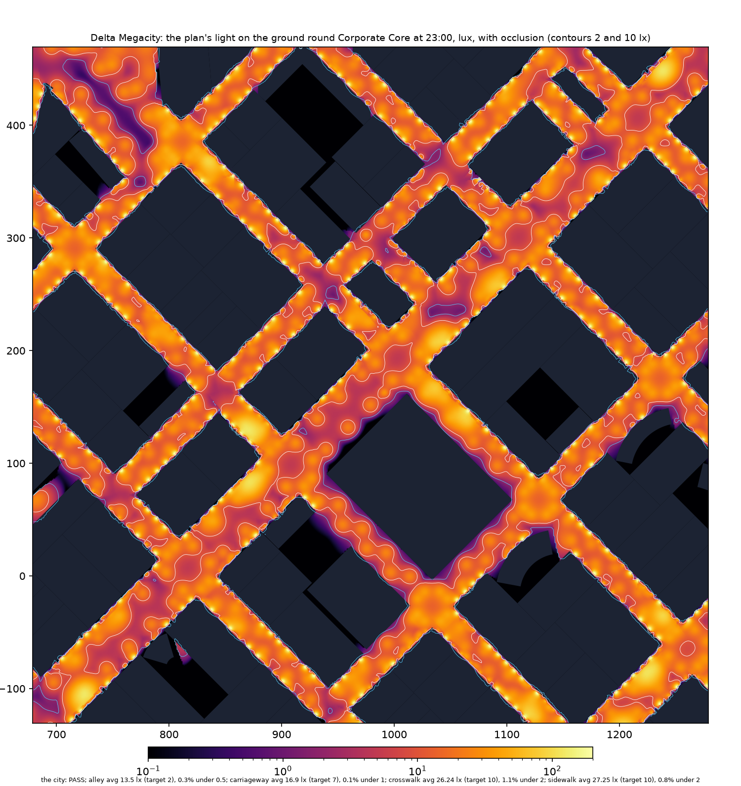

## Unreal

**The import.** Delta Megacity (`C:/Users/swagn/CityGen/builds/ag16/delta_megacity`, AG16's
build) imported over its AG16 import in the CityAG16 project with its plan (`citygen unreal
... --atmos DIR --no-hlod`, `CITYGEN_UE_OFFLOAD=500`): both plugins built in 15 s, then the
controller and 500 cell actors created, every other actor unchanged, 2 min 51 s; the plan's
later changes updated only what they touched (the controller alone for the exposure, 496
cells for the reaches).

**The check by night** (`--check-only --shots`, the play window's views,
`CITYGEN_UE_PLAY_SHOTS_ONLY=1` as in run-through 2) passes: streaming, 505 of 507 traces down,
36 of 36 roofs and facades, a 345 m walk on the ground, the console cheats, the play features
by night with atmosgen's lights live (127 of the 1,719 registered by the 89 cells loaded round
the player, 13 shadowed; the 768 light pools past them) and a 1,654 m teleport, the flight.

| A Corporate Core junction | An Old Town junction |
|---|---|
| 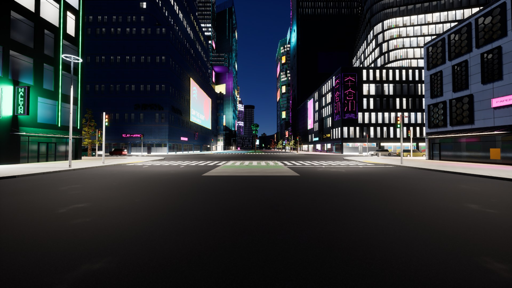 | 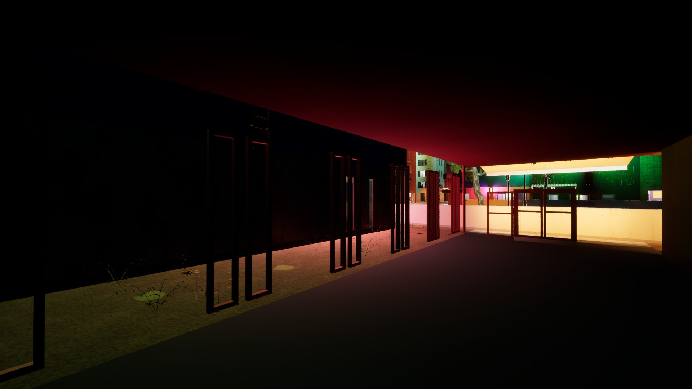 |
| **An Old Town alley** | **The Industrial Port's highway, lit by its columns** |
| 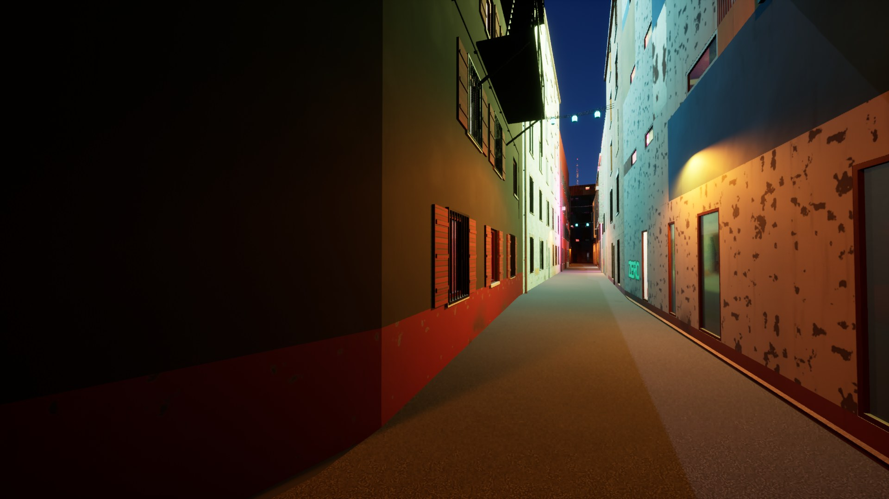 | 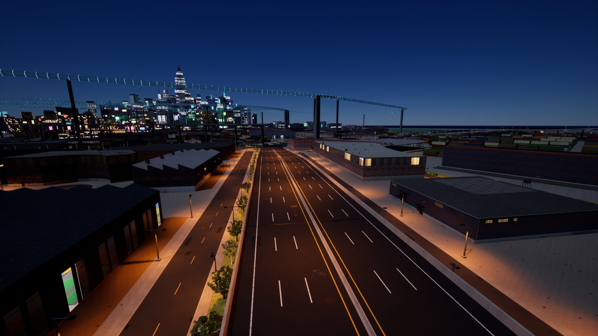 |
| **The Corporate Core from the air** | **The Corporate Core, a walk** |
| 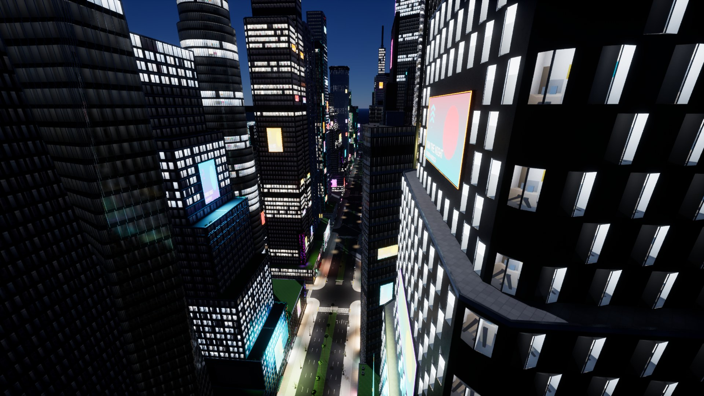 | 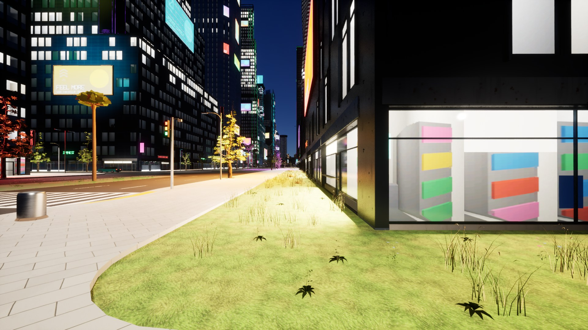 |

## The night's frame time

AG16's benchmark by night on Delta (`citygen unreal ... --bench-only --bench-atmos
--bench-passes night_native,night_plan,night_plan_all`), native 2560 x 1440 on the PC alone,
three runs each, the median (`bench/before`: main at c1d566a, AT0's plan through
`-CityGenAtmosPlan`; `bench/after`: AT1's plan in the level). `night_native` is the night
without atmosgen's lights (before: the play features' 192 spot lamps; after: their light pools
alone), `night_plan` atmosgen's lights (512 live within 300 m, 16 shadowed), `night_plan_all`
with AT0's prototypes of fog, rain and wet streets on too.

| Pass | p95 all, before | p95 all, after | walk, before | walk, after | GPU p95 all, before / after | GPU "Lights" pass walking, before / after |
|---|---|---|---|---|---|---|
| `night_native` | 12.8 | 11.6 | 13.0 | 11.3 | 11.2 / 9.9 | 1.9 / - |
| `night_plan` | 14.0 | **14.4** | 14.4 | **14.6** | 12.6 / 13.3 | 3.0 / 3.7 |
| `night_plan_all` | 16.0 | **16.4** | 16.5 | **16.8** | 14.9 / 15.4 | 2.7 / 3.2 |

(ms.) AT1's night, its lights, is 14.4 ms p95 over the route, 2.3 ms under decision 12.6's
16.7 ms; with AT0's fog, rain and wet street prototypes on as well (AT4's and AT5's, off in the
level by default) 16.4 ms over the route, within the budget, and 16.8 ms walking, 0.1 ms over
it, where Lumen's reflections on the wet decal (2.5 ms, AT0) are the obvious lever.

Two things the after runs found:

- **What a light reaches is what it costs.** AT1's first after run had the deferred light pass at
  5.2 ms walking against AT0's 3.0, night_plan_all at 18.0 ms: the live set near a walker had
  filled with large-reach spots (signal mast arms, corner poles, alley packs, posts with
  cube-map shadows) where AT0's held mostly small sign faces. Each class's reach is now what its
  light needs (cobra 40 to 30 m, highway 60 to 45, post tops 28 to 18 and never shadowed, wall
  packs 24 to 18, shop spill 16 to 12): a screen-coverage proxy of the live set at the walks'
  starts went from 43 to 70 back to AT0's 29 to 54, and the pass to 3.7 ms. The lux check takes
  the same reach window, so the plan placed more corner poles and fill lights to stay lit.
- **The benchmark's game lost the foreground.** With the desktop in use, the game's window lost
  the foreground and Windows moved its threads to the 12700K's efficiency cores: game and
  render threads twice as slow for minutes at the same GPU time (render thread 25 ms, GPU
  11 ms; every render-thread stat uniformly doubled). The benchmark now opts the game out of
  power throttling and runs it above normal priority (`bench.unthrottle`) and records whether
  it held the foreground (`front`). Runs 1 and 2 held it throughout (16.39 and 16.41 ms over
  the route, 16.76 and 16.79 walking); run 3 lost it after 3 minutes and only its tail slowed
  (walking p95 30.7 ms at a 15.8 ms median), so the median of three stands.

| Before (AT0's plan) | After (AT1's plan) |
|---|---|
| 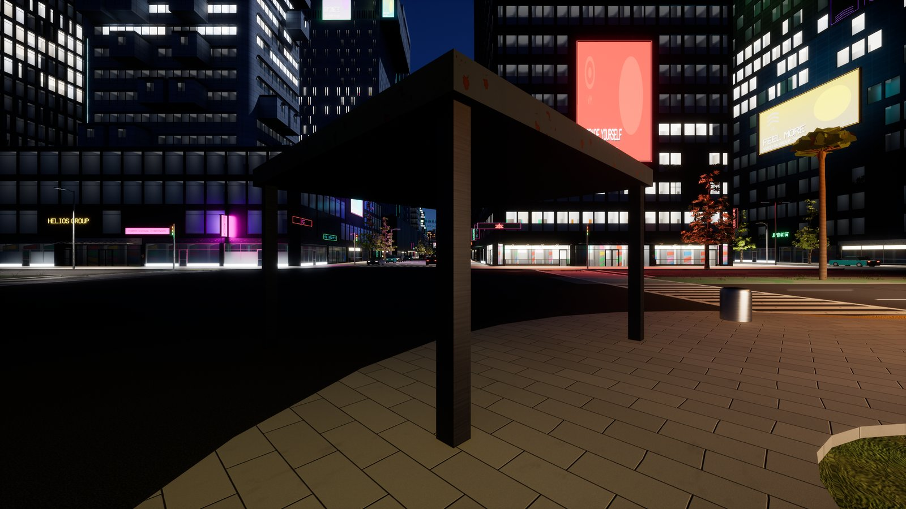 | 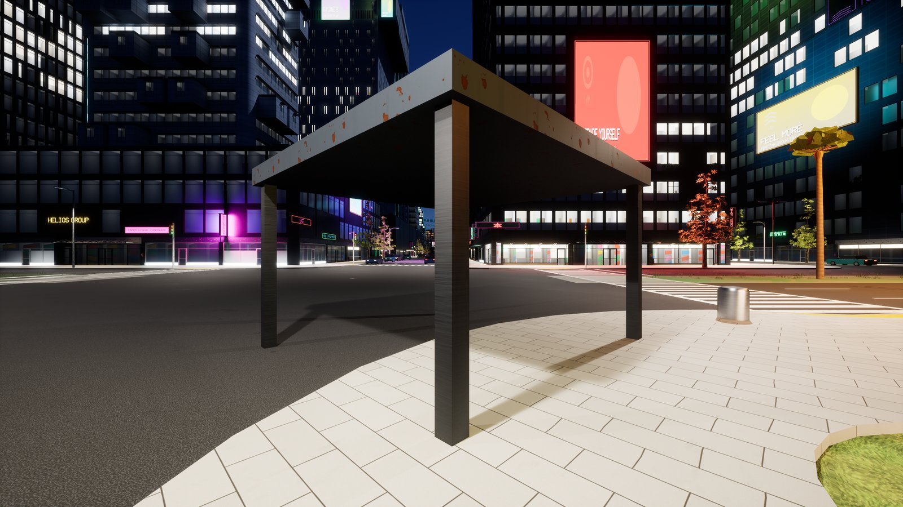 |
| 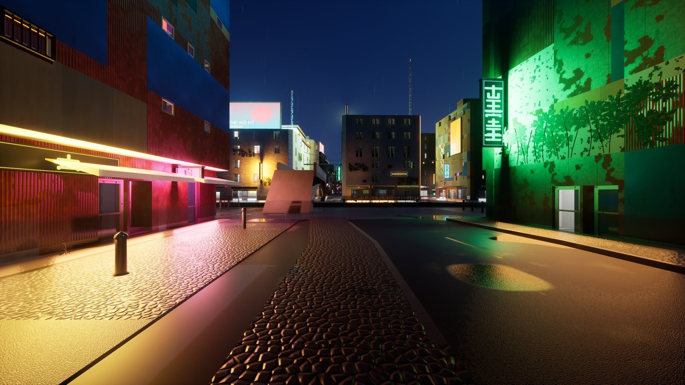 | 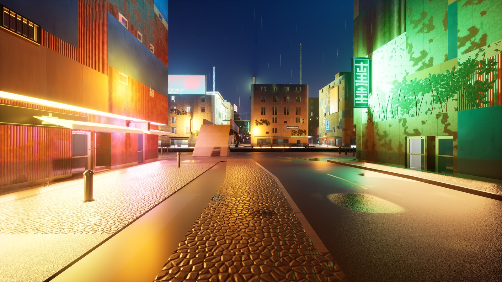 |
| 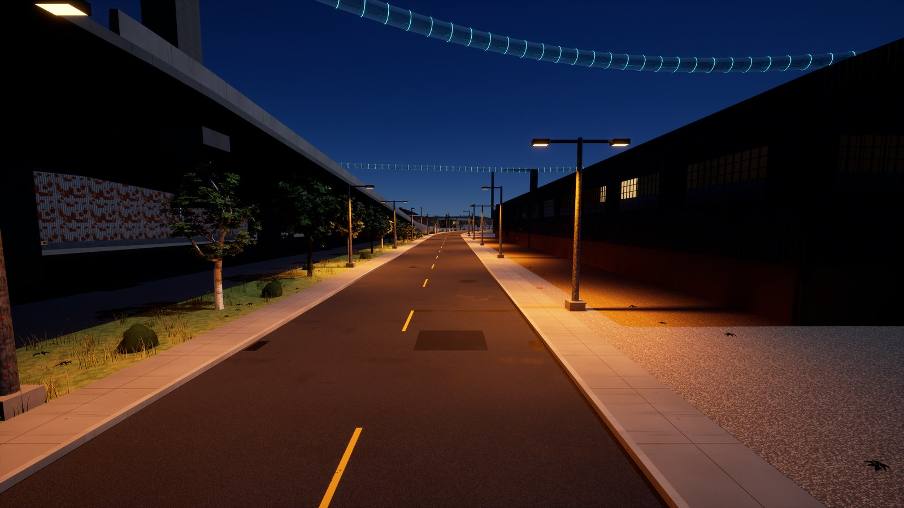 | 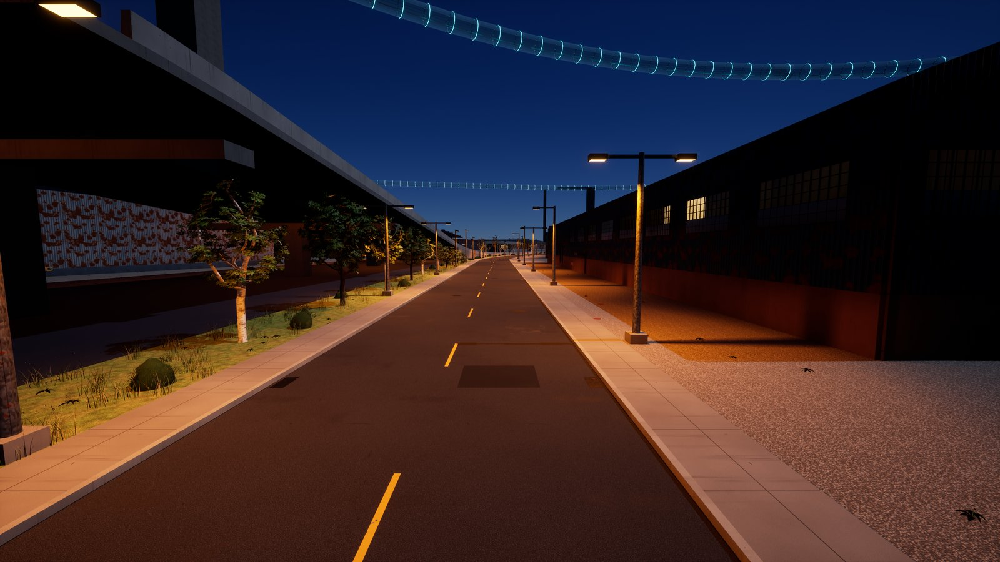 |

The Corporate Core walk shows the fix: AT0 left the carriageway beside the plaza dark, AT1 lights
it and the junction. Old Town is brighter all round, and its green neon band floods its own wall
more (the lights now show at the plan's street exposure, below): AT2's standoff and barn doors.

**Exposure.** The runtime shows the night at the play features' fixed -3 EV100 and scales every
light by $2^{-3 - EV_{ref}}$. AT0 set the reference to 3 for its 52 lx streets; at AT1's
physical 15 to 17 lx the roads read five times darker through that mapping, so the night looks'
reference is matched to their streets (a road at $E$ lux shows $L = 0.08 E / \pi$, middle gray at
$EV_{100} = \log_2(8 L)$: neon rain 1.5, clear night 1.0) until AT3 moves the exposure.

## Validation

- `tests/atmosgen` (`test_at_plan.py`, `test_at_streets.py`), `tests/test_unreal_atmos.py`,
  `tests/test_bench.py`, `tests/test_unreal_play.py`: 38 passed;
  `tests/test_unreal.py` and `tests/test_no_network.py` without the two real-Unreal small city
  imports (Delta's import and check cover the importer): 146 passed (53 min).
- The plan and its lux check on Delta and the eight samples above: every one passes.
- Delta imported and checked by night in Unreal; the benchmark before and after.

## Open items

- **Fixtures asked of stage 2** (`emitters.py`'s third ask, assetgen scope 4.6): 5,722 of
  Delta's lights stand on poles, mast arms, wall packs and canopy downlights stage 2 does not
  draw yet (the light is right, the fixture missing).
- **Lamp heads** are still derived from M6's prototypes (AG8's variants put the head elsewhere,
  a post top lower); the first emitter ask.
- **Walking with fog, rain and wet streets** is 0.1 ms over the budget: AT4 and AT5's to bring
  down (the wet decal's reflections).
- **Alleys** average 12 to 14 lx, brighter than a gritty mood wants; the looks are AT6's (the
  check's floor is 0.5 lx).
- **Sky stations** (inside their towers) get their light in AT2.
