# AT2: neon and signs as light (atmosgen)

Stage 3's third milestone (`docs/atmosgen_scope.md` sections 6.1 and 13): the city's signs,
neon, towers and megasites as light. Built on the Windows PC (RTX 4070 Ti, 32 GB), 2026-11-11,
on main after AT1 (#195) and the packaged game fixes (#197). AT0's and AT1's reports set the
starting point: sign faces as rect lights read right, but a band flush on its wall floods it
(a standoff and barn doors, less of a band's luminance as light); ask assetgen for the drawn
face and its color; most of AT2's lights in the live set's tiers, not as new shadowed ones.

## What AT2 built

| Part | Where | What |
|---|---|---|
| Lit faces | `plan.signs`, `presets.PHOTOMETRY` (`sign_face`, `banner_face`, `holo_face`) | billboards, banners and holo-boards as rect lights the size of their face, stood off it so the light's plane is 0.95 m out of the wall (past everything stage 2 hangs on a facade, 0.91 m), a share of the face's luminance as light times its page cell's own brightness, in the page's color at full; a holo-board in front of a facade lights only away from it; a big face close across a narrow street dimmed so the facade it faces gets at most 150 lx |
| The faces check | `lux.face_check`, the plan's `checks.faces` | each lit face's light on its own wall and on what stands out of the wall, round the face, at most 1 lx; what it throws on the facade opposite reported; a failing plan not delivered |
| Neon spill | `neon_spill`, `shop_neon`, `blade_neon` | neon bands and facade shop signs a small colored spot stood off the sign, aimed out and down at the sidewalk (its cone short of 90 degrees: its wall stays dark); a blade sign a point at its middle (AT1's two rects); near tier only, no specular |
| Crown floods and uplights | `plan.floods`, `Shape`, `sides` | a spot below a tower's crown on each side of its box (two on a wide one), 4 m off the facade or on the setback under it, aimed up into its lit zone, its cone, intensity and reach from the geometry; on every landmark, every tower AG15 gave crown LEDs (in their accent, read from assetgen's manifest), a share of the others by the mood; never a vacant tower; uplights from the podium or the ground on landmarks and some towers |
| Aviation lights | `plan.aviation` | on every building and megasite structure 60 m tall (40 m in a spaceport's district), red: flashing 30 times a minute at the top (a mast's tip, else the roof's corners), a building's together, steady at its corners every 90 m below; near tier (their glow is the runtime's beacon) |
| Searchlights | `plan.searchlights` | on landmarks (by kind: a megatower 4) and the mood's number on a district's tallest towers (two to a roof), sweeping by a hash (period 14 to 26 s, 22 to 40 degrees either way) |
| Megasites | `plan.megasites` | a freight terminal's yard under 30 m high masts every 90 m off its stacks and buildings, its cranes' boom floods; a spaceport's apron with high masts along its long sides and blue edge lights, its pads' rims green and white, each pad flooded from its launch tower |
| Flicker and broken lights | `presets.FLICKER_BY_KIND`, `DYING_KINDS` | the mood's shares (up with danger) by kind: neon fails most, an LED billboard least, safety lights never; a broken sign flickers deep instead of going dark (its face stays lit as stage 2 draws it) |
| District palettes and grit | `presets.PALETTES`, `FLOODS`, `MIX_*`, `spec.mood` | a palette per archetype (cool cyan, white and violet in the core; magenta, violet and amber in markets; red, amber and green in old towns; sodium amber in the port), the city's from the spec for districts without their own; floods' white and share and searchlights by archetype; in a gritty district a share of the lamps burn another temperature (old sodium, mercury, fluorescent, new LED) and some are dimmer, a clean one uniform |
| The high tier | `presets.TIERS`, the plan's `tiers.high_*` | crown floods, uplights, searchlights and high masts in a pool of their own, 48 within 750 m (World Partition's loading range) |
| The emitter asks | `emitters.py`, assetgen scope 4.6 | the second ask read where met (a slot record with its `face`, a cell's `emit`), the luminance derived from the page meanwhile; a fourth ask: fixtures for AT2's lights (`roof`, `beacon`, `mast`, `ground`) |
| Exporter and runtime | `citygen/unreal_atmos.py`, `ue/CityGenAtmos`, `ue/atmos_assets.py` | packing version 2 (19 floats: a blink's or sweep's period, amount, phase); the controller's high pool; blinks and sweeps from the world's time; per cell a red glow per aviation light (`M_CgBeacon`, blinking with it) and a beam per searchlight (`M_CgBeam`, a cone turned with its sweep), shown by night; `CityGenAtmos.High`, `.Fixtures`; `docs/unreal_export.md`, "From AT2" |

## The plans

`atmosgen plan` on AG16's builds (an empty spec: `neon_rain`, checked at 23:00), every city
passing its lux check and its faces check:

| City | Lights | Lit faces | Neon and shop spill | Floods | Aviation | Searchlights | Masts and airfield | Sidewalk avg / under min | Carriageway | Own wall max | Opposite median | Crowns flooded (in AG15 accents) | High tier | Check |
|---|---|---|---|---|---|---|---|---|---|---|---|---|---|---|
| Delta Megacity | 50,304 | 5,425 | 13,128 | 1,527 | 2,201 | 8 | 29 | 23.96 / 1.1% | 14.83 / 0.4% | 0.0 lx | 24.91 lx | 310 (217) | 1564 | PASS |
| Vesper Bay | 46,794 | 5,114 | 12,958 | 768 | 1,759 | 10 | 278 | 24.72 / 1.2% | 15.21 / 0.3% | 0.0 lx | 80.88 lx | 140 (87) | 823 | PASS |
| Vesper Bay Decks | 51,360 | 5,120 | 14,081 | 768 | 1,759 | 10 | 278 | 24.84 / 1.1% | 15.26 / 0.3% | 0.0 lx | 81.2 lx | 140 (87) | 823 | PASS |
| Nexus City | 54,556 | 6,161 | 15,403 | 1,173 | 1,681 | 20 | 214 | 25.36 / 1.4% | 15.41 / 1.1% | 0.0 lx | 66.85 lx | 232 (160) | 1225 | PASS |
| Greyhook | 27,013 | 3,060 | 7,142 | 377 | 1,075 | 10 | 204 | 20.08 / 0.7% | 13.39 / 0.1% | 0.0 lx | 88.33 lx | 86 (60) | 405 | PASS |
| Saltreach Free Port | 27,508 | 2,304 | 6,922 | 984 | 1,552 | 0 | 22 | 20.17 / 1.3% | 14.08 / 1.6% | 0.0 lx | 75.28 lx | 194 (136) | 1006 | PASS |
| Cragmouth | 57,150 | 7,673 | 16,040 | 925 | 1,642 | 10 | 6 | 27.42 / 0.9% | 15.77 / 0.1% | 0.0 lx | 80.07 lx | 182 (128) | 941 | PASS |
| Vesper Bay Pinned | 48,010 | 5,685 | 13,984 | 95 | 1,311 | 8 | 276 | 26.1 / 1.2% | 15.34 / 0.9% | 0.0 lx | 87.92 lx | 18 (17) | 141 | PASS |
| Vesper Bay Stacks | 48,049 | 5,669 | 14,183 | 73 | 1,172 | 8 | 276 | 26.37 / 1.5% | 15.59 / 0.9% | 0.0 lx | 96.43 lx | 13 (12) | 119 | PASS |

(lux: average over the class's points / share under its minimum; the own wall is the most any
lit face throws on its wall or what stands out of it; the opposite is the median light a lit
face throws on the facade it faces, where it reaches one.) Each plan takes 15 to 35 s on the PC.

**Delta Megacity's plan** (50,304 lights, AT1's 53,559): 5,425 lit faces (billboards, banners,
holo-boards; 76 front holo-boards' backs left out, 410 big faces dimmed for the facade opposite,
which they now light at a median of 25 lx and a 90th percentile of 261 lx, 1,700 lx before that
cap), 452 neon bands and 12,676 shop signs as neon spill (AT1's 19,984 shop sign rects: a blade
sign is one point now), 1,527 floods (310 of 368 towers and landmarks crowned, 217 of them in
their crown LEDs' accent; 82 uplit; 18 vacant towers dark; 86 floods left out where another
building stands), 2,201 aviation lights on 425 structures (1,337 flashing, 864 steady), 8
searchlights (four on the Corporate Core's megatower, two each on the tallest towers of the
Transit Nexus and Midtown), 29 high masts and 12 boom floods in the Industrial Port's freight
terminal. Its tiers: 15,329 near, 33,411 mid, 1,564 high. 9,851 lights stand on fixtures asked of
stage 2. Broken lights 2,007 (AT1 4,114: a broken sign now flickers deep instead, its face lit),
8,585 flickering. The sidewalks average 24.0 lx (AT1 26.6: the shop signs' spill is smaller and
aimed down), carriageways 14.8 lx, every class within its targets.

| Delta's plan by kind | Light on the ground round the Corporate Core |
|---|---|
| 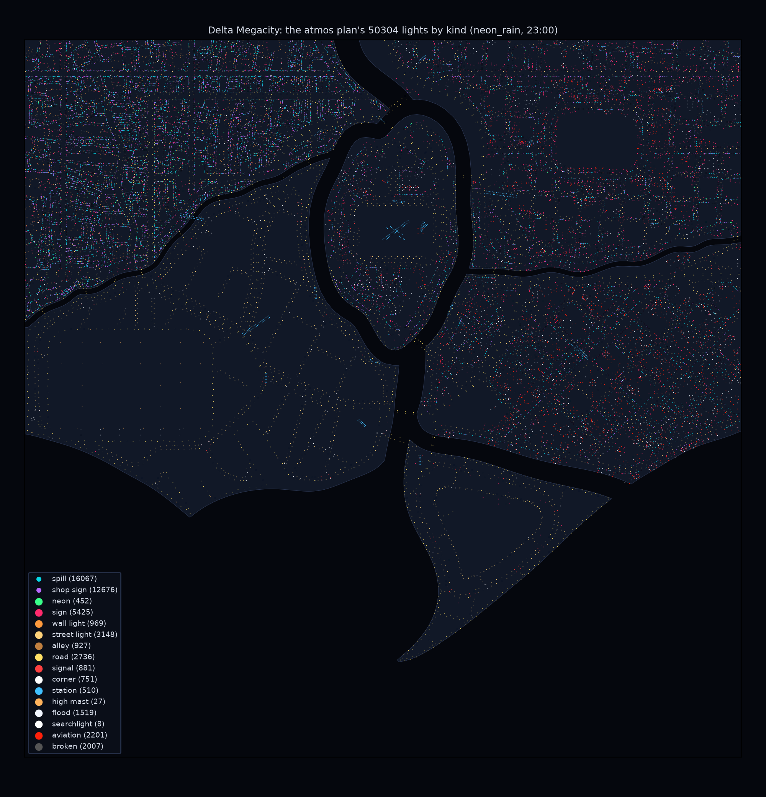 | 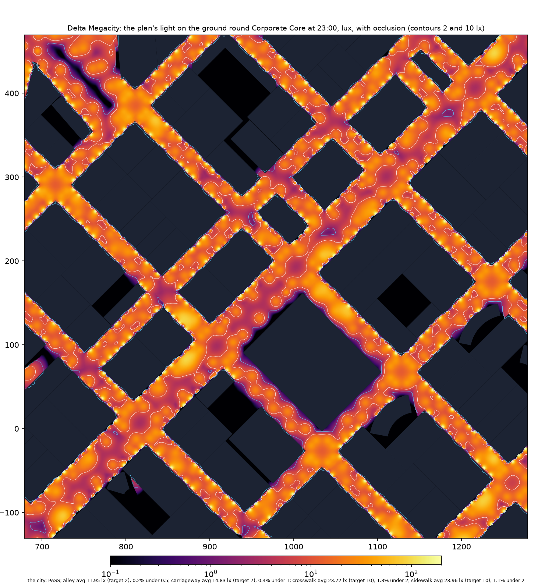 |

## Unreal

**The import.** Delta Megacity (`C:/Users/swagn/CityGen/builds/ag16/delta_megacity`, AG16's
build) imported over its AT1 import in the CityAG16 project with its AT2 plan (`citygen unreal
... --atmos DIR --no-hlod`, `CITYGEN_UE_OFFLOAD=500`): both plugins built in 13 s, atmosgen's
assets made again (version 3: `M_CgBeacon`, `M_CgBeam`), then the controller and 513 cells
(13 new, 501 re-packed by `ATMOS_VERSION` atmos2), every other actor unchanged, under 2 min.

**The check by night** (`--check-only --shots`, the play window's views,
`CITYGEN_UE_PLAY_SHOTS_ONLY=1`) passes: streaming, 505 of 507 traces down, 36 of 36 roofs and
facades, a 345 m walk, the console cheats, the play features by night (157 of atmosgen's lights
live of 1,847 in the 92 cells round the player, 14 shadowed, 24 in the high tier, 63 aviation
beacons), a 1,654 m teleport, the flight. Its night views:

| Old Town: neon spill and shop signs on the sidewalk | Midtown: a blade sign on its wall, a crowned tower |
|---|---|
| 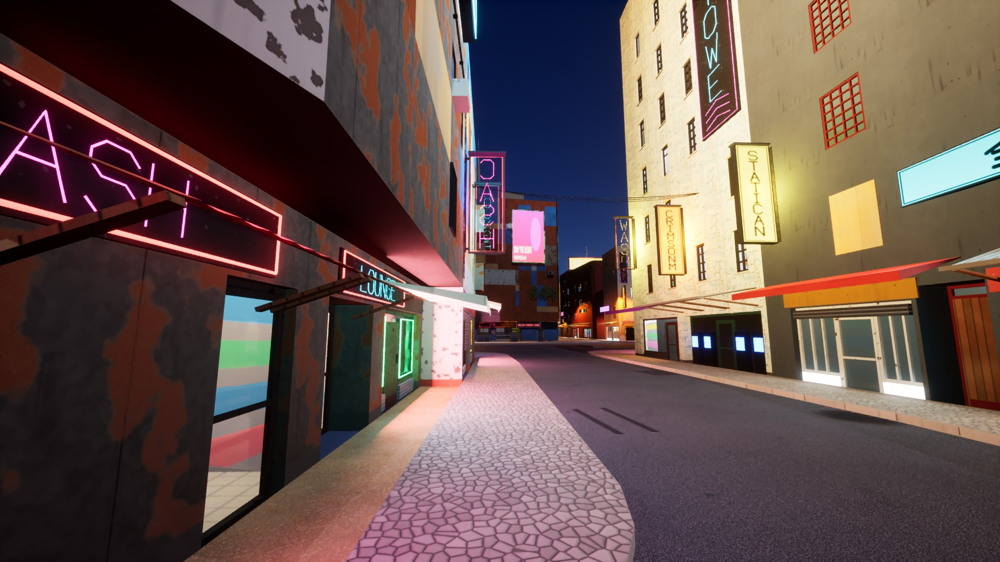 | 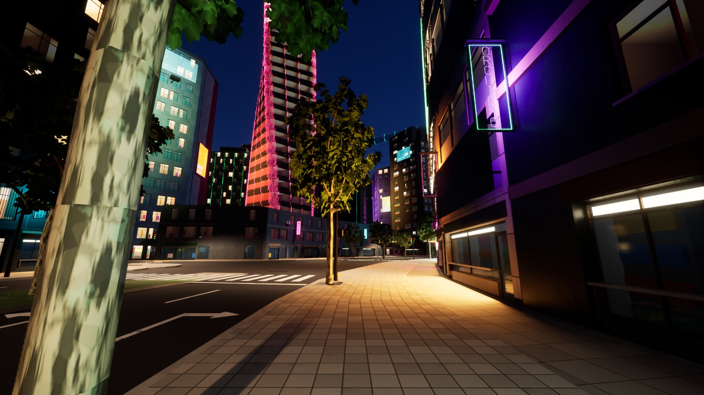 |
| **The Corporate Core from 180 m: crowns in their LED accents, searchlights, beacons** | **The megatower's searchlights over flooded crowns** |
| 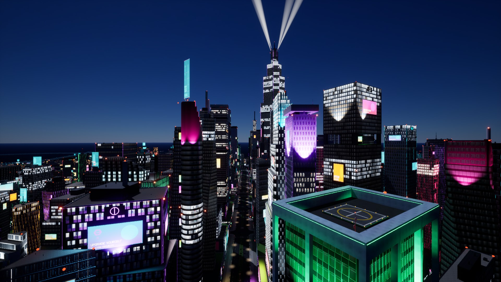 | 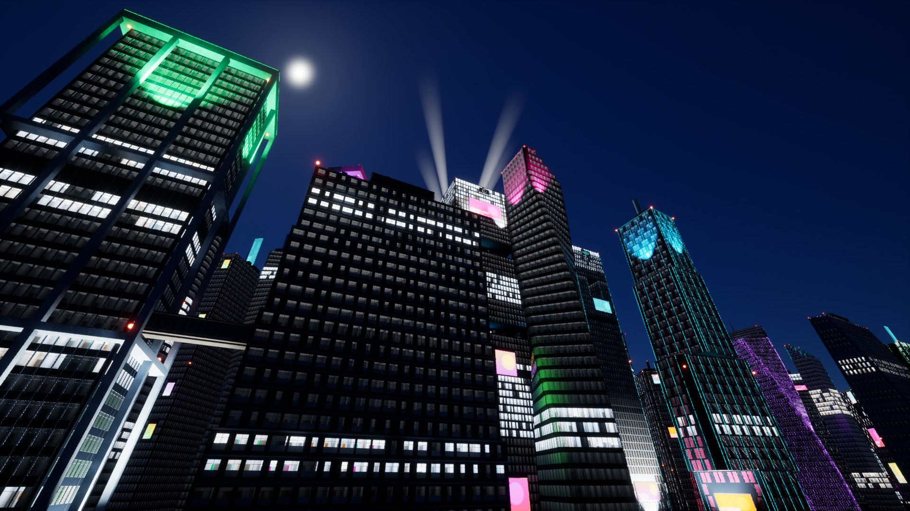 |
| **Looking up in the Corporate Core** | **The Industrial Port's yard under its high masts** |
| 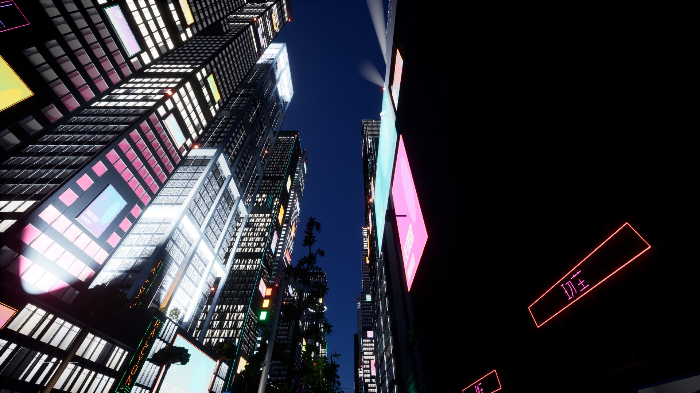 | 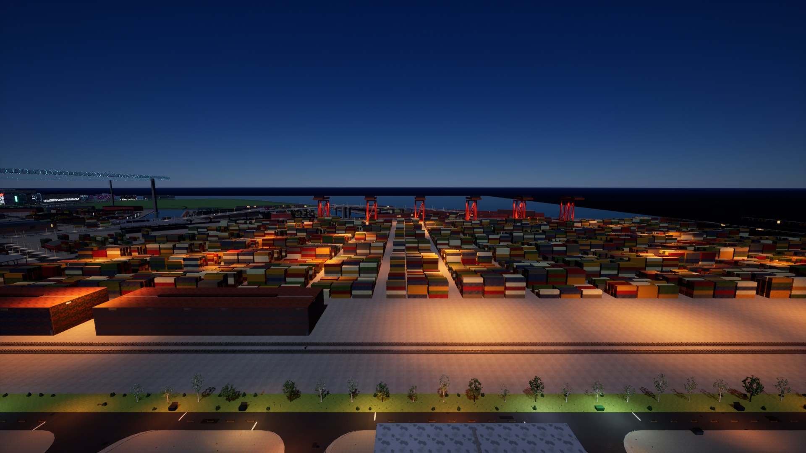 |

What they show:

- **The lit faces light the street and not their walls:** the billboards and banners stand clean
  on dark facades, no ball of light in them and no wash round them (AT0's band); the sidewalks
  under the shop signs and neon bands take their colors (Old Town's magenta, Midtown's violet
  blade sign on its own wall: a blade sign's spill is a small point, meant to).
- **Crowns:** each flooded tower's crown washed from below in its crown LEDs' accent (green,
  magenta, violet, cyan; white where AG15 gave it none), a grazing scallop under each side's
  flood fading up the crown.
- **Searchlights:** four beams over the megatower sweeping out of step, each a cone from its
  light, brightest at the roof and fading up into the sky.
- **Aviation lights:** a red glow at every tall roof's corners and mast tips, blinking together
  per building (30 a minute), steady ones down the tallest towers' corners.
- **The port:** the freight terminal's yard sodium under its high masts, the cranes lit under
  their booms; before AT2 it was dark (the benchmark's flight, below).

## The night's frame time

AG16's benchmark by night on Delta (`citygen unreal ... --bench-only --bench-atmos
--bench-passes night_native,night_plan,night_plan_all`), native 2560 x 1440 on the PC alone,
three runs each, the median (`bench/before`: main at 4fdcf107, AT1's plan; `bench/after`: AT2's
plan, plugin and assets). `night_plan` is the night with atmosgen's lights (AT2's: the lit faces,
neon spill, the high tier's floods and searchlights, the beacons and beams), `night_plan_all` with
AT0's fog, rain and wet street prototypes on as well (AT4's and AT5's, off in the level).

| Pass | p95 all, before | p95 all, after | walk, before | walk, after | GPU p95 all, before / after | GPU "Lights" walking, before / after |
|---|---|---|---|---|---|---|
| `night_native` | 11.3 | 11.7 | 11.0 | 11.4 | 9.6 / 9.6 | - |
| `night_plan` | 14.0 | **14.3** | 14.2 | **14.5** | 12.8 / 13.1 | 3.50 / 3.54 |
| `night_plan_all` | 16.0 | **16.4** | 16.3 | **16.7** | 14.9 / 15.3 | 2.99 / 2.91 |

(ms.) AT2's night is 14.3 ms p95 over the route, 2.4 ms under decision 12.6's 16.7 ms, 0.3 ms
over AT1's; with AT0's prototypes on, 16.4 ms over the route and 16.7 ms walking, at the budget
(AT1's after run: 16.8 walking). What it costs:

- **The deferred lights pass did not grow** (walking 3.50 to 3.54 ms): the lit faces stayed rect
  lights the size of their faces, the neon spill and shop signs became small spots and points
  near the view (a blade sign one light, not two rects), aviation lights live only near the view
  (their red glow is the beacon), and the floods, searchlights and high masts are a pool of their
  own, 48 at most within 750 m, never shadowed. From the air the first import had 228 aviation
  lights in the 512 of the mid set; near tier only, the mid set keeps the streets.
- **The rest is Lumen and shadows:** Lumen's reflections walking 0.91 to 1.03 ms (2.45 to 2.81
  with the wet decal: more of the city glows and is lit to reflect), shadow depths 1.32 to 1.40.
  The beacons (an instanced sphere per aviation light) and the beams (a cone per searchlight)
  are below the profile's resolution.
- **One run of three lost the foreground** (`front` 0.19, as in AT1's after run): every pass of
  it ran slow (`night_native` too, 16.5 ms), so the median of three stands; the other two agree
  within 0.1 ms.

| Before (AT1's plan) | After (AT2's plan) |
|---|---|
| 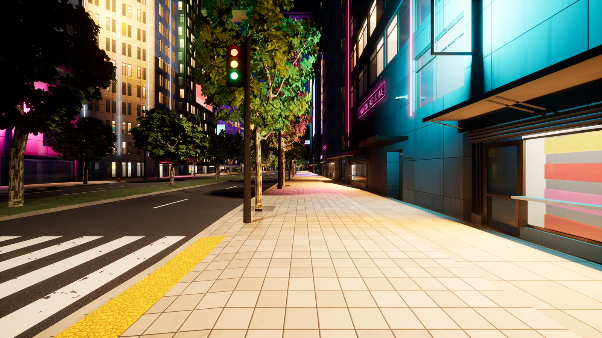 | 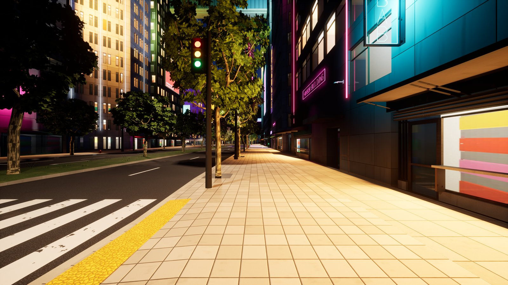 |
| 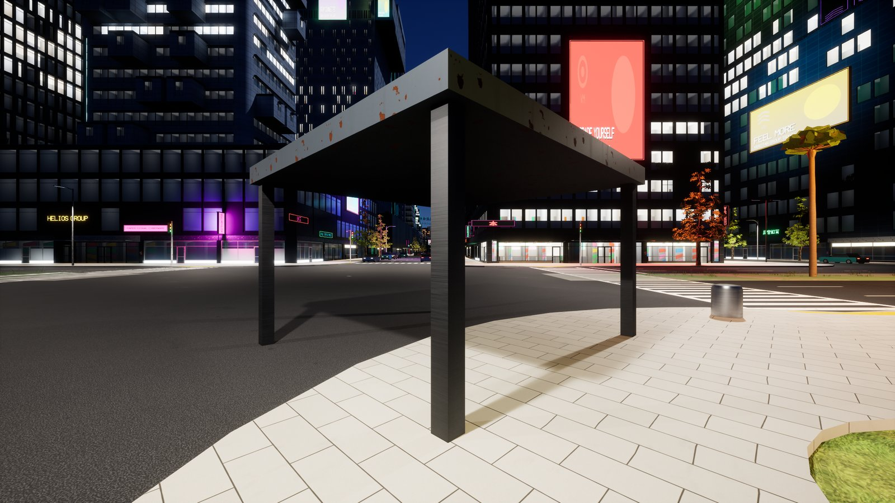 | 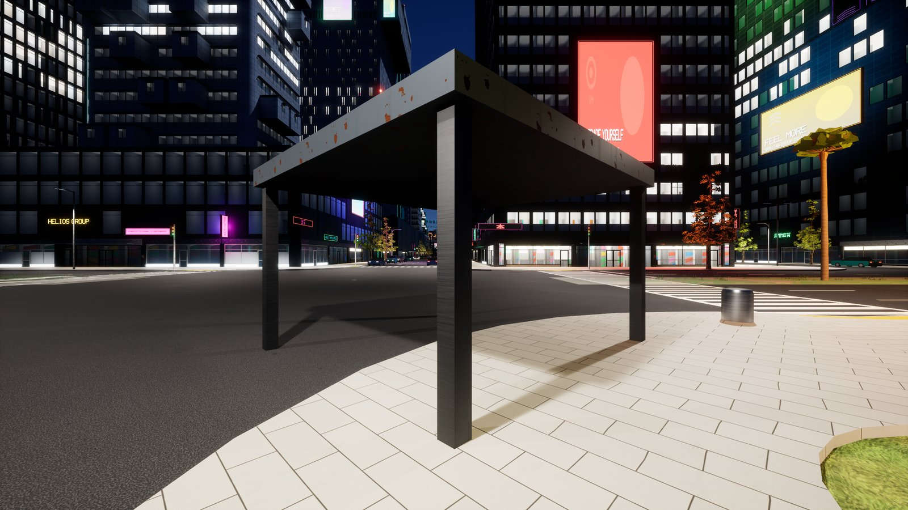 |
| 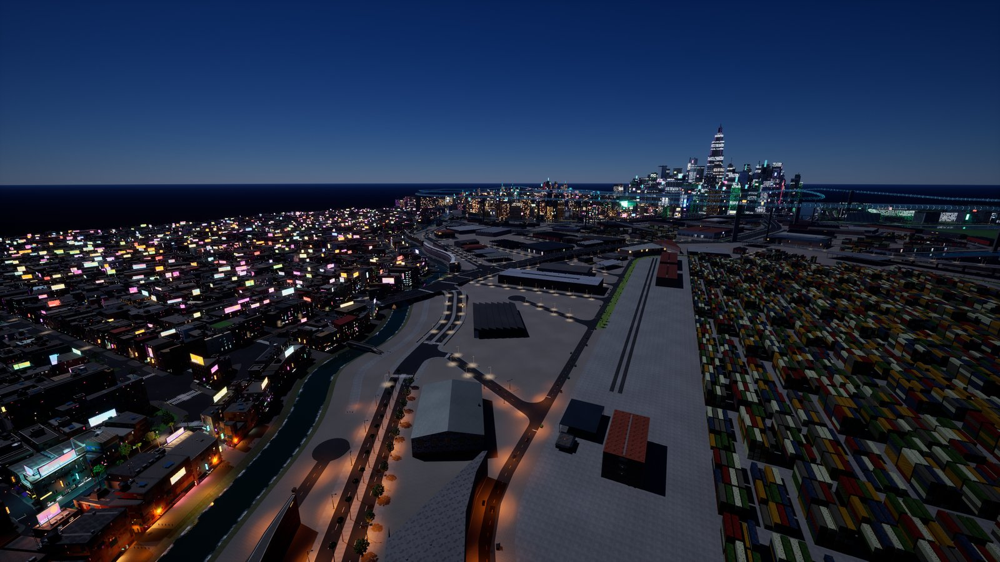 | 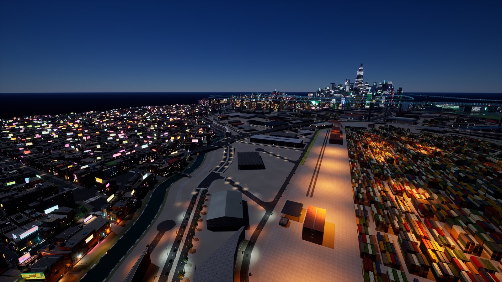 |

## Validation

- `tests/atmosgen` (`test_at_plan.py`, `test_at_streets.py`, the new `test_at_signs.py`),
  `tests/test_unreal_atmos.py`, `tests/test_bench.py`, `tests/test_unreal_play.py` and the cook
  test of `tests/test_unreal.py` (what the runtimes load by path): 50 passed.
- The plan with its lux and faces checks on Delta and the eight samples above: every one passes.
- Delta imported and checked by night in Unreal (CityAG16), shots of sign-lit streets and lit
  towers; the benchmark by night before and after, three runs each.

## Open items

- **Fixtures asked of stage 2** (`emitters.py`'s third and fourth asks, assetgen scope 4.6): 9,851
  of Delta's lights stand on poles, mast arms, wall packs, canopy downlights, flood outriggers,
  beacons, masts and ground lights stage 2 does not draw yet; the runtime's beacon spheres and
  beam cones stand in for two of them.
- **A sign's face and color from assetgen** (the second ask): read where `signs.json` has them,
  derived until AG6 or AG8 records them (every light of the plans above is derived).
- **A flickering or dying sign's face stays steady:** the light flickers, the emissive face
  stage 2 draws does not; a per-instance flicker in the sign master, by the same hash, would
  match them (an ask of AG6 and AG8).
- **Searchlight beams in fog:** the beams are cones of their own; with AT4's volumetric fog the
  spot lights also scatter within its 200 m, and AT4 should decide which stays.
- **The far city:** beacons and beams show within World Partition's loading range (768 m), the
  high tier within 750 m; past that is AT7's (light cards, the HLODs' emissive).
- **Walking with fog, rain and wet streets** is at the budget (16.7 ms): AT4 and AT5's wet decal
  and its Lumen reflections remain the lever (2.8 ms walking).
