# AT3: sky and time (atmosgen)

Stage 3's fourth milestone (`docs/atmosgen_scope.md` sections 6.2 and 13): night, dusk and day
skies, the cloud deck lit from below by the city, the moon and a few stars, and the time of day
driving `MPC_CityGen`'s `Hour` and `Night`, every light's schedule and the exposure, which
replaces the play features' moon and night switch. Built on the Windows PC (RTX 4070 Ti,
32 GB), 2026-11-11 and 12, on main after AT2 (#203).

## What AT3 built

| Part | Where | What |
|---|---|---|
| The sun and the moon | `atmosgen/sky.py`, `presets.SKY`, spec `sky` | the sun's elevation and azimuth by the hour from the city's latitude (35 by default) and the sun's declination on the day of the year (172), solar time; the moon trailing it by its phase (0.62, a waning gibbous up in the east-southeast by 23:00), its declination mirrored by the phase, its light by its lit fraction |
| Curves over the sun's elevation | `presets.SUN_CURVE`, the plan's `sky.curve` | the exposure from the night's held -3 EV100 to the day's (1.6, 0.8 under neon rain's closed deck), `Night`, the sun's light, the sky light, the stars; the runtime and the Blender preview read the same keys |
| The named hours | the plan's `sky.hours` | day 16:00, dusk where the sun stands at -3 degrees (19:28 here), night (the look's 23:00); a row per hour (`sky.by_hour`) |
| Schedules the sun sets | `sky.schedules` | `dusk_dawn` (the street lights) on from the sun at +3 degrees to -3, `tunnel` 0.6 by day; the lux check reads the plan's schedules |
| The sky glow | `sky.glow`, `sky_glow.png`, `preview_sky.png` | every light's upward flux on a 64 m raster, lit onto the deck's underside by a Lambertian footprint at its height, $E(r) = \Phi h^2 / (\pi (h^2 + r^2)^2)$, shown as $0.45 E / \pi$ times the look's glow |
| Exporter | `citygen/unreal_atmos.py`, `ue/import_city.py` | the controller's sky settings (`sky_settings`, in its hash), the glow as `Atmos/T_<City>_SkyGlow`, `ATMOS_VERSION` atmos3 |
| Runtime | `ue/CityGenAtmos` (`ApplyTime`, `EnsureDome`), `ue/atmos_assets.py` (`M_CgSky`, version 8) | the importer's sun as the sun, then the moon; the sky light; the exposure held per hour; `Night` and `Hour`; schedules interpolated between the hours; a sky dome: the sky atmosphere, the sun's disk, stars, the moon with its phase, the cloud deck at its height lit by the sun or the moon and by the city; `TimeSpeed`; console `CityGenAtmos.Hour day|dusk|night`, `.Sky`, `.Exposure`, `.TimeSpeed`, `.Cover` |
| Play features | `ue/CityGenPlay` | day and night are the controller's hours; the Tab menu's time row a slider (drag to any quarter hour, arrows an hour, a click swaps day and night); their own night switch only for a level without atmosgen |
| Benchmark and check | `citygen/bench.py`, `ue/check_city.py` | passes `dusk_plan(_all)`, `day_plan(_all)`, `night_plan_nosky`; `bench.busy` counts a game or a screen recorder; the bench names what takes the game's foreground and takes it back; the check reads the sky by night, dusk and day, `dusk_*`, `t<HHMM>_*` and `*_clear` views |
| Blender | `atmosgen/preview.py`, `assetgen/blender/ag6_preview.py` | `atmosgen preview --hour H` at a twilight hour: a dusk sky, the windows at the plan's Night, the lights dimmed by the exposure's step |

## The plan on Delta

`atmosgen plan` on AG16's Delta build (the same city as AT0 to AT2, so the frame times compare; an
empty spec: `neon_rain`): every check passes as in AT2 (the lux and faces checks are unchanged, the
street lights' `dusk_dawn` at 23:00 still 1). The sky: day 16:00 (the sun at 37 degrees), dusk
19:28 (-3 degrees), night 23:00 (-30); the exposure 0.8 EV100 by day under the closed deck, -3 by
night; the moon at 0.86 lit, 14 degrees up in the east-southeast at 23:00. The deck at 420 m, 80%
covered, glows at 0.62 cd/m2 over the core and 0.12 on average over the city, from 13.8 Mlm of
upward light (crown floods and the upper halves of the sign faces most of it).

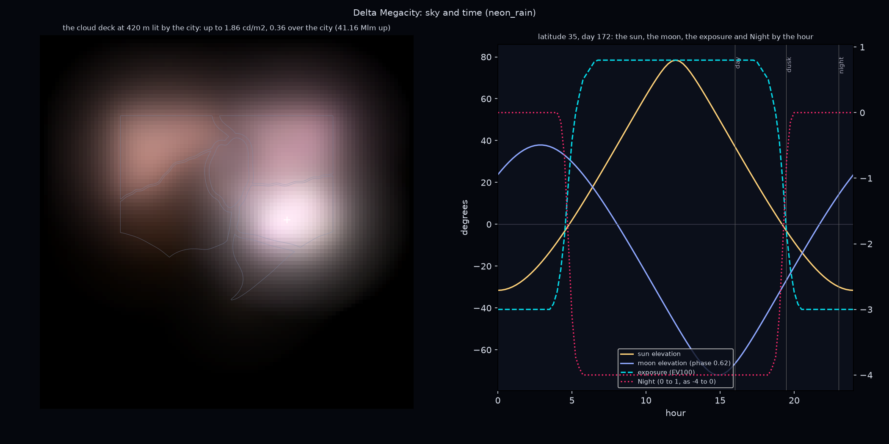

The first glow (`ESCAPE` 0.5 of the direct upward light and 0.35 of the bounce leaving the
canyons) put the core at 11.7 cd/m2, a sky brighter than the streets; at 0.12 and 0.2 it was 1.9
and in Unreal still a pale sheet washing the night out; at 0.04 and 0.07 (most of the upward
light lands on the facades the floods are aimed at and the signs face) the core's deck is about
twice middle grey at the night's exposure, the rest of the sky dark.

## Unreal

**The import.** Delta imported over its AT2 import in CityAG16 with AT3's plan (`citygen unreal
... --atmos DIR --no-hlod`): the plugins built in 15 s, atmosgen's assets made again (`M_CgSky`),
the glow texture imported, the controller and the 513 cells updated by `ATMOS_VERSION` atmos3,
nothing else touched, 3 min 14 s.

**The check** (`--check-only --shots`) passes: streaming, 505 of 507 traces down, 36 of 36 roofs
and facades, a 345 m walk on the ground, the console cheats, the play features, the teleport, the
flight, and the sky and time: night 23:00 (the sun at -29.9 degrees, `Night` 1.00, -3.00 EV100,
157 lights live), dusk 19:28 (-3.1 degrees, `Night` 0.81, -1.80 EV100, 157 live), day 16:00 (37.1
degrees, `Night` 0, 0.80 EV100, none live).

| The Corporate Core by night under the glowing deck | The deck over the skyline from the harbour |
|---|---|
| 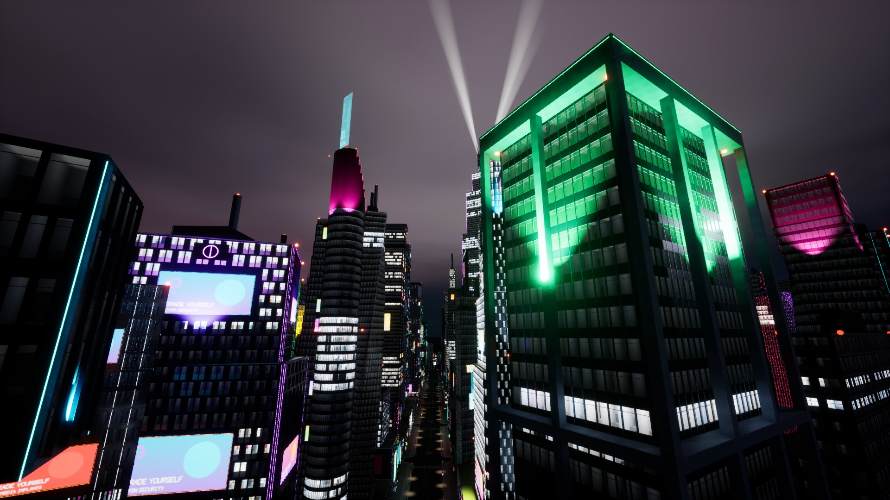 | 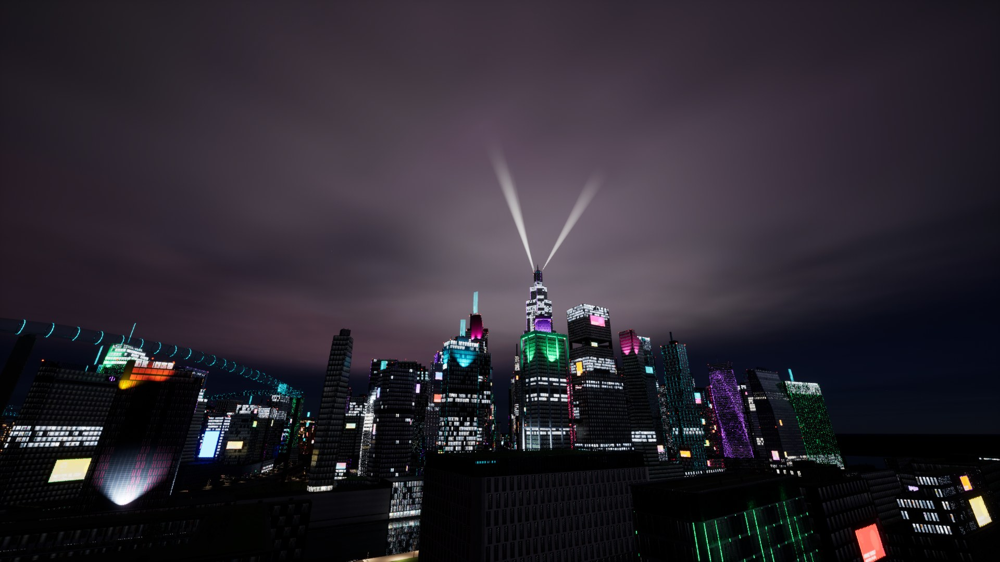 |
| **The moon over the bay, the deck opened (`*_clear`)** | **Stars over the core, the deck opened** |
| 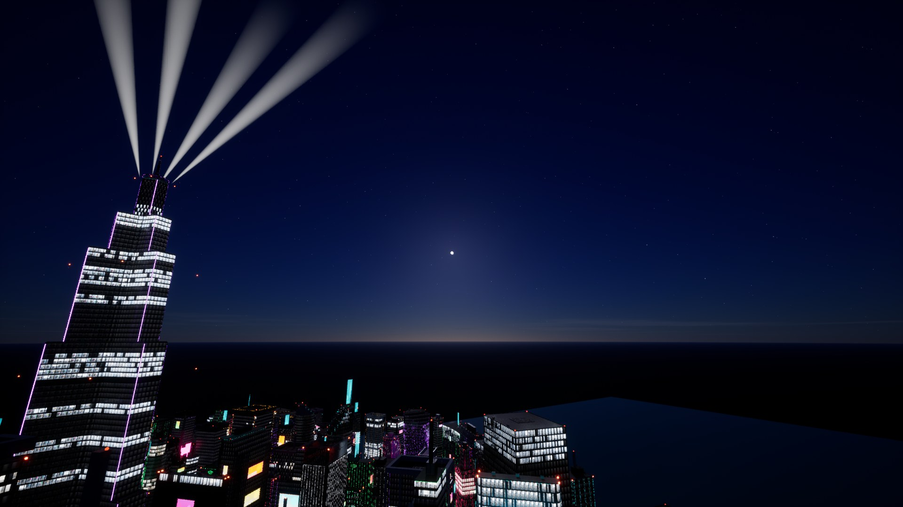 | 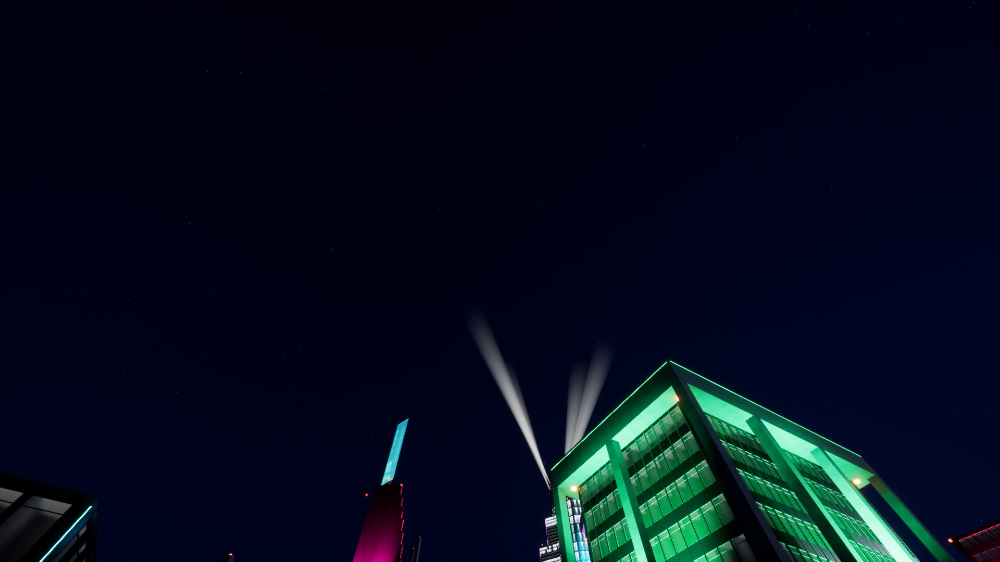 |
| **Dusk: the sun just set behind the port** | **Dusk over the Corporate Core** |
| 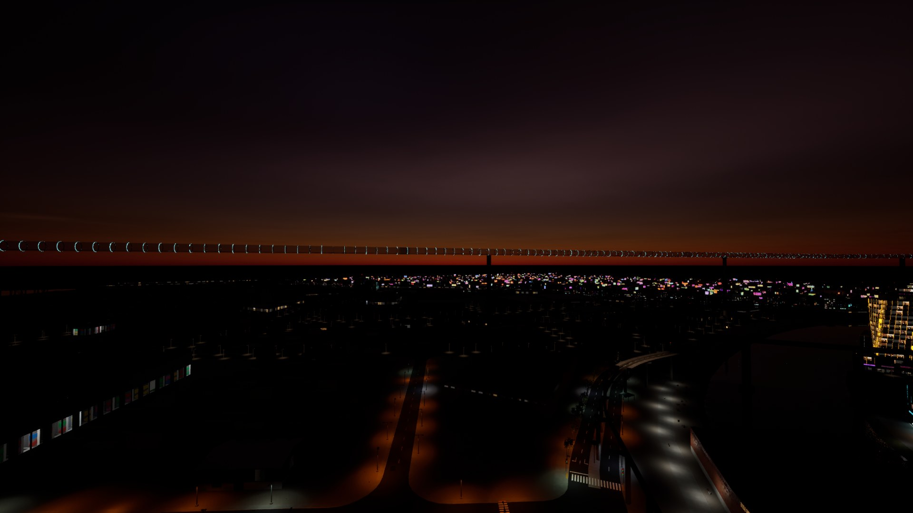 | 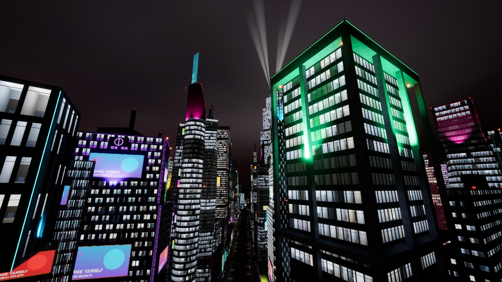 |
| **20:45, the blue hour** | **Day (16:00) under the overcast deck** |
| 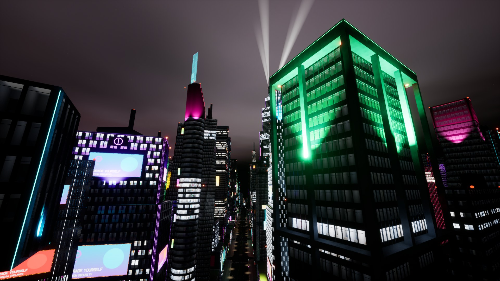 | 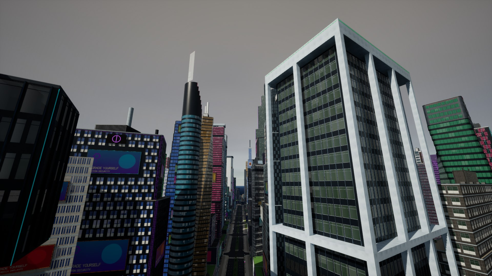 |
| **A Corporate Core street at dusk** | **The Tab menu's time-of-day slider** |
| 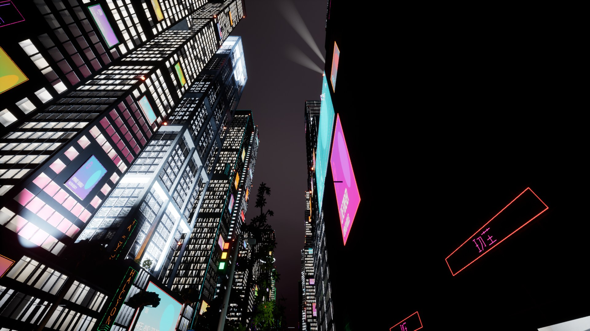 | 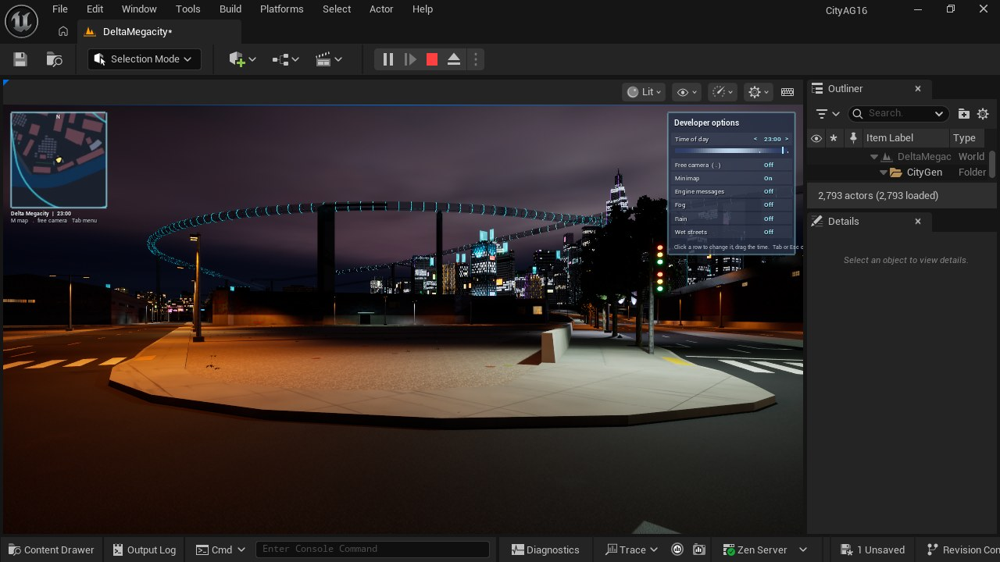 |

What they show:

- **The night sky** is the city's: a low deck glowing violet and amber over the core from its own
  light, darker over the water and the edges, its texture of thicker and thinner cloud moving with
  the wind; searchlight beams reach into it.
- **The moon** in the east-southeast at 14 degrees, its waning gibbous phase lit from where the
  sun is under the horizon, a halo round it; under neon rain's 80% deck it shows only through its
  gaps (the check's `*_clear` views open the deck to 20% with `CityGenAtmos.Cover`). Stars are
  few and faint, as over a lit city.
- **Dusk** is the sky atmosphere's own twilight (the sun at -3 degrees still lights it from under
  the horizon), the deck lit from the west, the street lights coming on with `dusk_dawn` and the
  windows by AG15's schedules, the exposure between the night's and the day's: the lamps read
  dimmer against a brighter sky, as real ones do.
- **Day** is the importer's sun at its hour's place under the overcast deck, the exposure held
  (no adaptation), no plan light live.

**Two fixes the first Unreal run found:** the sky material failed to compile (a vector parameter
reaches a custom node as its RGB, so the glow's bounds lost their second corner: now two
parameters), and the engine said so with "your scene contains a skydome mesh ... does not cover
that part of the screen" over a black sky; and the first glow was far too bright (above).

## The frame time

AG16's benchmark on Delta (`citygen unreal ... --bench-only --bench-atmos`), native 2560 x 1440,
three runs, the median. **Before** is AT2's after benchmark (`docs/progress/AT2/bench/after`: 3
runs on 2026-11-11, the PC alone, the same build, main's code at AT2's merge; the before run
taken for AT3 shared the GPU with a game and was dropped). **After** (`bench/after`): AT3's plan,
plugin and assets, the three runs all with the game in front (100%, 98%, 98%) and the PC
otherwise idle (other processes 0.4 cores on average).

| Pass | p95 all, before | p95 all, after | walk, before | walk, after | GPU p95 all, before / after |
|---|---|---|---|---|---|
| `night_native` | 11.7 | **11.2** | 11.4 | **10.8** | 9.6 / 9.7 |
| `night_plan` | 14.3 | **14.4** | 14.5 | **14.6** | 13.1 / 13.2 |
| `night_plan_all` | 16.4 | **16.4** | 16.7 | **16.8** | 15.3 / 15.3 |
| `dusk_plan` | - | **14.3** | - | **14.5** | - / 13.2 |
| `day_plan` | - | **11.1** | - | **10.7** | - / 9.8 |

(ms.) AT3's night is 14.4 ms p95 over the route, 2.3 ms under decision 12.6's 16.7 ms; dusk 14.3
(the plan's lights come on with the street lights and the signs' evening schedule); day 11.1 (no
plan light live). With AT0's fog, rain and wet street prototypes on, the night is 16.4 ms over the
route, as AT2's, and 16.8 ms walking, 0.1 ms over the budget on that route (AT2: 16.7).

- **What the sky costs:** the sky dome is one draw over the sky's pixels, 0.11 ms of base pass
  walking by night (the GPU's passes, `bench.json`); the GPU's time over the route is otherwise
  the same as AT2's (p50 walking 12.19 against 12.14 ms with the plan's lights, 14.19 against
  14.23 with the prototypes). The moon as the importer's one directional light
  (AT2's night had it too, as the play features' moon) and the sky light's capture cost what they
  did. **`bench/after_sky`**: the sky material made cheaper (the deck worked out first, the stars
  only where it is open, the moon only near it, four cloud octaves for five): its base pass 0.09
  ms for 0.11, the GPU's p50 walking 11.8 against 12.2 ms with the plan's lights and 14.4 against
  14.2 with the prototypes, and the frame's p95 0.3 ms higher (night_plan 14.7, night_plan_all
  16.7, 17.1 walking), all of it on the CPU's side: those runs shared the CPU with the Claude
  app (0.6 cores, and the foreground 5% of the time) and night_plan's first pass compiled the
  new material's shaders (a 1.6 s hitch). The sky is about 0.1 ms of the GPU either way; the
  cheaper material is kept, and the 0.1 ms walking with the prototypes goes to AT4 (open items).
- **The first after benchmark lost the game's foreground** in two of its three runs (in front 51%
  and 7% of the run: the threads twice as slow, AT1's finding), with nobody at the desktop. The
  benchmark now names the process that holds the foreground whenever the game does not, and takes
  it back every 2 s (`bench.take_front`: the foreground window's thread's input joined for a
  moment, else `SwitchToThisWindow`; `others.json`'s `lost_to` and `retaken`). The rerun held it
  throughout. In the after_sky runs the window taking it was the Claude desktop app's
  (`claude.exe`), and the first take-back (without `SwitchToThisWindow`) was refused every time.

| Night (after) | Dusk (after) | Day (after) |
|---|---|---|
| 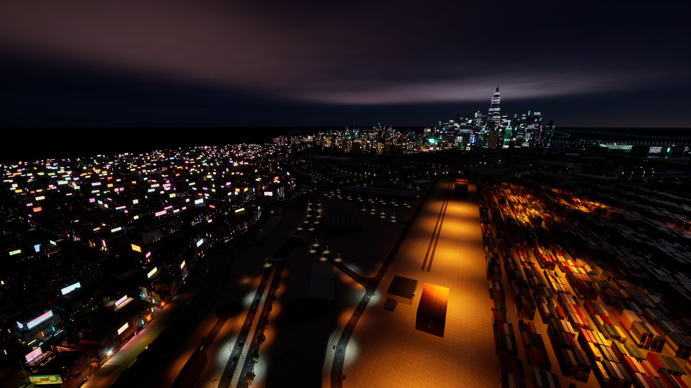 | 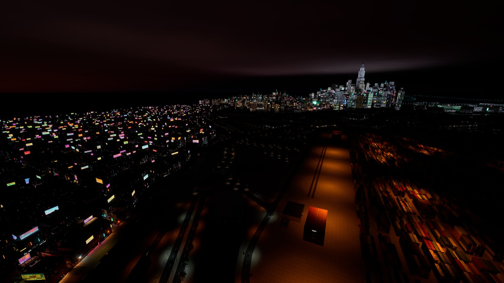 | 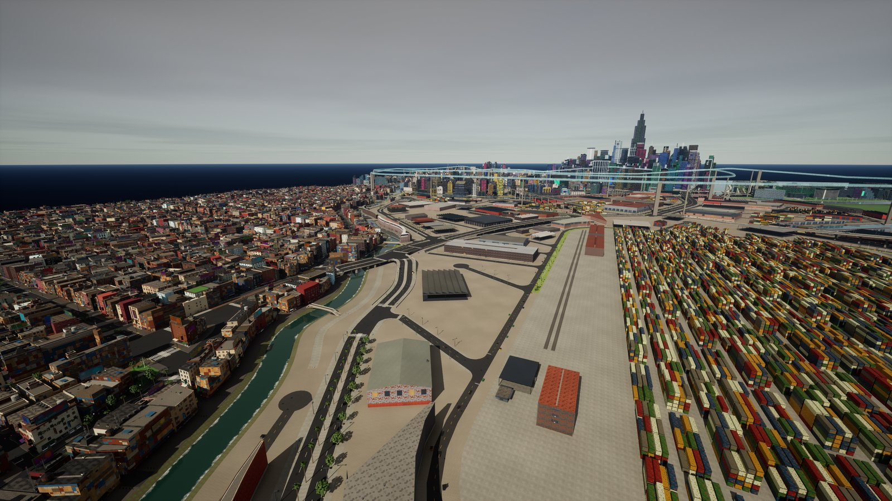 |
| 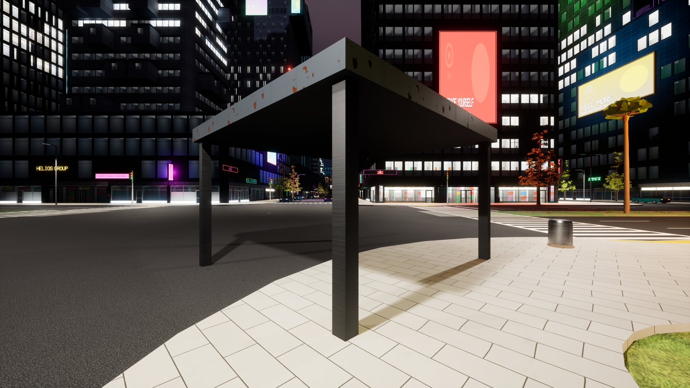 | 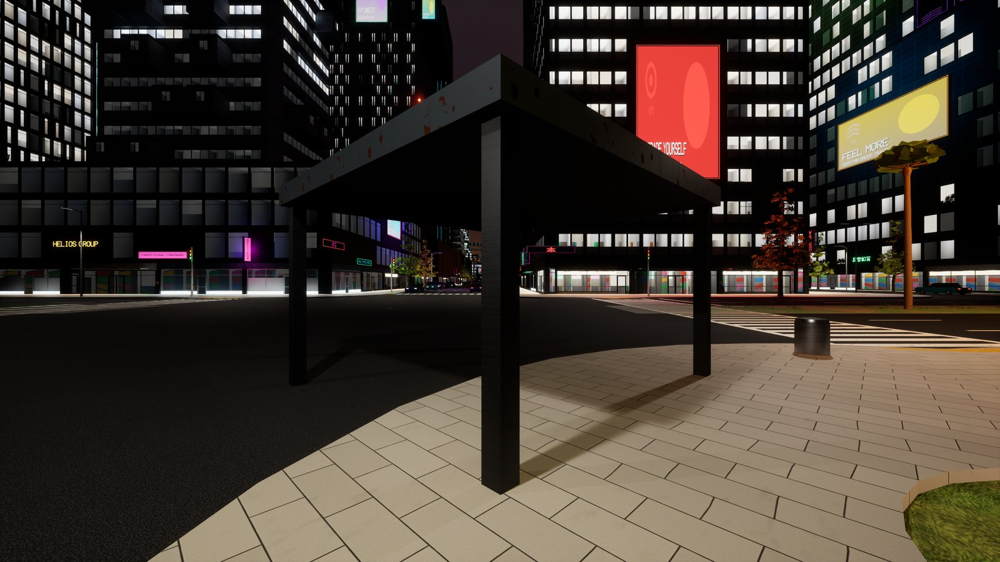 | 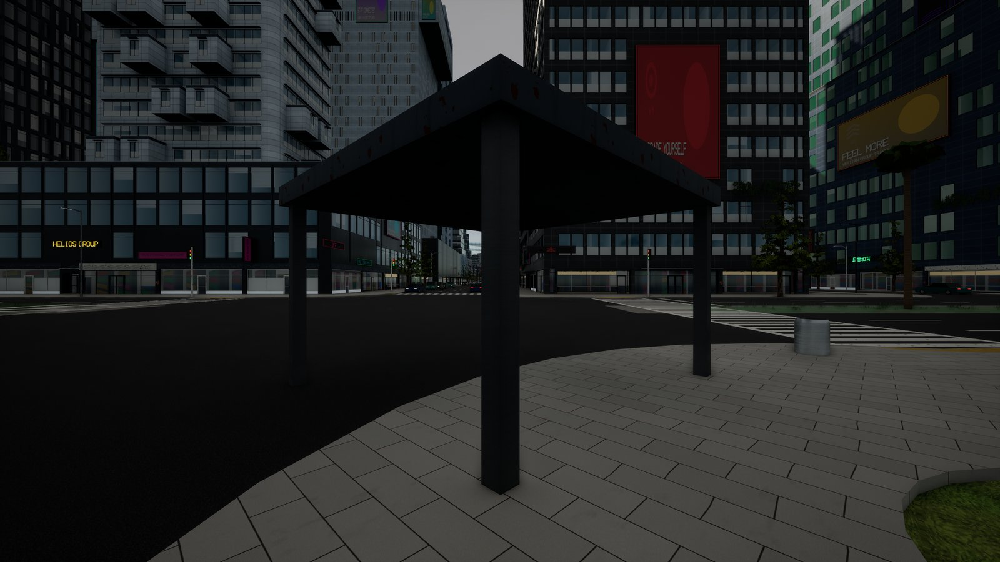 |

## Blender preview at dusk

`atmosgen preview BUILD --hour 19.4` (the sun at -2.4 degrees): the twilight sky graded from the
glow under the sun's azimuth to a deep blue zenith, the windows at the plan's `Night` there (0.72),
the plan's lights near each view dimmed by the exposure's step from the night (2,583 and 2,663
lights), in Cycles at 3840 x 2160, 32 samples (22 and 5 minutes).

| The Corporate Core at dusk | A Corporate Core street at dusk |
|---|---|
| 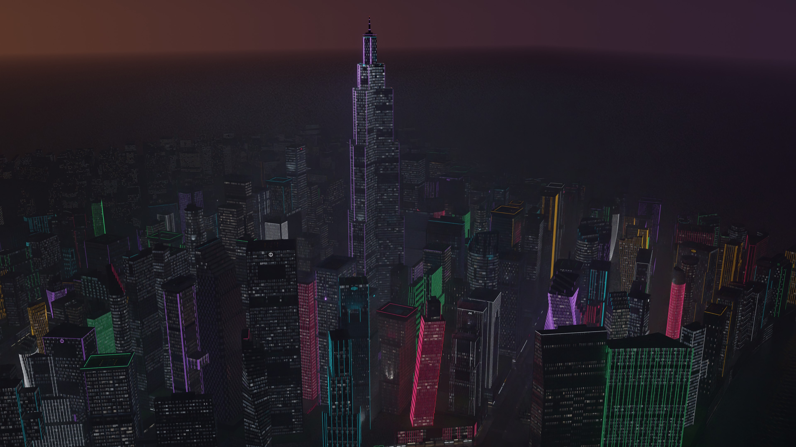 | 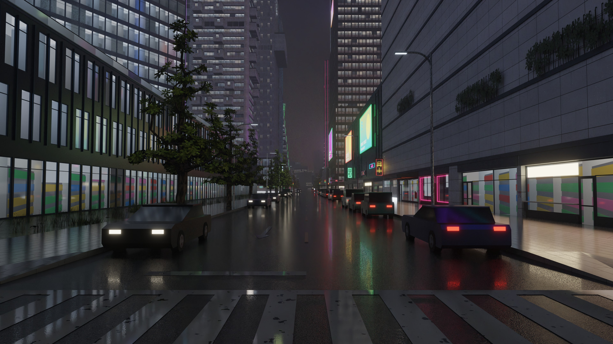 |

## Validation

- `tests/atmosgen` (with the new `test_at_sky.py`: the sun by latitude and season, the moon by its
  phase, the curves, the schedules the sun sets, the flux and what goes up, the glow against the
  footprint's integral, the PNG round trip, the plan's and the exporter's records),
  `tests/test_unreal_atmos.py`, `tests/test_bench.py` (the AT3 passes, a game and a recorder busy,
  who took the foreground), `tests/test_unreal_play.py` and the cook test of `tests/test_unreal.py`
  (what the runtimes load by path: `M_CgSky`, the engine's sphere): 61 passed.
- The plan on Delta with its lux and faces checks: passes.
- Delta imported and checked in Unreal (CityAG16) with night, dusk, day, blue hour and clear-sky
  shots; the benchmark after, three clean runs (before: AT2's after).

## Open items

- **Walking with fog, rain and wet streets is 16.8 ms**, 0.1 over the budget on that route
  (AT2's 16.7; the sky dome's base pass is about that 0.1 ms): AT4 and AT5's to bring down (the
  wet decal's Lumen reflections, 2.8 ms walking).
- **The take-back of the foreground with `SwitchToThisWindow`** is not measured yet (added after
  the last runs); the follow-up's benchmark is its first.
- **The day's exposure** (`DAY_EV100` 1.6) was set from the shots against AG16's day, not from
  Unreal's eye adaptation measured; AT6's looks should settle it with the grade.
- **The sky glow is the plan's at 23:00** scaled by `Night`; shops closing after midnight do not
  dim it (the raster would need a value per hour band).
- **One directional light** is the sun and then the moon: between the sun at -12 degrees and -16
  neither lights the ground (astronomical twilight, under the deck), and the moon's light pops in
  over those four degrees rather than with its own rise.
- **The moon and stars under neon rain** show only in the deck's gaps (80% cover); a clear-night
  look shows them fully. The stars are a hashed lattice, a pixel or two each, faint at 1440p.
- **Blender's dusk sky** is a gradient, not the sky atmosphere; the deck and its glow are
  Unreal's only.
