# AT4: air (atmosgen)

Stage 3's fifth milestone (`docs/atmosgen_scope.md` sections 6.3 and 13): height and
volumetric fog per look, light shafts from the strong lights through the haze, fog and smog
volumes (mist over the canals and rivers at night, smog over industry and the port, haze under
the decks and in tunnels, all thicker where danger is) and steam and smoke plumes (manholes and
drains, roof exhausts, food stalls, tunnel vents, chimneys). Built on the Windows PC (RTX 4070
Ti, 32 GB), 2026-11-12, on main after AT3 (#207) and the parked cars (#209).

## What AT4 built

| Part | Where | What |
|---|---|---|
| The fog of the look | `presets.AIR_LOOK`, the plan's `air` | the weather's height fog times the look's `density` (neon rain 4.4) and `falloff` (0.4: the haze keeps to the street canyons, the city reads from the air), its volumetric extinction times `extinction` (3), phase g 0.72 (halos round the lamps and signs, shafts along the beams), the volumetric fog to 160 m; by the hour from the sky's Night (`fog_hours`: 1.25 by night, 0.8 by day) |
| Light shafts | `presets.SCATTER`, the controller's `KindScatter` | each light kind's volumetric scattering: street lights, signals, corner and road poles 1, high masts 2, crown floods 1.5, lit faces 0.35; none from the neon spill, shop signs and shopfronts (AT0: most of the live set); none from searchlights |
| Searchlights in fog | `presets.BEAM_FOG_GAIN`, `UpdateBeamGlow` | **decision:** AT2's beam meshes stay (a beam reaches 400 m into the sky, the volumetric fog 160 m, where a froxel is metres wide and a 2 degree cone a flicker of blocks); the spot lights scatter none, so there is one beam, brighter by 1 + 0.6 times the fog's share |
| Fog and smog volumes | `air.Air.mist`, `smog`, `haze`, `tunnel_haze`; `planmodel.FogVolume` | ellipsoids: mist along M16's canals, basins, rivers and channels (pieces 90 m along the water's line, as wide as it there, 7 m over its surface, after dusk: schedule `mist`); smog over the industrial and spaceport districts and their megasites (a 340 m grid, 80 m deep, by day and night: `smog`); haze under M14's decks (a 120 m grid from the ground to the soffit) and in road tunnels and underpasses (pieces along the covered stretch); each times its district's mood haze and 0.7 + 0.6 times its danger (decision 12.5); a `glow` of the city's light by night |
| Steam and smoke | `air.Air.street`, `vents`, `roofs`, `stalls`, `chimneys`; `planmodel.Emitter` | steam from AG7's manholes and drains, read from the street packs (`air.street_details`: the `manhole` and `grate` decals of the road pieces; a sidewalk piece's grates are tree pits), M9's ventilation buildings; exhaust from M3's roof mechanical units; cooking from M6's food stalls and kiosks; smoke from chimneys on industrial roofs and stove pipes on shanty stacks (`emitters.py`'s fifth ask: the flue); the share that steams by the district's grit (a clean core's manholes now and then, an old town's often) |
| The air check | `air.Air.check`, the plan's `checks.air` | every plume on its source (a manhole's or stall's middle, a roof unit's or vent's footprint) and out of every building mass and deck slab; every volume over its water, in its district or megasite, under its deck, in its tunnel; at most 24 volumes and 400 plumes a 256 m tile; a plan failing it is not delivered |
| Preview | `air.air_map`, `atmosgen lux` | `preview_air.png`: the volumes and the plumes over the city |
| Exporter | `citygen/unreal_atmos.py`, `ue/import_city.py` | packing version 3: a cell's volumes (14 floats) and plumes (9), cells wherever any lie; the controller's air (`air_settings`); `ATMOS_VERSION` atmos4 |
| Runtime | `ue/CityGenAtmos` | the height fog by the hour; light shafts by kind; the nearest 24 volumes within 900 m as local fog volume components from a pool (radial and height fog, phase g, albedo, a glow by night); per cell an instanced component of plume cards in `M_CgSteam` (`atmos_assets.py` version 12: turned to the eye, rising, slowing, widening and drifting by world position offset, soft and lit by the translucency volume), culled past 220 m; the plan's engine settings while it runs (`TunedSettings`); console `.Air`, `.Tuned`, `.VolumeGain`, `.VolumeGlow`, `.SteamGain`, `.FogSet`, `.FogView`, `.PlumeDebug` |
| The parked cars | `ue/import_city.py` (`VEHICLE_CULL_M`) | the cars' parts drawn only as near as they show (bodies 450 m, glass 250, wheels 120), the wheels without shadows |
| Benchmark | `citygen/bench.py`, `citygen/cli.py` | passes `night_plan_air`, `dusk_plan_air`, `day_plan_air`, `night_plan_proto` (AT3's `night_plan_all`), the exploring `x_*`; the lean route (`--bench-route lean`, the default for atmos benchmarks: one walk, the drive, the flight, a short warm-up, one run) |
| Check | `ue/check_city.py` | the controller's air by night; `*_noair` views (the same view without the fog and the air); `$CITYGEN_UE_ATMOS_CMDS` (console commands for a round of art direction) |

**Effects from code, settled:** AT0 found no API to author Niagara from code. AT4 builds the air
without it: the fog volumes are the engine's local fog volume components (made and pooled by
the controller) and the plumes instanced cards in a code-made material.

## The plan on Delta

`atmosgen plan` on AG16's Delta build (`neon_rain`): the lux and faces checks as in AT3, and the
air check passes. 169 volumes (151 pieces of mist on 12 bodies of water: the Great River, the
delta branches, the separation channels, Old Town's canals and the port's basins; 18 puffs of
smog over the Industrial Port), at most 7 in a tile; 732 plumes (156 of the 1,021 manholes and
84 of the 2,437 drains AG7 drew, 207 roof units, 20 stalls, 76 chimneys, 189 stove pipes), at
most 24 in a tile. Delta has no deck and no road tunnel: Vesper Bay Decks shows the haze under a
deck (below).

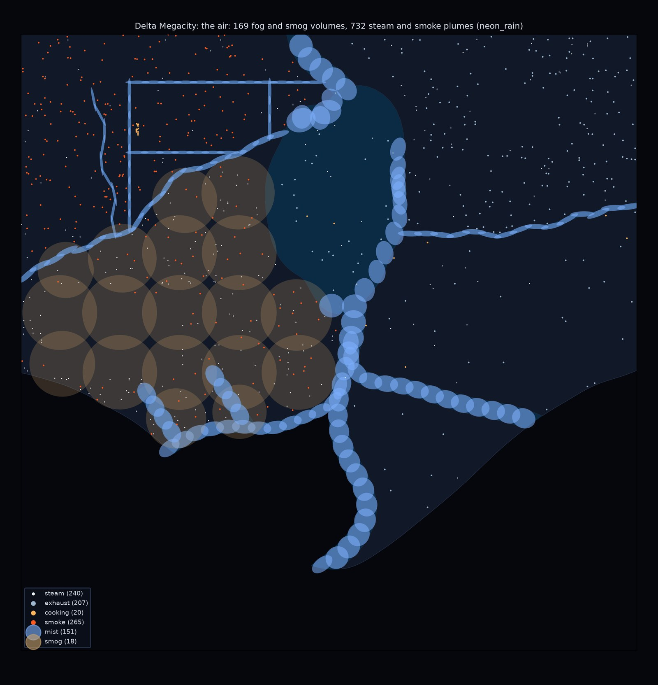

## Unreal

Delta imported over its AT3 import in CityAG16 (`citygen unreal ... --atmos DIR --no-hlod`,
`CITYGEN_UE_OFFLOAD=500`): the plugins built, atmosgen's assets made again (`M_CgSteam`), the
controller and 522 cells re-packed (9 new: cells of volumes or plumes alone), the 57 parked
car placements re-placed (their cull distances), nothing else touched, under 4 minutes. The
check passes: streaming, collision, the walk, the play features, the sky by night, dusk and
day, and the air (the fog on, 54 volumes registered and 24 live round the player, 126 plumes in
586 cards, the four engine settings applied).

| A Corporate Core street by night, with the air | The same street without it |
|---|---|
| 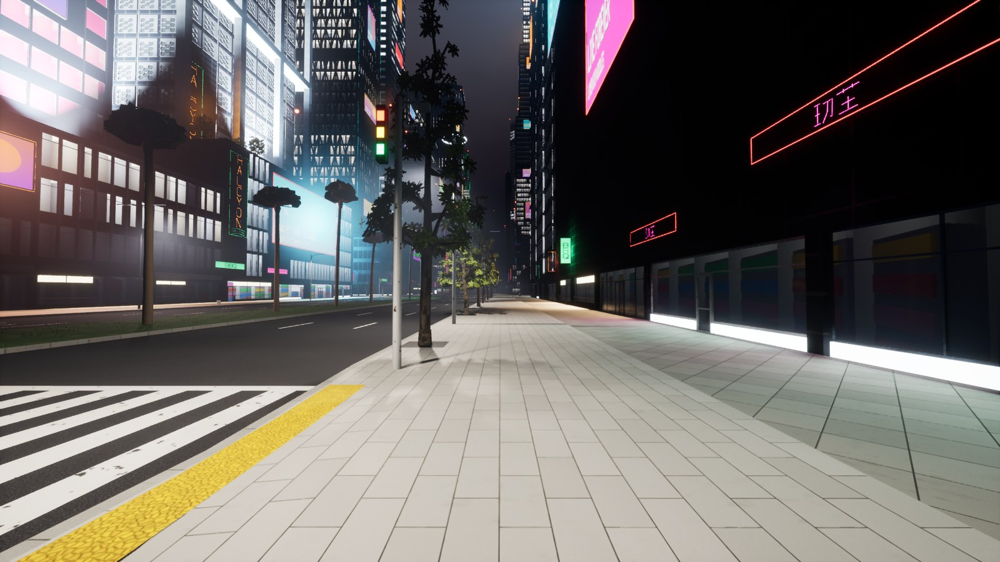 | 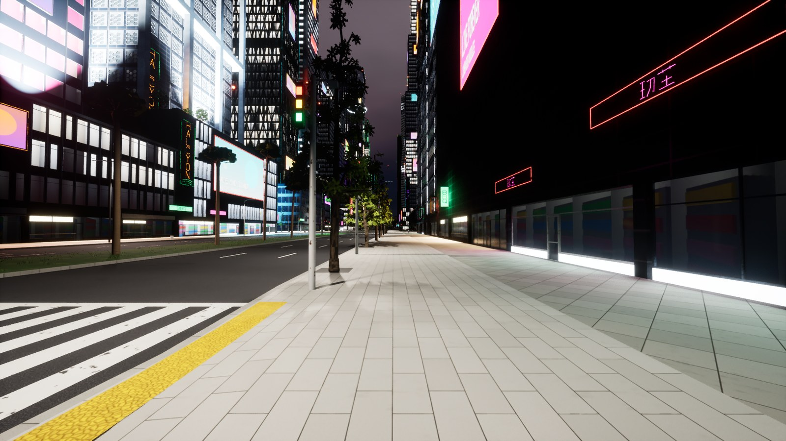 |
| **Old Town: the haze takes the neon** | **Without it** |
| 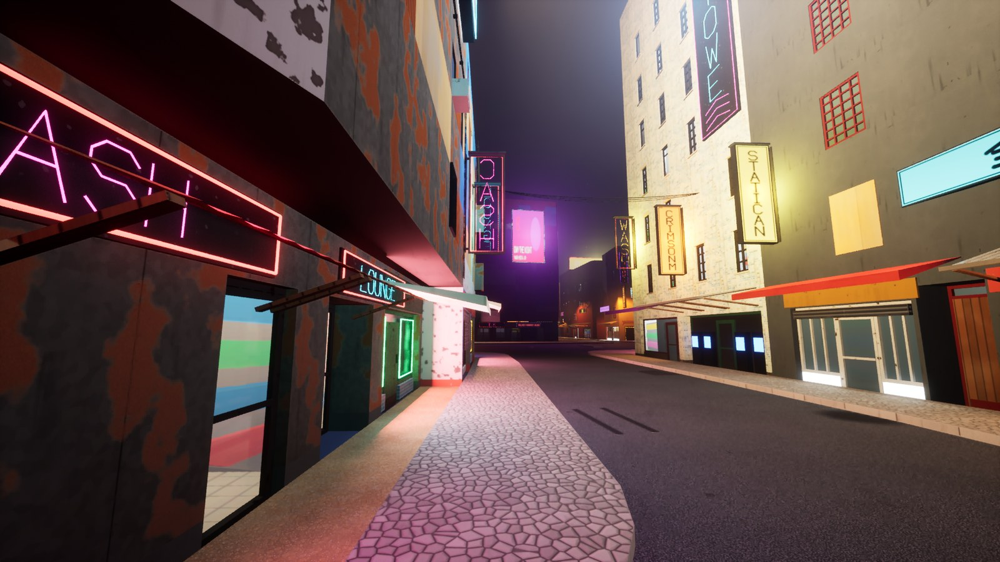 | 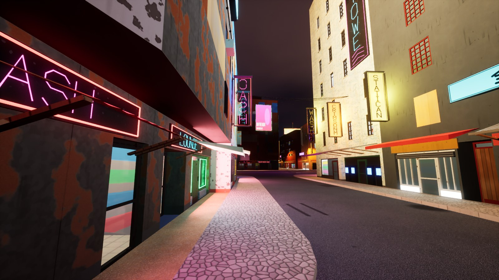 |
| **Mist on an Old Town canal** | **Without it** |
| 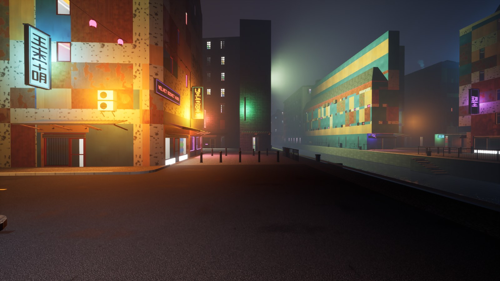 | 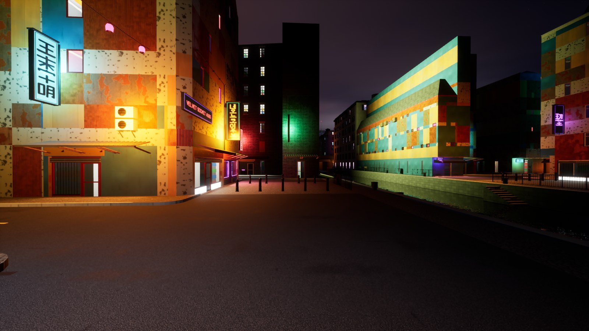 |
| **Mist on the Great River under a bridge** | **Steam from a Midtown manhole** |
| 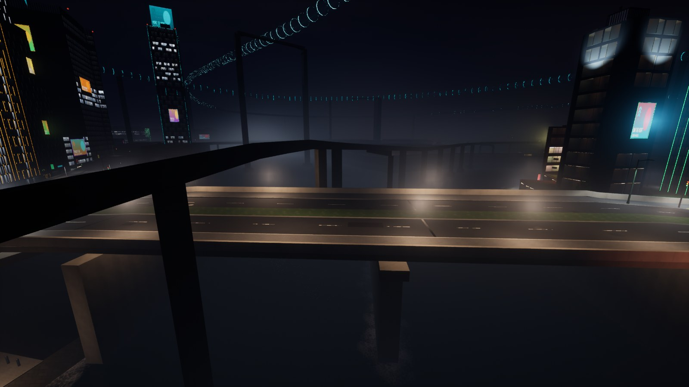 | 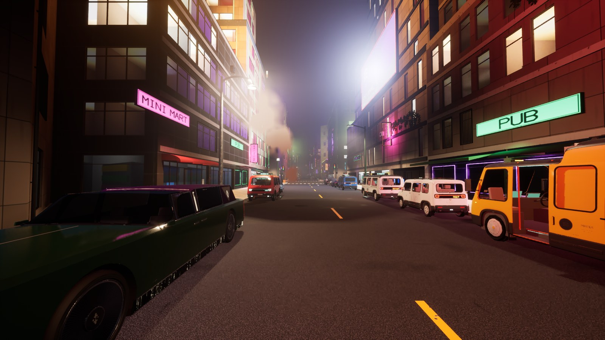 |
| **The Industrial Port from 120 m: smog and basin mist** | **Without it** |
| 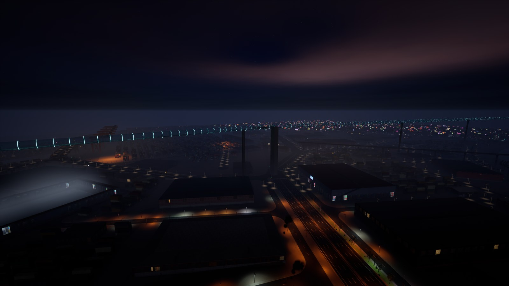 | 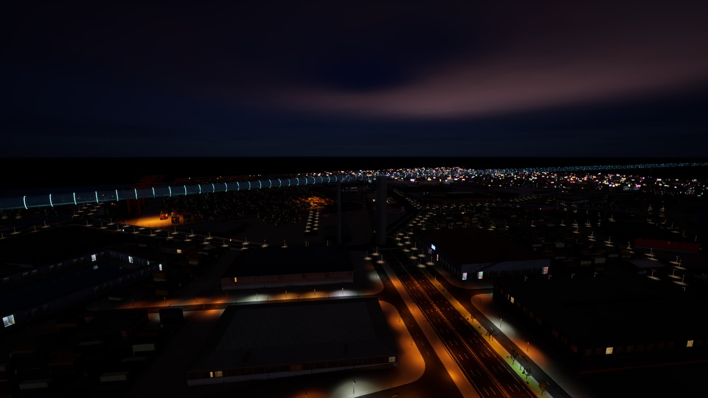 |
| **A port street in its sodium haze** | **The megatower's searchlights in fog** |
| 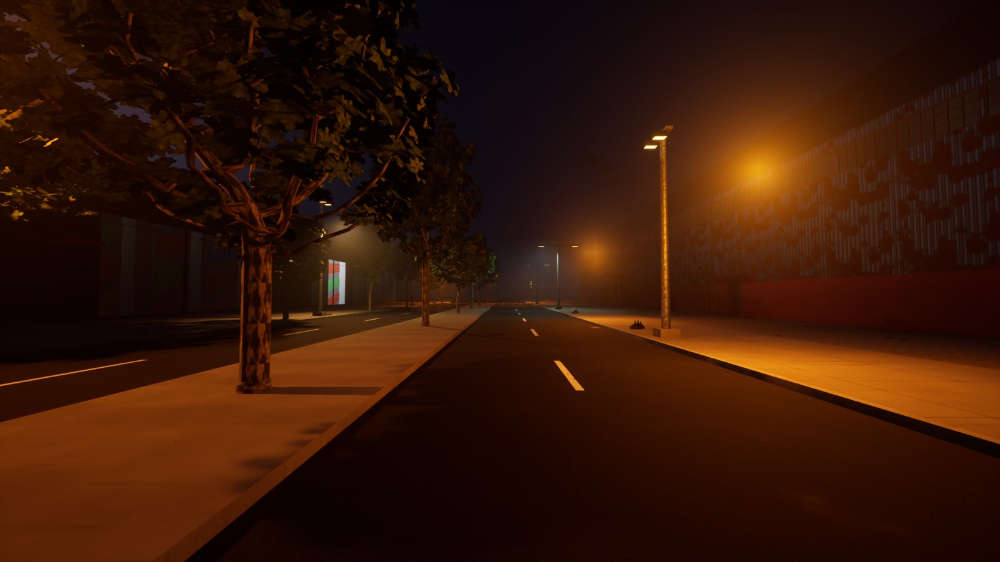 | 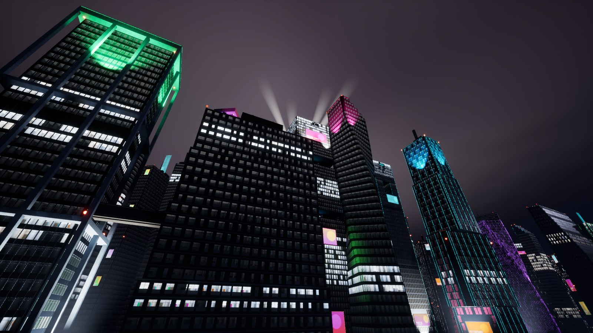 |
| **Vesper Bay Decks: haze under the deck** | **Without it** |
| 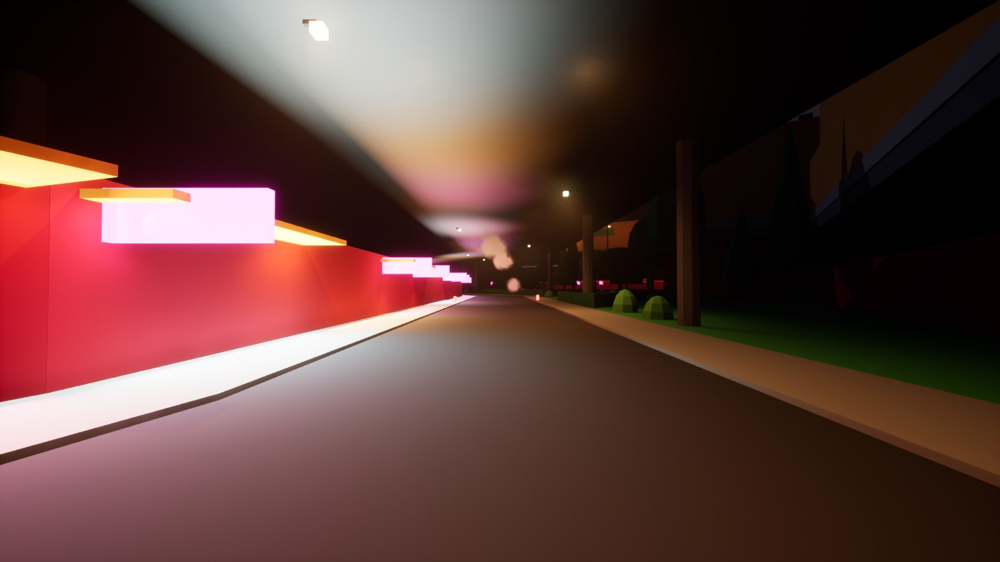 | 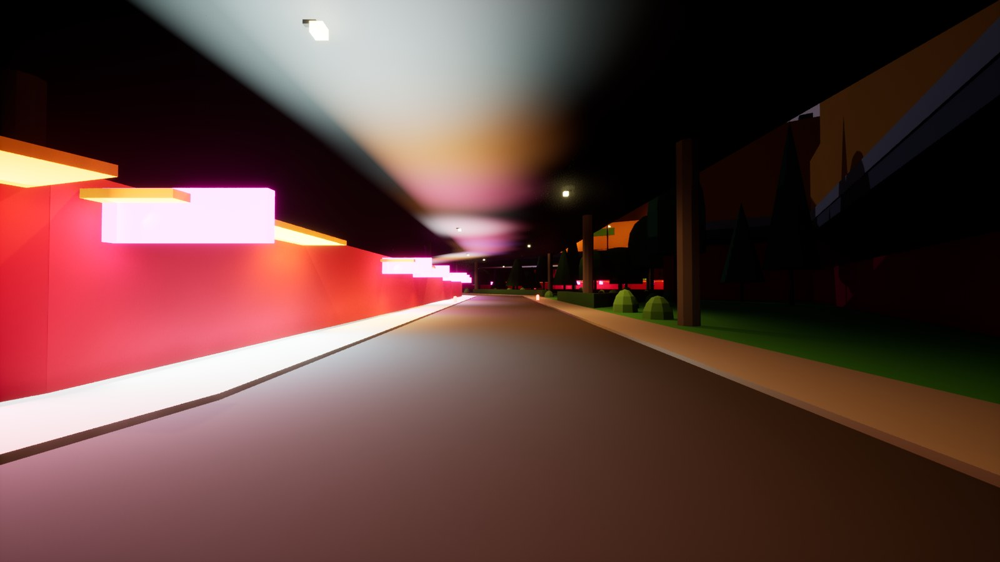 |
| **Dusk** | **Day (16:00): the overcast's haze** |
| 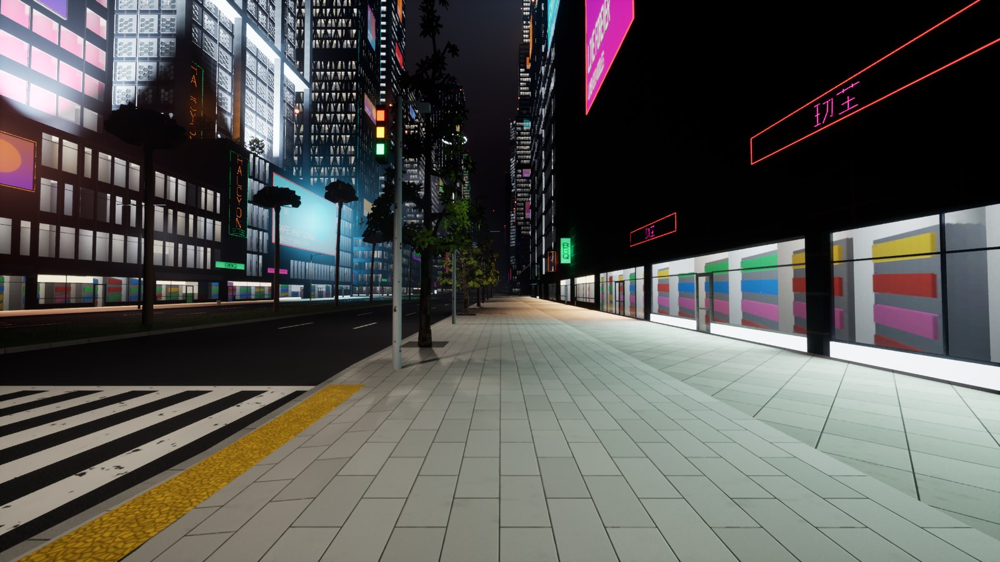 | 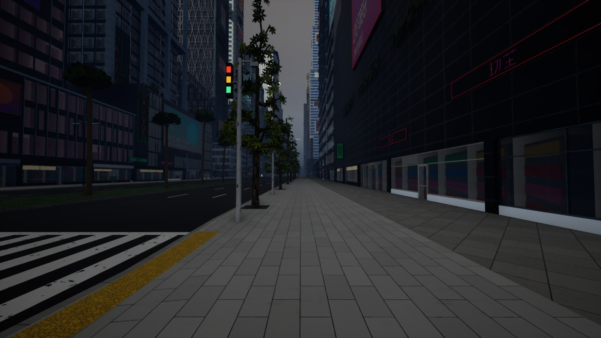 |

What they show:

- **The haze** takes every lamp and sign into a halo and fades the street 200 m off; the clean
  Corporate Core reads crisp near and soft far, Old Town's neon blooms into the air. From the
  air the falloff keeps it to the canyons: the city's lights read to the horizon.
- **Mist** lies on the water after dusk (thickest before dawn), glowing faintly with the city's
  light; **smog** is a brown layer over the port.
- **Steam** rises from the manholes in wisps, lit by the street (the plumes are rising cards:
  near the view they read best against a lit background, see the open items).
- **Searchlights:** the beams as before, a little brighter in the fog; their spot lights add
  no second beam.

**Rounds of art direction** (`wip/02_first_import`, `wip/03_tuning`; console commands per
round through `$CITYGEN_UE_ATMOS_CMDS`): the first import's fog (the weather's 0.018, AT0's)
did not read at street scale and the plumes and volumes did not show at all; the local fog
volumes' tile debug view and the plumes at a gain of 20 proved both drew, too faint; the fog
went 4.4 times denser with 3 times the volumetric extinction, the falloff to 0.4, the volumes 3
times denser with a glow of the city's light by night, the plumes' opacity gain 10.

## The night's frame time

Delta, native 2560 x 1440, the PC alone. **Before** is AT3's after (`docs/progress/AT3/bench/
after`) and this milestone's own before (`bench/before`: three runs on main's code, CityAG16 as
AT3 and the parked cars left it). **After** (`bench/after`) is **one run** (Swagnik,
2026-11-12: the benchmarks were too slow; the run held the game's foreground 99% of the time,
the other processes 1.1 cores, not starved); it was started before the lean route and ran the
full route with every pass.

| Pass | AT3 after | before (AT3 + cars) | after (AT4) | walk: AT3 / before / after |
|---|---|---|---|---|
| `night_native` | 11.2 | 13.1 | **11.6** | 10.8 / 13.3 / **11.3** |
| `night_plan` | 14.4 | 15.3 | **14.5** | 14.6 / 15.5 / **14.8** |
| `night_plan_air` (AT4's night) | - | - | **15.0** | - / - / **15.2** |
| `night_plan_all` (with AT0's rain and wet streets) | 16.4 | 17.1 | **15.6** | 16.8 / 17.4 / **15.8** |
| `night_plan_proto` (AT3's `night_plan_all`: no air, untuned) | - | - | 16.9 | - / - / 17.4 |
| `dusk_plan` | 14.3 | 14.9 | **14.4** | 14.5 / 15.1 / **14.6** |
| `dusk_plan_air` | - | - | **14.9** | - / - / **15.0** |
| `day_plan` | 11.1 | 11.7 | **11.2** | 10.7 / 11.2 / **10.7** |
| `day_plan_air` | - | - | **11.8** | - / - / **10.9** |

(ms, p95 of the moving frames over the route.) **AT4's night is 15.0 ms p95 over the route,
15.2 walking**; with AT0's rain and wet streets 15.6 and 15.8: 0.9 ms under decision 12.6's
16.7 ms, where AT3 was 0.1 over and the parked cars had taken it to 17.4 walking.

- **What the parked cars cost:** the night without atmosgen 11.2 to 13.1 ms (walking 10.8 to
  13.3), every pass 0.6 to 0.9 ms more, nearly all on the render thread: 3,431 cars in 4,354
  instanced components, the draw calls walking 860 to 1,843 (the render thread's p95 10.4 to 12.7
  ms, the GPU's 9.3 to 9.8). Their parts' cull distances (bodies 450 m, glass 250, wheels 120)
  took the draws back to 1,197 and the night without atmosgen to 11.6 ms (walking 11.3); a
  global LOD distance scale (`r.StaticMeshLODDistanceScale 2`) gave nothing.
- **The room the air needed** (`bench/explore`, one run, every pass with the air, rain and wet
  streets, each setting by hand): the volumetric fog's froxels 12 px a side and 96 slices deep
  (its pass 0.92 to 0.30 ms, the frame 0.6 ms), Lumen's reflections at half resolution (2.80 to
  1.60 ms walking: the wet streets' glossy ground; the frame 0.9 ms), both 1.5 ms; froxels of 16
  px gave 0.1 ms more and blocked the halos. They are the plan's `cvars`, applied by the
  controller while it runs (`TunedSettings`; the project's own put back at its end).
- **What the air costs:** `night_plan_air` against `night_plan` 0.5 ms over the route (the fog,
  24 local fog volumes, the plumes; the volumetric fog below the profile's top passes at its
  coarser grid); by day 0.6 ms. The four tuned settings make AT0's rain and wet streets 1.3 ms
  cheaper than in AT3 (`night_plan_proto` against `night_plan_all`).
- **A first after run that did not tune:** the controller's property was `RenderCVars`, which
  Unreal's Python names `render_c_vars`; the import set nothing and the settings were never
  applied (`night_plan_all` 16.9 ms). It is `TunedSettings` now, and the check's status says how
  many settings it applied (`cvars`).

## Validation

- `tests/atmosgen` (with the new `test_at_air.py`: volumes over the water, industry, decks and
  tunnels, plumes from their sources, the street packs' reader, only road pieces steaming, the
  air check, the settings, the plan's record), `tests/test_unreal_atmos.py` (cells with volumes
  and plumes, the controller's air), `tests/test_bench.py` (the air passes, the lean route),
  `tests/test_unreal_play.py`, the cook test of `tests/test_unreal.py`: 71 passed.
- The plan on Delta and Vesper Bay Decks: every check passes.
- Delta imported and checked in Unreal (CityAG16), the air's views by night, dusk and day;
  Vesper Bay Decks imported (its blockout) for the deck's haze; the benchmark after (one run).

## Open items

- **The plumes are faint from afar and against the dark:** rising cards lit by the translucency
  volume read near lit streets; a food stall's cooking (3 cards) hardly shows. A self-lit share
  by night or more cards per plume is AT6's art direction.
- **Vesper Bay Decks' deck haze is shot on its blockout** (a stage 2 import of a second city
  was hours); the haze is the same runtime.
- **Smog over the port** reads as a brown layer from the air; at street level it is the
  height fog's sodium haze. Its density and glow are art direction.
- **Fixtures asked of stage 2:** chimneys and stove pipes (the fifth ask) under the smoke.
- **Wet streets** remain AT0's decal (AT5); the tuned Lumen reflections are what make them
  affordable now.
