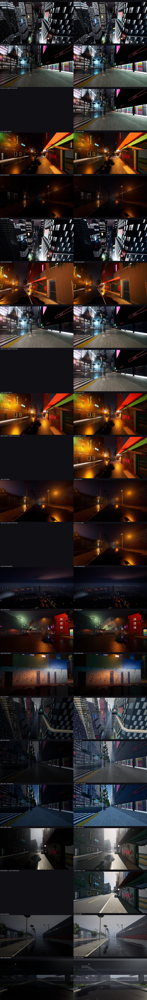

# Art direction (light and air): Delta Megacity, neon_rain, round 1 of at most 3

Checks: all passed (lux, faces, air, weather).

## Spec changes since the last round

- (first round)

## City

| Number | This round | Last round |
|---|---|---|
| look | neon_rain | - |
| hour | 23.0 | - |
| weather | rain | - |
| lights | 50300 | - |
| live (sight max) | 512 | - |
| sidewalk lx (avg) | 24.0 | - |
| crosswalk lx | 23.7 | - |
| carriageway lx | 14.8 | - |
| alley lx | 12.0 | - |
| under deck lx | - | - |
| exposure night (EV100) | -3 | - |
| exposure day (EV100) | -0.8 | - |
| overcast given back | 0.5 | - |
| deck glow (cd/m2, max) | 0.62 | - |
| fog volumes | 169 | - |
| plumes | 731 | - |
| puddled share | 0.0204 | - |
| covered share | 0.0304 | - |
| post bloom (night / day) | 1.0 / 0.5 | - |
| post flare (night / day) | 0.45 / 0.05 | - |
| post grain (night / day) | 0.12 / 0.05 | - |
| post chromatic (night / day) | 0.35 / 0.12 | - |
| post vignette (night / day) | 0.5 / 0.3 | - |
| post saturation (night / day) | 1.1 / 0.96 | - |
| post contrast (night / day) | 1.08 / 1.02 | - |

## Districts

| District | Archetype | Grit | Lamps | Neon | Flicker | Broken | Sidewalk lx | Carriageway lx | Post (night) | Tints |
|---|---|---|---|---|---|---|---|---|---|---|
| Transit Nexus | transit_hub | 0.3 | cobra_head led_cool | 0.9 | 0.045 | 0.018 | 14.7 | 12.0 | bloom 0.985, grain 0.1128, fringe 0.3325, sat 1.1, contrast 1.1005, lift 0.0008 | x(0.81 1.00 1.20), x(1.08 0.93 0.99) |
| Midtown | midtown_mixed | 0.21 | cobra_head neutral | 0.8 | 0.04 | 0.016 | 26.4 | 14.9 | bloom 0.9445, grain 0.0934, fringe 0.2852, sat 1.1099, contrast 1.1073, lift 0.0005 | x(0.87 0.99 1.14), x(1.08 0.93 0.99) |
| Corporate Core | corporate_core | 0 | cobra_head cool | 0.6 | 0 | 0 | 18.6 | 14.4 | bloom 0.85, grain 0.048, fringe 0.175, sat 1.133, contrast 1.1232, lift 0 | x(0.82 0.98 1.21), x(1.07 0.93 1.00) |
| Old Town | old_town | 0.955 | wall_pack sodium | 1.1 | 0.345 | 0.115 | 34.3 | 18.8 | bloom 1.2798, grain 0.2543, fringe 0.6764, sat 1.028, contrast 1.051, lift 0.0024 | x(0.87 1.08 1.03), x(1.21 0.91 0.89) |
| Industrial Port | industrial_port | 1 | high_mast sodium | 0.3 | 0.24 | 0.12 | 11.2 | 9.61 | bloom 1.3, grain 0.264, fringe 0.7, sat 1.023, contrast 1.0476, lift 0.0025 | x(0.98 0.98 1.00), x(1.28 0.89 0.84) |
| Research Campus | research_campus | 0 | post_top neutral | 0.3 | 0 | 0 | 8.57 | 10.2 | bloom 0.85, grain 0.048, fringe 0.175, sat 1.133, contrast 1.1232, lift 0 | x(0.83 1.00 1.17), x(1.07 0.93 0.99) |

## Shots

Exposure as the eye reads it: the mean log luminance in stops from middle grey (a night street sits near -4 to -2.5, a day street near -2 to -1), the share clipped and crushed, the mean saturation.

| Shot | Stops | Median | Clipped | Crushed | Saturation | Last round (stops) |
|---|---|---|---|---|---|---|
| dusk_air | -4.00 | 0.0116 | 0.002 | 0.237 | 0.374 | -4.41 |
| dusk_core | -3.02 | 0.0615 | 0.003 | 0.182 | 0.295 | -3.55 |
| dusk_core_nopost | -2.87 | 0.0600 | 0.003 | 0.177 | 0.202 | - |
| dusk_oldtown | -2.82 | 0.0216 | 0.001 | 0.042 | 0.747 | -3.65 |
| dusk_port | -6.34 | 0.0019 | 0.000 | 0.403 | 0.674 | -7.86 |
| night_air | -4.91 | 0.0042 | 0.006 | 0.322 | 0.499 | -4.24 |
| night_awning | -3.19 | 0.0224 | 0.000 | 0.045 | 0.744 | -2.77 |
| night_core | -3.12 | 0.0453 | 0.009 | 0.194 | 0.308 | -2.60 |
| night_core_nopost | -2.60 | 0.0605 | 0.009 | 0.169 | 0.214 | - |
| night_oldtown | -2.84 | 0.0262 | 0.001 | 0.046 | 0.802 | -2.49 |
| night_oldtown_nopost | -2.48 | 0.0313 | 0.001 | 0.040 | 0.796 | - |
| night_port | -5.07 | 0.0053 | 0.000 | 0.168 | 0.711 | -4.74 |
| night_port_nopost | -4.74 | 0.0076 | 0.000 | 0.136 | 0.710 | - |
| night_portsmog | -5.98 | 0.0031 | 0.000 | 0.305 | 0.431 | -5.82 |
| night_stall | -4.42 | 0.0066 | 0.000 | 0.120 | 0.616 | -4.12 |
| night_steam | -4.17 | 0.0088 | 0.000 | 0.214 | 0.486 | -3.77 |
| pday_air | -1.60 | 0.0688 | 0.000 | 0.021 | 0.302 | -5.14 |
| pday_core | -1.97 | 0.0498 | 0.000 | 0.000 | 0.260 | -6.25 |
| pday_core__clear | -2.11 | 0.0629 | 0.000 | 0.003 | 0.577 | -5.24 |
| pday_oldtown | -1.78 | 0.0410 | 0.000 | 0.000 | 0.153 | -5.61 |
| pday_oldtown__clear | -2.10 | 0.0383 | 0.000 | 0.021 | 0.268 | - |
| pday_port | -1.02 | 0.0907 | 0.000 | 0.000 | 0.115 | -4.51 |
| pday_viaduct | -2.52 | 0.0309 | 0.000 | 0.000 | 0.138 | -6.93 |

## Previews to open

- `preview_post.png`: the districts' post by grit and each district's grade on a chart
- `preview_lux.png`: the light on the ground round the core, by night
- `preview_plan.png`: every light by kind over the city
- `preview_sky.png`: the deck's glow; the sun, the moon and the exposure by the hour
- `preview_air.png`: the fog volumes and the plumes
- `preview_weather.png`: the rain shadow, puddles and drip bands

## If something reads wrong, change the atmos spec (never the code)

| What you see | Spec parameters |
|---|---|
| the whole city too wet, too clear, the wrong hour or season | `preset, weather, hour, sky.day_of_year, sky.latitude_deg` |
| a street too dark or too bright by night | `light_levels.<class>, light_levels.night_ev100` |
| the day too dark or too bright (under rain most of all) | `post.day_ev_bias, post.overcast_comp` |
| the grade's color off (neon rain: teal shadows, magenta highlights) | `post.shadows, post.highlights, post.tint, post.saturation, post.contrast` |
| too much or too little glow round the lights | `post.bloom, post.flare` |
| too much or too little film grain or fringing | `post.grain, post.chromatic, post.vignette` |
| a district too clean or too gritty for its place | `districts.<name>.grit` |
| a district's tint (cool core, sodium old town, magenta market) | `districts.<name>.shadows, districts.<name>.highlights, districts.<name>.tint` |
| the wrong lamps or light colour in a district | `districts.<name>.lamp, .temp, .spill` |
| too few or too many lit signs, too much flicker or too many dead lights | `districts.<name>.neon, .flicker, .broken` |
| alleys too lit or too dark | `districts.<name>.alleys` |
| haze too thick or too thin in a district | `districts.<name>.haze` |
| towers' crowns unlit or too many searchlights | `districts.<name>.floods, .searchlights, landmarks.<name>` |
| the moon, the stars or the cloud deck | `sky.moon, sky.stars, sky.cloud_deck_m, sky.cloud_cover, sky.cloud_glow` |
| the rain leaning the wrong way | `wind_deg` |
| a district's neon colours | `districts.<name>.palette, palette.neon` |

Then `atmosgen plan` again, import the plan (`citygen unreal BUILD UPROJECT --atmos DIR`), shoot the same views (`--check-only --shots`) and review with `--prev` and `--prev-shots`. Stop when the checks pass and the shots match the prompt, or after the last round; say what is still off.
