# AT7: far city and release (atmosgen)

Stage 3's last milestone (`docs/atmosgen_scope.md` sections 6.6 and 13): the skyline at night
(the far city must glitter, not go gray), the plan's budgets on every sample city and demo,
Unreal checks on the PC, and the release docs. Built on the Windows PC (RTX 4070 Ti, 32 GB),
2026-11-13, on main after AT6 (#218).

## What AT7 built

| Part | Where | What |
|---|---|---|
| Far cards | `atmosgen/far.py`, `presets.FAR`, the plan's `far`, `far/<tile>.json` | past the live set a light is no light at all; every light the far view sees gets cards by its photometric class: a **glow** at its lens turned to the eye (a share of its intensity: a cobra head 0.3, a post top 0.5, an aviation light all of it, blinking as it does), a **pool** on the surface a light aimed down lights (the walkways and lanes within 4 m of its middle, a raised road's deck too, else the ground; its luminance at the middle $E_0 \rho / \pi$ with $E_0 = I \cos^3\tau / h^2$, falling off as a point light's illuminance does, $(1 + (r/h)^2)^{-3/2}$, to $h \tan 70^\circ$ or its reach), a **wash** on the facade a crown flood or uplight lights (the class's design illuminance times the facade's albedo over $\pi$, as wide as the cone there and as tall as the lit zone); broken lights have none |
| What needs no card | (AG16) | lit windows, signs, neon, LED strips and logos are emissive surfaces the instanced HLODs keep past World Partition's loading range (each building's Custom Primitive Data as per-instance data); soffit, tunnel and platform lights are under their covers |
| The cloud glow | (AT3) | the deck lit from below by the plan's upward light, seen over the far city |
| The far check | `far.check`, the plan's `checks.far` | every street-lighting lamp with its pool or a reason (broken, too low over its surface), every aviation light with its glow, every card's numbers finite and positive, at most 3,000 cards a 256 m tile; a plan that fails it is not delivered |
| Preview | `far.preview`, `preview_far.png` (`atmosgen lux`) | the cards over the city from above and from 150 m over its corner past 300 m, at the plan's exposure |
| Budgets across cities | `atmosgen/budgets.py`, `atmosgen budgets PLAN... --out DIR` | plan time, checks, lights by tier, far cards, the most per tile against each budget, and near the view the most lights on within each live range against what the runtime keeps live |
| Exporter | `citygen/unreal_atmos.py` (`pack_far`, `far_settings`), `ue/import_city.py` (`atmos7`) | packing version 5: a cell holds the far cards whose middle lies in it (12 floats and an int); the controller's `bFar`, `FarGain`, `FarPx`, `FarFade`, `FarSpread`; the manifest's `atmos.far` |
| Runtime | `ue/CityGenAtmos` (`RebuildFar`, `UpdateFarParams`, `UpdateFarLevels`) | the cells' cards instanced per 1 km block (Delta: 22,600 cards in 13 blocks, built in 25 ms); `MPC_CityGenAtmos`'s `FarScale` (the lights' own exposure scale, 0 by day), `FarMidM`, `FarHighM`, `FarFixM` (where each tier's cards fade in: the walker's 1,200 m by sight, the circle's 300 m, the high tier's 750 m, the beacons' 832 m), `FarPx` (two pixels per distance), `FarSpread`; each card's level its schedule's at the hour; they replace the play features' light pools; console `CityGenAtmos.Far`, `.FarGain` |
| Materials | `ue/atmos_assets.py` (versions 18, 19) | `M_CgFarGlow` and `M_CgFarFlat`, additive and unlit; a card faded out, off by its schedule or by day collapses to a point by world position offset (no pixel cost) |
| Check and benchmark | `ue/check_city.py`, `citygen/bench.py` | the far city drawn and shown by night, none by day; `*_nofar` views (the same view's before); every atmos pass sets `CityGenAtmos.Far 1`, `night_plan_nofar` without |
| Cragmouth's mist | `atmosgen/air.py` (`_surface_of`) | the plan failed on the terrain sample: M16 leaves a body's `surface_m` unset on a terrain city; the mist now stands on M13's water level, along a river's profile |

## The far city on Delta

The same viewpoints without the far cards (`_nofar`: the play features' light pools past the
live range, AT6's far city) and with them, from the check's free camera (the circle: cards
from 240 m) at 1920 x 1080. Left before, right after.

**From 150 m over the port** toward the Corporate Core, 2.2 km away: the port's streets and
yards lit to the horizon where only the nearest pools were, the core's crowns washed in their
LEDs' colors:

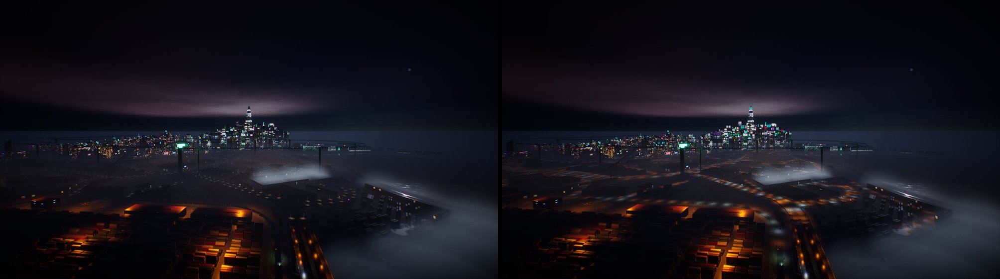

**From 400 m over the south-west corner**: the whole city's street grid picked out:

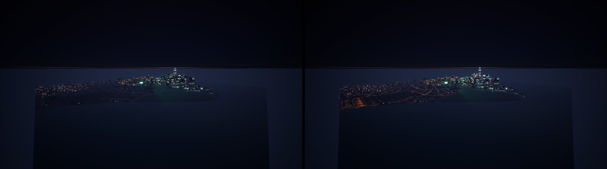

**From the sea**, 1.6 km south of the core, the haze of neon rain between:

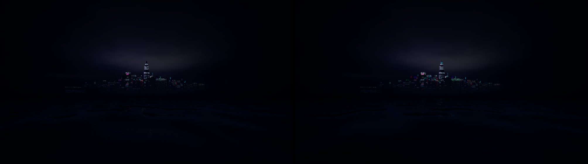

**The benchmark's flight at 150 m** (AT6's shot and AT7's, the same route and moment):

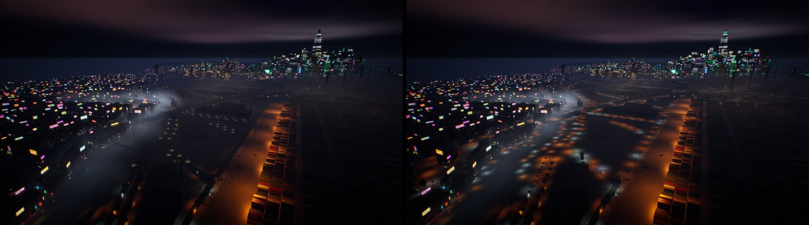

| | Without the far cards | With them |
|---|---|---|
| A port street by the river, the core 1.1 km off (by sight, as a walker) | 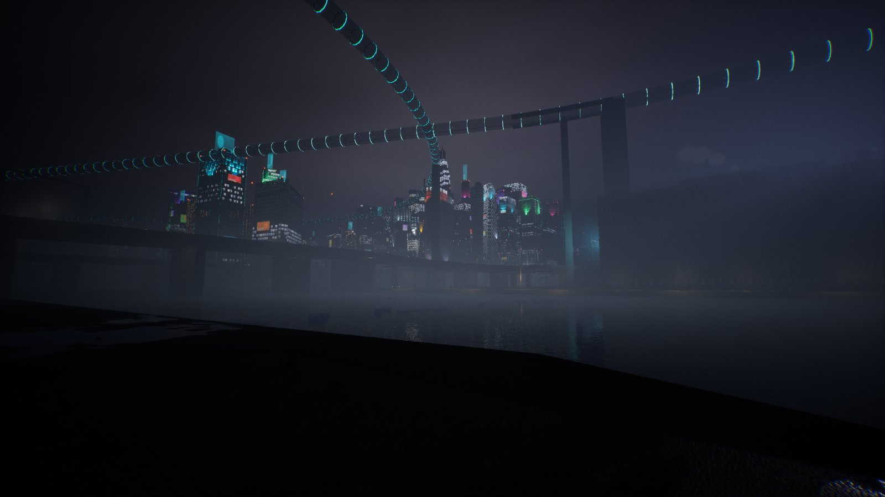 | 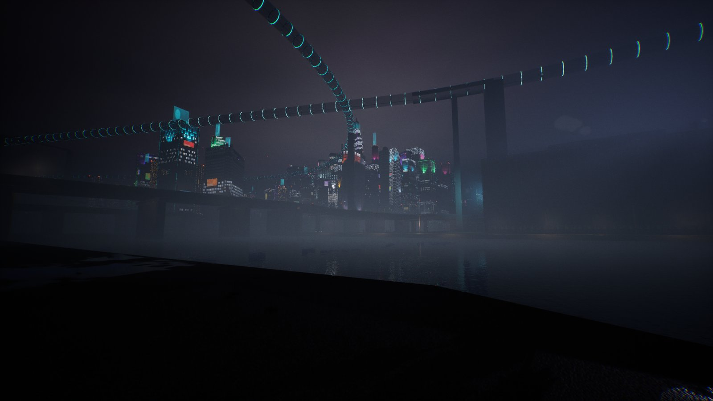 |
| Dusk from 150 m over the port | 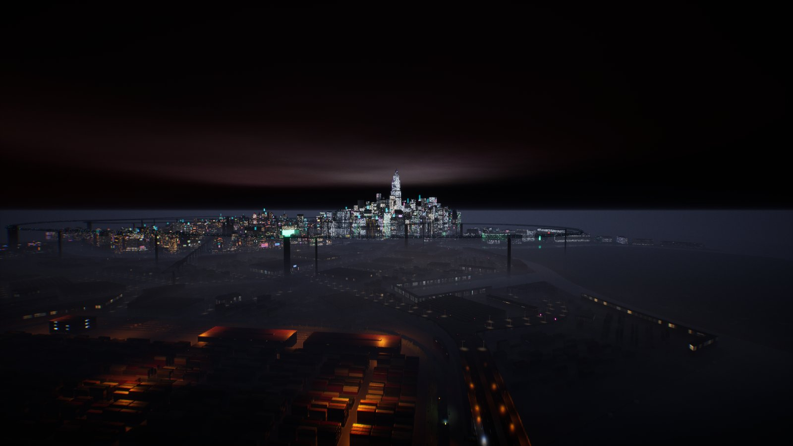 | 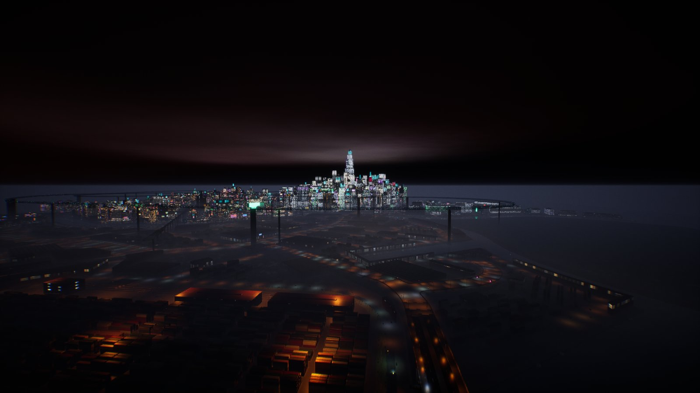 |
| Dusk from the sea | | 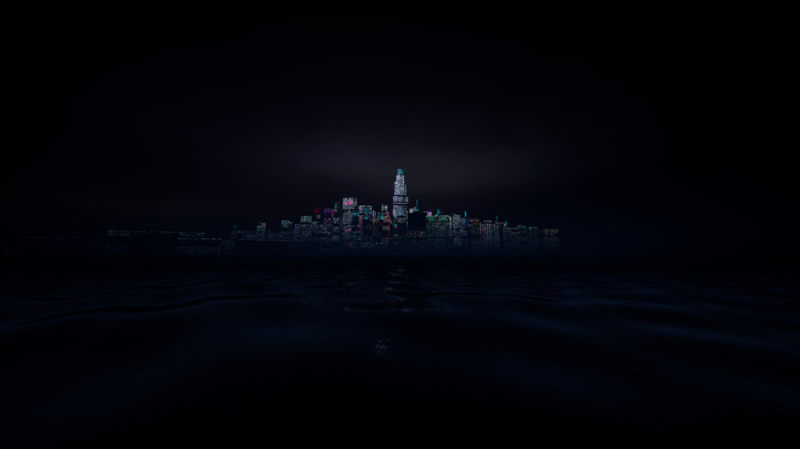 |
| By day (no card shows) | | 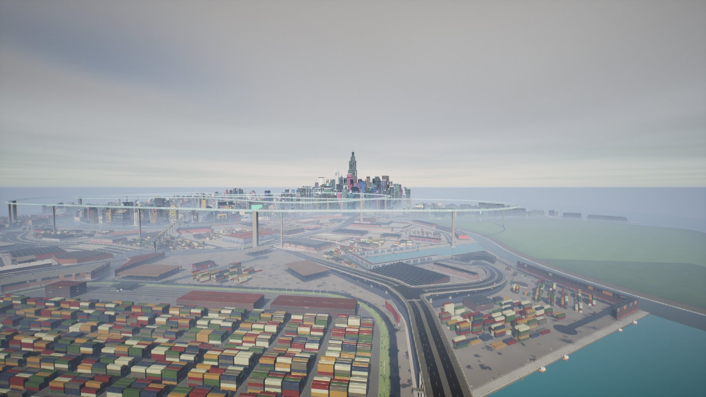 |

What they show:

- **The far streets read lit.** Past the live set the streets were dark between their windows
  (the play features' pools only under the 768 lamps nearest past the live range); now every
  lamp's pool and glow is there to the city's edge, sodium in the port and Old Town, white in
  the core, the highways' columns drawing their lines.
- **The skyline keeps its emissive.** The windows, signs and neon of the far towers are the
  HLODs' own (AG16); the crowns take their floods' washes past the high tier, aviation lights
  blink red past the beacons' 832 m.
- **On foot nothing changes within 1,200 m:** by sight the live set reaches that far, and the
  cards fade in only past it (the street view's core is 1.1 km off: the same before and after).
- **The first round** drew the far crowns as white blocks (`wip/02_first_import`: the facade's
  albedo 0.35 and a square profile); 0.08 and a soft profile (`wip/03_soft_washes`) read as
  lit crowns.

## Budgets on every sample

`atmosgen plan` on every sample and demo built from main (the play fixes' builds,
`builds/fix_play_cars/samples`; stage 2 only on Delta, the others derive their emitters from
citygen), then `atmosgen budgets` (`plans/budgets.md`, `budgets.json`; each city's
`plans/<city>_preview_far.png`). Every check passes on every city:

| City | Plan (s) | Lights (near / mid / high) | Far cards (glow / pool / wash) | Most in a tile: lights, volumes, emitters, drips, far cards (budget) | Most near the view: mid 300 m, shadowed 60 m, high 750 m, sight 1,200 m (kept live) |
|---|---|---|---|---|---|
| Vesper Bay | 54 | 46,780 (14,717 / 31,275 / 788) | 21,016 (11,151 / 9,148 / 717) | 1,271 / 6,000, 7 / 24, 14 / 400, 877 / 4,000, 375 / 3,000 | 5,130 / 512, 40 / 16, 693 / 48, 22,397 / 512 |
| Nexus City | 52 | 54,451 (17,084 / 36,257 / 1,110) | 23,379 (12,109 / 10,224 / 1,046) | 1,381, 8, 15, 583, 357 | 5,083, 35, 798, 35,788 |
| Greyhook | 44 | 26,880 (8,217 / 18,395 / 268) | 14,161 (7,599 / 6,328 / 234) | 1,203, 4, 7, 495, 247 | 4,915, 30, 147, 19,528 |
| Saltreach Free Port | 37 | 27,505 (8,474 / 18,027 / 1,004) | 14,072 (7,325 / 5,773 / 974) | 1,516, 6, 16, 491, 369 | 5,913, 37, 935, 22,627 |
| Vesper Bay Pinned | 48 | 47,959 (15,295 / 32,582 / 82) | 19,921 (10,727 / 9,170 / 24) | 1,529, 7, 16, 507, 362 | 5,326, 41, 36, 23,176 |
| Vesper Bay Stacks | 49 | 48,022 (15,355 / 32,585 / 82) | 19,964 (10,679 / 9,261 / 24) | 1,422, 7, 19, 688, 364 | 5,436, 42, 36, 23,119 |
| Vesper Bay Decks | 54 | 51,337 (15,840 / 34,709 / 788) | 21,470 (11,378 / 9,375 / 717) | 1,271, 8, 14, 1,115, 375 | 5,130, 40, 693, 25,296 |
| Cragmouth | 50 | 57,031 (17,681 / 38,535 / 815) | 22,023 (11,460 / 9,770 / 793) | 1,326, 5, 14, 996, 371 | 5,426, 43, 631, 41,955 |
| Delta Megacity | 69 | 50,300 (15,330 / 33,414 / 1,556) | 22,600 (11,653 / 9,440 / 1,507) | 1,531, 7, 24, 722, 359 | 5,830, 43, 993, 30,368 |

- **Per tile** every city is far under every budget: at most 1,531 lights of 6,000, 8 fog
  volumes of 24, 24 emitters of 400, 1,115 drip lines of 4,000, 375 far cards of 3,000.
- **Near the view** the runtime's caps bind (they are what keeps the night at its frame time):
  up to 5,900 lights on within 300 m of a point against the 512 kept live (the nearest), 43
  that may cast shadows within 60 m against 16, up to 993 high-tier lights within 750 m against
  48, and tens of thousands within a walker's 1,200 m against the 512 it sees. The share of the
  city where each binds is in `budgets.md`.
- **Plan time:** 37 to 69 s a city (Delta the longest: the weather's masks most of it).
- **Cragmouth failed at first** (the terrain sample): AT4's mist read M16's `surface_m`,
  which a terrain city leaves unset; fixed above. Its plan and every check pass now.

## Unreal

**What was imported:**

- **Delta Megacity** over AT6's import in CityAG16 (`citygen unreal ... --atmos DIR --no-hlod`,
  `CITYGEN_UE_OFFLOAD=500`): the plugins built (18 s), atmosgen's assets made again (version 18,
  then 19 for the soft washes), the controller and the 518 cells updated by `atmos7`, nothing
  else touched, 3 min 23 s. HLODs untouched (no mesh changed).
- **Vesper Bay** (the AG16 sample build with stage 2, `builds/ag16/vesper_bay`, copied under
  `builds/at7`) into a fresh throwaway project of its own (`--new-project`, CityAT7Check) with
  its own plan (every check passing, 21,009 far cards) and the HLODs. The first try was
  stopped by this session's disk watchdog in the actors stage: the editor's memory reached 46
  GB committed, the pagefile took the disk under 15 GB. Again with `CITYGEN_UE_OFFLOAD=150`
  (the meshes it had imported kept) it passed: 14,482 actors, 789 HLOD actors built (5 min
  29 s), 10 min 44 s. Its check passes (streaming, collision, the walk, the play features,
  the sky, the air, the weather, the look, and the far city: "11130 glows and 9879 pools and
  washes of 21009 cards in 13 blocks (built in 26 ms), shown True by night"). One lean night
  run (`bench_vesper_bay/`, not flagged): **14.6 ms p95** over the route (walk 13.3, drive
  15.6, fly 12.4; GPU 13.6). The project and the build's copy were deleted after.
- **Not imported:** the other samples and demos (no stage 2 build from main; importing each
  would take hours); their plans and checks above stand for them.

**Vesper Bay** from 150 m over Vess Docks toward its Corporate Core, without the far cards and
with them:

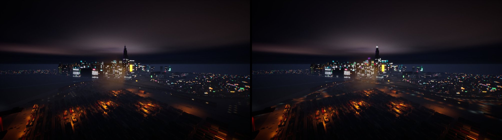

and from 400 m over its south-west corner:

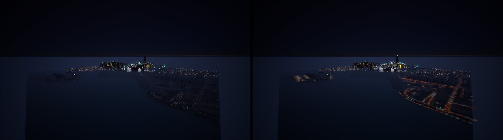

**Delta's check passes** by night, dusk and day (streaming, collision, the walk, the play
features, the sky, the air, the weather, the look) and the far city: "11653 glows and 10947
pools and washes of 22600 cards in 13 blocks (built in 25 ms), shown True by night, past 1200
m (high 1200, beacons 832)"; by day none shown.

## The night's frame time

The lean benchmark once (`--bench-atmos`, decision 12.6; `bench/`): `night_plan_all` (the far
cards on, with the rain, air, wet streets and the look) on the lean route at 2560 x 1440, the
flight at 150 m being where the far city shows most. Not flagged: the game held the foreground
throughout, the other processes 0.28 cores on average. No rerun: more than 0.3 ms under the
budget. **Before** is AT6's after (#218, `docs/progress/AT6/bench`).

| Route | p95 before (AT6) | p95 after | GPU p95 after | p50 after |
|---|---|---|---|---|
| walk | 15.2 | **14.8** | 13.4 | 13.3 |
| drive | 15.2 | **14.9** | 13.5 | 13.3 |
| fly | 15.8 | **15.2** | 11.9 | 11.6 |
| all | 15.4 | **15.0** | 13.3 | 12.7 |

(ms.) **The night is 15.0 ms p95 over the route, 1.7 ms under decision 12.6's 16.7 ms**, the
flight 15.2 (its p95 the game thread's, 14.4 ms, the streaming, as in AT5 and AT6). The far
cards cost nothing measurable: the play features' 768 light-pool decals they replace were
deferred decals, the cards a few thousand tiny additive quads past the live range, and every
card not shown collapses to a point. Within one run's spread of AT6's, so no GPU profiles
were needed for tuning.

## Validation

- Tests (logged, `-v -rfE --durations=25`): `tests/atmosgen/test_at_far.py` (new: the cards
  of the plan, a flood's wash, aviation glows and broken lights, a pool on a raised deck, the
  budget check, the preview's intensity, the budget table), `tests/atmosgen/test_at_plan.py`
  (the schemas), `tests/atmosgen/test_at_air.py`, `tests/test_unreal_atmos.py` (the far cards
  in the cells), `tests/test_bench.py` (the far passes).
- Every sample's and demo's plan (above); Delta imported and checked in CityAG16 by night,
  dusk and day with the skyline views; the lean benchmark once; Vesper Bay imported into a
  fresh project and checked.

## The packaged game

PACKAGE_RESULT

## Open items

- **Lights within the live range but past its cap** (the circle's 512 nearest within 300 m in
  a dense district reach 100 m or less) are dark and have no card (the cards fade in from the
  range's edge, not from where the set ends); a card per unpicked light would need the live
  set's state in the material.
- **Washes are rectangles on a facade's plane**; on a curved or stepped crown they cut across
  the form's edge where it turns. A wash card per crown face with the form's outline would
  follow it.
- **Glows are seen through nothing at night but the depth buffer:** a far lamp behind a low
  roof that the HLOD's simplified mesh leaves out shows through; the HLODs keep the shells, so
  this is rare.
- **The sea view at 1.6 km** is dim in neon rain (the rain's fog over the water): the far city
  reads as glitter, not a lit skyline; a clear night shows more.
- **The cloud glow** is AT3's raster at 23:00, scaled by Night (AT3's open item: shops closing
  after midnight do not dim it).
