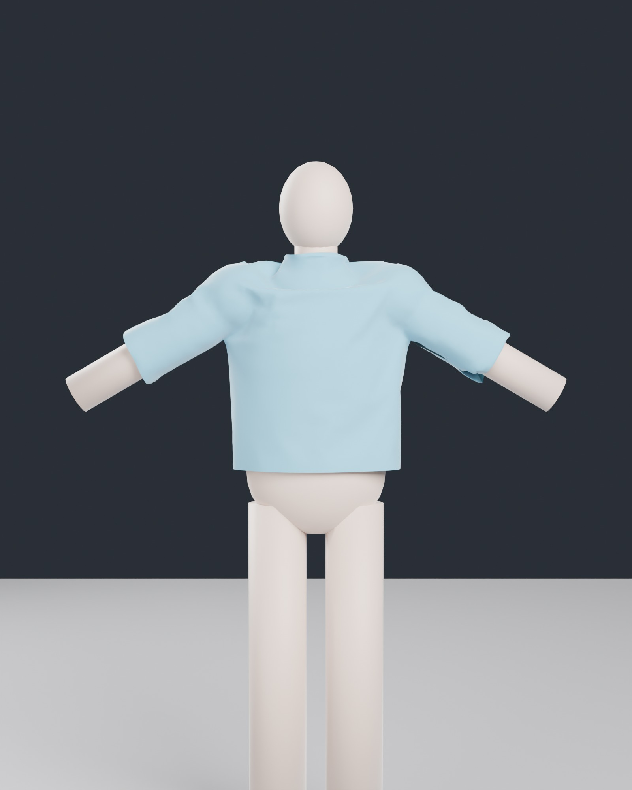
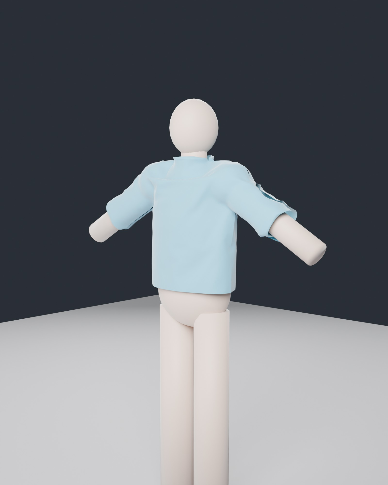

# LG0: groundwork and spike (lifegen)

Stage 4's first milestone (`docs/lifegen_scope.md` section 13): the contract (the life spec
and styles, the plan's format, the asks of citygen, the `CityGenLife` plugin's skeleton built
by the exporter, ZoneGraph lanes built from the city's own graphs), a spike on one district
of Delta Megacity measured against the benchmark, probes of what Unreal 5.8 lets a script do
for people (MetaHuman, Mutable, retargeting, the engine pieces' maturity) and a garment
draped in Blender's cloth solver. Built on the Windows PC (RTX 4070 Ti, 32 GB, UE 5.8) on
2026-11-13, on main after AT7, the play fixes and the showcase (#221).

Swagnik's decisions of 2026-11-13 (scope section 12) set the frame: a generator of the plan
and a library with the `CityGenLife` plugin on Mass, ZoneGraph, Smart Objects and StateTree;
MetaHuman bodies if 5.8 can be driven from a script; generated garments with a kit out of the
repo as the fallback; Epic's Game Animation Sample near the view and free mocap for the rest;
nothing in the repo unless anyone may use it; **the fleet is AG18's hand-designed vehicles**;
**a 20 ms p95 frame budget** with no tuning rounds unless a milestone goes over it; stepping
aside and looking first.

## What LG0 built

| Part | Where | What |
|---|---|---|
| Life spec and presets | `lifegen/spec.py`, `presets.py`, `schemas/life_spec.schema.json` | per district its people (busy, residents, workers, visitors, the day's shape within M11's hour bands), style (fashion groups, their colors, cyberware, wear by wealth and danger), fleet (AG18's models by the parked cars' table); transit, air, water, budgets (20 ms p95, 2,000 people and 500 vehicles within 300 m), reactions, the spike |
| Plan format | `lifegen/planmodel.py`, `schemas/life_plan.schema.json`, `tile_spawns.schema.json`, `contribution.schema.json` | `life_plan.json`, `spawns/<tile>.json`, `unreal_contribution.life.json` (layer 4), every entry hashed |
| The plan | `lifegen plan BUILD`, `lifegen/plan.py` | people, vehicles, gang members and police per district and hour; spawn and sink points with rates by hour; place slots; the spike; checks; `preview_crowds.png` |
| Asks of citygen | `lifegen/asks.py` | signal phases and timing, bus routes, turn restrictions, lobby points, piers, air corridors (and of assetgen: doors, met; AG18's missing kinds) |
| Runtime plugin | `citygen/ue/CityGenLife` | the controller: ZoneGraph lanes from the graphs, people and cars as Mass entities moved by two Mass processors, instanced stand-ins and AG18's car parts |
| Exporter | `citygen/unreal_life.py`, `import_city.Importer.life_controller`, `--life`, `--no-life` | the manifest's `life`, `BUILD/unreal/life.json`, the controller placed with the spike, the stand-in material |
| Probes | `lifegen/probes/plugins.py`, `ue_probe.py`, `cmu_style.py` | the engine pieces' maturity; MetaHuman Creator, Mutable and retargeting from Python |
| Garment test | `lifegen/blender/garment_test.py` | a tee of two flat panels sewn and draped on a plain body, headless, baked, rendered |

## The plan on Delta

`lifegen plan` on Delta (the play fixes' build), an empty spec: 2 to 3 s, 131 tiles.

6,789 spawn points (5,470 main and 1,081 service building entrances and the loading docks
and garages, the station stairs, the garages' and lots' entrances, the taxi stands), 688
place slots, all on the walkway graph and all in one walkway component; 58,189 people and
3,394 vehicles on the streets at the peak hour. Every check passes
([`plan/life_report.txt`](plan/life_report.txt)).

| District | People at 23:00 | People at the peak | Vehicles at the peak | Spawns | Slots |
|---|---|---|---|---|---|
| Transit Nexus | 2,060 | 6,042 | 461 | 163 | 58 |
| Midtown | 5,421 | 10,685 | 771 | 899 | 86 |
| Corporate Core | 1,664 | 8,785 | 971 | 291 | 191 |
| Old Town | 23,373 | 33,786 | 931 | 5,130 | 191 |
| Industrial Port | 480 | 2,692 | 698 | 249 | 120 |
| Research Campus | 147 | 1,672 | 118 | 54 | 41 |

The day's shape is held within M11's five hour bands (each band keeps M11's density), so the
curves step where the bands meet (Old Town from 30,000 at 19:00 to 14,000 at 20:00): M11's
densities are per band, and smoothing across bands is LG3's to decide (it would move the
bands' means). Old Town has 23,373 people on its streets at 23:00, twelve times the budget's
2,000 within 300 m: the plan's people are spread over the whole 2 km district, so LG3 spawns
by tile and view (the budget is per view, not per district).

**The asks of citygen** (`lifegen/asks.py`; status on Delta):

| Ask | Needed by | On Delta | Meanwhile |
|---|---|---|---|
| Signal phases and timing per signalized junction | LG3, LG5 | derived | two phases from the legs' angles, every crosswalk across the stopped legs, a 60 s cycle |
| Bus routes and their stops | LG5 | missing | M6's 86 bus stops are there, no route joins them |
| Turn restrictions | LG5 | derived | every connector lane allowed |
| Lobby points behind main doors | LG3 | derived | people go in 1.5 m behind AG3's door |
| Piers for ferries and water taxis | LG7 | missing | M16's quays and AG7's quay stairs; no berth named |
| Air corridors | LG7 | derived | layers over the avenues and highways |
| Doors with their walkways (assetgen) | LG3 | met | AG3's doors |
| AG18's missing kinds (assetgen) | LG5, LG7 | derived | cars, taxis, vans and pickups from the 15 packs |

## The spike: Delta's Old Town in Unreal

**Setup.** Delta as the play fixes left it in CityAG16 (`builds/fix_play_cars`, its atmos
plan), imported again over that import with the life plan (`--life`): the import placed one
actor (`life`) and updated nothing else of the city but AT7's atmos cells, whose hashes moved
with main. The spike is Old Town (the benchmark's lean walk district, the one with the most
buildings) at 23:00: **2,000 stand-ins** (the budget's people, of Old Town's 23,373 on its
streets at that hour) on the walkway lanes within 450 m of its middle, densest round the
middle (a lane's share falling as $1 / (1 + (d / 150\,\mathrm{m})^2)$), and **40 cars** of
nine of AG18's models (the Tanager Mino, Cab and Porter, Brakk's three, the Halcyon Ridge,
Orrin Lumen and Pebble, by Old Town's weights), painted by step H's rule. At BeginPlay the
controller builds **11,340 ZoneGraph lanes** (5,831 walkway lanes, 5,509 drive lanes and
connectors) from `graphs.json` in 14 to 30 ms, then makes 2,040 Mass entities.

The stand-ins walk the walkways both ways at 1.15 to 1.55 m/s, keeping (mostly) right across
each walkway's width, turning onto the walkways their end meets (not back the way they came
unless it is a dead end), turning back at the live region's edge; the cars drive the lane
graph at 25 to 40 km/h, slowing to keep 9 m behind the car ahead on their lane and the one
they go to next, and start again on a lane of the region at a dead end or its edge. There are
no signals yet (LG5) and no avoidance between people (LG3).

| By day (a market street in Old Town) | By night |
|---|---|
|  |  |
|  |  |

(`unreal/`: the check's free camera views, `--view pday_* / night_*`; the stand-ins are a
cylinder and a sphere in their district's clothing colors, the cars AG18's packs.)

### What it costs

AG16's benchmark, the lean route (Old Town's walk, the drive, the flight at 150 m), one run,
`--bench-atmos` with `night_plan_all` (the night as delivered: the plan's lights, fog, air,
rain, wet streets, post, far city), standalone game at 2560 x 1440 native, on the PC with
nothing else heavy running (others under 1 core). ms; p95 of the moving frames.

**Before and after** (`bench/before`: the project before the import with the life plan;
`bench/final`: after it, as delivered):

| `night_plan_all` | p95 all | walk | drive | fly | game p95 (walk) | GPU p95 (walk) | draws p50 (walk) |
|---|---|---|---|---|---|---|---|
| before (no life) | 15.1 | 14.9 | 14.9 | 15.5 | 13.8 | 13.5 | 492 |
| after (2,000 stand-ins, 40 cars) | **16.6** | **16.6** | 15.4 | 17.3 | 16.5 | 14.2 | 1,519 |

Under the 20 ms budget (decision 12.7) everywhere: **+1.5 ms all, +1.7 ms walking among the
crowd**. Within one game process, the `night_life*` passes (`bench/final`, the same route
each) part it:

| Pass | p95 all | walk | fly | game p95 (walk) | GPU p95 (walk) | Lumen scene update (walk) |
|---|---|---|---|---|---|---|
| `night_life_off` (the spike hidden, not moving) | 15.2 | 15.6 | 15.2 | 15.2 | 13.6 | 0 |
| `night_life` (as delivered) | 16.8 | 18.1 | 17.0 | 17.7 | 14.3 | 0 |
| `night_life_noshadow` (no shadows from people and cars) | 16.7 | 18.0 | 17.0 | 17.8 | 13.8 | 0 |
| `night_life_lumen` (in Lumen's scene, render state rebuilt each frame: the first build) | 23.6 | 25.2 | 18.1 | 21.3 | 23.9 | 8.2 |

(The first import's build, `bench/after` and `bench/tuning`: walk 26.3 ms with every move
recreating the components' render state, which put the moving instances through Lumen's
scene update; 19.1 ms without the rebuild but still in Lumen's scene, 1.4 ms of it.)

- **The game thread pays most of it:** about 2.5 ms at the walk's p95 (the controller's own
  tick, the two Mass processors and the instance updates, is 1.0 to 1.8 ms a frame by its
  status line; the rest is the engine's instance data and GPU scene upload for 2,000 bodies,
  2,000 heads and 40 cars' 6 parts each, moved every frame). The walk becomes game-bound.
- **The GPU pays 0.6 ms** (shadow depths 1.5 to 1.7 ms: the stand-ins' shadows cost
  0.5 ms), once the people are out of Lumen's scene and their render state is not rebuilt.
- **What it means for LG3:** 2,000 plain instanced stand-ins within 300 m fit the budget
  with 3.4 ms to spare walking; real characters cost far more per person (skinning, more
  draws), so LG1 and LG3 need the LODs of scope 6.1 (full characters only near, cheap
  instanced or baked ones beyond), and moving far instances less often.

**The cars.** 40 cars over Old Town's 1,404 lanes a car may start on are few to the eye in
the shots, Old Town's narrow streets mostly hidden between its buildings from above. A check
run with `CityGenLife.Respawn 2000 400` (`CITYGEN_UE_ATMOS_CMDS`; the status line logs 400
cars and 2,400 entities) shows them on the streets round the middle
([`unreal/pday_traffic_400cars.jpg`](unreal/pday_traffic_400cars.jpg), a car in the street
in [`unreal/pday_traffic_400cars_detail.jpg`](unreal/pday_traffic_400cars_detail.jpg)); the
benchmark ran with the plan's 40. With no signals or yielding yet, cars pass through each
other at junctions (LG5).

## Probes

### The engine pieces in 5.8 (`lifegen/probes/plugins.py`, [`probes/engine_pieces.json`](probes/engine_pieces.json))

Read from the plugins' descriptors in `C:/Games/UE_5.8`:

| Piece | State in 5.8 | lifegen's use |
|---|---|---|
| Mass Entity | engine module (MassCore, MassEntity; headers still moving: `MassEntityHandle.h` deprecated for `Mass/EntityHandle.h`) | the entities and processors (LG0 uses only these) |
| Mass Gameplay (simulation phases, spawner, representation, LOD), Mass AI, Mass Crowd | **experimental** | LG3's spawning, LODs and crowd lanes (LG0 runs its processors itself, without them) |
| ZoneGraph, ZoneGraph Annotations | **experimental** | the lanes (LG0 builds them; `FZoneGraphBVTree::Build` is not exported, so the plugin builds the tree itself) |
| Smart Objects, StateTree, Gameplay StateTree | released | LG4's places and behaviors |
| Gameplay Behaviors (Smart Objects) | **experimental** | optional for LG4 |
| Motion Matching (Pose Search), Chooser, IK Rig and retargeting, ML Deformer | released | LG1's animation near the view, retargeting |
| Motion Warping | beta | LG4 (sitting, doors) |
| AnimToTexture | **experimental** | LG1's far crowds (baked vertex animation) |
| Mutable | beta | LG1's assembly, if chosen |
| Chaos Cloth, Chaos Cloth Asset (panel cloth) | released | LG2's cloth near the view |
| Chaos Outfit Asset | beta | MetaHuman outfits |
| Chaos Vehicles | **experimental** | LG5: kinematic movers on lanes, physics only near the player |
| MetaHuman Creator (MetaHumanCharacter) | beta | LG1's bodies |
| MetaHuman Crowd | **experimental** | Epic's Mass crowd of MetaHumans (appearance provider, Mass visualization trait, representation subsystem, crowd pipelines for heads, grooms, outfits, clothing): LG1 and LG3 should start from it |
| MetaHuman SDK | released | |

### MetaHuman from a script (`lifegen/probes/ue_probe.py`, [`probes/ue_probe_result.json`](probes/ue_probe_result.json))

In a throwaway project (`UnrealProjects/LG0Probe`, the First Person template with the
MetaHuman, Mutable, Mass, ZoneGraph, Smart Objects, StateTree, Pose Search, AnimToTexture and
Chaos Cloth plugins on), headless (`UnrealEditor-Cmd -run=pythonscript`):

- **Creating and editing: yes.** `AssetTools.create_asset` with
  `MetaHumanCharacterFactoryNew` makes a MetaHuman Character asset;
  `MetaHumanCharacterEditorSubsystem` (51 Python functions) opens it for editing, reads its
  body's 32 constraints (height 135 to 220 cm, chest, waist, hips, inseam, ...), sets them
  and commits the body (`set_body_constraints`, `commit_body_state`); the face by
  `set_face_model_coefficients` and landmarks, conforming to a template mesh or a DNA file,
  are there too. So a person's body can be drawn from a seed in Python.
- **Skin: not without the optional content.** "MetaHuman Optional Content folder not
  found": texture synthesis (the skin's textures from its tone) is disabled until the
  engine's optional MetaHuman content is installed.
- **Building: not without Epic's cloud.** `build_meta_human` refuses: "Character is not
  rigged". Rigging is `request_auto_rigging`, a MetaHuman cloud service (its results
  include `Unauthorized`, `EulaNotAccepted`, `LoginFailed`): it needs the user's Epic
  account and the MetaHuman EULA. The probe stopped there (no sign-in, nothing downloaded).
  High-resolution textures are a cloud request too.
- **Mutable:** a Customizable Object is made by its factory and compiled by
  `CustomizableObjectEditorFunctionLibrary` (`new_customizable_object`,
  `compile_customizable_object_synchronously`), and its node classes are visible to
  Python, but its graph has no Python editing API: an object's graph would be authored
  by hand or in C++. MetaHuman Crowd's pipelines are the likelier route.

### Retargeting by script (CMU-style)

No download: `lifegen/probes/cmu_style.py` writes a BVH in the CMU database's skeleton (its
27 joints and names) with a generated walk, skins a stick figure to it in Blender and writes
an FBX. The probe imports it (a skeletal mesh, its skeleton and the clip), makes an IK Rig for
it and for the template's mannequin (`IKRigController`: `apply_auto_generated_retarget_definition`,
`apply_auto_fbik`), a retargeter between them (`IKRetargeterController`: the rigs, the default
ops, `auto_map_chains`, `auto_align_all_bones`) and runs `IKRetargetBatchOperation.
duplicate_and_retarget`: **the clip comes out on the mannequin's skeleton, moving**
(`cmu_style_walk_Anim_Manny`, its thighs and arms turning over the frames). The automatic
characterization knows Epic's skeletons and found no chains on the CMU one: the probe sets its
11 chains by script (`add_retarget_chain`, named as the mannequin's so the fuzzy map pairs
them). The pose's quality (the reference pose's alignment, the clip's length: Blender wrote
10.4 s for a 2 s walk) was not judged: LG1's.

**The Game Animation Sample** is on the UE5 mannequin's skeleton, which MetaHuman bodies
share, so near the view it needs no retargeting at all.

### What Swagnik would have to fetch (nothing was fetched)

| For | What | Where |
|---|---|---|
| LG1: MetaHuman skin | the engine's MetaHuman optional content (texture synthesis models) | Epic Games Launcher, UE 5.8, Options |
| LG1: MetaHuman rigging and high-resolution textures | an Epic account signed in to the editor and the MetaHuman EULA accepted, once | the editor's MetaHuman Creator |
| LG1: the near view's animation | Epic's Game Animation Sample (Epic's license: in his project, never the repo) | Fab / the Launcher's samples |
| LG1: the far crowds' animation | a free mocap library (CMU's database or its BVH conversions; licenses that let anyone use them) | a download he chooses |
| LG2: fallback garments | a small authored or bought base kit (only if generated garments do not hold up) | Fab or his own |

## Garment test

`lifegen/blender/garment_test.py` (Blender 5.2, headless, stdlib and bpy only): a tee from two
flat panels, one outline in code (body, sleeves along the arms, a neck opening), each
triangulated by a constrained Delaunay fill at 2.2 cm (1,141 vertices a panel), hung 20 cm in
front of and behind a plain body of primitives in an A pose; its sides, underarms, sleeve
tops and shoulders joined by 102 sewing springs, the hem, cuffs and neck open. The cloth
solver sews it shut round the body for 30 frames without gravity, then lets it hang
(150 frames, 13.5 s); the last frame is kept as a mesh of its own (2,282 vertices, 4,266
triangles, written as a GLB outside the repo) and rendered in Cycles.

| Front | Three quarters |
|---|---|
|  |  |

The seams close from 40 cm apart to 0.9 cm on average (5.7 cm at most, at a cuff), and the
tee sits on the shoulders and hangs over the chest and the arms' tops
([`garment/garment_report.json`](garment/garment_report.json)). A first try with the shoulder
seam under the shoulders' tops left the sleeves crumpled in the armpits: a pattern must be
cut for the body it dresses (LG2 cuts each per body type, from the body's own measurements).
It reads as a garment, not yet as clothing: no thickness, hems or seam allowances, a
mannequin of primitives, no textile. LG2's work.

## Recommendations for LG1 to LG8

- **LG1 (people).**
  - Bodies from MetaHuman Creator by script (see the probes): one character asset per
    archetype of body, edited by the editor subsystem from a seed (body constraints, face
    model coefficients, skin), assembled by `BuildMetaHuman` into the user's project, never
    the repo. The cloud steps (auto-rigging, high-resolution textures) need the user's Epic
    sign-in and EULA, so a library step the user runs once; the local parts first.
  - Look at **MetaHuman Crowd** (`Engine/Plugins/MetaHuman/MetaHumanCrowd`, experimental in
    5.8) before writing lifegen's own assembly: it is Epic's Mass crowd of MetaHumans (an
    appearance provider, a Mass visualization trait, a representation subsystem swapping
    actors and instanced stand-ins, crowd pipelines for heads, grooms, outfits and
    skeletal clothing). It may be LG1's assembly and LG3's LODs; Mutable (beta) is the
    other route.
  - The animation: Epic's Game Animation Sample is on the UE5 Manny skeleton, which
    MetaHuman bodies share, so near the view it needs no retarget; the free mocap for the
    rest goes through IK Rig's batch retarget by script (the probe).
  - Far stand-ins: AnimToTexture (experimental) bakes a walk to vertex animation for
    instanced far crowds; keep the instanced path the spike measured.
- **LG3 (crowds).** Spawn by tile and view from the plan's spawn points and rates (the
  budget is 2,000 within 300 m of the view, not a district's 23,000); keep people out of
  Lumen's scene and the distance fields; do not recreate render state per frame; update far
  instances less often (the game thread paid most of the spike's cost); add avoidance and
  the signals; smooth the hour bands' steps if the crowds visibly jump at 06, 10, 16 and 20.
- **LG4 (places).** Smart Objects at the plan's 688 slots (`slot.<prop id>`), StateTree
  behaviors; both released in 5.8.
- **LG5 (traffic).** The asks first: signal phases and bus routes from citygen; the cars
  already drive the lane graph as ZoneGraph lanes with a following rule; add lane changes,
  the signals' stop lines, parking from M11's spaces, and the missing kinds as the Mac
  designs them. Chaos Vehicles is experimental: kinematic movers on lanes, as now, with
  physics only near the player.
- **LG6 to LG8.** Transit on M5's lines as lanes of their own; air lanes and piers after their
  asks; every milestone runs the lean benchmark before and after (night_plan_all and the
  `night_life*` passes) against the 20 ms budget.
