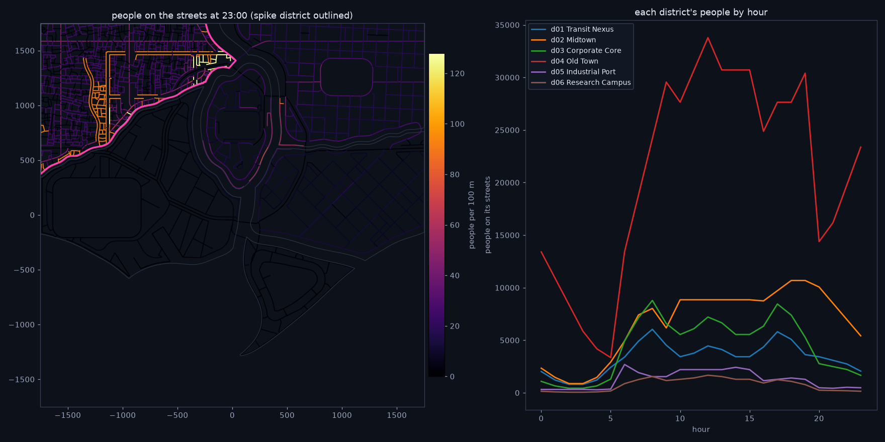
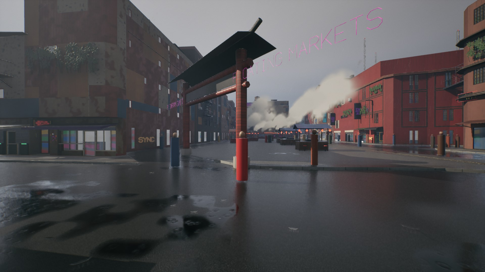
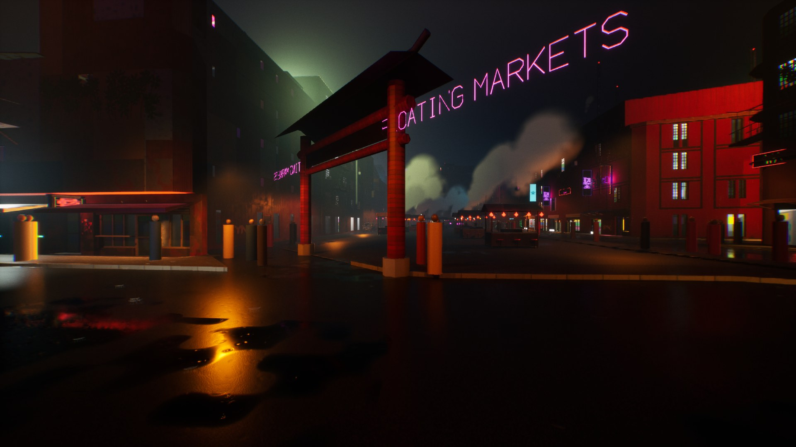
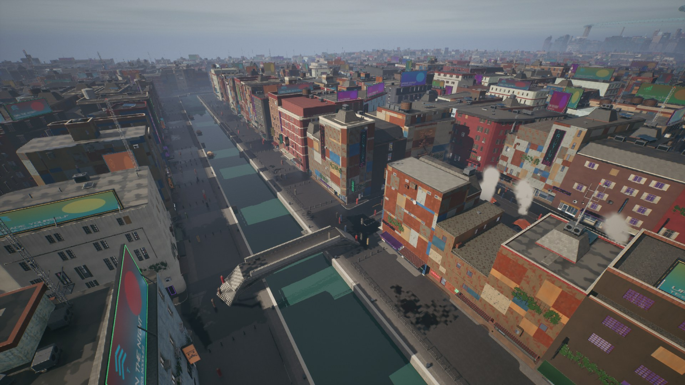
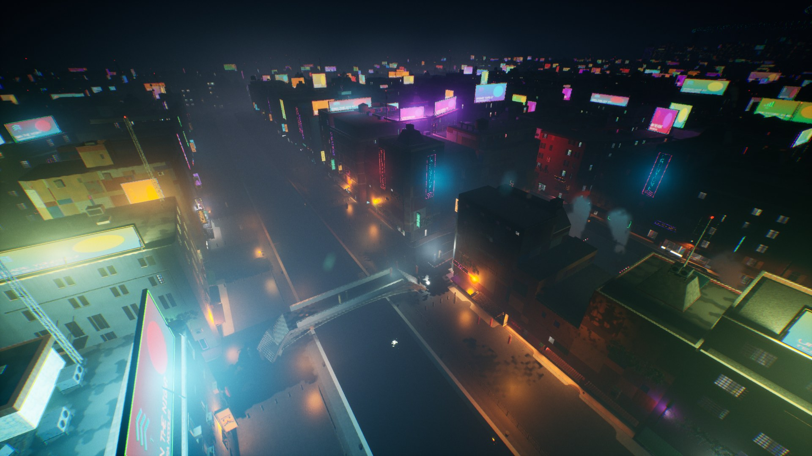

# LG0: groundwork and spike (lifegen)

Stage 4's first milestone (`docs/lifegen_scope.md` section 13): the contract (the life spec
and styles, the plan's format, the asks of citygen, the `CityGenLife` plugin's skeleton built
by the exporter, ZoneGraph lanes built from the city's own graphs), a spike on one district
of Delta Megacity measured against the benchmark, probes of what Unreal 5.8 lets a script do
for people (MetaHuman, Mutable, retargeting, the engine pieces' maturity) and a garment
draped in Blender's cloth solver. Built on the Windows PC (RTX 4070 Ti, 32 GB, UE 5.8) on
2026-11-13, on main after AT7, the play fixes and the showcase (#221).

Swagnik's decisions of 2026-11-13 (scope section 12) set the frame: a generator of the plan
and a library with the `CityGenLife` plugin on Mass, ZoneGraph, Smart Objects and StateTree;
MetaHuman bodies if 5.8 can be driven from a script; generated garments with a kit out of the
repo as the fallback; Epic's Game Animation Sample near the view and free mocap for the rest;
nothing in the repo unless anyone may use it; **the fleet is AG18's hand-designed vehicles**;
**a 20 ms p95 frame budget** with no tuning rounds unless a milestone goes over it; stepping
aside and looking first.

## What LG0 built

| Part | Where | What |
|---|---|---|
| Life spec and presets | `lifegen/spec.py`, `presets.py`, `schemas/life_spec.schema.json` | per district its people (busy, residents, workers, visitors, the day's shape within M11's hour bands), style (fashion groups, their colors, cyberware, wear by wealth and danger), fleet (AG18's models by the parked cars' table); transit, air, water, budgets (20 ms p95, 2,000 people and 500 vehicles within 300 m), reactions, the spike |
| Plan format | `lifegen/planmodel.py`, `schemas/life_plan.schema.json`, `tile_spawns.schema.json`, `contribution.schema.json` | `life_plan.json`, `spawns/<tile>.json`, `unreal_contribution.life.json` (layer 4), every entry hashed |
| The plan | `lifegen plan BUILD`, `lifegen/plan.py` | people, vehicles, gang members and police per district and hour; spawn and sink points with rates by hour; place slots; the spike; checks; `preview_crowds.png` |
| Asks of citygen | `lifegen/asks.py` | signal phases and timing, bus routes, turn restrictions, lobby points, piers, air corridors (and of assetgen: doors, met; AG18's missing kinds) |
| Runtime plugin | `citygen/ue/CityGenLife` | the controller: ZoneGraph lanes from the graphs, people and cars as Mass entities moved by two Mass processors, instanced stand-ins and AG18's car parts |
| Exporter | `citygen/unreal_life.py`, `import_city.Importer.life_controller`, `--life`, `--no-life` | the manifest's `life`, `BUILD/unreal/life.json`, the controller placed with the spike, the stand-in material |
| Probes | `lifegen/probes/plugins.py`, `ue_probe.py`, `cmu_style.py` | the engine pieces' maturity; MetaHuman Creator, Mutable and retargeting from Python |
| Garment test | `lifegen/blender/garment_test.py` | a tee of two flat panels sewn and draped on a plain body, headless, baked, rendered |

## The plan on Delta

`lifegen plan` on Delta (the play fixes' build), an empty spec: 2 to 3 s, 131 tiles.

6,789 spawn points (5,470 main and 1,081 service building entrances and the loading docks
and garages, the station stairs, the garages' and lots' entrances, the taxi stands), 688
place slots, all on the walkway graph and all in one walkway component; 58,189 people and
3,394 vehicles on the streets at the peak hour. Every check passes
([`plan/life_report.txt`](plan/life_report.txt)).

| District | People at 23:00 | People at the peak | Vehicles at the peak | Spawns | Slots |
|---|---|---|---|---|---|
| Transit Nexus | 2,060 | 6,042 | 461 | 163 | 58 |
| Midtown | 5,421 | 10,685 | 771 | 899 | 86 |
| Corporate Core | 1,664 | 8,785 | 971 | 291 | 191 |
| Old Town | 23,373 | 33,786 | 931 | 5,130 | 191 |
| Industrial Port | 480 | 2,692 | 698 | 249 | 120 |
| Research Campus | 147 | 1,672 | 118 | 54 | 41 |

The day's shape is held within M11's five hour bands (each band keeps M11's density), so the
curves step where the bands meet (Old Town from 30,000 at 19:00 to 14,000 at 20:00): M11's
densities are per band, and smoothing across bands is LG3's to decide (it would move the
bands' means). Old Town has 23,373 people on its streets at 23:00, twelve times the budget's
2,000 within 300 m: the plan's people are spread over the whole 2 km district, so LG3 spawns
by tile and view (the budget is per view, not per district).

**The asks of citygen** (`lifegen/asks.py`; status on Delta):

| Ask | Needed by | On Delta | Meanwhile |
|---|---|---|---|
| Signal phases and timing per signalized junction | LG3, LG5 | derived | two phases from the legs' angles, every crosswalk across the stopped legs, a 60 s cycle |
| Bus routes and their stops | LG5 | missing | M6's 86 bus stops are there, no route joins them |
| Turn restrictions | LG5 | derived | every connector lane allowed |
| Lobby points behind main doors | LG3 | derived | people go in 1.5 m behind AG3's door |
| Piers for ferries and water taxis | LG7 | missing | M16's quays and AG7's quay stairs; no berth named |
| Air corridors | LG7 | derived | layers over the avenues and highways |
| Doors with their walkways (assetgen) | LG3 | met | AG3's doors |
| AG18's missing kinds (assetgen) | LG5, LG7 | derived | cars, taxis, vans and pickups from the 15 packs |

## The spike: Delta's Old Town in Unreal

**Setup.** Delta as the play fixes left it in CityAG16 (`builds/fix_play_cars`, its atmos
plan), imported again over that import with the life plan (`--life`): the import placed one
actor (`life`) and updated nothing else of the city but AT7's atmos cells, whose hashes moved
with main. The spike is Old Town (the benchmark's lean walk district, the one with the most
buildings) at 23:00: **2,000 stand-ins** (the budget's people, of Old Town's 23,373 on its
streets at that hour) on the walkway lanes within 450 m of its middle, densest round the
middle (a lane's share falling as $1 / (1 + (d / 150\,\mathrm{m})^2)$), and **40 cars** of
nine of AG18's models (the Tanager Mino, Cab and Porter, Brakk's three, the Halcyon Ridge,
Orrin Lumen and Pebble, by Old Town's weights), painted by step H's rule. At BeginPlay the
controller builds **11,340 ZoneGraph lanes** (5,831 walkway lanes, 5,509 drive lanes and
connectors) from `graphs.json` in 14 to 30 ms, then makes 2,040 Mass entities.

The stand-ins walk the walkways both ways at 1.15 to 1.55 m/s, keeping (mostly) right across
each walkway's width, turning onto the walkways their end meets (not back the way they came
unless it is a dead end), turning back at the live region's edge; the cars drive the lane
graph at 25 to 40 km/h, slowing to keep 9 m behind the car ahead on their lane and the one
they go to next, and start again on a lane of the region at a dead end or its edge. There are
no signals yet (LG5) and no avoidance between people (LG3).

| By day (a market street in Old Town) | By night |
|---|---|
|  |  |
|  |  |

(`unreal/`: the check's free camera views, `--view pday_* / night_*`; the stand-ins are a
cylinder and a sphere in their district's clothing colors, the cars AG18's packs.)

<!-- SPIKE_BENCH -->

## Probes

<!-- PROBES -->

## Garment test

<!-- GARMENT -->

## Recommendations for LG1 to LG8

- **LG1 (people).**
  - Bodies from MetaHuman Creator by script (see the probes): one character asset per
    archetype of body, edited by the editor subsystem from a seed (body constraints, face
    model coefficients, skin), assembled by `BuildMetaHuman` into the user's project, never
    the repo. The cloud steps (auto-rigging, high-resolution textures) need the user's Epic
    sign-in and EULA, so a library step the user runs once; the local parts first.
  - Look at **MetaHuman Crowd** (`Engine/Plugins/MetaHuman/MetaHumanCrowd`, experimental in
    5.8) before writing lifegen's own assembly: it is Epic's Mass crowd of MetaHumans (an
    appearance provider, a Mass visualization trait, a representation subsystem swapping
    actors and instanced stand-ins, crowd pipelines for heads, grooms, outfits and
    skeletal clothing). It may be LG1's assembly and LG3's LODs; Mutable (beta) is the
    other route.
  - The animation: Epic's Game Animation Sample is on the UE5 Manny skeleton, which
    MetaHuman bodies share, so near the view it needs no retarget; the free mocap for the
    rest goes through IK Rig's batch retarget by script (the probe).
  - Far stand-ins: AnimToTexture (experimental) bakes a walk to vertex animation for
    instanced far crowds; keep the instanced path the spike measured.
- **LG3 (crowds).** Spawn by tile and view from the plan's spawn points and rates (the
  budget is 2,000 within 300 m of the view, not a district's 23,000); keep people out of
  Lumen's scene and the distance fields; do not recreate render state per frame; update far
  instances less often (the game thread paid most of the spike's cost); add avoidance and
  the signals; smooth the hour bands' steps if the crowds visibly jump at 06, 10, 16 and 20.
- **LG4 (places).** Smart Objects at the plan's 688 slots (`slot.<prop id>`), StateTree
  behaviors; both released in 5.8.
- **LG5 (traffic).** The asks first: signal phases and bus routes from citygen; the cars
  already drive the lane graph as ZoneGraph lanes with a following rule; add lane changes,
  the signals' stop lines, parking from M11's spaces, and the missing kinds as the Mac
  designs them. Chaos Vehicles is experimental: kinematic movers on lanes, as now, with
  physics only near the player.
- **LG6 to LG8.** Transit on M5's lines as lanes of their own; air lanes and piers after their
  asks; every milestone runs the lean benchmark before and after (night_plan_all and the
  `night_life*` passes) against the 20 ms budget.
