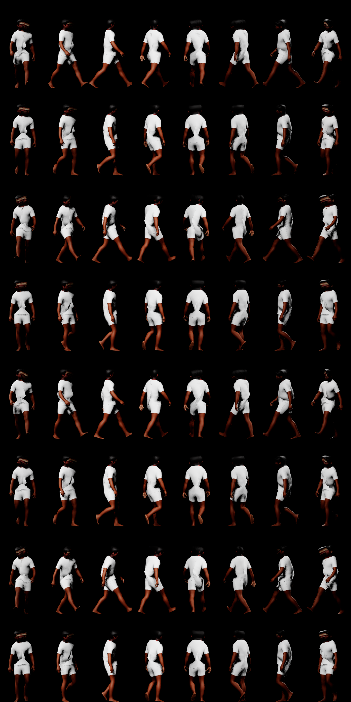

# LG1: people (lifegen)

Stage 4's second milestone (`docs/lifegen_scope.md` section 13): the population library
(bodies, faces, skin and hair by seed, assembled MetaHumans), Epic's animations on them, far
stand-ins that still walk (baked animation and impostors), people in MetaHuman's own plain
wardrobe, the plan's person draws, and Delta's Old Town spike walked by these people in
place of LG0's stand-ins. Built on the Windows PC (RTX 4070 Ti, 32 GB, UE 5.8.4) on
2026-11-14, on main after LG0 (#222), DLSS and fixtures (#224) and cars and steam (#225).

Swagnik's frame for it (2026-11-14): MetaHumans made by script on his sign-in (rigging and
assembly only, as the EULA he accepted allows), Unreal's own animations only (his Game
Animation Sample), no CMU or other mocap, nothing of Epic's in the repo (decision 5), the
20 ms p95 budget at native 2560 x 1440 (decision 7).

## What LG1 built

| Part | Where | What |
|---|---|---|
| The library's spec | `lifegen/library.py` | 24 characters by seed: a MetaHuman preset each (its hair, eyebrows and plain wardrobe), its face blended toward a second preset of the same body, height and build, skin tone; the clips (two walks, two idles); the far stand-ins; the runtime's tiers; the library's hash |
| The plan's person draws | `lifegen/plan.py`, `planmodel.py` | every spike person's character, height scale, gait, pace, outfit tint and seed (`spike.persons`, columns), every spawn point's seed (`Spawn.seed`); the check `people_draws` |
| The library's build | `citygen/ue/people_library.py`, `citygen/unreal_people.py` | characters made, rigged and textured by Epic's MetaHuman service, assembled; the clips retargeted and made in place; the mid mesh with its walk baked into textures; the impostor sheets; the manifest; the cache outside the repo |
| Epic's animations | `citygen/ue/people_gas.py`, `unreal_people.migrate` | the clips' closure in the user's Game Animation Sample, copied into the project |
| The exporter | `citygen/unreal_life.py` (`persons`, `people_library`), `citygen/unreal.py` (`--people`, `--gas`), `ue/import_city.py` (`people_assets`, `LIFE_VERSION` life2) | the people's draws and the library's assets on the life controller |
| The runtime | `citygen/ue/CityGenLife/.../CityGenLifePeople.cpp` | the three tiers: near skeletal people, mid baked walks, far cards; `CityGenLife.Tiers`; the status line's `library` |
| Benchmark | `citygen/bench.py` | `night_life_near0`, `night_life_near80`; every life pass sets the tiers |

## MetaHumans by script: what worked

Everything ran by script, nothing by hand, in the city project (CityAG16) and first in a
throwaway one:

- **Making a character:** a preset (`/MetaHumanCharacter/Optional/Presets/<name>`, the engine's
  optional MetaHuman content, installed) duplicated as an asset; the creator's editor
  subsystem opens it for editing, blends its face model's 1,397 coefficients toward another
  preset's, sets its body's constraints (height, chest, waist, hips: of 30, among them
  Masculine/Feminine, Muscularity and Fat) and its skin tone.
- **Rigging works by script.** `request_auto_rigging` (joints only, blocking) on the editor's
  saved sign-in: the EOS SDK's persistent login (`LogEOSAuth: Login complete: EOS_Success`,
  `LogMetaHumanAuth: User name is ...`) with no sign-in window
  (`-NoMetaHumanAccountPortalLoginFallback` keeps one from ever opening). 5 to 40 s a
  character.
- **Texture sources:** the build refuses a rigged character without them ("missing textures,
  use Download Texture Sources"); `request_texture_sources` (2k, blocking) fetches them from
  the same service in 20 to 35 s.
- **Assembly needs the full editor.** The creator's build (Cinematic and Optimized alike)
  bakes textures through texture graphs, which a commandlet does not run ("Couldn't find baked
  texture ... This should have been produced by the texture graph", "Collection build
  failed"); the full editor, off screen (`-RenderOffscreen`, the script on its tick), builds
  it: the Optimized pipeline at Medium in 60 to 125 s a character. What it makes per
  character (`/Game/CityGen/People/Built/<id>`): the body (3 LODs: 6,745, 3,311 and 948
  vertices, on `metahuman_base_skel`, which every body shares), the face (3 LODs: 4,065, 903,
  243, on the face archetype's skeleton), the outfit (the default garment, 4 LODs), the
  grooms with their cards and helmets, baked skin textures (virtual), the actor Blueprint;
  about 250 MB.
- **Memory:** the editor keeps what each assembly loaded; past a dozen characters its
  commit outgrew the PC's memory and Windows grew the page file by 28 GB in a minute. The
  build ends an editor run every 6 characters (`PER_RUN`) and starts the next.

MetaHumanSetup (Swagnik's sign-in project) was deleted once rigging by script worked.

## Epic's animations

The clips are Epic's Game Animation Sample's (`M_Neutral_Walk_Loop_F`, `M_Relaxed_Walk_Loop_F`,
`M_Neutral_Stand_Idle_Loop`, `M_Relaxed_Stand_Idle_Loop`), on the UEFN mannequin's skeleton:

- **Copied by script:** `people_gas.py` lists the clips' hard references in the sample (14
  packages: the clips, the mannequin's mesh, skeleton, IK rig, physics asset, material,
  textures, LOD settings and a curve compression setting; the notify Blueprints and pose
  search databases left out) and the venv copies those files into the project at their own
  paths. The sample's editor ran read only with `-userdir=` outside it; the engine still made
  four things in the sample's folder (empty `Content/Collections` and `Content/Developers`,
  `Intermediate/Build/XmlConfigCache.bin`, `Saved/UnrealBuildTool/BuildConfiguration.xml`, a
  `DerivedDataCache/VT` folder), editor scaffolding, not content (the session's attempt to
  remove them was refused by the permission check; they are harmless).
- **Retargeted onto the MetaHuman body** by IK Rig's batch retarget (the sample's IK rig,
  the body's generated by script). The retarget leaves the pelvis's height and the walk's
  travel in the root bone; `in_place` rewrites the clip (the root still, the pelvis taking
  the height, the travel dropped), since the people are moved along their lanes. Without it a
  locked root dropped the body 70 to 85 cm into the ground.
- **Speeds:** the sample's root motion gives each walk's own speed (neutral 2.0 m/s, relaxed
  1.65); a person plays its gait's clip at its pace over that (the plan's 1.15 to 1.55 m/s:
  0.58 to 0.94).

## Far stand-ins

- **Mid (baked walks):** each character as one static mesh (body and face at LOD 1, outfit at
  LOD 2, the hair's helmet; GeometryScript) whose walk AnimToTexture bakes into bone textures
  (bone mode, 121 frames at 15 fps, the body as the driver), on lifegen's mid material (each
  slot's baked base color, as a plain 512 px copy, or its color). One instanced component per
  character; each person's walk plays on the GPU from per-instance data.
- **Far (impostors):** a sheet per character, 8 sides by 8 frames of one stride (1.98 s),
  128 x 256 a cell, rendered by scene captures of the mid mesh pinned to each frame (a lit
  color sheet and a coverage mask); a card turned to the view about its up axis shows the
  cell for the view's side of the person and the stride's frame.

| A character's impostor sheet (8 sides, 8 frames) |
|---|
|  |

TBD: the rest (Delta, shots, benchmark, package) once measured.
