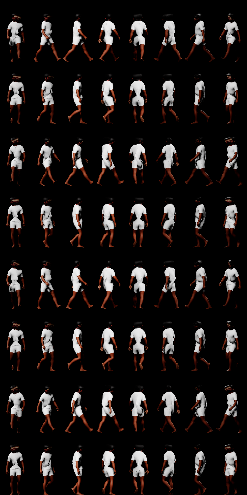
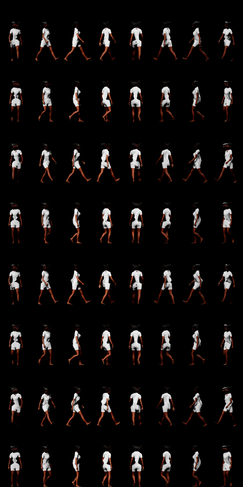
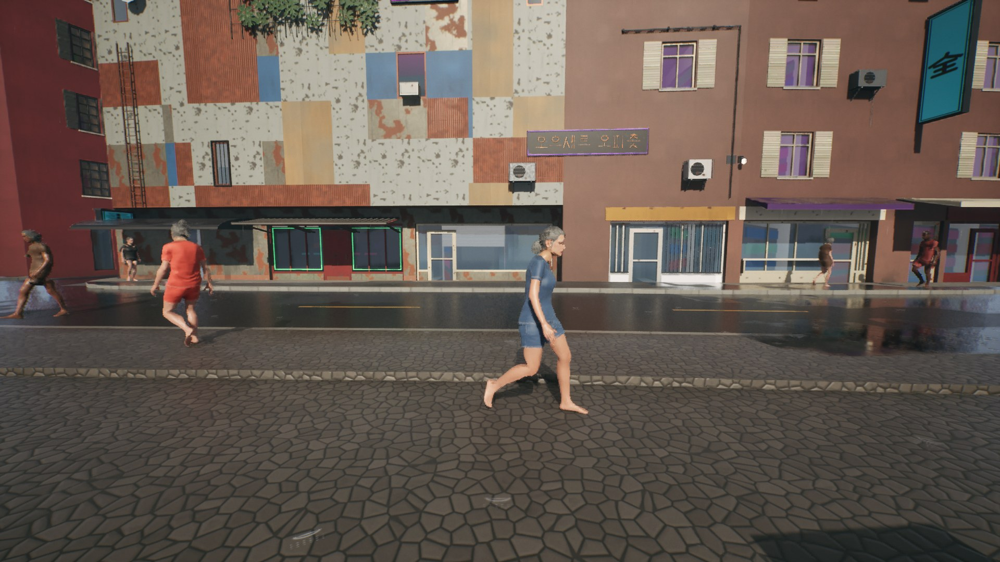
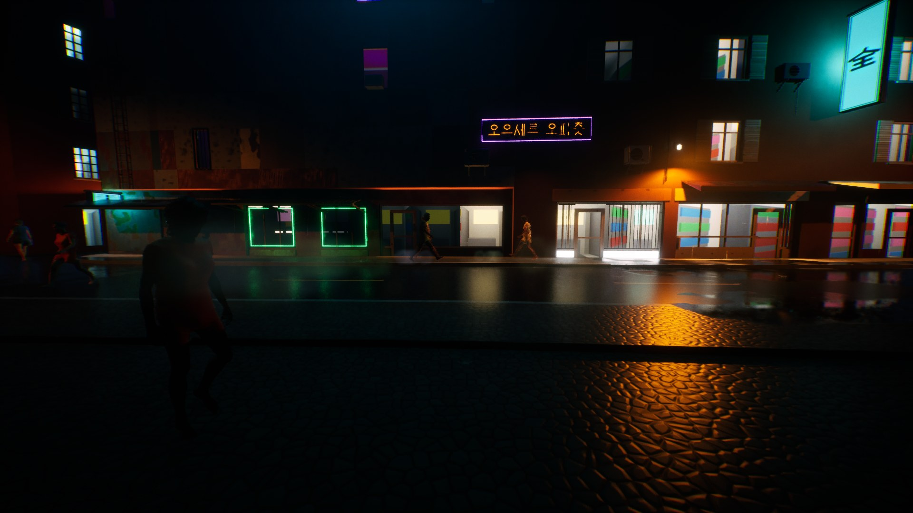
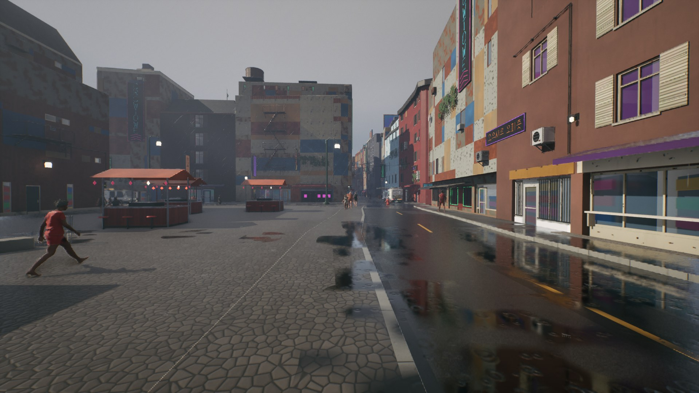
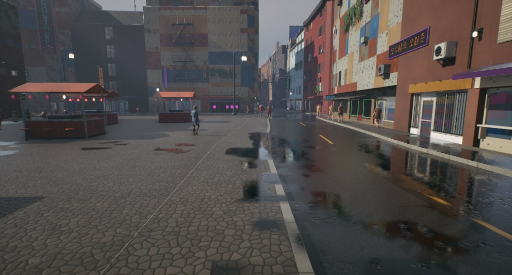
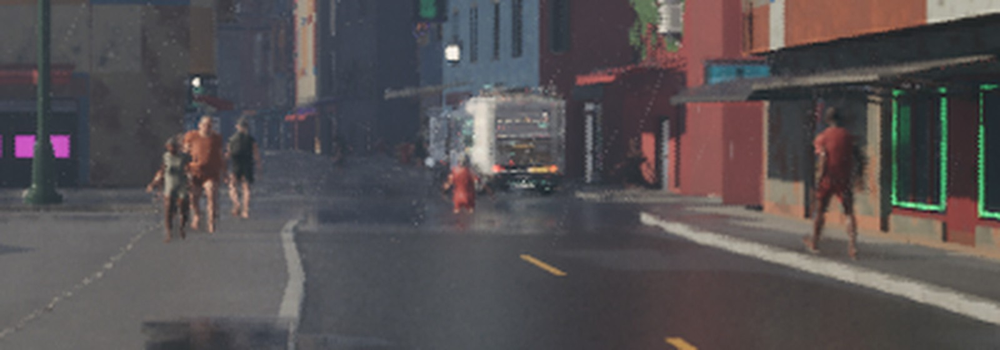
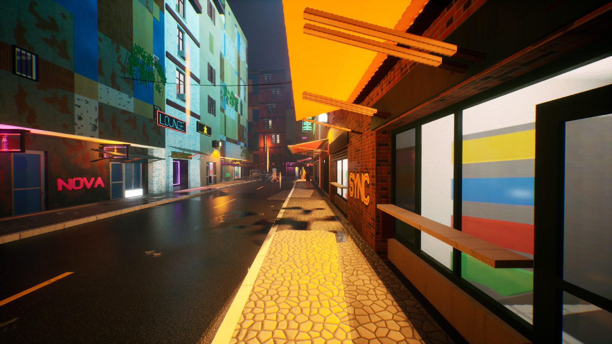

# LG1: people (lifegen)

Stage 4's second milestone (`docs/lifegen_scope.md` section 13): the population library
(bodies, faces, skin and hair by seed, assembled MetaHumans), Epic's animations on them, far
stand-ins that still walk (baked animation and impostors), people in MetaHuman's own plain
wardrobe, the plan's person draws, and Delta's Old Town spike walked by these people in
place of LG0's stand-ins. Built on the Windows PC (RTX 4070 Ti, 32 GB, UE 5.8.4) on
2026-11-14, on main after LG0 (#222), DLSS and fixtures (#224) and cars and steam (#225).

Swagnik's frame for it (2026-11-14): MetaHumans made by script on his sign-in (rigging and
assembly only, as the EULA he accepted allows), Unreal's own animations only (his Game
Animation Sample), no CMU or other mocap, nothing of Epic's in the repo (decision 5), the
20 ms p95 budget at native 2560 x 1440 (decision 7).

## What LG1 built

| Part | Where | What |
|---|---|---|
| The library's spec | `lifegen/library.py` | 24 characters by seed: a MetaHuman preset each (its hair, eyebrows and plain wardrobe), its face blended toward a second preset of the same body, height and build, skin tone; the clips (two walks, two idles); the far stand-ins; the runtime's tiers; the library's hash |
| The plan's person draws | `lifegen/plan.py`, `planmodel.py` | every spike person's character, height scale, gait, pace, outfit tint and seed (`spike.persons`, columns), every spawn point's seed (`Spawn.seed`); the check `people_draws` |
| The library's build | `citygen/ue/people_library.py`, `citygen/unreal_people.py` | characters made, rigged and textured by Epic's MetaHuman service, assembled; the clips retargeted and made in place; the mid mesh with its walk baked into textures; the impostor sheets; the manifest; the cache outside the repo |
| Epic's animations | `citygen/ue/people_gas.py`, `unreal_people.migrate` | the clips' closure in the user's Game Animation Sample, copied into the project |
| The exporter | `citygen/unreal_life.py` (`persons`, `people_library`), `citygen/unreal.py` (`--people`, `--gas`), `ue/import_city.py` (`people_assets`, `LIFE_VERSION` life2) | the people's draws and the library's assets on the life controller |
| The runtime | `citygen/ue/CityGenLife/.../CityGenLifePeople.cpp` | the three tiers: near skeletal people, mid baked walks, far cards; `CityGenLife.Tiers`; the status line's `library` |
| Benchmark | `citygen/bench.py` | `night_life_near0`, `night_life_near80`; every life pass sets the tiers |

## MetaHumans by script: what worked

Everything ran by script, nothing by hand, in the city project (CityAG16) and first in a
throwaway one:

- **Making a character:** a preset (`/MetaHumanCharacter/Optional/Presets/<name>`, the engine's
  optional MetaHuman content, installed) duplicated as an asset; the creator's editor
  subsystem opens it for editing, blends its face model's 1,397 coefficients toward another
  preset's, sets its body's constraints (height, chest, waist, hips: of 30, among them
  Masculine/Feminine, Muscularity and Fat) and its skin tone.
- **Rigging works by script.** `request_auto_rigging` (joints only, blocking) on the editor's
  saved sign-in: the EOS SDK's persistent login (`LogEOSAuth: Login complete: EOS_Success`,
  `LogMetaHumanAuth: User name is ...`) with no sign-in window
  (`-NoMetaHumanAccountPortalLoginFallback` keeps one from ever opening). 5 to 40 s a
  character.
- **Texture sources:** the build refuses a rigged character without them ("missing textures,
  use Download Texture Sources"); `request_texture_sources` (2k, blocking) fetches them from
  the same service in 20 to 35 s.
- **Assembly needs the full editor.** The creator's build (Cinematic and Optimized alike)
  bakes textures through texture graphs, which a commandlet does not run ("Couldn't find baked
  texture ... This should have been produced by the texture graph", "Collection build
  failed"); the full editor, off screen (`-RenderOffscreen`, the script on its tick), builds
  it: the Optimized pipeline at Medium in 60 to 125 s a character. What it makes per
  character (`/Game/CityGen/People/Built/<id>`): the body (3 LODs: 6,745, 3,311 and 948
  vertices, on `metahuman_base_skel`, which every body shares), the face (3 LODs: 4,065, 903,
  243, on the face archetype's skeleton), the outfit (the default garment, 4 LODs), the
  grooms with their cards and helmets, baked skin textures (virtual), the actor Blueprint;
  about 250 MB.
- **Memory:** the editor keeps what each assembly loaded; past a dozen characters its
  commit outgrew the PC's memory and Windows grew the page file by 28 GB in a minute. The
  build ends an editor run every 6 characters (`PER_RUN`) and starts the next.

MetaHumanSetup (Swagnik's sign-in project) was deleted once rigging by script worked.

## Epic's animations

The clips are Epic's Game Animation Sample's (`M_Neutral_Walk_Loop_F`, `M_Relaxed_Walk_Loop_F`,
`M_Neutral_Stand_Idle_Loop`, `M_Relaxed_Stand_Idle_Loop`), on the UEFN mannequin's skeleton:

- **Copied by script:** `people_gas.py` lists the clips' hard references in the sample (14
  packages: the clips, the mannequin's mesh, skeleton, IK rig, physics asset, material,
  textures, LOD settings and a curve compression setting; the notify Blueprints and pose
  search databases left out) and the venv copies those files into the project at their own
  paths. The sample's editor ran read only with `-userdir=` outside it; the engine still made
  four things in the sample's folder (empty `Content/Collections` and `Content/Developers`,
  `Intermediate/Build/XmlConfigCache.bin`, `Saved/UnrealBuildTool/BuildConfiguration.xml`, a
  `DerivedDataCache/VT` folder), editor scaffolding, not content (the session's attempt to
  remove them was refused by the permission check; they are harmless).
- **Retargeted onto the MetaHuman body** by IK Rig's batch retarget (the sample's IK rig,
  the body's generated by script). The retarget leaves the pelvis's height and the walk's
  travel in the root bone; `in_place` rewrites the clip (the root still, the pelvis taking
  the height, the travel dropped), since the people are moved along their lanes. Without it a
  locked root dropped the body 70 to 85 cm into the ground.
- **Speeds:** the sample's root motion gives each walk's own speed (neutral 2.0 m/s, relaxed
  1.65); a person plays its gait's clip at its pace over that (the plan's 1.15 to 1.55 m/s:
  0.58 to 0.94).

## Far stand-ins

- **Mid (baked walks):** each character as one static mesh (body and face at LOD 1 without
  the face's see-through eye shells and eyelashes, outfit at LOD 2, the hair's helmet;
  GeometryScript) whose walk AnimToTexture bakes into bone textures (bone mode, 121 frames at
  15 fps, the body as the driver, four triangles a vertex), on lifegen's mid material (each
  slot's baked base color as a plain 512 px copy, the hair a color by the character, the
  garments white and tinted per person). One instanced component per character; each
  person's walk plays on the GPU from per-instance data, its outfit in its own tint.
- **Far (impostors):** a sheet per character, 8 sides by 8 frames of one stride (1.98 s),
  128 x 256 a cell, rendered by scene captures of the mid mesh pinned to each frame (a lit
  color sheet and a coverage mask); a card turned to the view about its up axis shows the
  cell for the view's side of the person and the stride's frame, the garments' white tinted
  per person.
- **The tiers at run time:** near within 30 m (at most 160 at once) as skeletal MetaHumans
  playing Epic's walks, mid to 90 m as baked walks, far to 300 m as cards; a person keeps its
  walk's phase as it changes tier. In the check's views 24 near, 229 mid and 1,050 far at
  once on Old Town's main street; the controller's people update 0.2 to 0.5 ms a frame.

| Two characters' impostor sheets (8 sides down, 8 frames across) | |
|---|---|
|  |  |

## Delta's Old Town with people

Delta (from `builds/fix_play_cars/samples/delta_megacity`, its atmos plan and LG0's life
plan made again with the person draws) imported over its earlier import in the city
project (`CityAG16`, with DLSS): only the life controller changed (1 actor updated, 14,688
unchanged); the people library from the project's stamp. Every check passes (spawn,
streaming, collision, the walk, the flight, the atmos and life status).

| People up close by day | The same street by night |
|---|---|
|  |  |
| **A crowd from street level** | **The walker among them** |
|  |  |
| **Mid people (baked walks, 40 to 80 m), enlarged** | **By night down a lit street** |
|  |  |

More: `unreal/` (close by day and night, the street from both ends, the walker's body, the
crowd from 30 m up, `pday_people_far.jpg`, where roofs hide most of the street).

## Benchmark

The lean route (one walk, the drive, the flight) on the PC at 2560 x 1440, one run a pass,
`docs/progress/LG1/bench/`:

| pass | p95 all | walk | drive | fly | game p95 (all) | draws p50 (walk) |
|---|---|---|---|---|---|---|
| `night_life_off` (no people or cars) | 18.1 | 17.3 | 18.6 | 17.8 | 14.8 | 471 |
| `night_life` (first build, mid shadows on) | 19.8 | 23.7 | 19.0 | 19.1 | 17.6 | 3,057 |
| `night_life_near80` | 20.2 | 23.9 | 19.4 | 19.0 | 17.8 | 3,006 |
| `night_life_near0` (no skeletal people) | 19.1 | 20.0 | 19.1 | 18.9 | 16.8 | 2,414 |
| `night_plan_all` (first build) | 20.5 | 25.6 | 19.2 | 19.3 | 18.5 | 3,044 |
| **`night_plan_all`** (mid shadows off) | **19.6** | 22.8 | 18.7 | 18.9 | 17.9 | 1,907 |
| `night_life_near20m` (mid shadows off) | 19.5 | 22.1 | 19.3 | 18.7 | 17.4 | 1,618 |
| `night_plan_all_dlss_q` (first build) | 17.1 | 20.8 | 14.4 | 17.1 | 16.0 | 2,986 |
| **`night_plan_all_dlss_q`** (mid shadows off) | **17.9** | 22.3 | 14.7 | 17.6 | 17.1 | 1,938 |

DLSS Quality helps the GPU (9 ms p95 against 14) but not the game thread, which bounds the
night either way, so its two runs differ by run-to-run noise. (A third DLSS run, flagged, is
left out: its flight hitched 146 times while the session deleted old builds.)

- **Within the budget:** the route's p95 is 19.6 ms native with the library's tiers (near 30 m,
  at most 160; mid 90 m; far 300 m), under decision 7's 20 ms; LG0's 2,000 stand-ins measured
  15.1 to 16.6 ms before DLSS's fixtures (#224) moved the night to 18.8 to 20.0. The walk is
  over it (22.8 ms), the game thread's: the skeletal people near the walker (20 to 30 in Old
  Town's main street) cost about 3 ms of it, the mid and far tiers about 2.5 ms.
- **The one change from measuring:** the mid tier casts no shadow. A mid mesh keeps a section
  per creator slot (about 15), so its shadow depths doubled the people's draws (3,044 to 1,907
  on the walk) for shadows nobody sees past 30 m.
- **Counts that fit:** 2,000 people within 450 m of the spike's middle, about 25 skeletal at
  once on a busy street, 150 to 250 mid and 1,000 far. Fewer near people (`near80`, a 20 m
  near tier) change little: the near count on the route is far under the cap, and the cost
  is per section, not per person. What would buy the walk back is a mid mesh of one section
  (an atlas of the creator's slots) and the face at a lower LOD near the edge of the near
  tier; both left for LG3, which fills every street.

## Package

`builds/packaged/Delta_lg1/Windows/CityAG16.exe` (PACKAGE_NOTE).

## What Swagnik still has to do

- Nothing to run for this city: the library is built in `CityAG16` and cached at
  `~/.cache/cybergen/people/<hash>` (3.2 GB, outside the repo); another project gets it with
  `citygen unreal ... --people` (copied from the cache, no cloud or sample needed).
- The Game Animation Sample can go: the four clips and their closure are copied into the
  project (`/Game/Characters/UEFN_Mannequin`) and the retargeted clips are in the cache. It is
  needed again only to build a library with other clips. Its folder has five bits of
  editor scaffolding the session could not remove (permission check): `Content/Collections`,
  `Content/Developers`, `Intermediate/Build/XmlConfigCache.bin`,
  `Saved/UnrealBuildTool/BuildConfiguration.xml` and `DerivedDataCache/VT`.
- MetaHumanSetup was deleted after rigging by script worked.

## Open items

- **The mid tier's faces:** the face is bound to the body's triangles (AnimToTexture takes one
  driver mesh, and the body has no head), so the face smears by a few centimeters in the
  walk; it reads as a person from 30 m on, but not as a face (`sheets/`). A head driver of
  its own, or the face's vertices tied to the head bone, would fix it.
- **The mid and far garments:** the low LODs of body and outfit cross, so the skin shows
  through the shirt in places; the creator's body masks under the garments are not baked
  into the mid mesh.
- **Barefoot:** MetaHuman's default wardrobe has no shoes; LG2's garments bring them.
- **Clips:** two walks and two idles; the idles are retargeted but not yet played (people
  only walk until LG3's stops and LG4's places).
- **Draw calls:** the mid mesh's sections (above); the near people's faces at LOD 0.
- **The far view:** the check's view from 30 m up sees the roofs more than the crowd; a view
  down a long street would show the cards better.
