# LG2: clothing (lifegen)

Stage 4's clothing milestone (`docs/lifegen_scope.md` 6.2 and section 13): every person of the
city in generated clothing, in all three tiers, city-wide. Garments cut from pattern
parameters on each character's own body and draped in Blender's cloth solver, generated
textiles, accessories and cyberware, outfits drawn by district, group, wealth and weather,
the variety check. Built on the Windows PC (RTX 4070 Ti, 12700K, UE 5.8.4) on 2026-11-14 and
15, on main after LG5 (#230).

## What LG2 built

| Part | Where | What |
|---|---|---|
| Garment patterns and looks | `lifegen/garments.py` | 15 garment kinds (tee, long tee, shirt, hoodie, coveralls, bomber, jacket, trench, raincoat, cargo, trousers, skirt, sneakers, boots, dress shoes) as pattern parameters (parts covered, ease per region by fit, hem, sleeve, neckline, flare, hood, collar, opening, trims); 11 accessories; 10 look groups (`presets.GROUPS` and `rain`) with their outfits, textiles and accessories; 6 looks a character, 144 in all; `draft` cuts a garment for one body's landmarks |
| Textiles | `lifegen/textiles.py` | denim, leather, vinyl, nylon, knit, rib, canvas, wool, mesh, reflective, LED trim, rubber, metal, plastic, visor: tileable PBR sets in AG6's style (integer-hash noise, `pbr.pack`), dyed ones a light weave the person's colors multiply |
| The Blender stage | `lifegen/blender/garments.py` | per character: the mannequin (body, plain outfit and face as one surface), every garment built on it, draped, finished; accessories; each look composed (layers pushed apart, covered faces out) and written as near (LOD 0, 1) and mid meshes; renders |
| The library's build | `citygen/ue/people_library.py`, `citygen/unreal_people.py` | the bodies exported, the clothing dressed in Blender between two editor runs, the looks' skeletal meshes (weights from the body and the plain outfit), mid meshes and cards per look |
| The plan | `lifegen/plan.py`, `presets.py`, `spec.py` | each pool person's look and group (the pool by the city's groups), per district its people by group (and the weather's share in raincoats), its colors per group, its wear; the check `variety` |
| Exporter and runtime | `citygen/unreal_life.py` (`PACK_VERSION` 5), `ue/import_city.py` (`LIFE_VERSION` life6), `CityGenLife` | a person spawned in a district takes a pool slot of a group the district wears and three dye colors of it; near garments tinted per person, mid and far by per-instance data and the cards' dye mask |

## How a garment is made

The scope's plan was flat sewing panels hung round the body and sewn shut by the cloth
solver's springs, as LG0's tee was. That tee crumpled wherever its one-size cut and the body
disagreed; cutting flat panels to fit 24 bodies of every build (and pants round a crotch) by
springs is fragile. So a garment is **cut from its pattern on the body it dresses** and the
cloth solver drapes it from there (`lifegen/blender/garments.py`):

1. **The mannequin.** The character's assembled body has no skin under MetaHuman's plain tee
   and shorts (the creator's assembly takes those triangles out), so the body, the plain
   outfit and the face's skin become one closed surface (a voxel remesh at 9 mm, about 15,000
   faces); every vertex is labelled with its part (torso, neck, head, upper and lower arm,
   hand, thigh, calf, foot: the nearest bone segment less the part's own radius) and its
   place along it. The plain outfit's openings are measured too (its neck opening, sleeve
   ends, leg hems): the body has no skin inside them, so every look reaches past each.
2. **The pattern** (`lifegen/garments.py`, `draft`): the parts a garment covers, its ease per
   region (fitted to loose by the look's draw; an outer layer always looser than any base
   layer), its cuts by the body's landmarks (hem, sleeve and ankle lengths, the neckline at
   the plain outfit's, a front opening), a skirt's or coat's flare, a hood (up: an ellipsoid
   open at the face; down: a roll), a collar (stand or turned down), trims (ribbed cuffs and
   hems, zips, plackets, pockets, reflective and LED bands, soles).
3. **The build**: the mannequin's faces of those parts offset by the ease (at most 45% of the
   room to the next part, so arms and legs keep apart), smoothed over the body's hollows and
   held outside it, cut by the pattern's planes on the parts each belongs to; the panels'
   coordinates round each part and along it (meters) are the UVs, so a textile lies on the
   garment as on its pattern piece.
4. **The drape**: Blender's cloth solver (28 frames, gravity on, the mannequin a collision
   object) settles it, fitted parts held by goal springs, skirts, coat tails and hoods free; a
   drape that throws vertices is dropped.
5. **The finish**: a rim of the textile's thickness at every open edge, the trims as their own
   slots, the vertex colors (a multiplier, and in alpha the dye channel: base layer, outer
   layer, bottom, or none for fixed colors such as soles, police blue, metal).
6. **The look**: its garments and accessories joined; each layer pushed 4 mm outside the
   layers under it (shoes, bottoms, the base top, the outer layer; a tucked shirt under its
   trousers), the faces another layer covers taken out; written as the near mesh (LOD 0,
   about 17,000 to 27,000 triangles), LOD 1 (45%) and the mid mesh (4,500 triangles, the
   textiles' mean colors in its vertex colors).

Accessories are hard-surface, built on the head's measures (visor, respirator, mask,
headset, cap, beanie, hard hat, implant plates with a glowing line) or the torso (backpack,
bag), held rigidly to their bone (head, spine_04, spine_02); arm plates (cyberware with a
glowing seam) follow the forearm's skin and only on bare forearms. A hood up is held to the
head more the higher it goes. Looks with a hood up, a cap, a beanie or a hard hat leave the
hair out.

## The garments on every body

Every character's six looks, drawn on its own body in Blender (the renders' colors are three
of the look's group's, as a person of that group might wear; in the city each person draws
their own):

| Front, characters 0 to 11 | Three quarters, characters 0 to 11 |
|---|---|
| [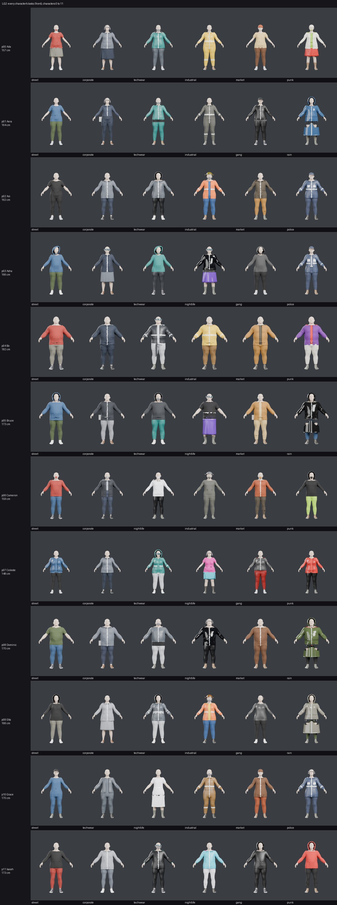](garments/bodies_front_1.jpg) | [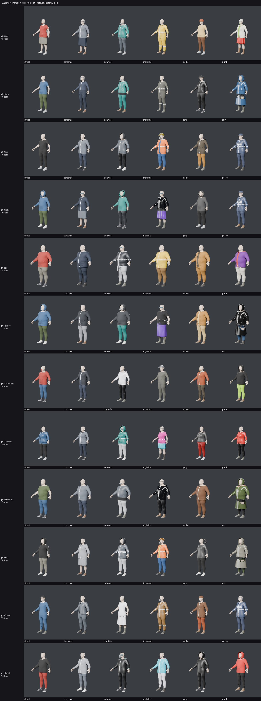](garments/bodies_34_1.jpg) |
| **Front, characters 12 to 23** | **Three quarters, characters 12 to 23** |
| [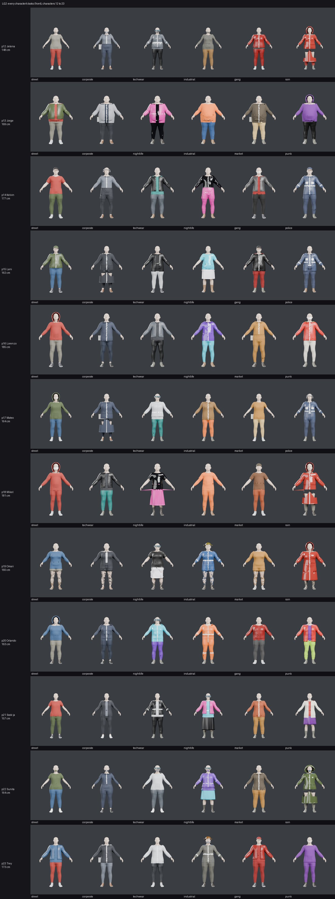](garments/bodies_front_2.jpg) | [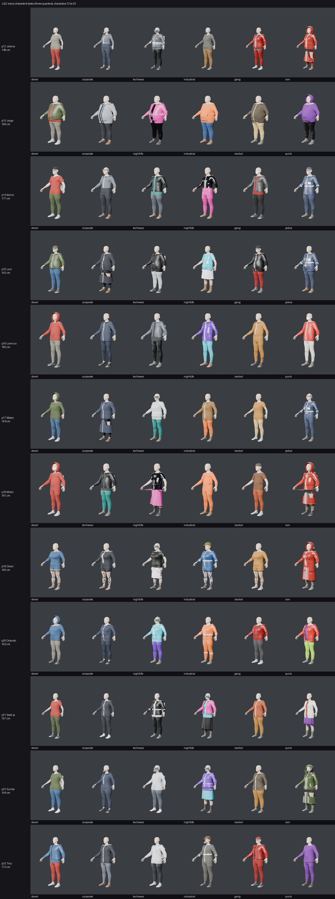](garments/bodies_34_2.jpg) |

Outfits by style group (a row a group, eight of its looks: street, corporate, techwear,
nightlife, market, industrial, punk, gang, police, rain):

[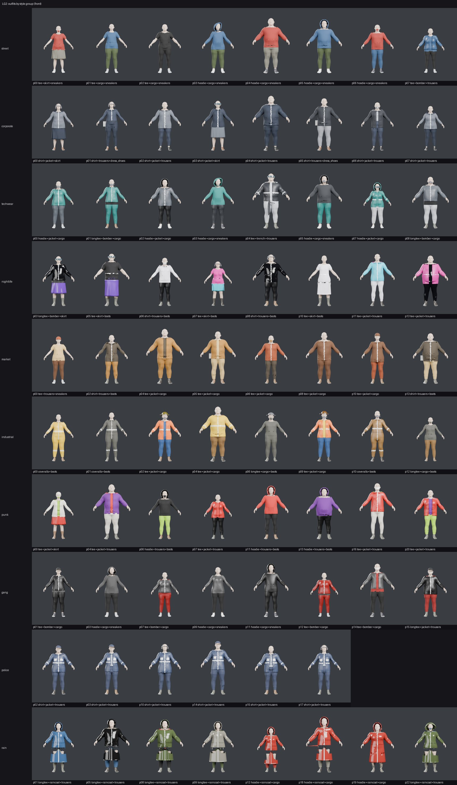](garments/styles.jpg)

The textiles (base color and normal; a dyed textile's base is a light weave the person's
color multiplies, the wear mask in the ORM image's alpha):

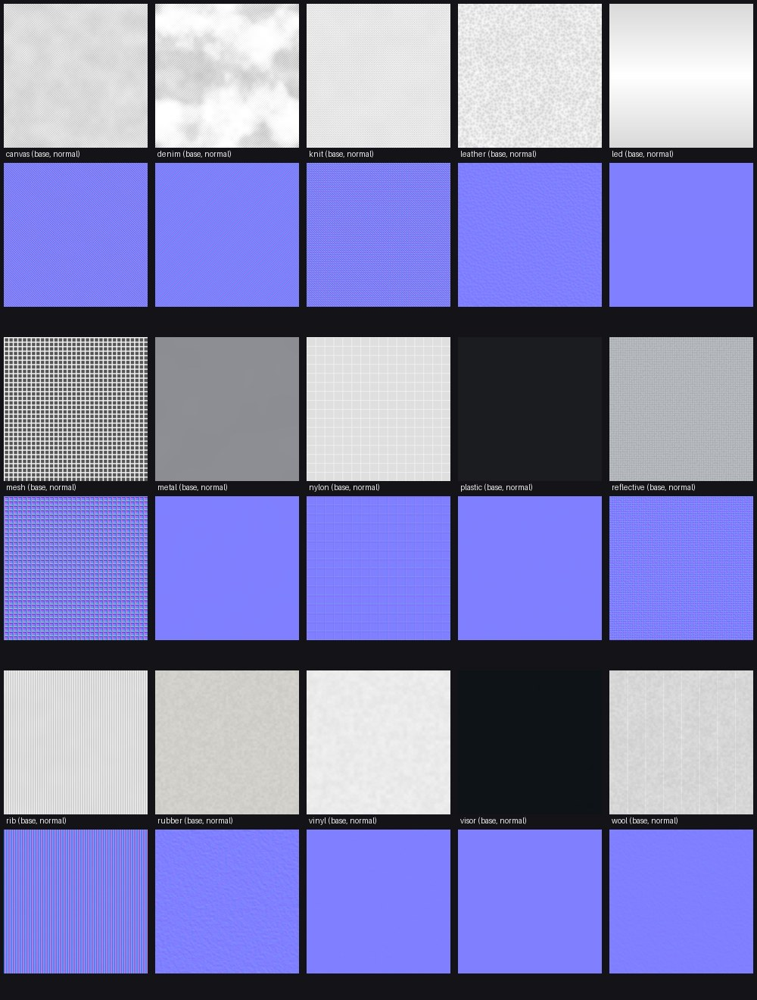

## Outfits in the plan, and the variety check

- **Looks by group** (`garments.GROUP_LOOKS`): street 24, corporate 22, techwear 20,
  nightlife 16, market 14, industrial 14, punk 10, gang 10, rain 8, police 6; a character
  has one look of a group at most, so a group's looks are worn by that many faces.
- **The pool** (2,400 people, LG3's): each person is a character (LG1's draw) in one of its
  looks; the looks' groups are drawn half by the city's people per group at the crowd's hour
  and half by each group's largest share of any district (`plan.assign_looks`), so a quiet
  district's own group (Delta's port: 70% industrial, 0.5% of the city's people at night)
  has people enough when the view is there.
- **Spawning** (`CityGenLife` `TakeSlot`, `DressSlot`): a person coming out of a door in a
  district takes a free slot of a group drawn by that district's people by group (the
  district's style groups; in rain, drizzle a share in raincoats: `presets.WEATHER_OUTFITS`,
  the spec's `crowd.weather`, fixed to clear until LG8 drives it), then three colors from that
  group's 12 in that district (a gang's own faction color first) and a wear about the
  district's (worn and grimed by its danger and poverty, `style.wear`).
- **Variety** (the check `variety`, scope 8): at each district's busiest hour, the people
  within 50 m of one another (its busiest tile's density, at most the pool's), the expected
  number of pairs alike in character, look and the two colors every look carries must be at
  most 1, and no look over 12% of a district's people.

On Delta (`lifegen plan`, every check passing): 125 of the 144 looks in the pool (no police
look: no district's style has police, which LG4's patrols bring; no raincoat: the weather is
clear), at most 0.44 expected alike pairs within 50 m (the port, where 70% wear one group's
14 looks), the commonest look 3.2 to 10.3% of a district.

## In Unreal: Delta

The library was built once with the final code (hash `dd24b28ed929920b`, 24 characters, 144
looks, 2,082 s for the looks, mid meshes and cards after Blender's dressing; every look's
garments appended with no dropped triangle) and Delta imported into the test project
(`CityAG16`) with LG2's plan (`lifegen plan`, every check passing). `--check` passes
(spawn, streaming, collision, the walk and the curb, sky, air, weather, look, far city, play
features, fly). The library is in the people cache, so another project gets it by copy.

| A near person (within 30 m), day | The clothing switch off (LG3's debug view: the template body) |
|---|---|
| [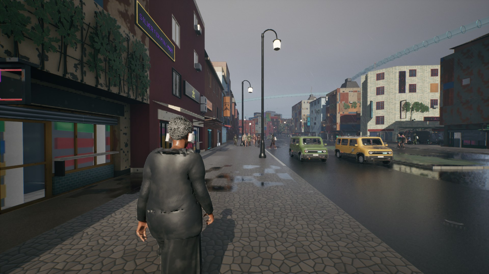](unreal/pday_near_clothes.jpg) | [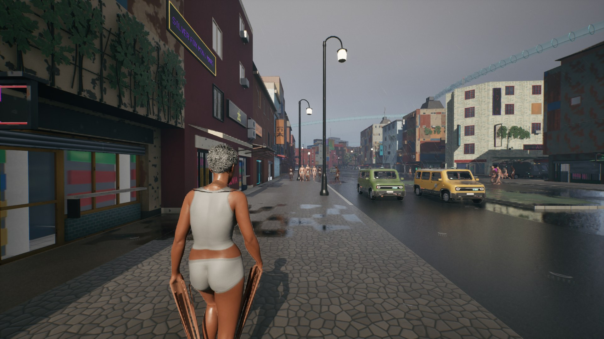](unreal/pday_near_noclothes.jpg) |
| **A downtown sidewalk by night (near people)** | **Old Town by night** |
| [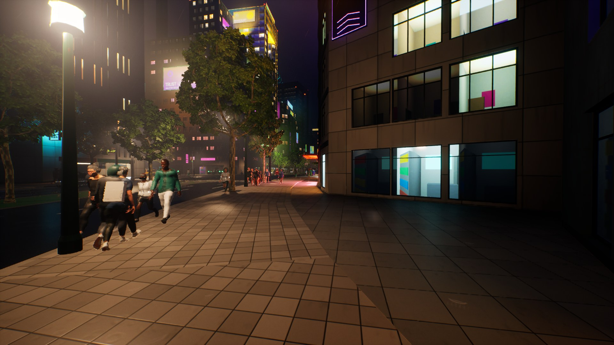](unreal/night_crowd_d02.jpg) | [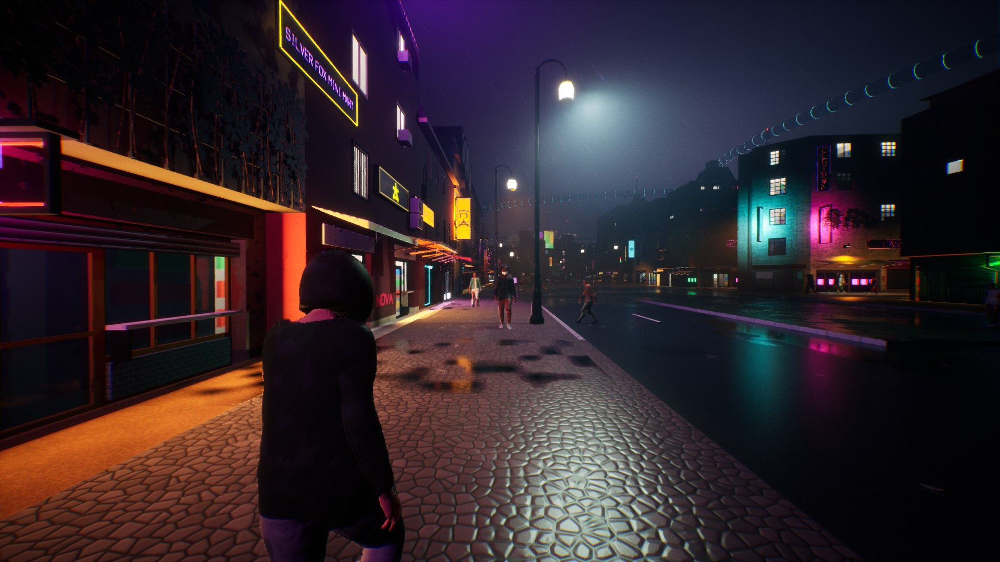](unreal/night_crowd_d04.jpg) |
| **The corporate core by night** | **Old Town from above, day** |
| [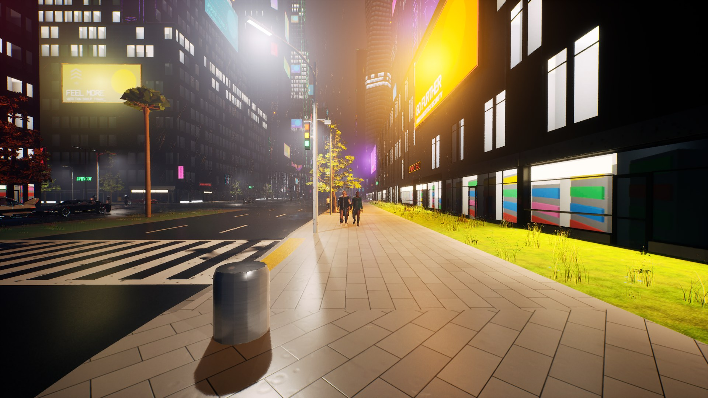](unreal/night_crowd_d03.jpg) | [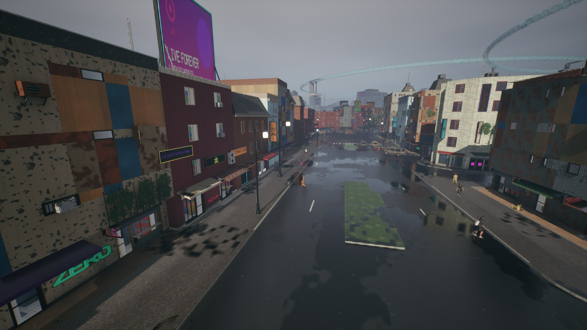](unreal/pday_crowd_d04_up.jpg) |
| **Every person at the mid tier (baked walks), close** | **Every person at the far tier (cards), close** |
| [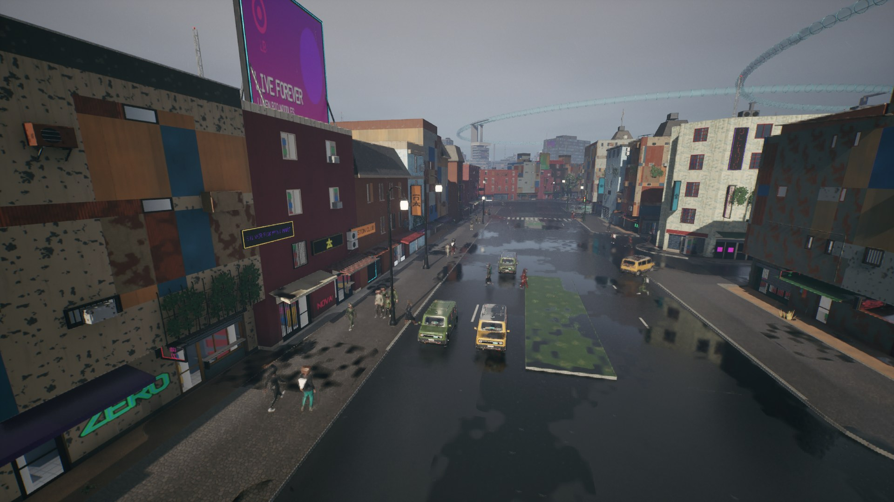](unreal/pday_allmid_close.jpg) | [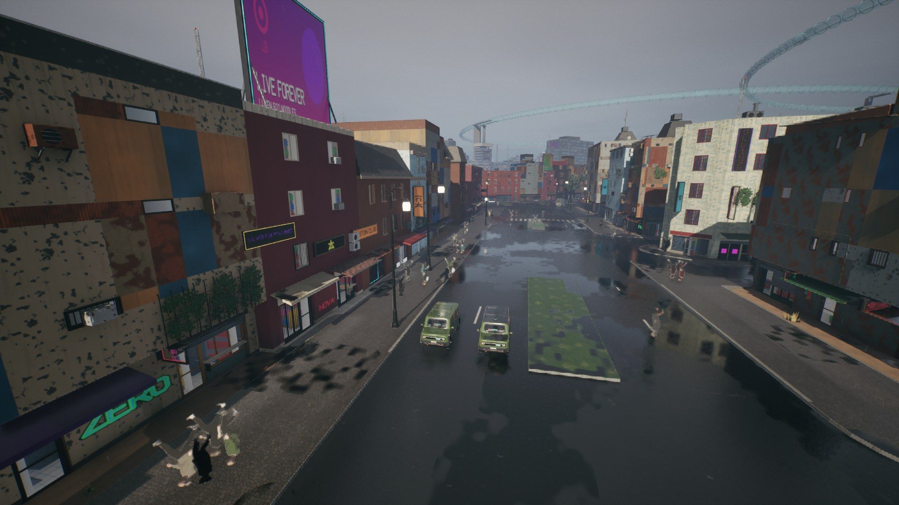](unreal/pday_allfar_close.jpg) |
| **Down a street, day (mid and far people)** | **The port, day** |
| [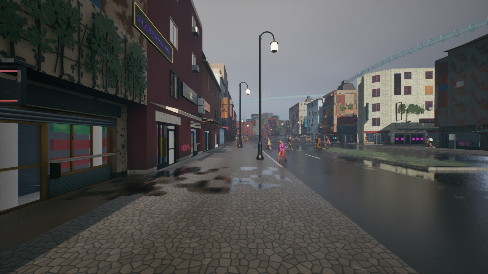](unreal/pday_far_street.jpg) | [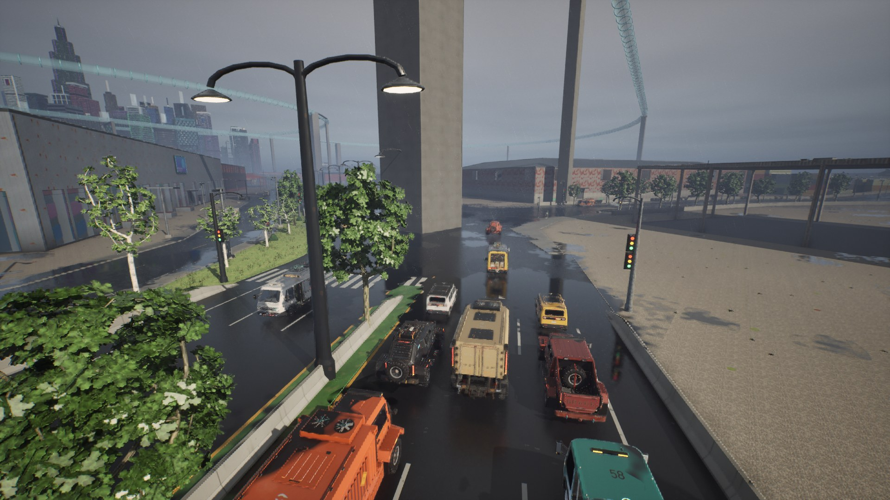](unreal/pday_crowd_d05_up.jpg) |

Up close (crops):

| | |
|---|---|
| [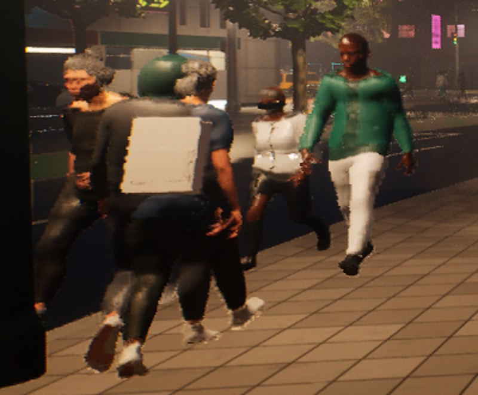](unreal/night_crowd_d02_crop.jpg) | [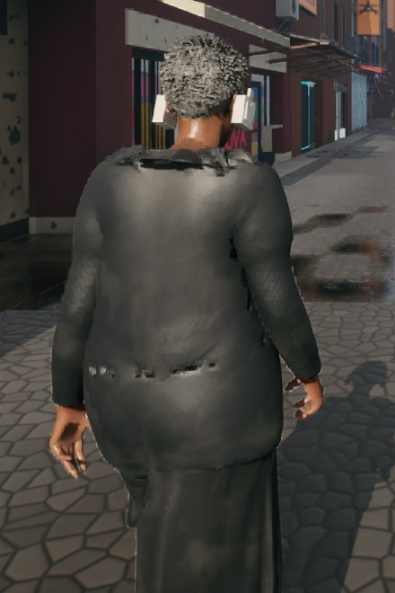](unreal/pday_near_clothes_crop.jpg) |

- **Near:** people read as dressed: shirts, long tees and jackets over trousers, cargo pants
  and skirts, sneakers with their white soles, boots, hard hats, visors, headsets and
  backpacks, each in their own colors. The garments are smooth shells with the textile's
  grain, not tailored cloth: no folds but the drape's, seams only where the trims are.
- **Mid and far:** the baked walks wear their look's colors per person; the cards show the
  outfit's silhouette and colors, which is what they are for at 90 to 300 m (seen close, as in
  the debug view above, they are smeared ghosts).
- **Faults seen** (open items below): a heavy-bodied character's long coat shows a row of
  holes across its back at the waist while walking (the layer under it, likely the trousers'
  waistband, passes through the coat as the two are skinned differently); collars and coat
  edges are jagged at the rims; the dyed garments are glossy in the rain.

## Benchmark

The lean route at native 2560 x 1440, one run a pass, no DLSS pass (`bench/final/`), against
LG5's `night_plan_all`:

| pass | p95 all | walk | drive | fly | game p95 (all) | draws p50 (walk) |
|---|---|---|---|---|---|---|
| **`night_plan_all`** (LG2, clothing on) | **20.8** | 23.8 | 20.9 | 19.7 | 18.1 | 2,415 |
| `night_life_noclothes` (the clothing switch off) | 22.0 | 29.2 | 20.9 | 19.6 | 20.3 | 2,071 |
| LG5's `night_plan_all` | 21.2 | 25.5 | 20.7 | 19.7 | 19.1 | 2,060 |

- **Clothing costs nothing measurable:** 20.8 ms p95 against LG5's 21.2 (the walk varies by
  2 ms from run to run with the same scene, as LG5 found), still over the 20 ms budget by the
  traffic's 1 ms (LG5's open item for the performance pass). The looks add draws on the walk
  (2,415 to 2,060: a look's garments are more sections than LG1's character), not frame time.
  No tuning round.
- **The switch off is slower** (22.0, walk 29.2): its near people are MetaHuman's whole
  template body, heavier than a look's garments, and its mid people draw holes over their
  garment slots. It is a debug view.

## The package

`builds/packaged/Delta_lg2` (Development, Win64, 5.1 GB; `package_lg2.cmd`, 15.5 minutes from
a mirror of `CityAG16` without its Saved, Intermediate, DerivedDataCache and plugin builds).
Its smoke launch (`-userdir=` outside the package, no `Saved/` left in it) loads the level in
14.1 s with the library's 144 looks and the clothing on: 610 people live round the player
start (2 near, 5 mid, 120 far in view), 599 cars, lifegen's tick 1.7 ms. The mirror was
deleted after it, as were the superseded `Delta_lg3_fix2` package and the people caches of the
development libraries (`Delta_lg5` kept).

## Cloth simulation

Not set up. Chaos Cloth's clothing data is made only by `UClothingAssetFactoryBase::
CreateFromSkeletalMesh`, a C++ virtual with no Python or Blueprint route, and the editor's
cloth painting is a manual tool; a plugin of its own for it was out of LG2's reach. The long
coats and skirts move with the legs' skinning (weights from the plain outfit and the body),
not by simulation.

## Tests

`tests/lifegen` (the new `test_lg_clothing.py`: looks, drafts, textiles, the variety check,
the exporter's outfits; `test_lg_plan.py`, `test_lg_people.py` updated) and
`tests/test_bench.py`: 52 passed (29 s). `tests/test_unreal.py` (the exporter's import script):
45 passed (the small city's Unreal imports included).

## Open items

- **A long coat over trousers shows the layer under it** at the waist while walking (a row of
  holes across a heavy-bodied character's back): the two layers are skinned apart. Taking the
  inner layer's faces out wherever an outer layer runs within a few centimeters (not only
  where a ray from them meets it) would cure it; it needs a library rebuild.
- **Rims and fronts:** the rims of collars, coat edges and zipped fronts are jagged (the
  voxel mannequin's 9 mm grid shows through the cuts); the front trims read as ragged white
  lines on the contact sheets.
- **No prints or logos** on the garments yet (AG6's brand logos were in the scope): the
  textiles are plain weaves, dyed.
- **Raincoats** (drawn only in rain, from LG8) have a weak front skirt panel.
- **Glossy in the rain:** the dyed garments take AT5's wetness as the streets do.
- **No police looks in Delta's pool:** no district's style has police; LG4's patrols bring
  them.
- **Hair:** a look with a cap, beanie, hard hat or hood up leaves the character's hair out,
  so the hat's shell alone covers the head; the contact sheets draw every head bald (the
  mannequin has no hair).
- **The far cards** seen close are smeared (as they are meant for 90 to 300 m).
- **Cloth simulation** (above).
- **The budget:** still LG5's 1 ms over 20 ms (the traffic), for the performance pass.
