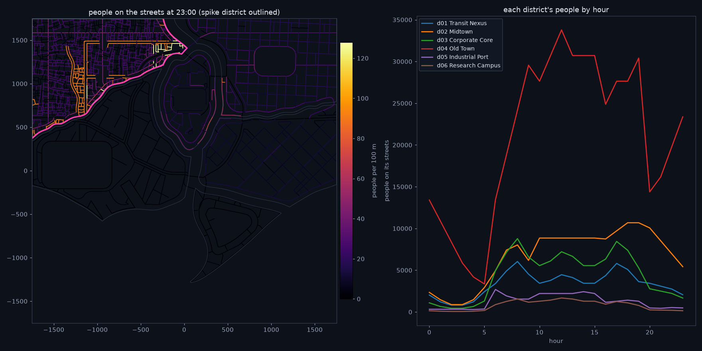
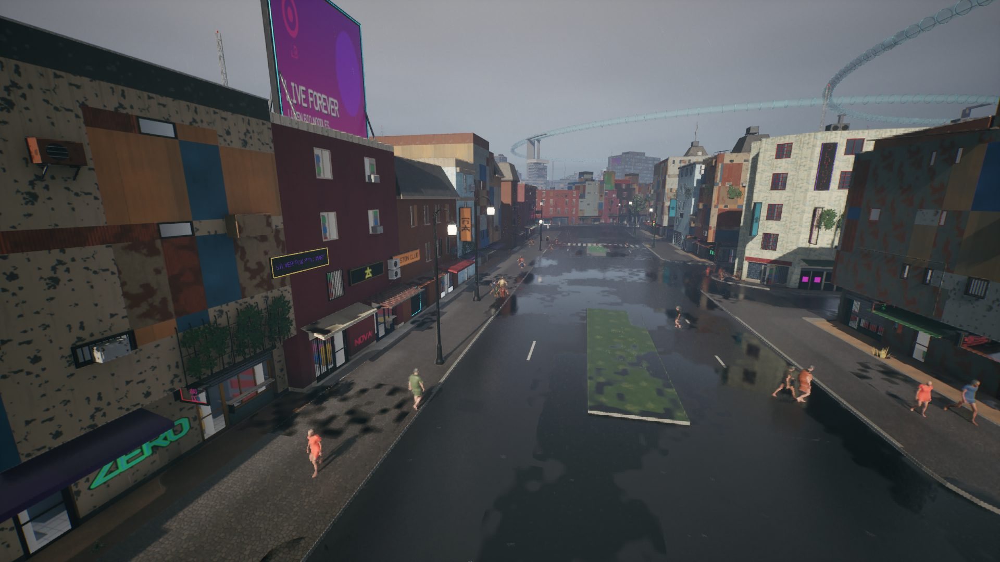
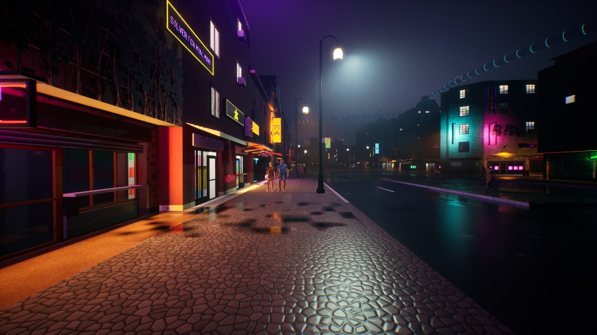
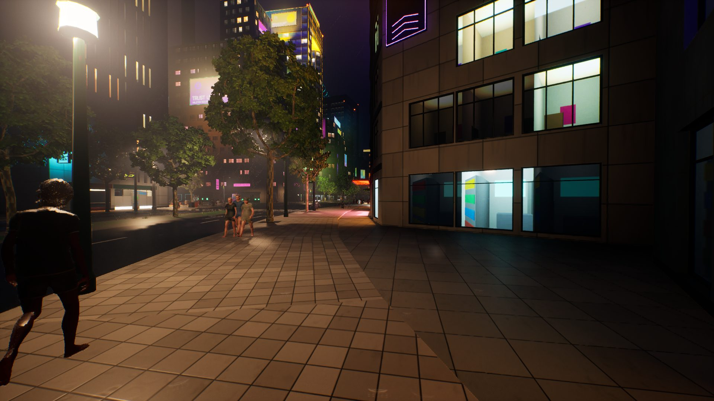
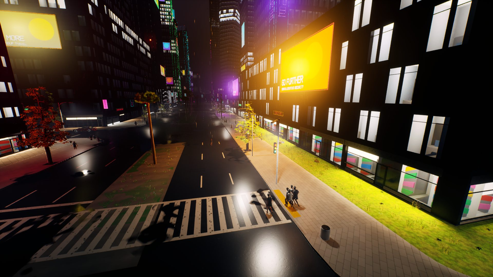
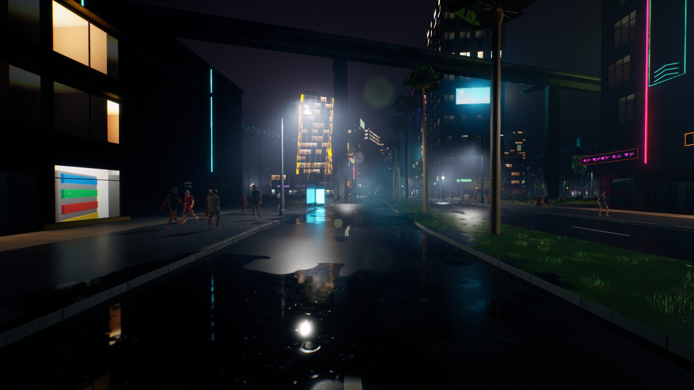
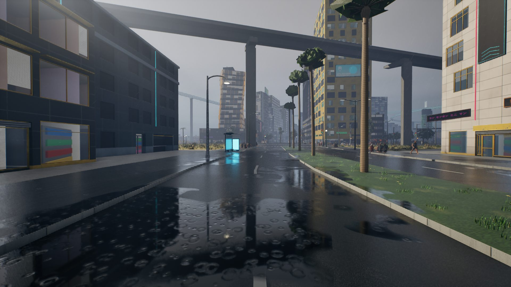
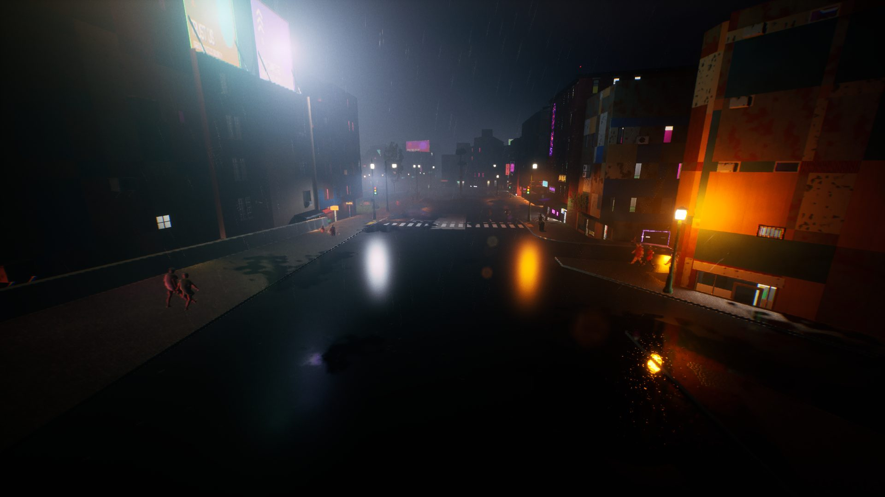
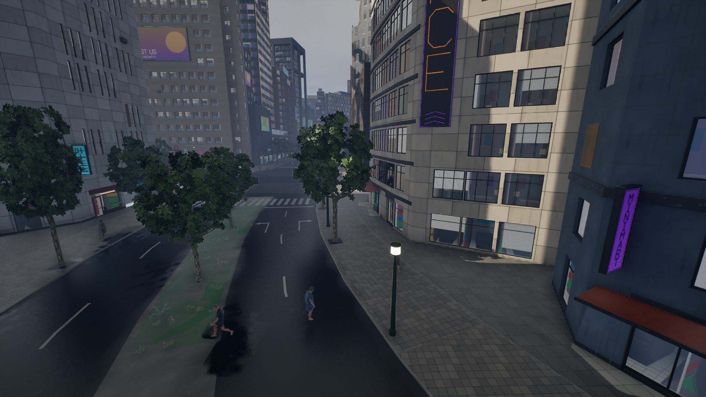

# LG3: crowds on the streets (lifegen)

Stage 4's fourth milestone, built before LG2 at Swagnik's ask (`docs/lifegen_scope.md`
section 13, scope 6.3): people on every walkway of the city at each street's density by hour,
not one district's spike; stairs, escalators and elevators between levels; crosswalks with
the signals; groups, their own pace, avoidance; trips out of and into doors, stations,
garages and taxi stands, never made or ended in sight. People keep LG1's plain outfit
(barefoot) until LG2. Built on the Windows PC (RTX 4070 Ti, 12700K, UE 5.8.4) on 2026-11-14,
on main after LG1 (#226).

## What LG3 built

| Part | Where | What |
|---|---|---|
| Every walkway's people | `lifegen/plan.py` `crowd_walks`; `planmodel.Walk`; each tile file's `walks` | a road segment's M11 people per hour band (its crowd per 100 m over its length, the district's busy, the crowd's `scale`) on its own walkways by length; every other walkway (a junction's corners and crossings, crosswalks, park and door paths, skybridges, platforms, stairs) at its district's mean sidewalk density times its kind's share (`presets.OFFSTREET`), along its slope; none on a walkway no spawn point reaches |
| The signals | `plan.signals`, `signals.json` (`planmodel.Signals`) | the ask `signal_phases`, derived: two phases per signalized junction from its legs' lines (within 45 degrees of the first leg's line together), each crosswalk walking while the leg it crosses is stopped, a 60 s cycle (3 s amber, 2 s all-red), people starting across in the first 12 s of their phase, an offset per junction by its id (`presets.SIGNAL`) |
| AG3's doors | `plan.door_points` | the spawn points are AG3's doors (a door per entrance and shop unit, `assets/unreal_contribution.buildings.json`) where the build has stage 2's buildings, M3's entrances otherwise; station stairs, garages and taxi stands as before; the ask `doors` met |
| The crowd | `plan.crowd_plan`, `planmodel.CrowdPlan`; the spec's `crowd` (hour, pool, scale, trip) | the pool of people the runtime simulates (2,400, each drawn from LG1's library by its seed), the districts' palettes, the hour, the live radius, trips, groups, jaywalking, avoidance, speeds |
| Checks | `plan.crowd_checks` | `crowd_densities` (the sidewalks keep M11's people per district and band within 1%), `crowd_levels` (every level with people on the main walkway graph), `signals`, `crowd_budget` (the pool within the 2,000 people in 300 m), `people_draws` (on the pool), `crowd_spawns` |
| The exporter | `citygen/unreal_life.py` `pack_crowd`, `pack_walks`, `pack_drive` (`PACK_VERSION` 3); `import_city.crowd_props` (`LIFE_VERSION` life3); `unreal.life_summary` | the whole walkway graph as lanes with kind, district, people per band and signal window; the doors on their walkways; the districts' days, dangers and palettes; the pool; the spike keeps its drive lanes and 40 cars until LG5 |
| The runtime | `CityGenLifeCrowd.cpp`, `CityGenLifeProcessors.cpp` (`ExecuteCity`, `CgLife::StepCity`), `CityGenLifePeople.cpp` | live walkways round the view, the fixed pool, trips through doors, groups, signals, jaywalking, avoidance, stairs and elevators, idles while standing, cheaper far people; `CityGenLife.Hour`, `CityGenLife.Crowd`; the status's `crowd` |
| The check | `citygen/ue/check_city.py` | the life status logged at every play view; a view named `*_wait*` waits 30 s more (the crowd at its crosswalks) |

The design, in short (`docs/unreal_export.md`, "From LG3: crowds on the streets"):

- **Live round the view.** Every walkway within 340 m of the view is live: one coming alive
  gets its people at the hour, one going past 380 m loses them, and a person walking toward a
  walkway that is not live turns back there. All of that happens past the far tier's 300 m,
  out of sight; the rest of the city is a number per walkway and costs nothing. A jump of the
  view (a teleport, a benchmark segment) fills the walkways round the new view at once.
- **A fixed pool.** 2,400 Mass entities made at BeginPlay, free until used: no entity is made
  or destroyed while the game runs. Where the walkways round the view want more people than
  92% of the pool, the density is scaled down evenly (`scale` in the status).
- **Trips.** The live doors send people out at the plan's rates, one after another onto
  their walkway; a person whose trip is over (600 s on average) goes in at the next door ahead
  of it; the doors keep the live people at their number.
- **Groups of 1 to 5** (56%, 26%, 11%, 5%, 2%), in pairs side by side, at the slowest
  member's pace, sharing their seed (the same ways, the same door).
- **Signals.** A signalized crosswalk's people wait at its curb until their phase's walk
  window; 1% (danger 0) to 30% (danger 1) cross against it.
- **Avoidance** within 90 m of the view: a slower or waiting person ahead is passed on the
  left or followed at its pace, people facing each other step to their own right, a group's
  members leave each other be, and people step aside and slow within 2.5 m of the player.
- **Stairs, escalators, elevators:** every walkway kind is walked (stairs at 0.6 of the pace,
  elevators at 0.6 m/s with nobody drawn inside).
- **Cheaper far away:** far people step every second frame, people drawn by no tier every
  fourth; far cards are sent every second frame; the ground is traced only under near and mid
  people.

## The plan on Delta

`lifegen plan` on Delta (`builds/fix_play_cars`'s build, an empty spec): 7 s, 132 tiles
([`plan/life_report.txt`](plan/life_report.txt)). 21,192 spawn points (AG3's doors, the
station stairs, garages and taxi stands), 14,075 of 14,736 walkways with people, 43,493 people
on them at 23:00 (33,145 on the sidewalks, as M11 has them, and 10,348 off the streets), 150
signals with 544 crosswalk walkways. Every check passes.

## In Unreal

Delta imported over its LG1 import in `CityAG16` (only the life controller changed: 1 actor
updated, 14,688 unchanged), with its atmos plan, DLSS and LG1's people library. Every check
passes (spawn, streaming, collision, the walk and the curb, the flight, sky and time, air,
weather, look, far city, play features). At BeginPlay the controller builds 20,245 ZoneGraph
lanes (14,736 walkways and the spike's 5,509 drive lanes).

| Old Town from 9 m, by day | Old Town's busiest street by night |
|---|---|
|  |  |
| **A group of three in Midtown** | **A group crossing in the Corporate Core** |
|  |  |
| **Transit Nexus by night** | **Transit Nexus by day** |
|  |  |
| **An Old Town junction, its signals** | **Midtown from 9 m (people on the carriageway: see open items)** |
|  |  |

The crowd at each view (the check's log, [`unreal/life_views.md`](unreal/life_views.md)):

| View | near | mid | far | live people | wanted | scale | waiting at a signal | tick ms |
|---|---|---|---|---|---|---|---|---|
| Old Town street | 26 | 170 | 1,581 | 2,319 | 6,328 | 0.35 | 6 | 1.86 |
| Midtown street | 25 | 146 | 1,023 | 1,843 | 1,760 | 1.00 | 43 | 1.29 |
| Corporate Core street | 14 | 54 | 382 | 767 | 744 | 1.00 | 16 | 1.17 |
| Transit Nexus street | 18 | 142 | 672 | 1,249 | 1,203 | 1.00 | 14 | 1.30 |

- **Old Town** wants 6,300 to 7,900 people within 340 m at 23:00; the pool holds 2,400, so it
  walks at 0.28 to 0.41 of its plan's density (a third of the people the plan gives its
  streets). Every other district walks at its full density.
- **Trips through the doors** were checked with short trips (`CityGenLife.Crowd 1 20`): over
  three views 4,873 people went in at doors and 3,134 came out, the live people held at 1,850
  against the 1,760 wanted. With the plan's 600 s trips nobody reaches a door in the check
  (the views move the camera every 30 s, so the people round each view are new).
- **Signals:** 10 to 45 people wait at a signal at any time in the live region; 146 crossed
  against one over the check.
- **Stairs:** Delta's stairs are its metro stations' (people go down them and are gone into
  the station); no view shows them well, and Delta has no decks (Vesper Bay Decks would show
  the levels).

## Benchmark

The lean route (one walk in Old Town, the drive from the city's middle, the flight at 150 m)
at native 2560 x 1440, one run, `docs/progress/LG3/bench/final/` (no DLSS pass for LG3:
Swagnik, 2026-11-14):

| pass | p95 all | walk | drive | fly | game p95 (all) | game p95 (walk) | draws p50 (walk) |
|---|---|---|---|---|---|---|---|
| **`night_plan_all`** (the night as delivered, the crowd on) | **19.3** | 21.4 | 19.3 | 18.5 | 16.9 | 20.5 | 1,618 |
| `night_life` (the same, the tiers set) | 19.4 | 21.6 | 19.3 | 18.5 | 16.4 | 21.0 | 1,700 |
| `night_life_off` (no people or cars) | 18.1 | 17.5 | 18.6 | 17.9 | 14.6 | 16.2 | 468 |
| LG1's `night_plan_all` (Old Town's spike, 2,000 people) | 19.6 | 22.8 | 18.7 | 18.9 | 17.9 | | 1,907 |

- **Within the budget:** 19.3 ms p95 over the route against decision 7's 20 ms, 0.3 ms under
  LG1's spike although the crowd now lives everywhere the route goes (the drive and the
  flight cross Transit Nexus, Midtown and the Corporate Core with 500 to 1,750 people live
  round the view, by the game's log). No tuning round.
- **The walk** is over the budget (21.4 ms, LG1's 22.8), the game thread's, as in LG1: the
  people near the walker cost about 4 ms of game thread at its p95 (16.2 without them). The
  controller's own tick is 1.2 to 1.9 ms a frame with a full pool (the status's `tick_ms`).
- **Not flagged:** the foreground kept, other processes under one core.

## Package

`C:/Users/swagn/CityGen/builds/packaged/Delta_lg3/Windows/CityAG16.exe` (see below for its
smoke launch).

## Open items

- **Crosswalk and crossing walkways along the carriageway:** where M17's and M22's cuts
  reach far from a junction, the walkway graph's crosswalks and crossings run their corner
  tails up to 25 m along the road near the curb or across it diagonally (922 crossings and 403
  crosswalks over 30 m in Delta), and people follow them on the carriageway. A citygen issue:
  the tails should follow the corner pads.
- **Old Town's density:** the pool keeps Old Town at about a third of its plan's people. A
  denser near ring (full density near the view, thinner far, the difference filled by the
  doors as the view comes closer) would show more people where they are seen, at the cost of
  more near people on the game thread.
- **The hour** is the plan's (23:00) until LG8 reads atmosgen's; `CityGenLife.Hour H` moves
  it by hand.
- **Signals for cars:** the phases are there (`signals.json`); the cars obey them in LG5.
- **Looking at the player** (decision 8) needs an aim layer on the near people (LG4 or LG8).
- **Waiting people's idle** plays on the near tier; mid and far people hold their walk's
  frame.
- From LG1: the mid tier's faces, skin through the low LOD garments, barefoot until LG2.
