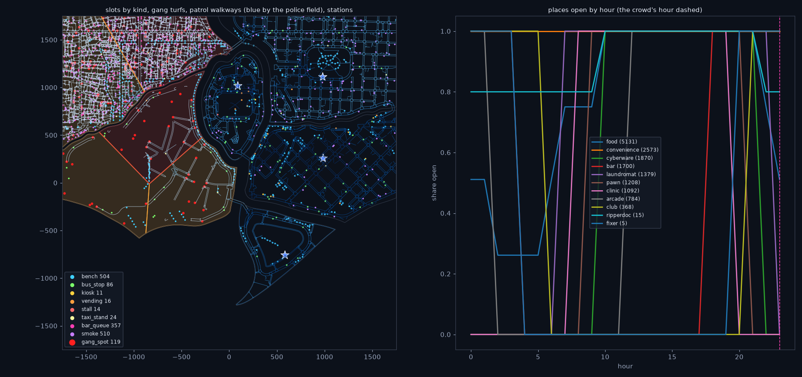

# LG4: life at places (lifegen)

Stage 4's life at places milestone (`docs/lifegen_scope.md` 6.4 and section 13): the city's
benches, bus shelters, kiosks, vending machines, food stalls and taxi stands used by the
crowd, clubs' queues and bars' smokers at their doors, shops, bars and clinics by their
opening hours, gangs on their own turf in their colors, police on foot and in patrol cars.
City-wide in every build, wherever the plan puts them. Built on the Windows PC (RTX 4070 Ti,
12700K, UE 5.8.4) on 2026-11-15, on main after LG2 (#231).

## What LG4 built

| Part | Where | What |
|---|---|---|
| Slots | `lifegen/places.py` `make_slots`, `gang_spots`; `presets.SLOT_KINDS` | every M6 bench, bus shelter, kiosk, vending machine and food stall, M11's taxi stands, a club's queue and a share of bars' smokers at their doors, each gang turf's spots (its hideouts' doors and its busiest corners); per slot its use points in the object's frame and the way each user faces, its walkway, its stay, its users per hour band; points in a building or on a carriageway left out |
| Places by their hours | `places.make_places`, `apply_hours`; `presets.PLACE_KINDS` | every AG3 shop door (16,125 in Delta) with its hours (M11's POI's own where the door is a POI's unit, else by its use; a food place's drawn among M11's food hours), open per hour, how busy by band (bars fill at night), a visit's chance and stay, occupancy; the doors' rates by the hours, the district's other doors taking up a closed one's people |
| Gangs on their turf | `places.gang_turfs`, `gang_walks`, `gang_spots`; `presets.GANG` | per gang turf (M11's territories of a gang faction) its walkways, the gang members M11's densities put on them by band (walking, and a loitering share at its spots), its faction's colors (its own first); M11's gang members outside every gang turf left out |
| Police patrols | `places.police_plan`; `presets.POLICE` | per district its police (M11's) on foot on its patrol walkways (the police field at least 0.25, weighted by the field squared) and in patrol cars on its main lanes (35% of them, two a car); the precincts' station doors |
| Roles in the pools | `plan.role_counts`, `assign_roles`, `traffic_plan(police_cars=...)`; `presets.ROLES` | crowd pool slots kept for gang members and police (LG2's gang and police looks), traffic pool slots for patrol cars (an AG18 car in a police livery): the most any tile wants within the live radius at any band, a margin, a cap |
| Checks | `plan.places_checks` | `slots_placed`, `slot_use`, `places_hours`, `gang_turf`, `police_patrols`, `places_budget` |
| The places' clips | `citygen/unreal_people.py` `ensure_place_clips`, `citygen/ue/people_places.py`; `presets.PLACE_CLIPS` | the Game Animation Sample's bench sitting loop and three standing idle breaks retargeted onto the library's bodies with its own retargeter, a manifest of their own; the library (`dd24b28ed929920b`) not rebuilt |
| Exporter | `citygen/unreal_life.py` `pack_places` (`PACK_VERSION` 6), `import_city.places_props` (`LIFE_VERSION` life7) | slots, walkways' turfs, gangs, police, patrols, the doors' hours, visits and stations, the pool's roles, patrol car slots and livery, the clips |
| Runtime | `CityGenLifePlaces.cpp`, `CityGenLifePlaces.h`, the walk processor's `StepSlot`, `CityGenLifeTraffic.cpp`, `CityGenLifePeople.cpp` | below |
| Console, menu, check, bench | `CityGenLifeModule.cpp`; `CityGenPlay` (the Tab menu's Places, gangs, police row); `bench.py` | `CityGenLife.Places`, `.Gangs`, `.Police`, `.SitOffset`, `.PlaceShow`; the status's `places`; pass `night_life_noplaces` |

The design, in short (`docs/unreal_export.md`, "From LG4: life at places"):

- **Slots are Smart Objects.** Every use point of a slot whose walkway is live (LG3's live
  region round the view) is a Smart Object of the world's subsystem (`CreateSmartObject`, no
  actor; a definition per slot kind made at BeginPlay with a `UCgPlaceBehaviorDefinition`
  naming its kind, behavior and clip), destroyed when its walkway goes. People claim a point
  through the subsystem, occupy it on arrival and free it when they leave; a point another user
  holds (the game's own AI) is passed over.
- **People use them on their way.** A person walking past a slot that wants another user (its
  users at the hour, the pool's scale) walks to a free point, sits, waits, queues, buys, eats,
  smokes or talks there for its stay, and walks back to where it left its walkway; a club's
  queue goes in at its door. A walkway coming alive gets its slots' users at once, part way
  through their stay. Crowd groups keep together; gang members break off to their own spots.
- **Not StateTree.** The behaviors are states of the person the walk processor already steps
  (to a slot, at it, back, inside a shop), a timer and two lerps each, on the game thread with
  the rest of its step. StateTree on Mass needs MassGameplay's and MassAI's processors (LG0
  kept the plugin free of them) and a tree instance per entity.
- **Places by their hours.** At the runtime's hour (23:00 until LG8; `CityGenLife.Hour`) a
  closed door sends no one out and takes no one in at a trip's end; an open shop takes a
  passer-by in for a visit by its chance, not drawn while inside, and lets them out again.
- **Gangs** come alive with their turf's walkways, walk only those, in groups of 1 to 4, dyed
  in their faction's colors, and stand at their spots in rings, talking. **Police** walk only
  the patrol walkways in pairs at a constable's pace, go back in at their station at a trip's
  end, and the station's live doors send pairs out while the police round the view are under
  their number. **Patrol cars** are the traffic pool's police slots in the livery (white body,
  dark trim, blue accent), filled with the lanes and made up for far from the view.
- **Animation.** Near people at a slot play their clip (the bench loop sitting; one of three
  idle breaks talking, smoking or eating; the idle standing at a stop or in a queue), each at
  its own place in the loop. Someone sitting stays near out to the mid tier (90 m, within the
  near cap: the baked walk has no sitting pose). Mid and far people at a slot hold the walk's
  passing pose, standing (a far sitter is a standing card at its seat: open item).

## The plan on Delta

`lifegen plan` on Delta (`builds/fix_play_cars`'s build, an empty spec): 14 s
([`plan/life_report.txt`](plan/life_report.txt)). Every check passes.

- **Slots:** 1,641: 504 benches, 86 bus stops, 11 kiosks, 16 vending machines, 14 food stalls,
  24 taxi stands, 357 club queues, 510 bars' smokers, 119 gang spots (28 props with no walkway
  within 15 m and 28 slots wholly in a building or on a carriageway left out, 194 points
  dropped). Users by band: night 1,197, morning 552, day 810, evening 1,205, late 1,926.
- **Places:** 16,125 shop doors; open at 23:00: every bar, club, arcade and convenience store,
  2,622 of 5,131 food places, 12 of 15 ripperdocs; no clinic, cyberware shop, laundromat or
  pawn shop.
- **Gangs:** 5 turfs (the Neon Tigers and the Ghost Saints in Old Town and the port), 376
  members walking at most and 564 at their spots by night; 62 of M11's gang members outside
  every gang turf left out. 288 pool slots kept (335 wanted near the view at most: scaled down
  there).
- **Police:** 303 on foot and 81 patrol cars at 23:00 over six precincts, four with a station's
  doors (Old Town's and the port's precincts have no station building in M11); 80 pool slots
  and 60 patrol car slots kept (`halcyon_sable` in the livery).

## In Unreal

SHOTS_PLACEHOLDER

## Benchmark

BENCH_PLACEHOLDER

## Package

PACKAGE_PLACEHOLDER

## Tests

TESTS_PLACEHOLDER

## Open items

OPEN_PLACEHOLDER
