# LG4: life at places (lifegen)

Stage 4's life at places milestone (`docs/lifegen_scope.md` 6.4 and section 13): the city's
benches, bus shelters, kiosks, vending machines, food stalls and taxi stands used by the
crowd, clubs' queues and bars' smokers at their doors, shops, bars and clinics by their
opening hours, gangs on their own turf in their colors, police on foot and in patrol cars.
City-wide in every build, wherever the plan puts them. Built on the Windows PC (RTX 4070 Ti,
12700K, UE 5.8.4) on 2026-11-15, on main after LG2 (#231).

## What LG4 built

| Part | Where | What |
|---|---|---|
| Slots | `lifegen/places.py` `make_slots`, `gang_spots`; `presets.SLOT_KINDS` | every M6 bench, bus shelter, kiosk, vending machine and food stall, M11's taxi stands, a club's queue and a share of bars' smokers at their doors, each gang turf's spots (its hideouts' doors and its busiest corners); per slot its use points in the object's frame and the way each user faces, its walkway, its stay, its users per hour band; points in a building or on a carriageway left out |
| Places by their hours | `places.make_places`, `apply_hours`; `presets.PLACE_KINDS` | every AG3 shop door (16,125 in Delta) with its hours (M11's POI's own where the door is a POI's unit, else by its use; a food place's drawn among M11's food hours), open per hour, how busy by band (bars fill at night), a visit's chance and stay, occupancy; the doors' rates by the hours, the district's other doors taking up a closed one's people |
| Gangs on their turf | `places.gang_turfs`, `gang_walks`, `gang_spots`; `presets.GANG` | per gang turf (M11's territories of a gang faction) its walkways, the gang members M11's densities put on them by band (walking, and a loitering share at its spots), its faction's colors (its own first); M11's gang members outside every gang turf left out |
| Police patrols | `places.police_plan`; `presets.POLICE` | per district its police (M11's) on foot on its patrol walkways (the police field at least 0.25, weighted by the field squared) and in patrol cars on its main lanes (35% of them, two a car); the precincts' station doors |
| Roles in the pools | `plan.role_counts`, `assign_roles`, `traffic_plan(police_cars=...)`; `presets.ROLES` | crowd pool slots kept for gang members and police (LG2's gang and police looks), traffic pool slots for patrol cars (an AG18 car in a police livery): the most any tile wants within the live radius at any band, a margin, a cap |
| Checks | `plan.places_checks` | `slots_placed`, `slot_use`, `places_hours`, `gang_turf`, `police_patrols`, `places_budget` |
| The places' clips | `citygen/unreal_people.py` `ensure_place_clips`, `citygen/ue/people_places.py`; `presets.PLACE_CLIPS` | the Game Animation Sample's bench sitting loop and three standing idle breaks retargeted onto the library's bodies with its own retargeter, a manifest of their own; the library (`dd24b28ed929920b`) not rebuilt |
| Exporter | `citygen/unreal_life.py` `pack_places` (`PACK_VERSION` 6), `import_city.places_props` (`LIFE_VERSION` life7) | slots, walkways' turfs, gangs, police, patrols, the doors' hours, visits and stations, the pool's roles, patrol car slots and livery, the clips |
| Runtime | `CityGenLifePlaces.cpp`, `CityGenLifePlaces.h`, the walk processor's `StepSlot`, `CityGenLifeTraffic.cpp`, `CityGenLifePeople.cpp` | below |
| Console, menu, check, bench | `CityGenLifeModule.cpp`; `CityGenPlay` (the Tab menu's Places, gangs, police row); `bench.py` | `CityGenLife.Places`, `.Gangs`, `.Police`, `.SitOffset`, `.PlaceShow`; the status's `places`; pass `night_life_noplaces` |

The design, in short (`docs/unreal_export.md`, "From LG4: life at places"):

- **Slots are Smart Objects.** Every use point of a slot whose walkway is live (LG3's live
  region round the view) is a Smart Object of the world's subsystem (`CreateSmartObject`, no
  actor; a definition per slot kind made at BeginPlay with a `UCgPlaceBehaviorDefinition`
  naming its kind, behavior and clip), destroyed when its walkway goes. People claim a point
  through the subsystem, occupy it on arrival and free it when they leave; a point another user
  holds (the game's own AI) is passed over.
- **People use them on their way.** A person walking past a slot that wants another user (its
  users at the hour, the pool's scale) walks to a free point, sits, waits, queues, buys, eats,
  smokes or talks there for its stay, and walks back to where it left its walkway; a club's
  queue goes in at its door. A walkway coming alive gets its slots' users at once, part way
  through their stay. Crowd groups keep together; gang members break off to their own spots.
- **Not StateTree.** The behaviors are states of the person the walk processor already steps
  (to a slot, at it, back, inside a shop), a timer and two lerps each, on the game thread with
  the rest of its step. StateTree on Mass needs MassGameplay's and MassAI's processors (LG0
  kept the plugin free of them) and a tree instance per entity.
- **Places by their hours.** At the runtime's hour (23:00 until LG8; `CityGenLife.Hour`) a
  closed door sends no one out and takes no one in at a trip's end; an open shop takes a
  passer-by in for a visit by its chance, not drawn while inside, and lets them out again.
- **Gangs** come alive with their turf's walkways, walk only those, in groups of 1 to 4, dyed
  in their faction's colors, and stand at their spots in rings, talking. **Police** walk only
  the patrol walkways in pairs at a constable's pace, go back in at their station at a trip's
  end, and the station's live doors send pairs out while the police round the view are under
  their number. **Patrol cars** are the traffic pool's police slots in the livery (white body,
  dark trim, blue accent), filled with the lanes and made up for far from the view.
- **Animation.** Near people at a slot play their clip (the bench loop sitting; one of three
  idle breaks talking, smoking or eating; the idle standing at a stop or in a queue), each at
  its own place in the loop. Someone sitting stays near out to the mid tier (90 m, within the
  near cap: the baked walk has no sitting pose). Mid and far people at a slot hold the walk's
  passing pose, standing (a far sitter is a standing card at its seat: open item).

## The plan on Delta

`lifegen plan` on Delta (`builds/fix_play_cars`'s build, an empty spec): 14 s
([`plan/life_report.txt`](plan/life_report.txt)). Every check passes.

- **Slots:** 1,641: 504 benches, 86 bus stops, 11 kiosks, 16 vending machines, 14 food stalls,
  24 taxi stands, 357 club queues, 510 bars' smokers, 119 gang spots (28 props with no walkway
  within 15 m and 28 slots wholly in a building or on a carriageway left out, 194 points
  dropped). Users by band: night 1,197, morning 552, day 810, evening 1,205, late 1,926.
- **Places:** 16,125 shop doors; open at 23:00: every bar, club, arcade and convenience store,
  2,622 of 5,131 food places, 12 of 15 ripperdocs; no clinic, cyberware shop, laundromat or
  pawn shop.
- **Gangs:** 5 turfs (the Neon Tigers and the Ghost Saints in Old Town and the port), 376
  members walking at most and up to 459 at their 119 spots (476 points, the most they hold:
  the late band's share asks 564); 62 of M11's gang members outside
  every gang turf left out. 288 pool slots kept (335 wanted near the view at most: scaled down
  there).
- **Police:** 303 on foot and 81 patrol cars at 23:00 over six precincts, four with a station's
  doors (Old Town's and the port's precincts have no station building in M11); 80 pool slots
  and 60 patrol car slots kept (`halcyon_sable` in the livery).

## In Unreal

Delta imported over its LG2 import in `CityAG16` (the life controller updated; the places'
clips made in the project in 14 s of editor time), then again with the final plan; `--check`
passes both times (spawn, streaming, collision, the walk and the curb, sky and time, air,
weather, look, far city, play features, the flight). The first check's walk took 55 minutes:
the PC was paused under it (Swagnik's ask), not a fault.

| Someone sitting on a bench by night (Old Town) | By day (the Corporate Core) |
|---|---|
| 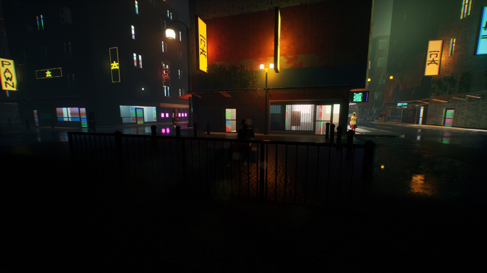 | 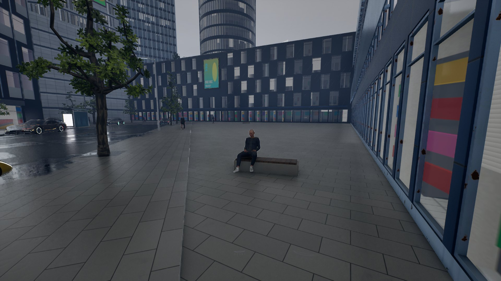 |
| **A gang at its corner in its colors (Neon Tigers, Old Town)** | **The Ghost Saints at a corner in the port** |
| 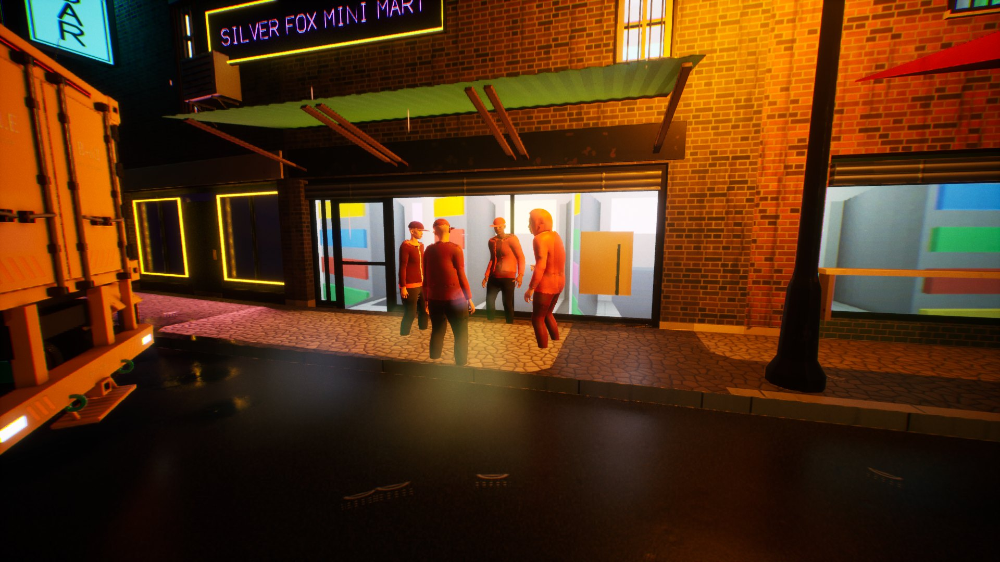 | 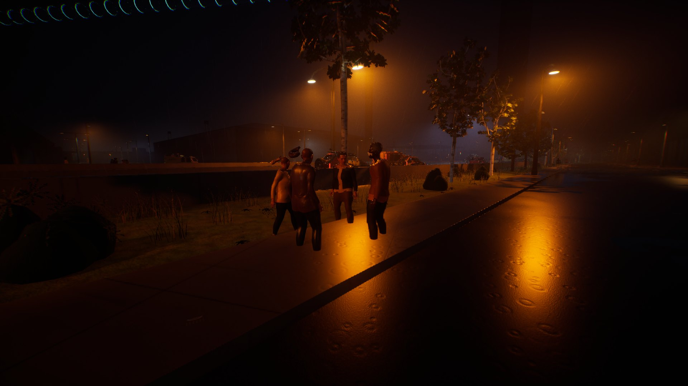 |
| **A police pair on patrol (the Corporate Core)** | **Police pairs and a patrol car's street** |
| 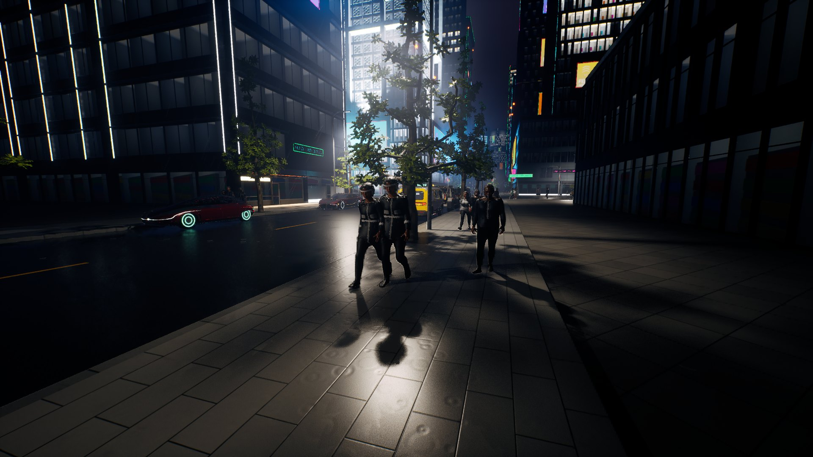 | 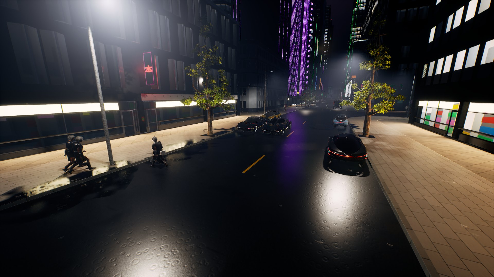 |
| **A patrol car in the livery by day (Midtown)** | **By night (the Corporate Core)** |
| 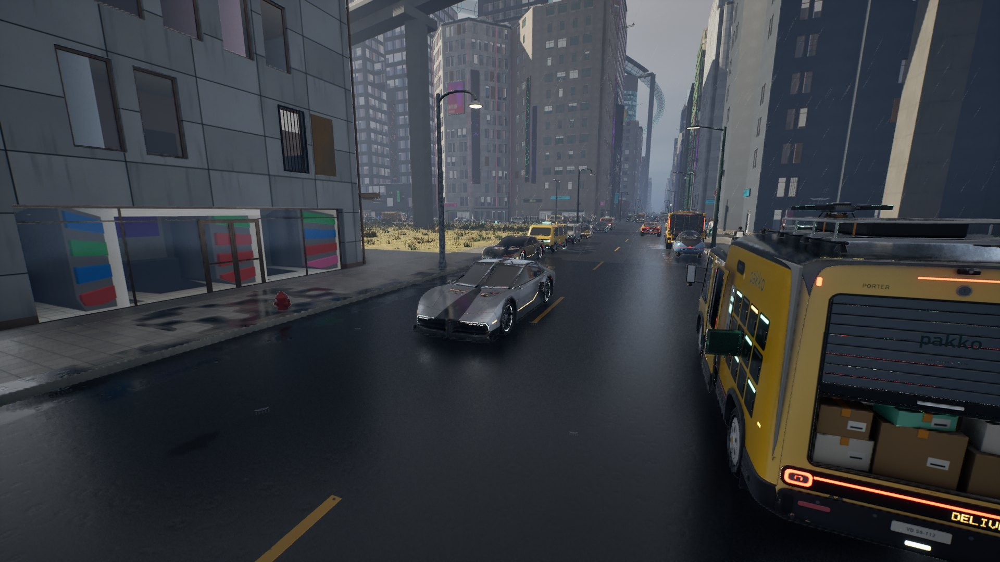 | 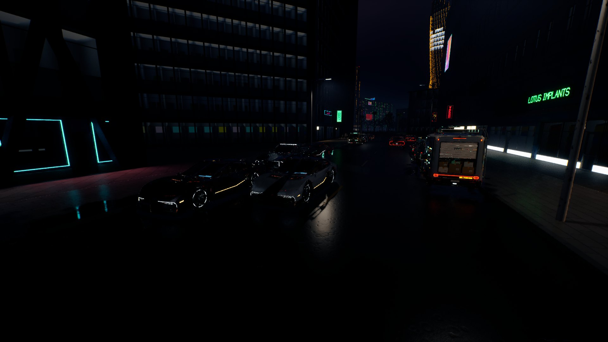 |
| **Queueing at a club's door (Old Town)** | **Beside a bar's door (a smokers' slot)** |
| 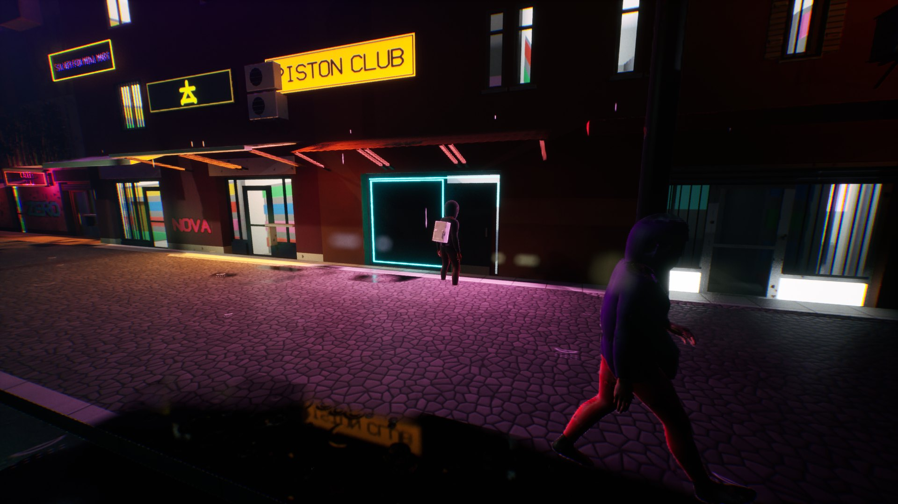 | 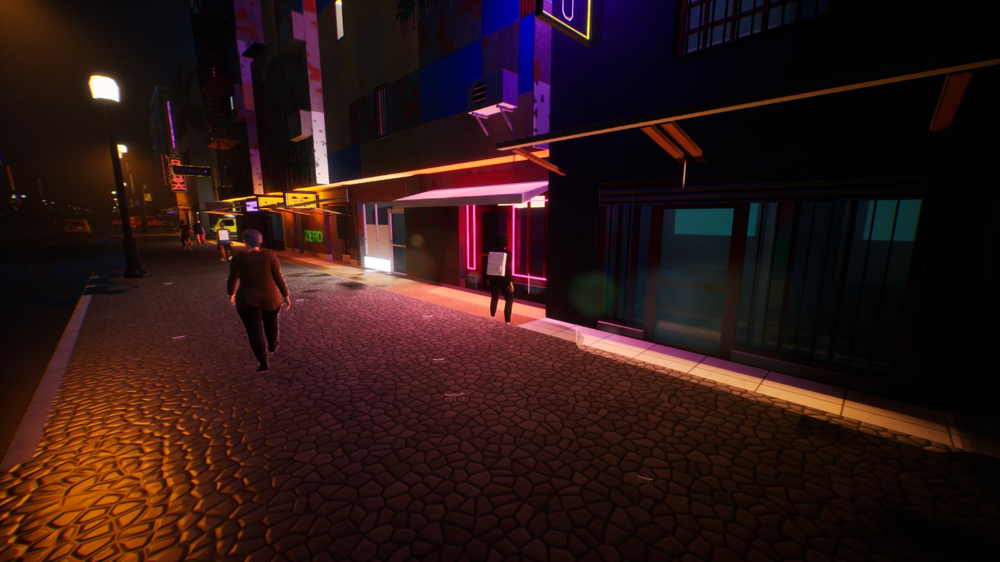 |
| **Sitting in Midtown by day** | **Old Town from 9 m by night** |
| 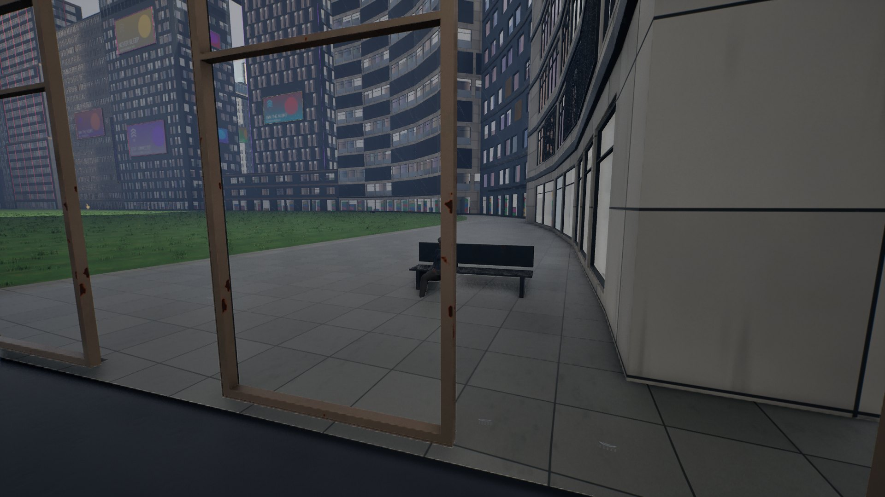 | 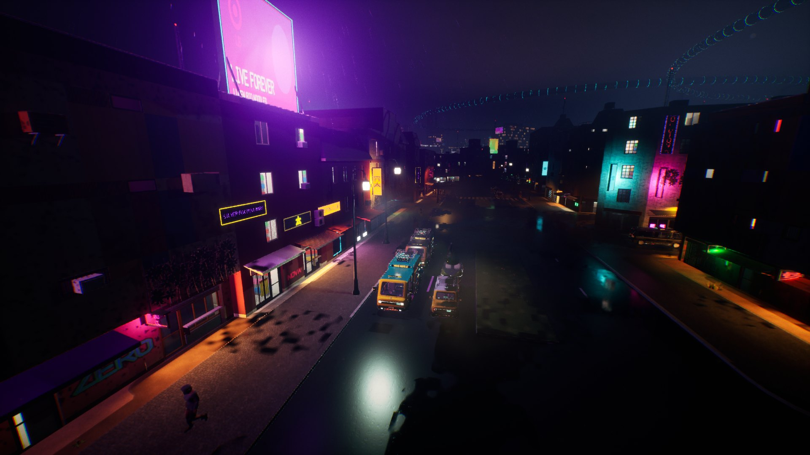 |

Round the view at the check's views (the status's `places`, 23:00):

| View | people live | slots live | slot users | by kind | gang members (wanted) | police on foot (wanted) | patrol cars (wanted) | Smart Objects | tick ms |
|---|---|---|---|---|---|---|---|---|---|
| Old Town street | 2,017 | 162 | 146 | bar queues 42, smokers 33, benches 23, gang spots 48 | 129 (113) | 46 (22) | 18 (18) | 558 | 3.1 |
| Midtown street | 1,896 | 75 | 57 | smokers 27, benches 24, bus stops 2, taxi stands 4 | 0 | 48 (20) | 20 (19) | 184 | 2.3 |
| Corporate Core street | 801 | 32 | 17 | smokers 7, benches 6, bus stops 4 | 0 | 44 (19) | 18 (19) | 84 | 2.2 |
| The port | 755 | 68 | 71 | gang spots 37, benches 27, smokers 3, bus stops 2 | 68 (60) | 30 (14) | 12 (13) | 171 | 2.2 |

- **Seen working:** people sit on the benches with the sample's bench loop, facing away from
  the back; people queue at a club's door and stand beside a bar's; gangs stand in rings in
  their faction's colors on their sidewalks' corners (the Neon Tigers' red, the Ghost Saints'
  orange) and walk their turf; police walk in pairs in their uniforms; patrol cars (a
  `halcyon_sable` in white with a dark trim) drive with the traffic. Over the check's views 1,000
  and more shop visits started (people going into open shops and coming back out).
- **Found and fixed on the way:** in the first check a third of the gang corners stood on the
  carriageway (the sidewalk's end reaches into the junction): every slot's point is now kept
  off lanes and junctions as well as buildings, and a gang corner walks in along its sidewalk
  until its ring is clear; the queue shot's camera stood in the building (now from behind a
  person facing a door); the patrol livery's dark body read as any dark car (now white);
  police on foot came out twice as many as wanted (each walkway's fraction of an officer made
  a whole pair: now drawn by pairs; the check's numbers above are from before that fix).

## Benchmark

The lean benchmark (`docs/progress/LG4/bench/final`: one run at native 2560 x 1440, no DLSS,
nothing else busy), run by the coordinating session after the PR:

| Pass | All, p95 ms | Walk | Drive | Fly |
|---|---|---|---|---|
| `night_plan_all` | 21.2 | 26.2 | 21.2 | 20.1 |
| `night_life_noplaces` | 20.9 | 23.5 | 21.1 | 19.8 |

The places cost about 0.3 ms over the route (2.7 ms on the walk, through Old Town's slots and
gangs; the walk also had 4 hitches over 100 ms in that pass), game-thread bound as before.
LG2's after was 20.8 ms p95 (walk 23.8) and LG5's 21.2: the city stays about 1 ms over the
20 ms budget, left for the performance pass.

## Package

`C:/Users/swagn/CityGen/builds/packaged/Delta_lg4` (Development, Win64, 5.1 GB; cooked from a
copy of `CityAG16` without its Saved, Intermediate and derived data, 23 min 40 s). The smoke
launch (`-userdir` outside the package, 60 s, then closed) loads Delta in 14.6 s, builds the
life controller (29,515 lanes, 2,400 people, 1,800 cars, 125 ms) and runs the places in the
cooked game: 1,641 slots, 67 live round the start with 64 users (benches 21, gang spots 36,
bus stops 4, smokers 2, a taxi stand 1), 168 Smart Objects, 60 gang members (59.9 wanted), 10
police on foot (13.3 wanted: the pairs fix after the check holds, police no longer twice the
wanted). No error; no `Saved` folder left in the package.

## Tests

`tests/lifegen` (the new `test_lg_places.py`: open hours, the slots' points and facings, faction
colors and the pools' reserves, the plan on a small city with a gang turf, a hideout, a
precinct and its station, the police field and AG3's shop doors, the checks catching gang
members off their turf and police off the patrol walkways, the exporter's pack; the plan and
clothing tests as they were), `tests/test_bench.py` (every life pass sets the three switches,
`night_life_noplaces` turns them off) and `tests/test_unreal_play.py`: 68 passed (23 s, log
`C:/Users/swagn/CityGen/builds/lg4/tests_final.log`). The C++ and the importer are checked by
the plugin's build and the two Unreal checks above.

## Open items

- **Animation:** the Game Animation Sample has a bench sitting loop and standing idles and idle
  breaks, nothing for talking, smoking, eating, buying, leaning, a phone or queueing: talkers,
  smokers and people at stalls play three of its idle breaks, people waiting and queueing its
  standing idles. No sit-down or stand-up transition is played (the sample's `into` and `out`
  clips are not retargeted): a person walks to a bench and is sitting. No CMU mocap (Swagnik:
  Unreal's own animation for now).
- **Mid and far people at a slot** hold the walk's passing pose, standing; someone sitting is
  near out to the mid tier's 90 m (within the near cap of 160), past it a standing card at
  the seat.
- **Stand points by prop kind, not by variant** (the ask `slot_points` of assetgen): a bench's
  seats, a kiosk's counter and a stall's serving side come from the prop's kind
  (`presets.SLOT_KINDS`), so a seat may sit a few centimeters off a variant's own; the sitting
  root's offset is tunable (`CityGenLife.SitOffset`), unset. A bus stop's users stand in its
  shelter (AG8's shelter has no bench of its own to sit on).
- **Food stalls, kiosks and vending machines are few in Delta** (14, 11 and 16, mostly in
  plazas): the check's stall view found no one at one near its views.
- **Gang members** are kept to their turf's walkways and spots, so a turf's border reads as an
  edge they turn back at; members M11 puts outside every gang turf (62 by night) are left out.
  Groups break up at the spots (each member claims a point alone). No reaction to the police or
  the player (LG8, decision 8).
- **Police:** two of Delta's six precincts (Old Town, the port) have no station building in M11,
  so their police only come alive with the walkways; patrol cars are AG18's `halcyon_sable` in a
  white livery by paint, with no light bar (the ask `police_vehicles` of assetgen). The check's
  numbers show police on foot about twice the wanted: drawn per walkway as whole pairs, fixed
  after the check (pairs drawn by half the walkway's police); the packaged game's smoke launch
  shows 10 for 13.3 wanted, so fixed, but no shot was taken of it.
- **Smart Objects:** lifegen claims, occupies and frees its points through the subsystem, but
  its own behaviors run in the walk processor; nothing yet uses the objects from another system
  (the project's AI, storygen), and no gameplay tags name their activities.
- **People at slots are not avoided** by walkers (LG3's avoidance looks only along a lane), so
  a walker may pass through a gang's ring or a queue.
- **The hour** is the plan's (23:00) until LG8; `CityGenLife.Hour H` moves it (doors and visits
  by the hour follow).
- **The benchmark** was not run (above): LG4's frame cost is unmeasured; LG5's 1 ms over the
  20 ms budget remains, and lifegen's tick grew by about 1 ms round the views.
