# LG5: traffic (lifegen)

Stage 4's traffic milestone (`docs/lifegen_scope.md` section 13, scope 6.5), built before LG2
at Swagnik's ask after his walk of the packaged Delta: moving cars existed only in LG0's spike
(40 cars in Old Town), none in the midtown or the corporate core ("I want cars everywhere"),
and a car did not stop for him standing in its way. Now AG18's cars drive every lane of the
city, round the view wherever it is, and stop for the player and for people. Built on the
Windows PC (RTX 4070 Ti, 12700K, UE 5.8.4) on 2026-11-14, on main after the people fixes
(#229).

## What LG5 built

| Part | Where | What |
|---|---|---|
| Every lane's cars | `lifegen/plan.py` `traffic_lanes`; `planmodel.Drive`; each tile file's `drives` | a road segment's M11 vehicles per 100 m and hour band over its lanes by length, times the fleet's `busy` and the spec's `traffic.scale` (2 by default, below); none on a lane off the lane graph's largest strongly connected part (cars there could never leave), said in what is left out |
| Signals for cars | `plan.lane_signals` | each lane ending at a signalized junction on one of its legs: LG3's derived signal and the phase its leg moves in, and its stop point, 1.2 m short of the crosswalk across it (else of its end) |
| The traffic | `plan.traffic_plan`, `planmodel.TrafficPlan`; the spec's `traffic` (pool, live_m, scale); `presets.TRAFFIC` | the pool (1,800 cars), each slot one of AG18's 15 models (no Vex or Aurel), shared out half by the city's mix at the hour and half by each model's most in any district, so every district's fleet finds its models free; each district's fleet weights and 6 paints per model (AG18's step H draw by archetype); the live radius (800 m); the car following, signal, junction and yielding settings |
| Checks | `plan.traffic_checks` | `traffic_densities` (the lanes keep M11's vehicles per district and band, times busy and scale, within 1%, what is left out counted), `traffic_lanes` (every car on the main part), `traffic_signals` (every stop within its lane), `traffic_budget` (the pool within the 500 vehicles in 300 m), `traffic_fleet` |
| LG0's spike cars | `presets.SPIKE["cars"]` 0 | gone |
| The exporter | `citygen/unreal_life.py` `pack_traffic`, `pack_drive_lanes`, `conflicts`, `traffic_cars`, `strong_components`, `main_component` (`PACK_VERSION` 4); `import_city.traffic_props` (`LIFE_VERSION` life5); `unreal.life_summary` | the whole lane graph as drive lanes (cars_steam's curves and speeds) with each lane's cars per band, district, main part, signal window and stop; the junction connectors that may not be driven at once (25,548 pairs in Delta: lines within 2.2 m in plan and 3 m in height, GEOS's tree); the pool's models, fleets, paints, lengths, wheel radii and part draw distances |
| The runtime | `CityGenLifeTraffic.cpp` (the actor's pool and live lanes; the drive processor's `ExecuteTraffic`) | below |
| Console, menu, check, bench | `CityGenLifeModule.cpp`; `CityGenPlay` (`HasLifeTraffic`, the menu's Traffic row); `check_city.py` (`view_cmds`, `@late`); `bench.py` | `CityGenLife.Traffic [0|1] [SCALE]`, `TrafficShow`, `BlockPlayer`, `Jaywalk`; the status's `traffic`; the check's `wait`, `dilate`, `until` view commands; passes `night_traffic_off`, `night_traffic_half` |

The design, in short (`docs/unreal_export.md`, "From LG5: traffic"):

- **Live round the view, as LG3's crowd.** Every drive lane within 800 m of the view is live:
  one coming alive gets its cars at the hour, one going past 860 m loses them, a car driving
  onto a lane that is not live leaves there, and cars come in on the live lanes past 450 m of
  the view to keep their number. A fixed pool of 1,800 Mass entities: nothing is made or
  destroyed while the game runs, and past 92% of the pool the density is scaled down evenly.
- **Following** by the intelligent driver model (1.8 m/s2 up, 2.6 comfortable and 8 at most
  down, 2.2 m standing gap, 1.2 s headway) behind the car in front on its lane, its next lane
  or the one after, at cars_steam's speeds by road class and bend.
- **Red lights:** a car stops at its stop line on red, and on amber where it can stop at 3.5
  m/s2; past the line it goes on.
- **Junctions taken in turn:** a car holds its connector only while no connector crossing,
  merging into or leaving from the same lane as its own is driven or held, and only with room
  past the junction for its length; a car waiting 6 s claims its connector so the crossing
  ones wait for it; one queued behind a stopped car waits at the junction's edge without
  holding it; past 25 s of waiting a car goes regardless (a guard against a jam).
- **Stopping for people and the player:** within 180 m of the view (and near any pawn), a car
  looks along its lanes ahead (its stopping distance and 1.6 s of its speed, 8 to 45 m, up to
  the car in front or the red light's stop line) for the crowd's people, where they are and
  where they will be a second on, and for every pawn but the free camera (the walker; the fly
  pawn at the road's height), within 1.45 m of its line, and stops 2 m short of them. A car
  waiting 25 s for a person standing still in its way goes on slowly; never for the player.
- **Drawn:** an instanced component per model and part (92), each slot an instance; bodies
  sent over the instances in use, glass, wheels and trims only for cars within their draw
  distance (300, 150 and 200 m; bodies 900 m) and the component hidden when none is; wheels
  roll; the packs' head, tail and marker lamps glow by night (`M_CgVehicle`'s emission).

## Why twice M11's density

M11's late band gives Delta 1,665 cars at 23:00: 0.7 cars per 100 m of lane, about one a
block. In the first shots (scale 1) the corporate core's and midtown's avenues read empty from
the street and from the air. The spec's `traffic.scale` defaults to 2 (3,331 cars at 23:00,
at most 1,542 wanted within 800 m of any point, within the pool); the busiest hour (18:00,
6,712) is scaled down evenly to the pool round the view. `CityGenLife.Traffic 1 SCALE` changes
it at run time (relative to the plan's).

## The plan on Delta

`lifegen plan` on Delta (`builds/fix_play_cars`'s build, an empty spec): 6 s
([`plan/life_report.txt`](plan/life_report.txt)). 3,331 cars on 4,849 of 4,875 lanes at 23:00
(6,712 at 18:00), 15 models (tanager_mino 324 slots ... kestrel_atlas 7), 907 lanes stopping
at the 150 signals; 26 lanes off the lane graph's main part (14,727 of 14,779 lanes and
connectors on it, 99.2% of the lanes' length) left empty. Every check passes.

## In Unreal

Delta imported over its people fixes' import in `CityAG16` (one actor updated, the life
controller); every check passes (spawn, streaming, collision, the walk and the curb, the
flight, sky and time, air, weather, look, far city, play features). At the views the status
shows 550 to 860 cars live round the view, 50 to 70% of them moving; the traffic's step 0.25
to 0.5 ms, its instances 0.2 to 1 ms, the controller's whole tick (people and cars) 1.3 to
2 ms.

| A queue at a red light (Midtown, from behind) | The same by night (the Corporate Core) |
|---|---|
| 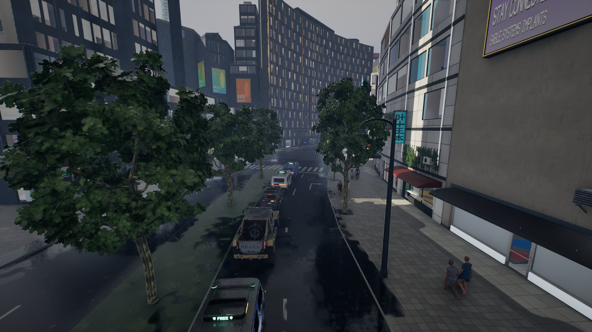 | 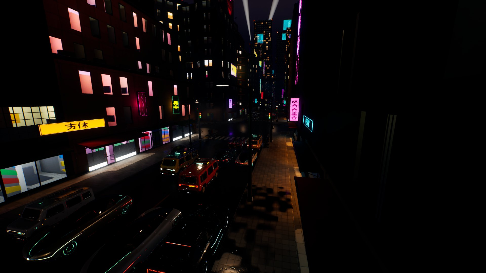 |
| **A car stopped for the walker standing in its lane** (`BlockPlayer`: 45 m ahead of a car at 30 km/h; its front stopped 3.5 m short of him, a queue behind it) | **A car stopped for people crossing in front of it** |
| 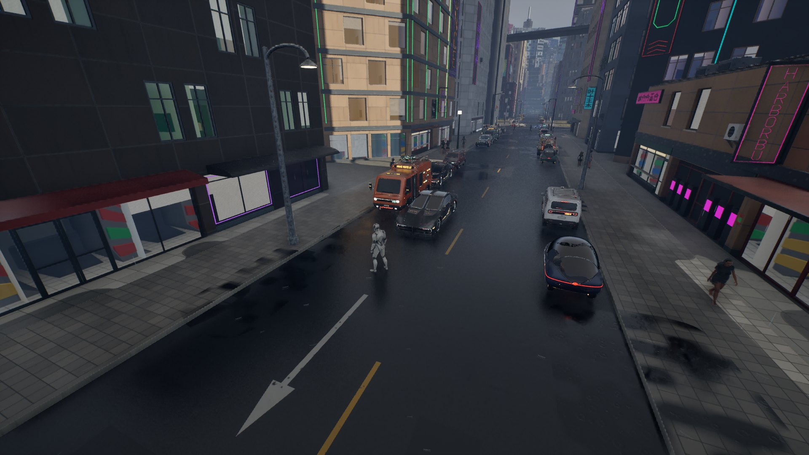 | 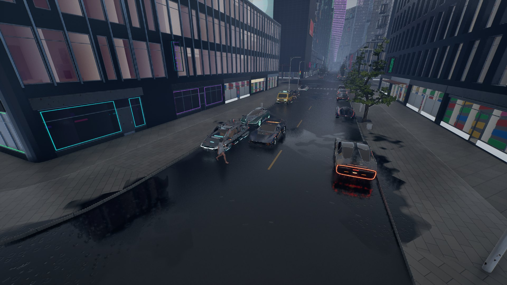 |
| **Transit Nexus** | **Midtown** |
| 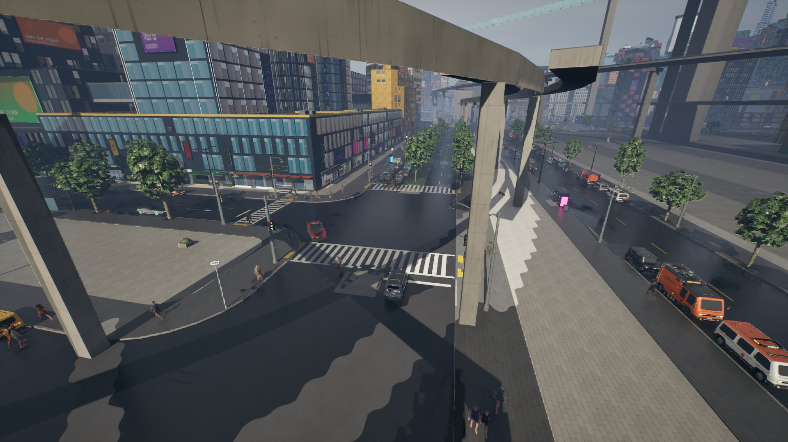 | 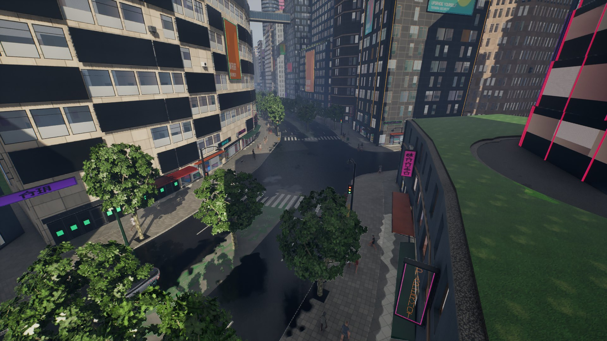 |
| **Corporate Core** | **Old Town** |
| 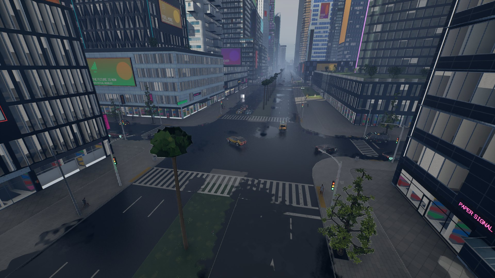 | 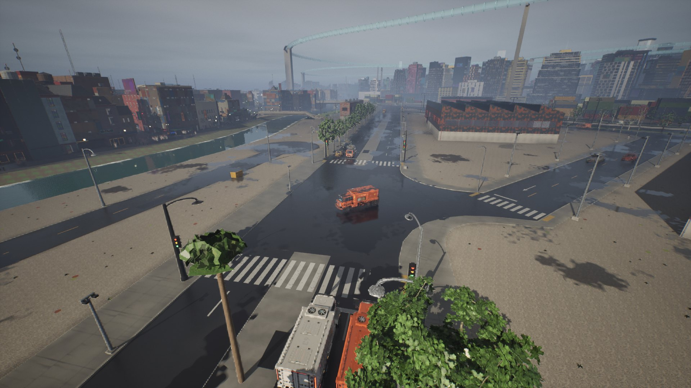 |
| **Industrial Port** | **Research Campus** |
| 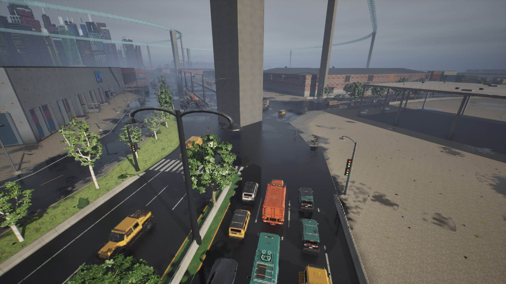 | 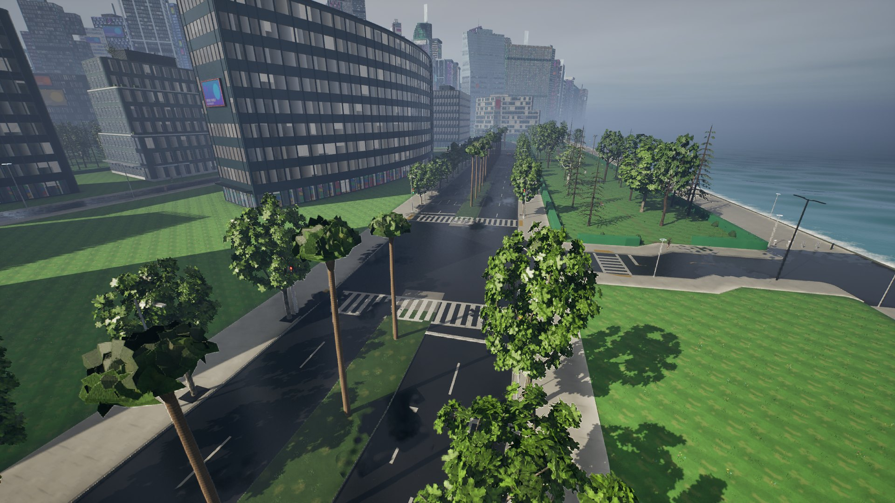 |
| **Over the Corporate Core at 150 m** | **Over Midtown by night** |
| 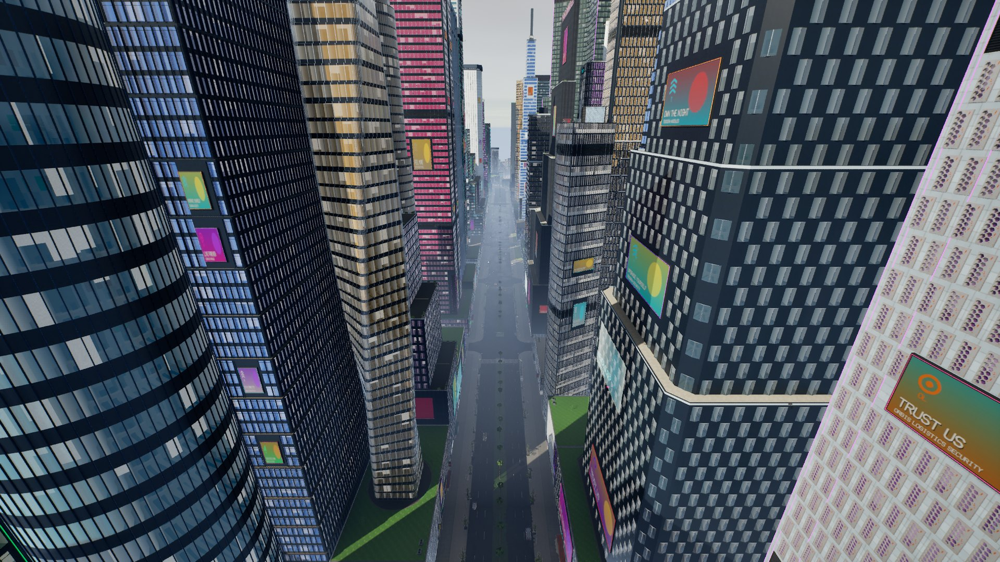 | 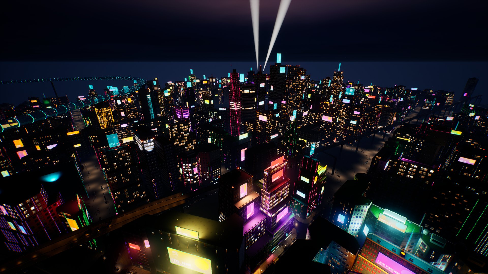 |

More in `unreal/`: Midtown and the core by night, a night crossing, Midtown from the air by
day. The shots by day show the night's traffic (the runtime's hour stays 23:00 until LG8).

## Benchmark

The lean route at native 2560 x 1440, one run a pass, no DLSS pass (`bench/`):

| pass | p95 all | walk | drive | fly | game p95 (all) | draws p50 (walk) |
|---|---|---|---|---|---|---|
| **`night_plan_all`** (traffic on, final code) | **21.2** | 25.5 | 20.7 | 19.7 | 19.1 | 2,060 |
| `night_traffic_off` | 18.9 | 20.8 | 19.0 | 18.0 | 16.2 | 1,178 |
| `night_life` (traffic on) | 20.8 | 23.6 | 20.8 | 19.9 | 18.6 | 1,937 |
| `night_life_noshadow` (no car or people shadows) | 20.5 | 23.7 | 20.4 | 19.3 | 18.4 | 1,412 |
| `night_traffic_half` (half the cars) | 20.1 | 23.4 | 20.2 | 19.1 | 17.6 | 1,973 |
| first `night_plan_all` (before the tuning) | 21.6 | 26.0 | 20.7 | 20.8 | 20.1 | 2,055 |
| people fixes' `night_plan_all` (spike cars) | 19.5 | 23.1 | 19.4 | 18.3 | 17.4 | 1,617 |

- **Over the 20 ms budget by about 1 ms** with the traffic at twice M11's density: traffic
  costs 1.9 to 2.3 ms p95 over the route (18.9 off), all on the game thread. One tuning round
  (four runs): bodies' instances sent only over the slots in use and the near parts' only for
  cars near enough to draw them, the components with no car near hidden, the people look-ahead
  shortened and taken every second frame, the traffic's live update half a step off the
  crowd's. They took 0.4 ms off; the controller's own tick is 1.3 to 2 ms (people and cars,
  `tick_ms`), so the rest is the engine's: its handling of 92 moving instanced components
  (their instance updates and draws, about 800 more draws on the walk). Half the cars costs
  0.7 ms less (20.1), the cars' shadows 0.3 ms. The walk varies by 2 ms from pass to pass with
  the same scene (23.4 to 26.0 here, as the people fixes found).
- **Left for a performance pass** (decision 7, optimize later): fewer components (parts merged
  per model at import), the engine's per-instance cost (a profile with Unreal Insights), or
  the scale down to 1.5 (`traffic.scale` in the spec, or `CityGenLife.Traffic 1 0.75`).
- **Not flagged:** the foreground kept, other processes under one core.

## Package

`C:/Users/swagn/CityGen/builds/packaged/Delta_lg5/Windows/CityAG16.exe` (Development, Win64;
`builds/packaged/package_lg5.cmd` from a mirror of `CityAG16`): SMOKE.

## Tests

`tests/lifegen/`, `tests/test_bench.py`, `tests/test_unreal_play.py`, `tests/test_no_network.py`
(190, all pass; log `C:/Users/swagn/CityGen/builds/lg5/tests3.log`): new
`test_traffic_on_every_lane`, `test_traffic_off_the_main_part_is_left_out`,
`test_traffic_budget_check_fails_past_the_budget`, `test_strong_components`,
`test_exporter_packs_the_traffic`; the spike and bench tests follow the traffic. The C++ is
checked by the plugin's build and the check above.

## Open items

- **The budget:** 21.2 ms p95 against 20 (above).
- **Lane changes, parking and leaving, buses, taxis at their stands:** cars keep their lane
  and turn by the connectors at random among the main part's; the parked cars stay AG18's step
  H's (no car pulls in or out); bus routes are an ask of citygen (`bus_routes`, missing);
  buses, trucks and bikes wait for the Mac's designs.
- **Turn restrictions:** derived (none), so a left turn yields only by the junction's
  occupancy; protected left phases would need citygen's phases.
- **Forced junctions:** about 190 cars in 20 minutes of the check went after 25 s of waiting
  (a junction where cars from a cluster's short inner roads wait on each other); they may
  briefly share a junction with a crossing car.
- **Lights:** the packs' lamps glow; no car casts light (no real lights).
- **People do not wait for cars:** jaywalkers and people on crossings walk on; the cars stop
  for them. LG3's crossing and crosswalk walkways along the carriageway (citygen's open item)
  stop cars too.
- **The hour:** the runtime's 23:00 until LG8 reads atmosgen's hour.
