# LG6: transit (lifegen)

Stage 4's transit milestone (`docs/lifegen_scope.md` 6.6, section 8's timetables, section 13):
every transit line of the city runs its trains to a timetable, they stop at the stations with
their doors open, and people leave and board them on the platforms. City-wide: every line,
every train, wherever the view is. Built on the Windows PC (RTX 4070 Ti, 12700K, UE 5.8.4) on
2026-11-16, on main after the crossings fix's Unreal run (#234).

## What LG6 built

| Part | Where | What |
|---|---|---|
| Tracks and stops | `lifegen/transit.py` `Track`, `stops_of`, `platform_half`, `clear_of` | per line of the model (`transit_lines`) its track (M5's path in 3D; a loop closing on itself) and its stops: each station's platform walkway (M5's `platform`, a metro's `concourse`, else its first access) projected onto the track (within 25 m in plan and 12 m in height), the platform deck's half width across the track, how far its people keep off the line's middle, where they board |
| Runs | `profile`, `speed_limits`, `cycle` | the fastest runs between stops on a 2 m grid: forward at the mode's acceleration, backward at its braking, at most its cruise and sqrt(lateral R) wherever any of the train is (R the track's radius in plan over its length); dwells by mode |
| The cycle | `cycle`, `sample` | a loop one way round from its first stop; an open line the whole track there and back, a 60 s layover at each end (a terminal station within a train's length of an end is where it turns, doors open), crossing to the other way's track over the 90 m before it turns; sampled every half second (constant acceleration within each grid step) |
| Trains | `trains_for`, `min_gap` | per hour band ceil(cycle / headway) trains evenly round the cycle (the spec's `transit.headway_min` by line name, else the mode's), fewer where two would come within a train's length and 60 m or into a terminal at once (the raised headway in the record's `notes`); ids `train.<line id>.<n>`, a layer 4 entry each |
| Boarding | `station_riders`, `boarding` | a station's riders are its street accesses' people (LG3's spawn rates by hour); per stop and band as many leave each train calling there as board it: the riders over the trains calling (every line and way), at least `board_min`, at most the mode's `board_max` |
| Checks | `transit.checks` | `timetables` (speeds, curve limits, acceleration and braking read back from the samples; dwells; a run no shorter than its distance at cruise; a loop closing, an open line turning at both ends; trains apart), `transit_stops`, `transit_boarding` (each stop's board walkway in the graph, reaching its station's street accesses), `transit_budget` (120 trains, 600 cars) |
| Outputs | `timetables.json` (`planmodel.Timetables`), the plan's `transit` (`TransitPlan`), `preview_transit.png`, the ask `train_models` | |
| Presets | `presets.TRANSIT_MODES`, `TRANSIT_HEADWAY_MIN`, `TRANSIT` | per mode cruise, rates, curve pull, dwell, cars and their size, the car's floor and base over the line, its track off the middle, doors, boarding |
| Exporter | `citygen/unreal_life.py` `pack_transit`, `TRANSIT_MODELS` (`PACK_VERSION` 7); `import_city.transit_props`, `transit_material` (`LIFE_VERSION` life8) | every line's track, train, cycle, samples, events and stops; the stand-ins' per mode model table; the platforms' keep-out and widths; the served stations' street accesses |
| Runtime | `CityGenLifeTransit.cpp`; the walk processor's `CgWalk::Board` and `WalkClear` | below |
| Console, menu, check, bench | `CityGenLifeModule.cpp`; `CityGenPlay` (the Tab menu's Transit row); `check_city.py` (`until` reads `transit.show`); `bench.py` | `CityGenLife.Transit [0|1]`, `CityGenLife.TransitShow board|dwell|moving|<mode>`; the status's `transit`; pass `night_life_notransit` |

The runtime, in short (`docs/unreal_export.md`, "From LG6: transit"):

- **By the world's time.** A train's place on its line's cycle is the sampled cycle at (the
  world's time + its phase) modulo the cycle, the phases spread evenly by the hour band's
  trains. Nothing is simulated: every line runs over the whole city, a train far off costs a
  lookup (and its instances are sent every fourth frame past 1.5 km). Lifegen's transit takes
  0.06 to 0.09 ms a frame (`transit_ms`).
- **On the track.** Each car is placed by the track's points at its two ends (its heading and
  pitch follow the track), on its way's own track, crossing over before an open line's turn.
- **At a stop.** The doors open 2 s after the train halts and shut 4 s before it leaves,
  sliding apart over 1.5 s; door leaves and the lit doorways between them are drawn for trains
  within 300 m.
- **Boarding and leaving.** Where the stop's platform walkway is live (LG3's live region round
  the view), as the train halts the stop's people come out of its doors one after another and
  walk onto the platform and on (pool slots spawned at the doors), and the crowd on the
  platform, the nearest a door on its side who reach it before the doors shut, walks into the
  doors and is gone. While transit runs, a served station's street accesses send no one out:
  its people come off the trains.
- **The platforms.** M5's platform walkway runs down the tracks' middle and its deck flanks
  them; people on a platform now keep off its trains (out to the side they walk) on a walkway
  as wide as the deck.

## The plan on Delta

`lifegen plan` on Delta (`builds/delta_main`, the live build, an empty spec): 10.5 s
([`plan/life_report.txt`](plan/life_report.txt)). Every check passes (`timetables`,
`transit_stops`, `transit_boarding`, `transit_budget` with LG0 to LG5's).

| Line | Mode | Track | Stops | Cycle | Trains by band (night, morning, day, evening, late) | Every (late) | Top speed |
|---|---|---|---|---|---|---|---|
| Metro Line | metro, open | 2,300 m | 3 | 695 s | 2, 4, 3, 4, 3 | 3.9 min | 20.8 m/s |
| Maglev Line | maglev, open (to the east edge) | 2,703 m | 3 | 627 s | 1, 3, 2, 3, 2 | 5.2 min | 34.4 m/s |
| Waterfront Monorail | monorail, open | 2,284 m | 5 | 723 s | 2, 4, 3, 4, 3 | 4.0 min | 16.0 m/s |
| Skyline Loop | sky tube, loop | 5,046 m | 5 | 427 s | 2, 4, 3, 4, 3 | 2.4 min | 30.0 m/s |
| Delta Loop | sky tube, loop | 4,973 m | 4 | 373 s | 2, 4, 3, 4, 3 | 2.1 min | 30.0 m/s |

14 trains (53 cars) at 23:00, 19 (72 cars) at the busiest bands; 4,377 people boarding a hour
at 23:00 over the 20 stops (2 to 50 a train). The maglev never reaches its 70 m/s cruise
between stations 600 to 1,300 m apart at 1 m/s2 and its curves' 575 m radius.

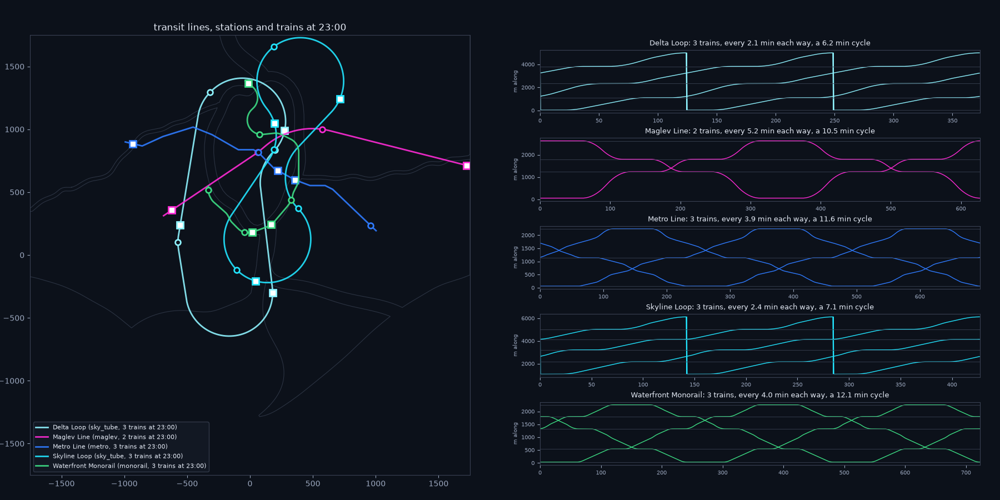

## In Unreal

Delta imported over its crossings-fix import in `CityAG16` (the life controller updated; the
people library `dd24b28ed929920b` unchanged), then twice more with the fixes found in the
shots (`--no-hlod`); the last `--check` passes (spawn, streaming, collision, the walk and the
curb, sky and time, air, weather, look, far city, play features, the flight). The controller
builds its 19 trains in 281 ms with its lanes; `transit_ms` 0.06 to 0.09 ms a frame, 552
instances.

| A maglev at Midtown by night, its doors open, people leaving and boarding | Sky pods at the Transit Nexus by night, people boarding at the platform |
|---|---|
| 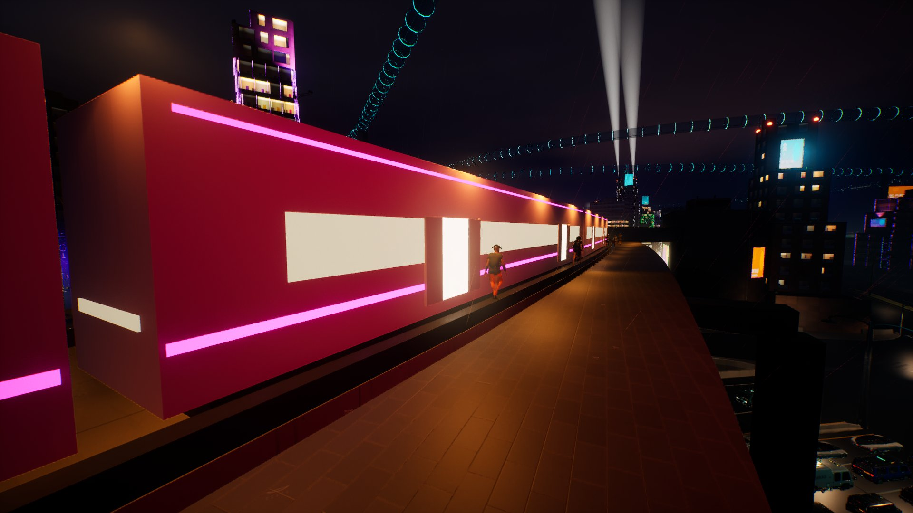 | 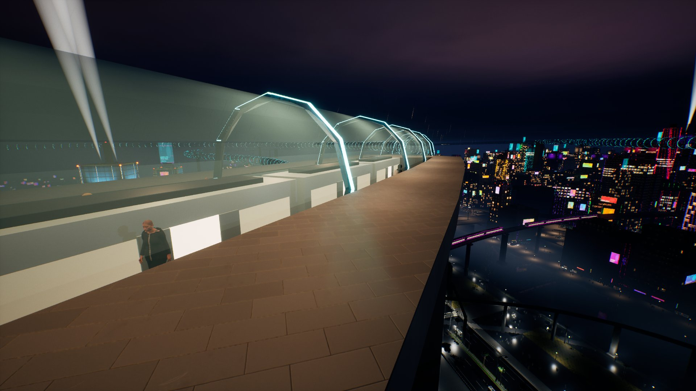 |
| **A pod standing at Midtown (Skyline Loop) by day** | **The Skyline Loop's pods at the Nexus, a Delta Loop pod passing over** |
| 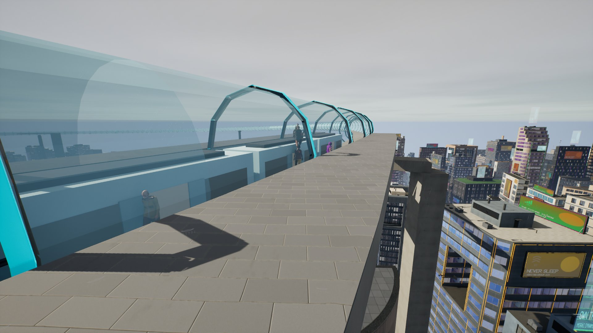 | 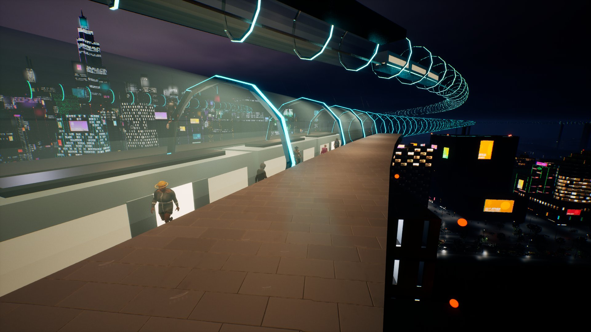 |
| **A sky pod running in its tube by day** | **By night** |
| 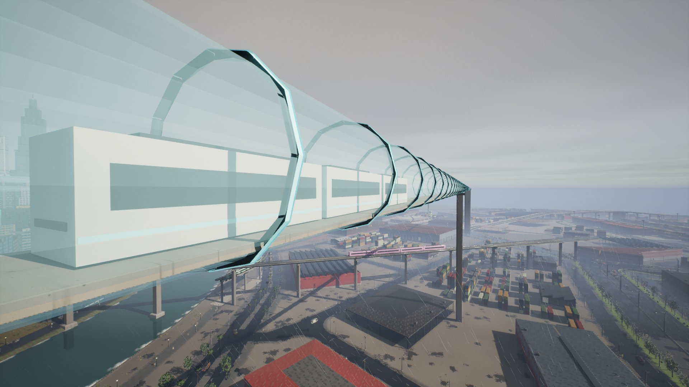 | 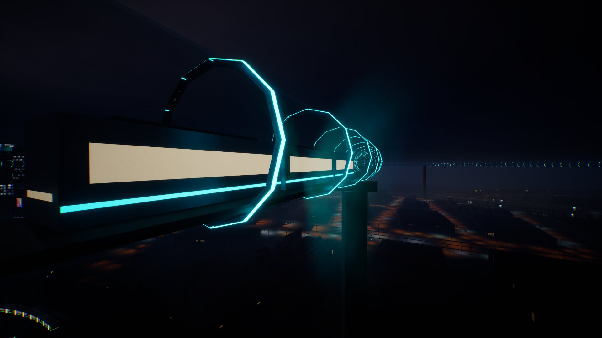 |
| **The maglev on its viaduct over the port by day** | **By night** |
| 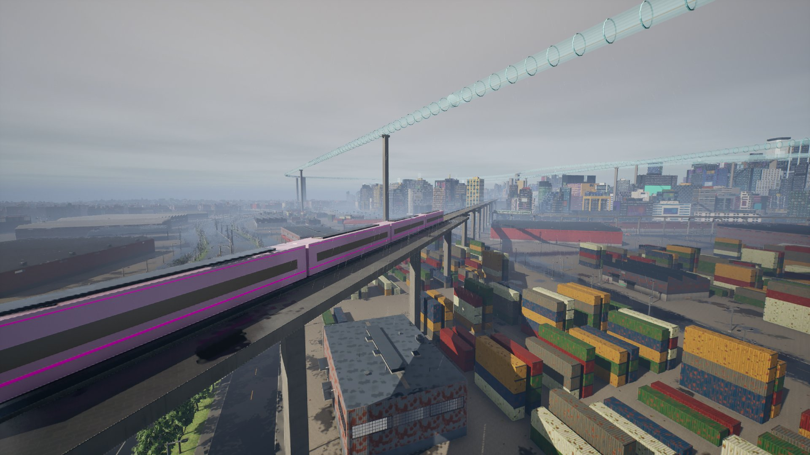 | 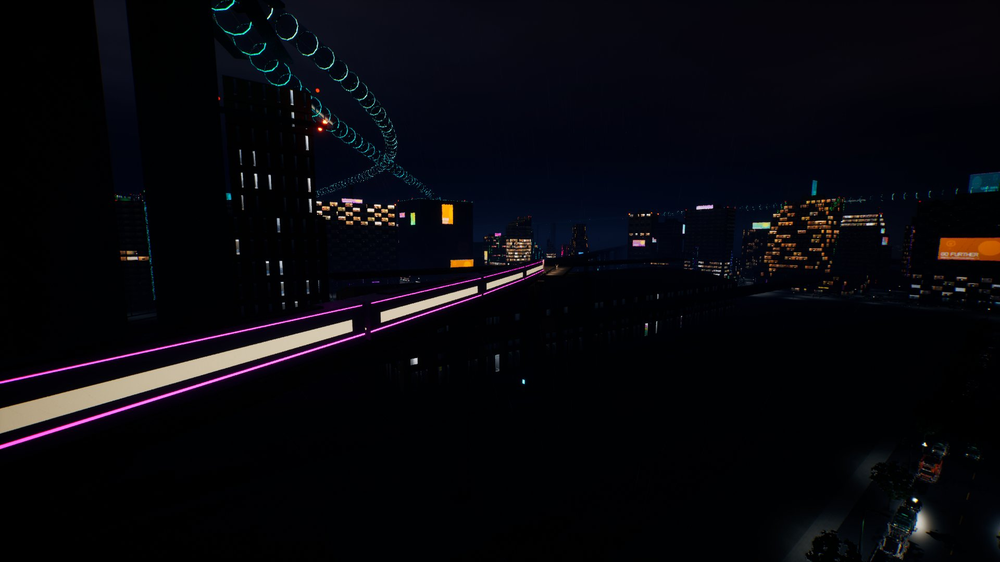 |
| **The monorail over the river by night** | **A metro train in its tunnel** |
| 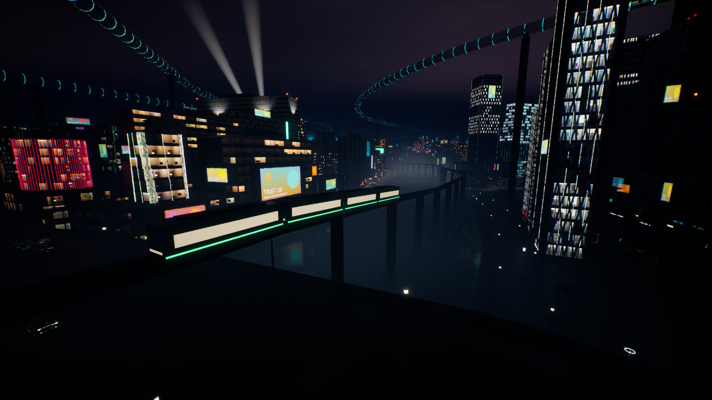 | 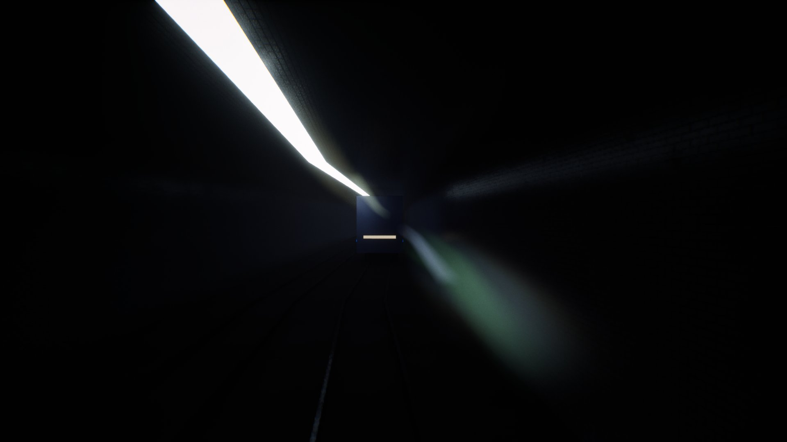 |

Round the check's views (the status's `transit`, 23:00): 14 trains running, 7 to 12 moving,
2 to 7 standing at stops; over the views 10 arrivals at live stops, 101 people out of the
trains and 14 into them (with 15 on their way), the doors' leaves drawn for the trains near the
view (24 instances at a standing maglev).

- **Found and fixed on the way:** the controller crashed at BeginPlay (a loop's closing point
  added from its own array); the sky pods ran 6 m low, under their tube (M19's line is the
  tube's axis, not its top: the pods' base is now 2.45 m under it, their floor the tube's deck);
  the lit windows blew out by night (their emission cut to a tenth); the shots of moving trains
  found them gone by the time the frame was taken (the world held still for the shot); the
  metro's camera stood in its last car (now behind it).

## Benchmark

The lean benchmark ([`bench/final`](bench/final): one run at native 2560 x 1440, no DLSS):

| pass | p95 all | walk | drive | fly | game p95 (all) | draws p50 (walk) |
|---|---|---|---|---|---|---|
| **`night_plan_all`** (transit on) | **22.1** | 26.8 | 21.4 | 21.0 | 20.3 | 2,410 |
| `night_life_notransit` | 22.0 | 25.7 | 21.6 | 20.8 | 20.5 | 2,379 |

- **Transit costs about 0.1 ms p95** over the route (its own step 0.06 to 0.09 ms, 552
  instances in two components and the door leaves); no tuning (the rule: only past about 1 ms).
- **The city's 22 ms** against LG5's 21.2 and the crossings refresh's 21.5: the run shared the
  PC with about three cores of other processes (another session's Python builds and this
  session's test run, `bench.busy` waited first, then 2.6 cores of Python on average during the
  runs). Both passes ran under the same load, so the difference holds; the absolute numbers
  are about 0.5 ms high. The budget's overrun (20 ms) stays for the performance pass.

## Package

`C:/Users/swagn/CityGen/builds/packaged/Delta_lg6/Windows/CityAG16.exe` (Development, Win64,
5.1 GB; `builds/packaged/package_lg6.cmd`, cooked in 18 minutes from `CityAG16` itself: see the
decisions). Its smoke launch (60 s, `-userdir` outside the package, the game closed after)
loads Delta in 17 s, builds the life controller with its 5 lines and 19 trains (146 ms), and
runs them in the cooked game: 14 trains running, 7 moving and 7 standing at stops, 42 door
leaf instances drawn near the start, transit's step 0.06 ms; no error of lifegen's, no `Saved`
folder left in the package. The cook's `Saved/Cooked` and `Saved/StagedBuilds` were deleted
from `CityAG16`, and the superseded `Delta_main` package with them (`Delta_lg6` passed).

## Tests

`tests/lifegen/` (with the new `test_lg_transit.py`: the small city's metro timetable, a sky
tube loop, speeds kept to a tight curve and the rates, a headway too close raised, the checks
catching a bad timetable, too many trains and a station off its track, boarding by the riders,
the exporter's pack, every mode's model and headway), `tests/test_bench.py`,
`tests/test_unreal.py` and `tests/test_unreal_play.py`: 104 passed, 1 failed
(`test_unreal_import_stage2_small_city`: its only failing line is the play walker's spawn, "no
body it sees", in the test's own throwaway project; LG6 does not touch the walker). Logs
`C:/Users/swagn/CityGen/builds/lg6/tests1.log` to `tests5.log`. The C++ is checked by the
plugin's build, the Unreal check and the package.

## Decisions (made without asking: Swagnik asleep)

- **The trains are stand-ins** (decision 6: the Mac designs vehicles; lifegen generates no
  vehicle geometry): boxes of `/Engine/BasicShapes` per car in a light body tinted toward the
  line's color, a band of lit windows, an accent band in the line's color glowing by night,
  roof gear, bogies, a maglev's skirt, a monorail's arms, lamp bands at the ends; the exporter's
  per mode model table (`unreal_life.TRANSIT_MODELS`) is what a mode's game pack replaces, the
  runtime unchanged. The ask `train_models` of assetgen says so.
- **Each way on its own track:** a metro's and an elevated rail's two drawn tracks (1.6 and
  2.15 m off the middle); a maglev's two cars side by side on its 7 m deck (1.6 m); an open sky
  tube's two pods side by side in its tube (1.25 m); a monorail's cars beside its one beam
  (1.8 m, arms over the beam: AG7 draws one 0.9 m beam, and a car straddling it could not pass
  one coming the other way). Right-hand running.
- **A loop runs one way** (its track order), centered in a sky tube.
- **An open line runs its whole track:** the maglev runs on past Midtown to the map's east
  edge and turns there (a layover with no doors), so no track stands unused; a terminal station
  within a train's length of an end is the turn. Trains cross to the other way's track over the
  90 m before a turn.
- **Placed by the world's time, not simulated:** the timetable is the truth; nothing drifts and
  far trains cost nothing to simulate. A band's change of trains (`CityGenLife.Hour`) moves the
  trains at once (the runtime's hour is 23:00 until LG8).
- **Headways by mode** (`TRANSIT_HEADWAY_MIN`, minutes by band, night to late): metro and
  elevated rail 8, 3, 4, 3, 5; monorail 8, 4, 5, 4, 6; maglev 12, 5, 6, 5, 8; sky tube 5, 2,
  2.5, 2, 3 (small pods, frequent). The spec's `transit.headway_min` by line name overrides them.
- **Riders from the stations' accesses:** a station's people a hour are its street accesses'
  (LG3's rates), shared over the trains calling there, at least a few a train so a platform
  shows life at night; while transit runs those accesses send no one (the trains bring them),
  so the crowd is not counted twice.
- **Boarding over a train:** a metro's concourse is 8 m over its track (M5) and a pylon sky
  station's platforms are level with its tube's axis (M5, AG7), 2.5 m over the pods' floor:
  people there board at the point over a door (they vanish there) and leave from it.
- **Doors** on the train's right only where it runs off the line's middle (its side platform),
  both sides where it runs on it (the sky loops).
- **The platforms' keep-out** (an LG3 fix this milestone needed): M5's platform walkway runs
  down the tracks' middle; its people now keep off the trains, on a walkway as wide as the
  platform deck.
- **`TransitShow` within 2 km** of the view (the city there is streamed in); the check's shots
  hold the world still for moving trains.
- **The package cooked from `CityAG16` itself,** not a `CityPackaged` mirror: C: had 25 to 30
  GB free (another session's builds) and the mirror alone is about 21 GB; the cook's
  `Saved/Cooked` and `Saved/StagedBuilds` were deleted after the smoke launch.

## Open items

- **Train models:** stand-ins until the Mac's designs (the ask `train_models`).
- **Metro platforms:** M5's metro stations have a concourse 8 m over the track and no platform
  at it, and AG7 draws the concourse as a solid block the trains run into at the stations; the
  metro's boarding is a vanishing at the concourse. An ask of citygen (a platform level at the
  track) for later.
- **Sky stations' platforms** level with the tube's axis, 2.5 m over the pods' floor (pylon
  stations; portal stations in a tower's floor are at the tube's floor, AG4).
- **People inside trains:** none drawn; those boarding vanish at the doors, those leaving come
  out of them.
- **Lights:** the trains' windows and bands glow; no train casts light.
- **The hour:** the runtime's 23:00 until LG8; a band change moves the trains at once.
- **The metro's shot** is dark (its tunnel lit by one strip; the train's lamps small).
- **The budget:** 22.1 ms p95 under load against 20 (the city's, not transit's).
