# LG7: air and water (lifegen)

Stage 4's air and water milestone (`docs/lifegen_scope.md` 6.7, section 8's "Air and water
lanes", section 13): everything that flies over the city and floats on its water. City-wide:
every route runs wherever the view is. Built on the Windows PC (RTX 4070 Ti, 12700K, UE 5.8.4)
on 2026-11-16, on main after LG6 (#235).

## What LG7 built

| Part | Where | What |
|---|---|---|
| Routes | `lifegen/airwater.py` `Route`, `finish`, `profile_loop` | everything that flies or floats runs a closed route: points with the heading the vehicle faces there, a speed profile on a 4 m grid (the kind's cruise, acceleration and braking, at most sqrt(lateral R) in a turn, its climb rate on a vertical stretch), dwells where it lands or berths, the cycle sampled every second (LG6's sampling); per hour band its vehicles evenly round the cycle, fewer where two would come within the kind's spacing |
| The airspace | `AirSpace`, `obstacles`, `Air` | building masses and roof items, skybridges, structures (sky tubes, decks, beams, pylons, columns), transit lines, megasite masses, signs in front of a facade or over a roof, widened 3 m in plan and 3 m in height, on a 4 m raster of 63 height slabs of 8 m (a bit each); a kind's blocked cells at a height grown by its margin (cars 8 m, police 10, media 12) and, for them, on 8 m cells |
| Paths | `astar`, `pull`, `fillet` | a windowed A* costing 1 over the avenues and highways and 2.2 elsewhere (between the towers, over lower roofs), the path pulled straight on cells no dearer than those it crossed (so a path along an avenue keeps to it), its corners rounded by the kind's turn radius where clear |
| Flying cars | `car_pairs`, `pad_route`, `circuit` | M3's `av_pad` and `helipad` roof items paired 500 to 2,200 m apart, flown between: up from one pad, across on the layer of the leg's heading (east-bound on the even `car_layers`, west-bound on the odd, at least 14 m over both roofs), down onto the other, a 45 s dwell, back on the other heading's layer, two cars a pair at most (one at each pad); circuits round three avenue or highway nodes of each district, each leg on its heading's layer, the change of layer along the first 120 m of a leg, as many as the district's cars per km2 by band need; AG18's hover cars (Kestrel's Dart, Meridian and Atlas) by the district's fleet, an underglow in a neon of the route's |
| Drones | `drone_roofs`, `drone_route` | delivery drones from a hub roof (15 to 70 m) to a drop roof (12 to 45 m) 150 to 650 m off, on `drone_layers` and 4 m cells, hovering down onto each roof (a point of the top mass 2.5 m clear of every roof item) |
| Police, media, aircraft, shuttles | `orbit`, `overflights`, `shuttle` | police orbits over each district (its middle, then its gang turfs) by its danger, more by night; media fliers round the tallest landmarks; aircraft across the map at 760 and 820 m, turning round off it; a spaceport's shuttle per launch pad, in along its flight cone, down onto the pad, a 4 minute dwell, up and away |
| The water | `WaterSpace` | M16's bodies (not the ornamental ones) on a 4 m raster: a surface and a depth per cell (M16's bed rule, linear from the nearest bank's toe, never deeper than M16's); a kind's water as exact geometry: shrunk by its half beam and margin, less the banks' slopes, the quays' bands, M6's moored boats (kept as they are), columns and AG7's bridge piers grown by as much, its draft under it, a bridge too low for its height out |
| Boats | `_water_route`, `_longest_run` | up and down every river, channel and canal keeping right (each way offset from the middle by the most both ways fit, a half turn at each end); a body cut by bridge piers its longest stretch from an end |
| Piers | `piers` (the ask `piers`, derived) | a water taxi's beside each quay's middle, moved along it to where a taxi fits clear of the moored boats (one a canal: the quays across a canal would put two at one spot); a ferry's at each end of a crossing of a river or channel where walkways come within 45 m of both shores (crossings 450 m apart, four at most) |
| Taxis, ferries, ships | `_water_route`, `ship_routes` | water taxis on tours of up to four piers, a 30 s call at each; double-ended ferries across, a minute at each pier; ships in from past the map's edge to the port's berths on water deep and wide enough, else lying at them, and one offshore between two far points of the map's edge |
| Checks | `checks` | `air_lanes` (each flier's path read back every 4 m against the airspace at its kind's margin; a pad's column at the drones'), `air_pads`, `water_lanes` (every boat within 1 m of its kind's water, exactly, and at the surface), `airwater_timing` (speeds, turns, climbs, acceleration and braking read back, dwells, routes closed, vehicles apart), `airwater_budget` (500 fliers, 300 drones, 160 boats at once) |
| Outputs | `airwater.json` (`planmodel.AirWater`: routes, pads, piers), the plan's `airwater` (`AirWaterPlan`), a layer 4 entry per route (`air_route`, `water_route`), `preview_airwater.png`; asks `piers` and `air_corridors` derived, `fleet_kinds` the kinds still to design | |
| Presets, spec | `presets.AW_VEHICLES`, `AIR`, `WATER`, `AW_BUDGET`; the spec's `air` and `water` (`busy`, per kind `kinds` multipliers, 0 a kind out) | |
| Exporter | `citygen/unreal_life.py` `pack_airwater`, `AIRWATER_MODELS` (`PACK_VERSION` 8); `import_city.airwater_props` (`LIFE_VERSION` life9) | every route's kind, model, color, points with headings, samples, dwells, vehicles per band and paints; the models' parts and meshes |
| Runtime | `CityGenLifeAir.cpp` | below |
| Console, menu, check, bench | `CityGenLifeModule.cpp`; `CityGenPlay` (the Tab menu's Air traffic and Boats rows); `check_city.py` (`until` reads `airwater.show`); `bench.py` | `CityGenLife.Air [0|1]`, `CityGenLife.Water [0|1]`, `CityGenLife.AirShow car|landing|layers|drone|police|media|aircraft|shuttle|boat|taxi|ferry|ship|pier`; the status's `airwater`; pass `night_life_noairwater` |

The runtime, in short (`docs/unreal_export.md`, "From LG7: air and water"):

- **By the world's time,** as LG6's trains: a vehicle's place along its route is the sampled
  cycle at (the world's time + its phase) modulo the cycle. Nothing is simulated; a vehicle
  far off costs a lookup, its instances sent every fourth frame past 1.5 km.
- **Heading** the route's at that point, interpolated (a double-ended ferry, and a ship backing
  out of its berth, run stern first); a flier banks by its turn rate and speed and pitches with
  its climb; a boat rolls and bobs.
- **Drawn** as instanced parts, one component per mesh and cull distance: AG18's hover cars'
  meshes in their district's paints (the police flier in LG4's livery with a flashing red and
  blue bar), nav lights, an underglow; stand-ins of `/Engine/BasicShapes` for the drones, media
  fliers, aircraft, shuttles, boats, water taxis, ferries and ships (decision 6: the Mac
  designs them; a kind's pack replaces its parts in the table), lit by night through
  `M_CgTransit`; strobes and beacons flashing. No shadows, no collision, out of Lumen's scene.

## The plan on Delta

`lifegen plan` on Delta (`builds/delta_main`, the live build, an empty spec): 40 s in all, the
air and water about 20 s of it ([`plan/life_report.txt`](plan/life_report.txt)). Every check
passes (`air_lanes`, `air_pads`, `water_lanes`, `airwater_timing`, `airwater_budget` with LG0
to LG6's).

| Kind | Routes | Vehicles by band (night, morning, day, evening, late) |
|---|---|---|
| flying car | 53 (27 pad pairs, 26 circuits) | 91, 207, 181, 238, 164 |
| drone | 50 | 11, 41, 47, 41, 22 |
| police flier | 9 | 9, 6, 6, 9, 9 |
| media flier | 2 | 2 every band |
| aircraft | 2 | 2, 4, 4, 4, 4 |
| shuttle | 0 (Delta has no spaceport) | |
| boat | 9 | 10, 12, 17, 17, 11 |
| water taxi | 3 | 3, 6, 6, 6, 3 |
| ferry | 3 | 3 every band |
| ship | 3 (two lying in the harbor basins, one offshore) | 3 every band |

At 23:00: 201 fliers (164 flying cars, 22 drones, 9 police, 2 media, 4 aircraft) and 20 boats.
54 of Delta's 70 pads are flown from; the 16 left out each have their own building's crown mast
standing over them (a citygen conflict: M3 puts the pad and the mast at one spot). 17 piers (11
water taxis', 6 ferries'), all called at. The Old Town's organic canal is cut by an AG7 bridge
pier across its channel and gets no boat; the two harbor basins open to the sea through water a
ship's 6 m draft does not clear (M16's shallow shelf), so their ships lie at their berths.

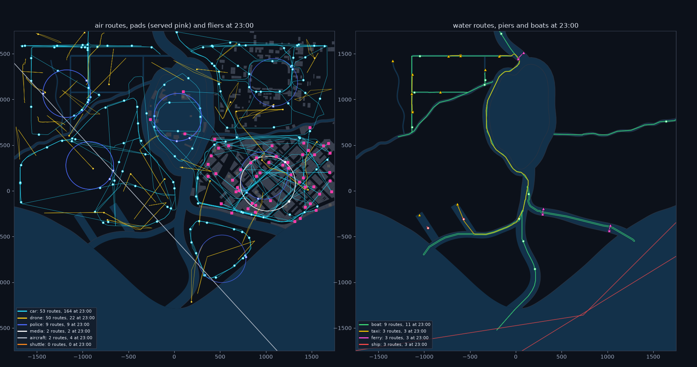

Vesper Bay (a sample with a spaceport; its citygen build only, not in Unreal) plans its four
shuttles down onto the spaceport's launch pads along its flight cone
([`plan/vesper_bay_preview_airwater.png`](plan/vesper_bay_preview_airwater.png)); its plan as
a whole fails two earlier checks there (LG4's `gang_turf`, LG6's `transit_stops`), not LG7's.

## In Unreal

Delta imported over its LG6 import in `CityAG16` (the life controller updated, every other
actor unchanged; the people library `dd24b28ed929920b` unchanged), then once more with the
fixes found in the first shots (`--no-hlod`); both `--check` runs pass (spawn, streaming,
collision, the walk and the curb, sky and time, air, weather, look, far city, play features,
the flight). The controller builds its 134 routes' 335 vehicles (2,681 instances in 16
components) with its lanes and trains; at 23:00 201 fliers and 20 boats run, 57 of them
dwelling on a pad, roof, pier or berth. Air and water's own step takes 0.17 ms a frame (at most
0.40).

| A flying car coming down onto its rooftop pad by night | A flying car on its layer over a Corporate Core avenue |
|---|---|
| 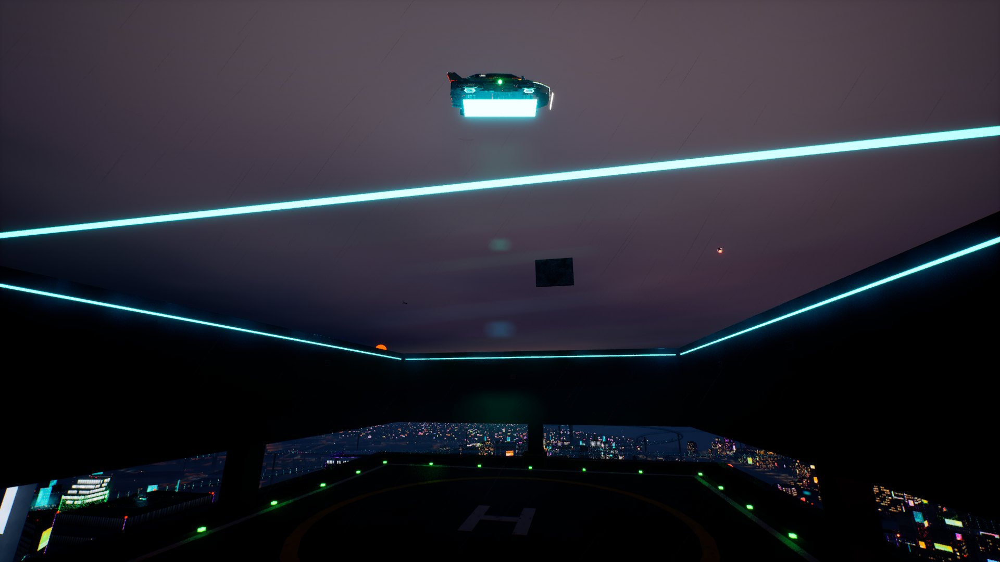 | 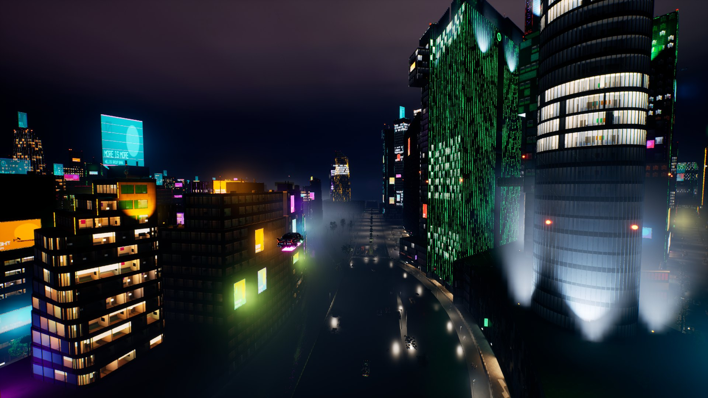 |
| **A police flier (the Meridian in its livery) over the Old Town** | **A delivery drone over Midtown** |
| 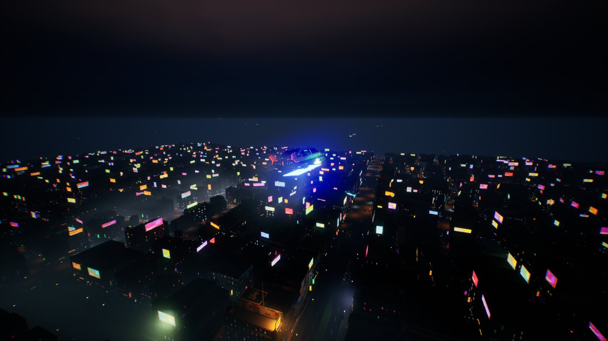 | 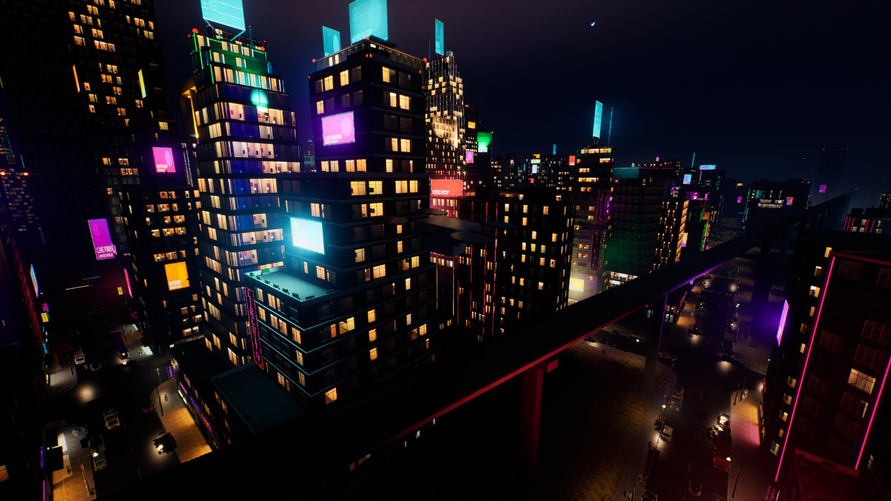 |
| **Over Midtown by day: a flying car on its layer above the avenue** | **Over Midtown by night** |
| 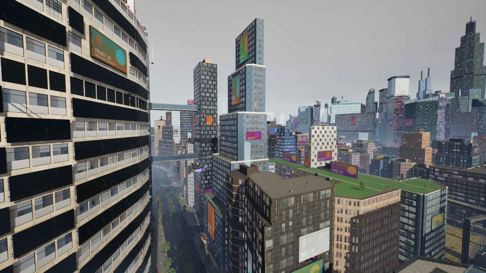 | 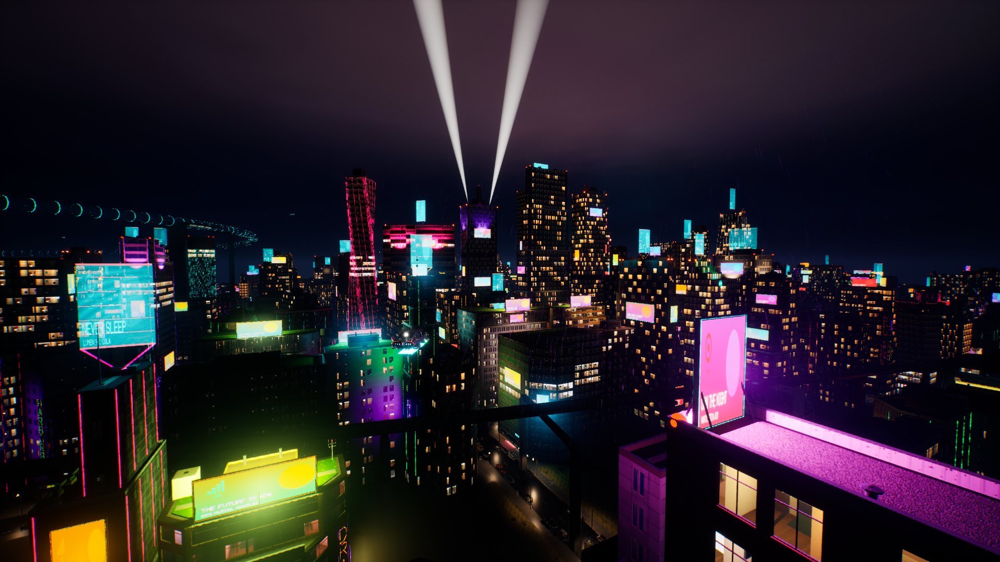 |
| **A boat on the Great River by day, a water taxi behind** | **By night** |
| 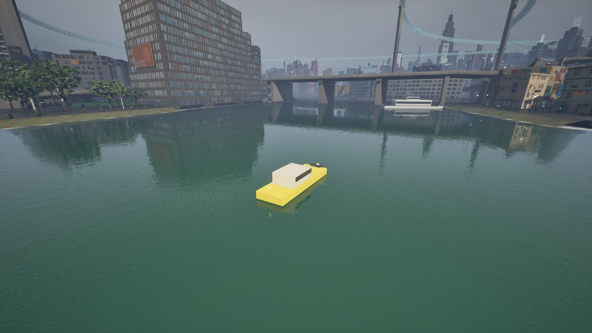 | 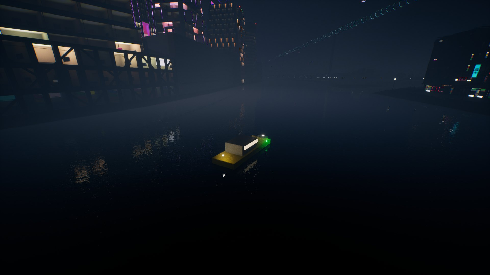 |
| **The ferry at its pier on the West Channel** | **A ship lying at its berth in a harbor basin** |
| 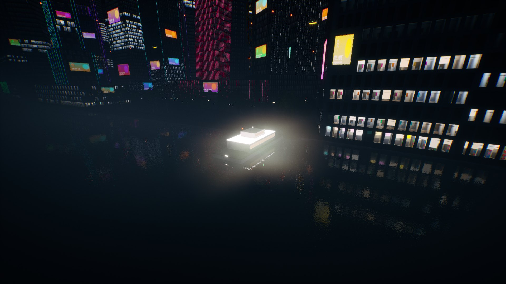 | 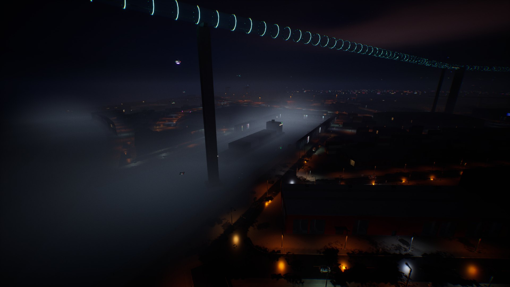 |

- **Found and fixed on the way:** fliers were near invisible by night (an underglow in a neon
  of the route's and larger nav lights added), lamps' bloom washed the ferry white (dimmed),
  the ship's containers glowed (made plain), the first landing and layers shots stood too far
  off (`AirShow landing` now frames the pad and the car coming down, `layers` sits behind a
  car); in the plan, taxi piers on canals lined with moored boats (found along the whole quay),
  boats on canals running stern first (a pivot turn at a narrow end), canals cut by bridge
  piers (their longest stretch), bodies at the map's edge (their ends inside it).

## Benchmark

BENCH_SECTION

## Package

PACKAGE_SECTION

## Tests

`tests/lifegen/` (with the new `test_lg_airwater.py`: the airspace by height, A* round a wall,
the pad flight clear of a tower on layers by heading, circuits, police, aircraft, the shuttle
on its launch pad, boats keeping right and turning at their ends, the canal's boat clear of a
moored one, piers and the double-ended ferry, ships lying at a basin and passing offshore, the
checks failing where they should, vehicles kept apart, the spec's kinds, the plan's file,
contribution and the exporter's pack with and without AG18's hover cars) and
`tests/test_bench.py`: 81 passed. `tests/test_unreal.py` and `tests/test_unreal_play.py`: 55
passed, the two Unreal imports among them (`test_unreal_import_small_city` and
`test_unreal_import_stage2_small_city`, run on their own: the walker's spawn that failed in
LG6's run passes now, so it was that run's load, not the code). Logs
`C:/Users/swagn/CityGen/builds/lg7/tests1.log` to `tests6.log`. The C++ is checked by the
plugin's build, the Unreal check and the package.

## Decisions (made without asking: Swagnik asleep)

- **Routes, not simulation:** every vehicle runs a closed route to a timetable by the world's
  time, as LG6's trains; nothing drifts, far vehicles cost a lookup, and every route covers the
  whole city. Fliers do not avoid each other at run time: the layers by heading keep two ways
  apart, and a route's own vehicles keep their spacing.
- **Layers by heading** (the aviation rule): east-bound legs on the even layers, west-bound on
  the odd, 12 to 40 m apart, so the two ways over one avenue never meet head on; a leg rises to
  the first layer 14 m over the roofs it leaves and lands on.
- **Lanes over the avenues and highways and between the towers** by one A*: cheapest over the
  avenues and highways, dearer elsewhere, so the fliers follow the roads where they can and cut
  between the towers where that is shorter; corners rounded by a 40 m turn radius where clear.
  The ask `air_corridors` stays derived.
- **Pads in pairs:** each pad flown to and from one other 500 to 2,200 m away, two cars a pair
  (one on each pad while the other flies), so no pad holds two cars. A pad with its building's
  own crown over it is left out with that reason, not moved.
- **Circuits** for the rest of each district's flying cars: three avenue or highway nodes, up
  to 8 cars a circuit per band.
- **Counts:** flying cars per km2 of a district by band 12, 28, 24, 32 and 22, times its busy,
  the spec's and 0.5 plus its wealth (Swagnik's "cars everywhere" for the sky as LG5 for the
  roads); drones 1.5 to 7 per km2; police orbits 0.5 plus 2.5 times the danger.
- **Models:** flying cars and police fliers are AG18's three Kestrel hover cars (never Vex or
  Aurel); everything else stands in from the engine's basic shapes in a per kind table the
  Mac's designs replace (the ask `fleet_kinds` lists them).
- **Spaceport:** Delta has none (its districts are a transit hub, midtown, corporate core, old
  town, industrial port and research campus); shuttles are planned and tested on Vesper Bay's
  spaceport and a test city's, and Delta gets aircraft high over it instead.
- **Water:** each kind's water as exact geometry, so a boat in a canal passes moored boats with
  its margin; boats keep right with a half turn at each end, down to a pivot where a canal is
  narrow; ferries double-ended; ships back out stern first (no turning basin yet).
- **Piers derived** from M16's quays (taxis) and river banks with walkways (ferries); the ask
  `piers` stays derived until citygen names its own.
- **Ships at the port:** a ship comes in where the water from the map's edge is deep and wide
  enough, else lies at its berth; one more passes offshore so the sea is not empty.
- **No real lights:** the fliers' and boats' lamps glow (emissive by Night), as LG5's cars; no
  flier casts light.
- **No shadows** for anything that flies or floats (a car's shadow 100 m below is lost in the
  night and costs a shadow pass of every instance).

## Open items

- **Models:** stand-ins until the Mac's designs (drones, media fliers, aircraft, shuttles,
  boats, water taxis, ferries, ships; the ask `fleet_kinds`).
- **Pads under crown masts:** 16 of Delta's pads have their own building's mast over them (an
  ask of citygen: keep a pad clear of the crown).
- **The organic canal** cut by an AG7 bridge pier standing across its channel; boats on two
  canals turn short of road bridges' piers (AG7: piers in a canal's middle).
- **Harbor basins:** the sea's shelf in front of them is too shallow for a ship's draft by M16's
  bed; ships lie at their berths there. No turning basins: ships back out stern first.
- **No avoidance:** fliers on different routes can pass close where their layers meet at a
  corner's change of layer; boats of different routes on one river keep to their lanes but are
  not checked against each other.
- **The hour:** the runtime's 23:00 until LG8; a band's change moves the vehicles at once.
