# LG8: weather, reactions and release (lifegen)

Stage 4's last milestone (`docs/lifegen_scope.md` 6.8, section 8, section 13): the city's life
by atmosgen's hour and weather (nightlife, umbrellas, shelter from the rain, fewer people out
and faster in rain, slower traffic), reactions to the player and to danger, the crowd and
traffic performance pass, every sample city planned with every check passing, Unreal checks on
the PC. City-wide: every behavior runs wherever the view is. Built on the Windows PC (RTX 4070
Ti, 12700K, UE 5.8.4) on 2026-11-16 and 17, on main after LG7 (#236).

## What LG8 built

| Part | Where | What |
|---|---|---|
| The weather's table | `lifegen/presets.py` `WEATHER_LIFE`, `WEATHER_KEYS`, `WEATHER_RAIN`; `lifegen/weather.py` `weather_record` | per atmosgen state (clear, drizzle, rain, fog, smog) the share of people out, their pace, the share in the rain looks (LG2's `WEATHER_OUTFITS`), the share of the others holding an umbrella, a passer-by's chance to shelter, the cars' share, speed and added headway; a rain state's values reached by its rain, so life follows atmosgen's change of state as its rain does |
| Shelter | `weather.walk_cover`, `Masks` | each walkway's stretches out of the rain, read from atmosgen's rain shadow (AT5's masks: something at least 2.1 m over it on the ground level), underground (a meter under the datum) or enclosed (skybridges, elevators, escalators, concourses); stretches 3 m or longer, gaps under 1.5 m joined; the walk rows' `cover` |
| Nightlife | `weather.nightlife`, `night_places` | people round the open bars, clubs and arcades (LG4's places, M11's POIs that are no place) on their door walkways by their busy and hours (3, 7 and 2 people at full busy), on top of M11's density; the walk rows' `night` |
| The pool's rain looks | `plan.crowd_plan`, `outfit_groups(rain=...)` | the pool's mix drawn at 0.6 of the rainiest state's rain looks, so the runtime's rain finds raincoats; the outfits' `district_groups_clear` and `rain_group` for the runtime's blend |
| Checks | `weather.checks` | `weather` (every state's shares and paces in reason, the reactions' settings), `shelter` (every stretch within its walkway, sorted, apart, long enough), `nightlife` (people only on an open nightlife place's door walkway, only in its open bands) |
| Vesper Bay's two failures | `places.gang_spots`, `transit.stops_of` | a gang spot whose ring runs past its turf's edge along the sidewalk is no spot of the turf's (LG4's `gang_turf`); a metro's concourse over a track lowered deep under foundations or the water bed is on its line where the track is at the station's own `track_z_m` (LG6's `transit_stops`: Corporate Core's concourse 16.2 m over its track) |
| Exporter | `citygen/unreal_life.py` `pack_weather`, `walk_cover`, `walk_night`, `run_clips` (`PACK_VERSION` 9); `import_city.weather_props` (`LIFE_VERSION` life10); `lifegen.presets.PLACE_CLIPS["run"]` | the table, the stretches, nightlife, umbrellas, reactions, stuck cars, the run clip (the Game Animation Sample's `M_Neutral_Run_Loop_F`, retargeted and made in place with LG4's place clips) and its speed |
| Runtime | `CityGenLifeWeather.cpp`; the walk processor (`StepCity`); the drive processor; `CityGenLifePeople.cpp` | below |
| Console, menu, check, bench | `CityGenLifeModule.cpp`; `CityGenPlay` (the Tab menu's Scare the crowd row); `check_city.py` (`until` reads `weather.show`); `bench.py` | `CityGenLife.FollowAtmos`, `.Weather`, `.Panic`, `.WeatherShow`; the status's `weather`; every life pass follows atmosgen's hour and weather, pass `night_life_noweather` |
| Performance | `CityGenLifeISM.h` (`UCgLifeISM`, `CityGenLife.Bounds`); `CityGenLifePeople.cpp`, `CityGenLifeTraffic.cpp`, `CityGenLifeActor.cpp` | fixed bounds on the life components, the near garments' material instances kept, fixed skeletal bounds, fewer traces and updates far off; trace scopes on the controller's steps; bench passes `night_life_ownbounds`, `night_life_enginebounds` |

The runtime, in short (`docs/unreal_export.md`, "From LG8: the hour, the weather and
reactions"):

- **The hour:** atmosgen's controller's `Hour` read every half second; an hour's step as time
  runs moves the doors' and places' rates and the live numbers (people come out and go in over
  their trips), a jump (the menu's day, dusk or night) fills the live walkways and lanes again.
  Transit and what flies and floats take their band from it.
- **The weather:** the state atmosgen turns to and its rain: people out, pace, raincoats (the
  district's groups blended toward the rain group), umbrellas, shelter, the cars' share, speed
  and headway; fewer out by people heading in at the next door (`ThinOut`).
- **Umbrellas:** a canopy and a shaft over the right shoulder of the near and mid people who
  hold one, folded under a cover, sitting or running; 30% with a lit shaft.
- **Shelter:** a passer-by walking into a stretch out of the rain stops there by the state's
  chance, against the buildings (the side away from its sidewalk's road) facing the road.
- **Reactions:** people standing still near the player turn to look at it; a danger
  (`Panic`) sends everyone but the police running, near the view on the Game Animation
  Sample's run, then half of those within 80 m come back to look at it.
- **Traffic:** room past every junction exit, never forced into a full box, cars stuck far
  from the view leave; slower and further apart in rain and fog.

## The plan on every sample city

`lifegen plan` with the final code on every sample city, the three demos and Cragmouth
(citygen models built for them: `builds/lg8/cities`; Delta's live build; Delta and Vesper Bay
with their atmos plans' rain shadows): every check passes on every city
([`plan/`](plan/): each city's report).

| City | Checks | People (peak) | Cars at 23:00 | Slots | Transit lines | Air, water routes | Walkways out of the rain | Nightlife late |
|---|---|---|---|---|---|---|---|---|
| Delta Megacity | 35 of 35 | 58,189 | 3,331 | 1,673 | 5 | 116, 18 | 3,623 (44.8 km, atmos) | 8,432 |
| Vesper Bay | 35 of 35 | 41,286 | 3,638 | 815 | 4 | 112, 8 | 3,792 (46.5 km, atmos) | 167 |
| Nexus City | 35 of 35 | 57,172 | 4,675 | 842 | 4 | 130, 16 | 710 (14.1 km) | 206 |
| Greyhook | 35 of 35 | 36,393 | 2,179 | 668 | 3 | 70, 3 | 493 (13.9 km) | 120 |
| Saltreach Free Port | 35 of 35 | 36,837 | 1,498 | 474 | 2 | 76, 3 | 500 (8.9 km) | 63 |
| Vesper Bay Pinned | 35 of 35 | 37,892 | 3,766 | 956 | 4 | 102, 7 | 763 (13.3 km) | 179 |
| Vesper Bay Stacks | 35 of 35 | 39,820 | 3,963 | 927 | 4 | 102, 7 | 707 (11.6 km) | 191 |
| Vesper Bay Decks | 35 of 35 | 43,169 | 3,701 | 823 | 4 | 112, 8 | 703 (14.7 km) | 177 |
| Cragmouth | 35 of 35 | 48,404 | 4,595 | 578 | 1 | 87, 5 | 837 (16.4 km) | 236 |

People at the peak band; nightlife's people in the late band (Delta and Vesper Bay plan with
their atmos plans' rain shadow, hence their many more stretches out of the rain); Delta's plan
made again with the final code has the imported plan's hash.

Four failures found and fixed on the way (two of them Vesper Bay's, which LG7 reported):

- **Vesper Bay `gang_turf`:** a gang spot at a corner by its turf's edge whose ring of points
  ran out of the turf along the sidewalk (`slot.d04.turf2.corner.jn.e1163s1074`): the whole ring
  must lie in the turf (`places.gang_spots`).
- **Vesper Bay `transit_stops`:** the Spine Line's Corporate Core station, a metro concourse at
  -8 m over a track M5 lowered to -24.2 m there (under the foundations): the stop is on its
  line where the track is at the station's own `track_z_m` (`transit.stops_of`).
- **Nexus City `transit_stops`:** the Spire Line's (a sky tube) Corporate Core terminal 10 m
  from its track's end, nearer than the turn point half a train in: no train called there; a
  terminal within a train's length past the turn point is called at the turn (`transit.cycle`).
- **Nexus City `air_lanes`:** a media flier's orbit tested every 6 m grazed a tower between two
  of its points at 280 m: the finished route is read back as the check reads it (every 4 m)
  before it is taken (`airwater.orbit`).

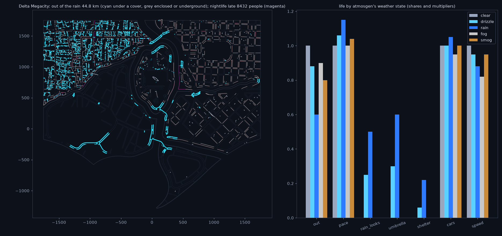

## In Unreal

**Delta Megacity** in its live project (`CityAG16`; the plan with its atmos plan's rain shadow,
the people library and the run clip): imported, then checked with LG8's views (every check
passes: spawn, streaming, collision, walk, curb, sky and time, air, weather, look, far city,
play features, fly). The life controller's status at each view (`CityGenLife.Status`) shows
it following atmosgen: the hour at 7, 16, 18 and 23 as the views set atmosgen's, the state and
its rain (rain: 0.6 of the people out, 45 to 80 umbrellas near and mid, 1 to 4 people
sheltering round the view), 30 people fleeing a panic, 6 to 12 coming back to look, 1 to 4
looking at the player, cars stuck far off leaving (13 to 20 in a check's run).

| | |
|---|---|
| 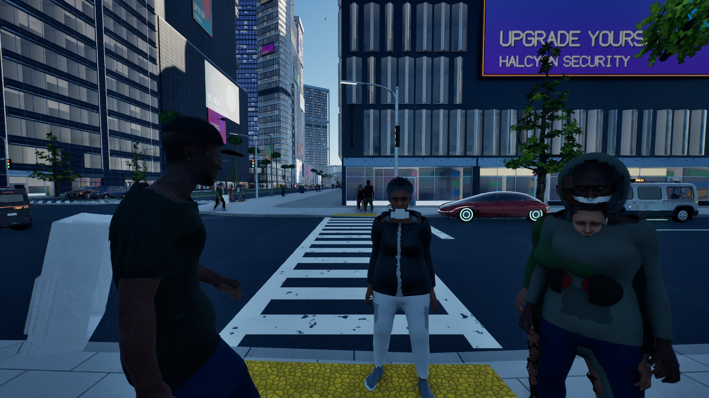 | 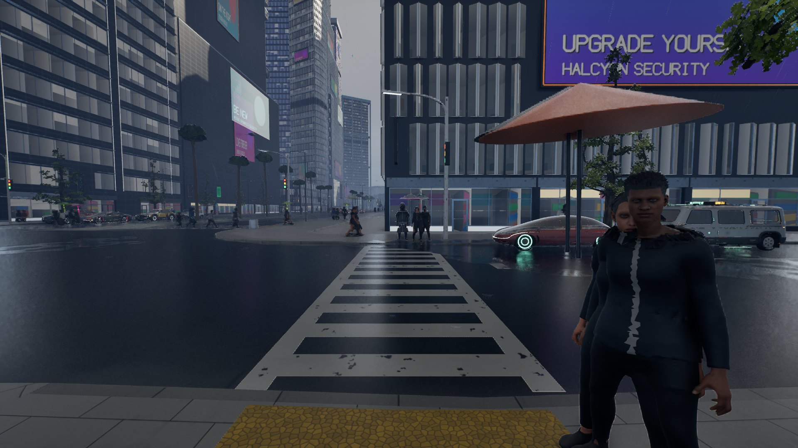 |
| Day, clear | The same corner in rain: fewer out, umbrellas, raincoats |
| 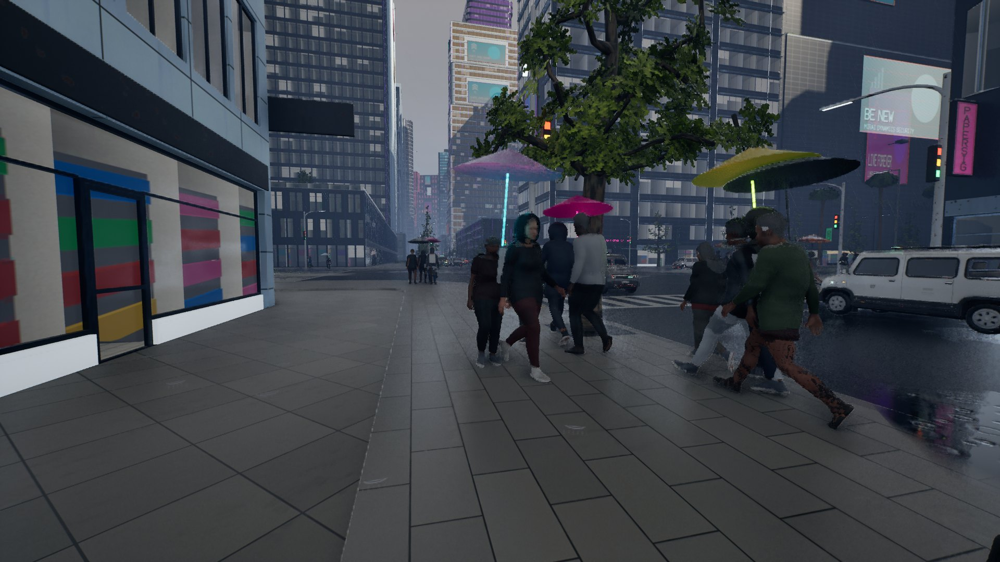 | 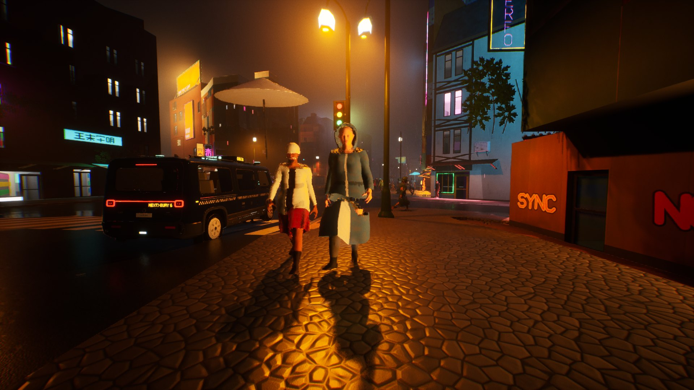 |
| Umbrellas, a lit one among them | By night in the rain |
| 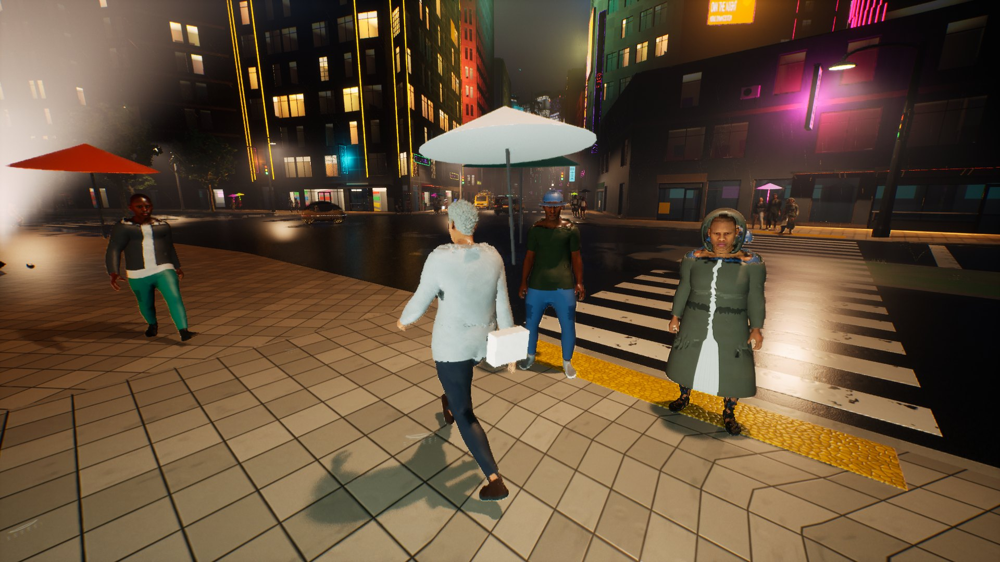 | 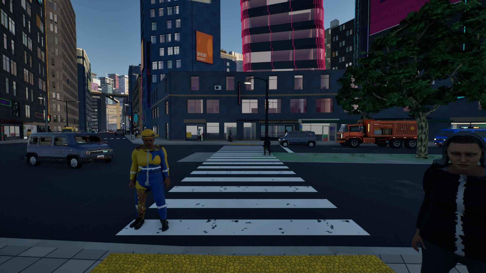 |
| People standing near the player turn to look at it | 18:00, clear: atmosgen's hour, life's numbers |
| 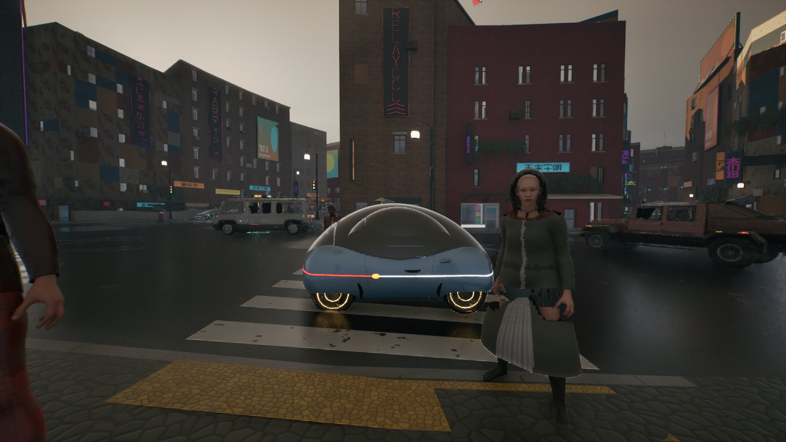 | 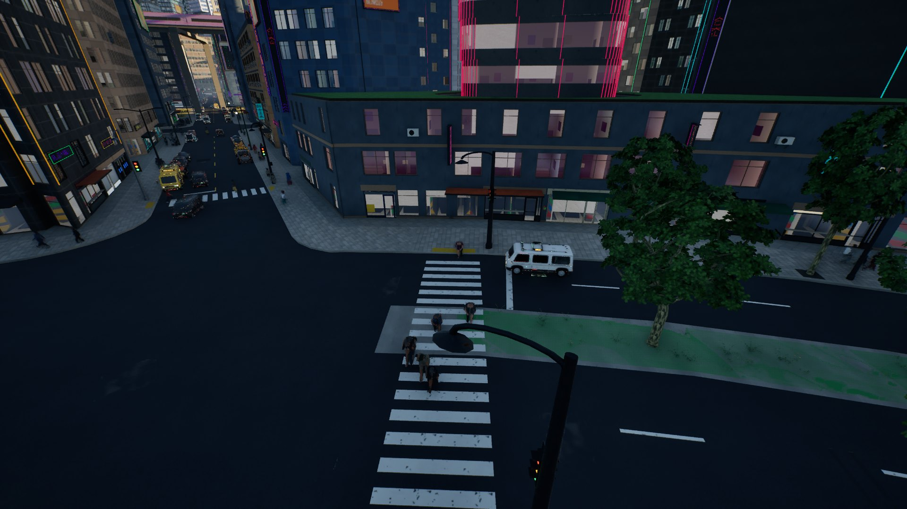 |
| Old Town at 18:00: the junction clear (LG5's jam fixed) | A panic: people running across the crossing |

**Vesper Bay** (the second city: a spaceport, four transit lines, an entertainment market),
blockout only, in a throwaway project of its own (`CityLG8VB`, deleted after the check):
every check passes; umbrellas and shelter in the rain, a panic run and gather, the shuttles
and trains running.

| | |
|---|---|
| 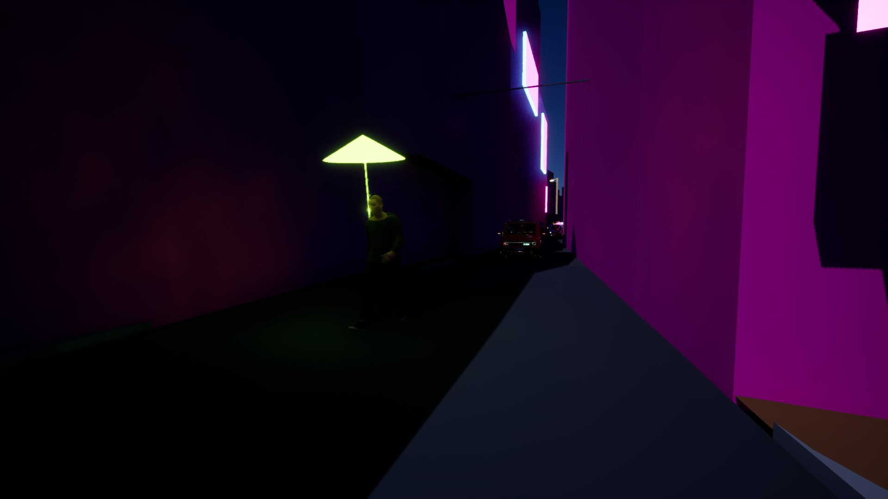 | 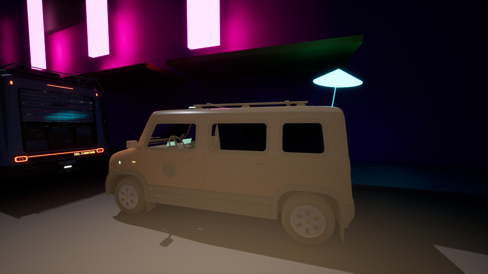 |
| Vesper Bay, blockout: umbrellas by night | Sheltering under a cover |

## Performance

The lean benchmark on Delta (one run a pass, native 2560 x 1440, no DLSS; frame times in ms),
against LG7's `night_plan_all`. Two runs, each with its passes side by side under the same
load (another session's test run beside them): run 1 with the instanced components' bounds
fixed to the city's box ([`bench/bench_run1.md`](bench/bench_run1.md)), run 2 comparing
lifegen's own measure of the bounds with the city's box ([`bench/bench_run2.md`](bench/bench_run2.md)).
The city's box is the default (`CityGenLife.Bounds 1`): it doubles the draw calls, which the
render thread and the GPU carry at no cost here, and saves the game thread, the bound, the
measure over every instance (game p95 18.8 ms against 20.5).

| Run, pass | p95 | walk | drive | fly | game p95 | draws p50 | other load |
|---|---|---|---|---|---|---|---|
| LG7 `night_plan_all` | 22.6 | 24.6 | 22.4 | 22.0 | 20.4 | 1,814 | 3.3 cores |
| LG8 run 1, `night_plan_all` (city box) | 23.0 | 24.4 | 22.8 | 22.5 | 21.0 | 3,632 | 3.4 cores |
| LG8 run 1, `night_life_noweather` (city box) | 22.1 | 25.1 | 22.2 | 20.4 | 19.9 | 3,591 | 3.4 cores |
| LG8 run 2, `night_plan_all` (lifegen's measure) | 22.6 | 24.3 | 21.9 | 22.1 | 20.5 | 1,705 | 1.7 cores |
| **LG8 run 2, city box (the default)** | **21.8** | 24.7 | 21.9 | 20.6 | 18.8 | 3,588 | 1.7 cores |

The weather costs little (the rain's umbrellas, shelter and thinning against
`night_life_noweather`, within a run's noise); the first pass of a run is slower than the
second in both runs (its streaming after the warm-up).

What the profile found (an Unreal Insights trace of the lean route, `profile/`):

- **The life controller's step:** `CityGenLife_Tick` 1.7 ms a frame at the median, 2.7 at the
  95th percentile, 5 at most on the walk (the crowd's step, the traffic's, the instance
  updates; the near people's ground traces cut to those within 150 m).
- **The slow frames are World Partition's:** the frames over the walk's 90th percentile spend
  55 ms more in `DeferredRenderUpdates_GameThread` than the rest, nearly all of it
  `UStaticMesh::GetUsedMaterials` under 2,362 updates of the level's instanced HLOD components
  a frame (7,806 calls; 180 in a normal frame): the HLOD layer's components sending their
  instance data again as cells load and unload, plus shader compiles and level streaming in the
  uncooked game ([`profile/spikes_hlod.txt`](profile/spikes_hlod.txt)). Lifegen's own
  components are updated once a frame each at about 20 microseconds.
- **Fixes made:** instanced components' bounds fixed to the city's box (`UCgLifeISM`,
  `CityGenLife.Bounds 1`; the engine's measure transforms every instance's box at each update,
  1.2 ms a frame; lifegen's own cheaper measure, `2`, still reads every instance and cost the
  game thread 1.7 ms at the 95th percentile against the box); the near garments' material
  instances made once per slot and reused (the garbage collector had purged hundreds a
  minute); fixed skeletal bounds near; far cards every third frame, far cars every second or
  fourth, a model's bodies with no car near every third.
- **Left:** merging each model's car parts into one mesh at import (LG5's idea) and the HLOD
  layer's updates while streaming (an engine, exporter and stage 2 matter; the packaged game,
  with no shader compiles in it, is not benchmarked here).

## The package

Delta cooked and packaged (Development, Win64) from `CityAG16` as LG6's and LG7's, staged
only and moved to `builds/packaged/Delta_lg8` (5.1 GB; no archive copy: the disk had room for
one), in 17.6 minutes. The smoke launch (its user folder outside the package, no `Saved`
folder left in it) loads Delta in 18.5 s; the life controller is ready with 2,400 people,
1,800 cars, five lines and 19 trains, 134 air and water routes, and follows atmosgen at 23:00
in the rain (0.6 of the people out, the pace 1.15, 3,917 stretches out of the rain).
`builds/packaged/Delta_lg7` was deleted before the cook (the disk), `CityAG16`'s
`Saved/Cooked` and `Saved/StagedBuilds` after the smoke launch.

## Tests

TESTS_TEXT

## Decisions (made without asking: Swagnik asleep)

- **atmosgen leads, life follows:** the runtime reads the hour and the weather from atmosgen's
  controller (its properties and `GetWeatherLabel` by reflection, as the play features do: no
  link between the plugins) every half second. An hour's step as time runs is soft (the doors'
  rates and the live numbers move; people come and go over their trips, nobody pops), a jump
  of more than an hour (the menu's day, dusk or night) fills the city again at once.
  `CityGenLife.Hour` still holds life at an hour of its own (and stops following); a level
  without atmosgen's controller lives at the plan's hour and the plan's own weather state.
- **The weather as a table by state, reached by the rain:** the scope's effects (fewer out in
  heavy rain, faster, raincoats and umbrellas, shelter, slower traffic) as one row per atmosgen
  state; a rain state's row is reached in proportion to atmosgen's rain over the state's own
  rain rate, so a change of state (atmosgen blends its rain over 20 s) moves life with it.
  Values: rain 0.6 of the people out, 1.15 times the pace, half in the rain looks, 60% of the
  others with umbrellas, a 22% chance to stop under a cover passed, cars 0.88 of their speed
  with 0.45 s more headway; drizzle, fog and smog in between (`presets.WEATHER_LIFE`).
- **Fewer out by going in:** the people over the weather's number are not removed in sight:
  past a tenth over, some walking head in at the next door ahead, as at a trip's end
  (`ThinOut`); the live walkways' numbers fall at once, past the far tier.
- **Umbrellas as instanced props, not held in a hand:** a canopy and a shaft from the engine's
  basic shapes (the stand-ins' way, until the Mac designs an umbrella) placed from the person's
  transform over the right shoulder, near and mid, by the person's hash and the weather's share,
  folded under a cover, sitting or running; ten canopy colors, 30% with a lit shaft. The arm is
  not posed: the Game Animation Sample has no holding clip, a layered pose needs an animation
  graph per person (scope: no third-party animation; open item).
- **Shelter from atmosgen's own rain shadow:** the stretches come from the atmos plan's masks
  (`lifegen plan --atmos`), the same covers the rain is cut under in Unreal; a city planned
  without an atmos plan has only its enclosed and underground walkways out of the rain. People
  stop under a stretch they walk into (one decision per stretch), alone (groups walk on), at
  the walkway's side facing out, for 25 to 140 s, out again a few seconds after the rain stops.
- **Nightlife on the doors' walkways:** the bars', clubs' and arcades' people on their door
  walkways by their busy and hours (3, 7 and 2 at full busy), on top of M11's densities so the
  densities check is unchanged; the pool still caps the live crowd, so they concentrate the
  late crowd round the bars.
- **Reactions:** looking is turning to face the player (no head look-at: single node
  animation); a danger is an event, not the player's speed or a car: storygen's hook
  (`Panic`), the console and the Tab menu's Scare the crowd row; everyone within 35 m but the
  police runs (police hold their ground; gang members run too), then half of those within 80 m
  and of the passers-by there come back to look for up to a minute. Cars stopping for the
  player on foot is LG5's; no horn (lifegen has no sound, scope 11).
- **Run clip:** the Game Animation Sample's forward run loop, retargeted and made in place
  with LG4's place clips (its own hash: the people library `dd24b28ed929920b` is untouched, not
  rebuilt).
- **Junctions:** every exit tested for room past the junction, a short one only while empty;
  a car waiting for room never forced in and claiming nothing (gridlock is worse than a wait);
  a car stuck 75 s where nobody sees it leaves (the lane is refilled), so no jam lasts out of
  sight. Wipers not made (optional in the brief; the cars have no wiper parts); the packs'
  lamps already glow by day and night (`M_CgVehicle`'s GlowDay), so no change for rain.
- **Performance pass by the profile:** an Unreal Insights trace of the lean route's walk found
  the life controller's own step at about 4 ms of the game thread, the instanced components'
  bounds and render data about 2.5 ms (234 component updates a frame, `CalcBoundsImpl` alone
  1.2 ms), the garbage collector's purges of the near people's garment material instances 2 to
  5 ms on average (2.4 ms of `ConditionalFinishDestroy` a frame on the walk, 0.17 on the
  flight), the near skeletal meshes' bounds 0.3 ms and the ground traces 0.9 ms. The fixes went
  at those (fixed bounds, the material instances kept, fixed skeletal bounds, fewer traces,
  fewer component updates far off); the merging of each model's car parts into one mesh at
  import (LG5's idea) was not needed for them and is left as an open item.
- **Fixed bounds over fewer draw calls:** the city's box as every life component's bounds
  doubles the draw calls (every component in every view, the shadow views most); lifegen's own
  measure of the shown instances halves them again but reads every instance each frame. Delta
  is bound by the game thread with the GPU and render thread to spare, so the box is the
  default (`CityGenLife.Bounds 1`: 21.8 ms p95 against 22.6 in the same run); the other two
  stay as console settings and bench passes for a city or machine that is bound otherwise.
- **The slow frames left as they are:** the profile puts the walk's slowest tenth of frames
  in World Partition's instanced HLOD components re-sending their instance data as cells
  stream (2,362 component updates in such a frame against 14), shader compiles and level
  streaming in the uncooked game, not in lifegen; that is stage 2's and the exporter's, so
  LG8 reports it rather than changing the HLOD setup in a lifegen milestone.
- **Vesper Bay for the second Unreal check:** the sample with a spaceport (shuttles), four
  transit lines and an entertainment market; imported blockout-only (no stage 2, so no AG3
  doors: its spawns are stations, garages and taxi stands) into a throwaway project of its own
  (`CityLG8VB`, the people library hard-linked from the cache instead of copied: 7.3 GB the
  disk did not have), with every AG18 pack for the traffic. Its atmos plan fails atmosgen's
  alley lux check on a blockout build (no stage 2 fixtures), so the exporter leaves it out:
  Vesper Bay ran at the plan's hour with life's weather held by `CityGenLife.Weather`.
- **Every sample city:** citygen models (no blockout) of the five samples, the three demos
  and Cragmouth built for the plans; Delta's and Vesper Bay's plans take their atmos plans'
  rain shadows, the others plan without one.

## Open items

- **Under the 20 ms budget:** not reached (21.8 ms p95 under light load, 23.0 under 3.4 cores
  of other load; the walk 24 to 25). The slow frames are World
  Partition's HLOD updates and streaming, not lifegen's step; the next steps are the car
  parts merged per model, and the HLOD layer's component updates (stage 2 and the exporter).
- **Umbrellas held in a hand:** the arm is not posed (no holding clip in the Game Animation
  Sample; a layered pose needs an animation graph per person); the umbrellas are stand-ins of
  the engine's basic shapes until the Mac designs one.
- **Shelter shots:** the people sheltering stand in the deepest shadow of the covers by night;
  a dusk or day view shows them better.
- **No horn, no wipers:** lifegen has no sound (scope 11); the AG18 packs have no wiper parts.
- **Vesper Bay's atmos plan on a blockout build** fails atmosgen's alley lux check (no stage 2
  fixtures), so its import left atmosgen out; life ran at the plan's hour with its own weather.
- **The mid tier's walk** smears at speed (the baked walk at a run's pace) while fleeing.
- **Forced junction entries:** the count of cars that took a junction after 25 s waiting
  (`forced`, 100 to 130 over a check's run on Delta) shows the old rule still clears deadlocks;
  a jam that lasts out of sight ends with the stuck cars leaving.
