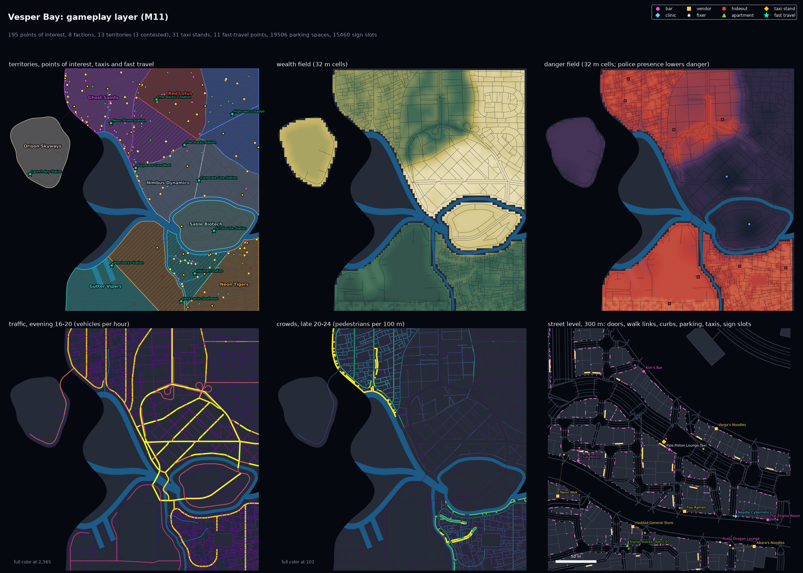

# M11: gameplay layer

M11 adds the gameplay layer to every city: named points of interest with their doors, faction
territories and police precincts, wealth, danger and police fields, traffic, crowd and spawn
density per street and hour band for lifegen, parking, taxi stands and fast-travel points,
and sign and ad slots for stages 2 and 3. It runs last, on the finished city
(`citygen/gameplay.py`, after props), and adds nine checks (`citygen/gameplay_checks.py`,
75 in all). The data is in `city_model.json` (eight new collections) and in a new export,
`gameplay.json`, beside the blockout exports.

Every sample passes all 75 checks on the same number of full-city tries as on M8c, and
each `city_model.json` is byte-identical on the M4 Mac (arm64) and on x86_64 Linux (docker
image `citygen-x86`, `linux/amd64`, `CITYGEN_WORKERS=3`), stage traces included:

| City | Tries (M8c, M11) | Points of interest | Factions | Territories | Taxi stands / fast travel | Parking spaces | Sign slots | sha256 of `city_model.json` (both machines) |
|---|---|---|---|---|---|---|---|---|
| archipelago_free_port | 1, 1 | 87 (vendor 38, bar 20, clinic 13, apartment 9, hideout 4, fixer 3) | 2 gangs, 2 corporations, police | 8 (2 contested) | 15 / 6 | 11126 | 7764 | `8c7533f9cef483e2cfb7029af4ae3cb26ee0ed720301170dba56ef94a4208b17` |
| delta_megacity | 1, 1 | 190 (vendor 79, bar 53, clinic 30, apartment 17, hideout 6, fixer 5) | 2 gangs, 3 corporations, police | 12 (2 contested) | 26 / 11 | 15016 | 14962 | `5b9811f4f8d21315e68c898cdd7c2efcb4532d170af98a6a5edeb05005422dd6` |
| nexus_city | 3, 3 | 215 (vendor 85, bar 65, clinic 32, apartment 21, fixer 7, hideout 5) | 3 gangs, 4 corporations, police | 13 (2 contested) | 33 / 13 | 15049 | 17615 | `2304d2b15a5d16b47789ccd236a2bd7bdae0f6c29d156a9bfc04c78315832c46` |
| peninsula_city | 1, 1 | 117 (vendor 38, bar 35, apartment 20, clinic 15, fixer 5, hideout 4) | 3 gangs, 2 corporations, police | 9 (1 contested) | 17 / 8 | 19766 | 6658 | `4a340f1228c1476d6bf45ce4b3ef748a1858758b256e06625b9d987df933f69d` |
| vesper_bay | 1, 1 | 195 (vendor 72, bar 55, clinic 27, apartment 26, hideout 8, fixer 7) | 4 gangs, 3 corporations, police | 13 (3 contested) | 31 / 11 | 19506 | 15460 | `98ea72f81e6f01f18443a32b3fcc8a2a359895bee37278ec7cf467ce09c22210` |
| vesper_bay_pinned | 2, 2 | 212 (vendor 74, bar 60, apartment 30, clinic 30, hideout 10, fixer 8) | 4 gangs, 3 corporations, police | 13 (4 contested) | 29 / 12 | 18614 | 16143 | `42894b0951c1659948c9f2244a16b594537bd4f8fa7af477b4ffb5d0a3f90e62` |

The stage takes 0.8 to 2.5 s per city on the Mac and its checks 0.1 to 0.6 s; run again on
a saved model with its own rows dropped, it gives the same bytes. Apart from the new
collections, the only change to the model is three values in each district's `params`
(`wealth`, `danger`, `police`, from the filled spec); every other collection is the M8c one,
so the blockout plans (and their goldens) are unchanged. `city_model.json` grows by about
15% (Vesper Bay 48.2 to 55.5 MB, most of it the sign slots and densities);
`gameplay.json` is 8.5 MB for Vesper Bay.

## What the stage builds

| collection | what | from |
|---|---|---|
| `factions` | gangs, corporations, the city police (`faction.<kind>`, name, color, home district, zones) | a gang per district with `danger` 0.45 or more (or the spec's `faction`), a corporation for corporate, campus, port, transit hub and spaceport districts, else the police |
| `zones` | territories (`zone.territory`: polygons, blocks, faction, how firmly held, contested or not) and police precincts (`zone.police`: the district, presence, station building) | 1 to 4 turfs per district (one per 0.6 km2), seeds by farthest-point sampling over the block centers, cells cut by straight bisectors; a rival gang takes the turf nearest its home district (within 3 km) |
| `fields` | `field.wealth`, `field.danger`, `field.police`: 32 m rasters over the bounds, values 0 to 1 | the district values blended with an integer box blur (3 cells), then: police up near stations, precinct stations and avenues; wealth up near parks, plazas and water and landmarks, down under raised highways and in alleys; danger up in alleys and under raised highways, down where police and wealth rise |
| `pois` | `poi.bar` (bar, club, arcade), `poi.clinic` (clinic, ripperdoc), `poi.vendor` (food, convenience, pawn), `poi.apartment` (capsule, studio, apartment, penthouse by wealth; a floor), `poi.hideout` (warehouse, squat, back room), `poi.fixer` (a table in a bar) | ground-floor units of M3 by use, a budget per km2 by archetype and spacing (bars 60 m, clinics 120 m, vendors 50 m apart), ranked by a hash of the unit, the street class and the danger or wealth at the door; apartments in residential, mixed and hotel buildings; a hideout in each gang turf (two over 0.8 km2), warehouses and stacks first; one or two fixers per district in its most dangerous bars |
| `densities` | per road segment: speed, and per hour band (night 0-6, morning 6-10, day 10-16, evening 16-20, late 20-24) traffic (vehicles per hour), vehicles, pedestrians, gang members and police per 100 m | lanes times a per-lane capacity and peak use by class, an hour profile by archetype, the shops on the segment, stations within 150 m, the danger and police fields, whether a gang holds the turf |
| `parking` | `parking.garage` (parking structures; underground garages under big towers), `parking.lot` (deep front setbacks of warehouses, sheds, hangars, labs and terminals), `parking.street` (curb parking lanes) | capacities from floor area (28 to 30 m2 a space), lot area (25 m2) and curb length (6.5 m) |
| `travel_points` | `travel.taxi_stand` at stations, hotels, landmarks and bars of nightlife districts (250 m apart, one per road segment); `travel.fast_travel`, one to four per district (stations, places, landmarks, signalized junctions; 350 m apart) | |
| `sign_slots` | `shop_sign` (one per M6 sign prop, blade or flat), `billboard` (M3 roof billboards, and facade panels facing highways and avenues), `holo_ad` (over tower roofs without pads), `neon` (vertical bands at a corner of mid-rise facades) | sizes, facing direction, content (shop use, ad, corporate, district) and the evening audience of the street it faces; new slots start above the building's shop signs and keep 3 m from skybridge ends |

Every point of interest, parking entrance and travel point carries an `Access`: the door, the
ground walkway it opens on (within 40 m, in the walkway component of its landmass), the drive
lane a car stops on (a ground lane of a local road in the lane graph's largest strongly
connected part, within 60 m on the road the door faces, else 150 m) and the curb point on
that lane, which must lie on the door's walkway component. A candidate without one is not
placed, so the two reachability checks hold by construction and the layer never makes a city
retry.

Names come from fixed word lists by hash and are unique in the city (no two generated
factions share a word). Ids come from what a place is and where it sits: `<building>.u03.bar`,
`<building>.apt012`, `<building>.hideout`, `<segment>.density`, `<segment>.taxi`,
`<prop>.slot`, `<district>.turf2`; no build counters.

## Spec

`districts[].wealth`, `danger`, `police` (0 to 1; archetype defaults in `presets.py`) and
`faction` (a name; districts with the same name share the faction). Existing specs need no
edits; the filled spec gains the three values per district.

## Checks

| check | what |
|---|---|
| `poi_reachable_foot` | every door on a ground walkway within 40 m in the main walkway component of its landmass; the curb on the same component |
| `poi_reachable_car` | every curb lane a ground drive lane of a local road in the lane graph's largest strongly connected part; the curb on the lane within 150 m of the door |
| `poi_places` | names present and unique (with travel points), doors within 1.5 m of the building's facade, units of the right use, fixers in an existing venue, hours and zones valid |
| `territories` | each district's territories cover it without overlap and hold each block once; a police precinct per district; factions and zones refer to each other |
| `gameplay_fields` | the three rasters cover the bounds, values 0 to 1 |
| `street_density` | a row per road segment with five bands, nothing negative, traffic within the lanes' capacity, no cars on pedestrian ways |
| `parking` | capacity, garages in their building, lots clear of buildings and carriageways, curb parking where the road has parking and drive lanes |
| `travel_points` | a fast-travel point in every district with streets, taxi stands 250 m apart, each on its sidewalk |
| `sign_slots` | one slot per sign prop and roof billboard, facade slots on a facade of their building above its shop signs and apart from each other, holo-ads over their roof |

## Sweep

`citygen sweep --suite m8a --workers 3` ([`sweep.md`](sweep.md), `sweep.json`), next to
M8c's ([`../M8c/sweep.md`](../M8c/sweep.md)):

| | M8c | M11 |
|---|---|---|
| builds passing every check | 58 of 68 | 58 of 68 |
| builds whose pass, failing checks, retries, hydrology and road variant or layout salt differ from M8c | | 0 |
| full-city tries beyond the first, all 68 builds | 110 | 110 |
| crashes | 0 | 0 |
| build time, all 68 builds (one process each, the Mac shared with another session) | 5976 s | 6551 s |

The layer makes no city retry: on every build each full-city try fails or passes exactly as
on M8c, and the ten builds that fail fail the same M1 to M7 checks (placement, road graph,
open space share, curve radius and the rest; M8a's open items).

The first sweep of the layer ([`sweep_first_pass.md`](sweep_first_pass.md)) found two
defects, both fixed before the one above:
- **Setback lots over other buildings:** a surface lot cut from a lot's front setback could
  cover a building of a neighboring lot or a complex (up to 1840 m2), so `parking` failed
  and five builds took one to three more full-city tries. Lots are now tested against every
  building footprint and carriageway with the check's own measure (`lot_obstacles`,
  `lot_clash`) and dropped when they touch one.
- **A district with no fast-travel candidate:** on Vesper Bay s404 the spaceport island had
  no station, place, landmark or signalized junction, so `travel_points` failed on all nine
  tries and the build broke. Such a district now falls back to its other junctions, then the
  middle of each drive lane, and the check asks for a point only where one of those lane
  middles is reachable on foot and by car.
Both are pinned by tests (`test_lots_keep_clear_of_buildings`,
`test_fast_travel_without_stations_or_signals`); the sample cities do not change.

## Tests

`tests/test_gameplay.py` (20 tests): the layer on Testport passes and matches a fresh check
run; it is complete (every kind, territories and precincts in every district, a density row
per segment, unique names); a failing case for each of the nine checks; the spec defaults and
a spec `faction` shared by two districts; the `gameplay.json` tile index; the helpers
(compass words, the largest strongly connected part, unique names); the two sweep
regressions; and the stage run twice on the same model, once with 2-ULP noise on everything
GEOS computes inside it, giving the same rows and the same model bytes. The check counts in
`test_build.py`, `test_buildings.py` and `test_streets.py` gain the nine checks; the committed
reports compared with fresh builds are now this folder's.

## Open items

- **No blockout geometry.** Points of interest, slots, parking and travel points are data
  only (in `city_model.json` and `gameplay.json`); markers in the .blend and glTF tiles were
  left out to keep the blockout plans, and their goldens, unchanged.
- **Doors on pedestrian streets.** A shop on a pedestrian street or deep in a market gets its
  curb on the nearest drive lane, up to 150 m away (the dotted links in the street inset);
  a drop-off point at the end of the pedestrian street would be closer to how a game routes
  a taxi.
- **Rival turfs are geometric.** The rival gang takes the turf nearest its home district;
  contested borders do not yet follow streets or water, and turfs cross canals.
- **Densities are estimates.** Traffic and crowds come from road class, lanes, the shops on
  each segment, stations nearby and an hour profile per archetype, not from a trip model;
  lifegen can calibrate them (the per-band lists are the interface).
- **Shop slots inherit M6.** The 13k shop-sign slots of a big city are one per M6 sign prop;
  stage 2 may want them grouped per shopfront.
- **Shapely warnings in M2.** The sweep logs "divide by zero encountered in buffer" from
  `blocks.row_pieces` (a flat-capped buffer of a degenerate street piece) on some seeds; it
  predates M11 and changes no result here.

## Files

`<city>/` holds `preview_gameplay.png` and the other previews, `report.txt` and
`report.json`, `trace.json`, `blockout_report.txt`, `render_top.jpg` and the 8K
`render_iso_city.jpg`. `sweep.md` and `sweep.json` are the sweep, `sweep_first_pass.*` the
first one; `wip/` the work-in-progress previews.
