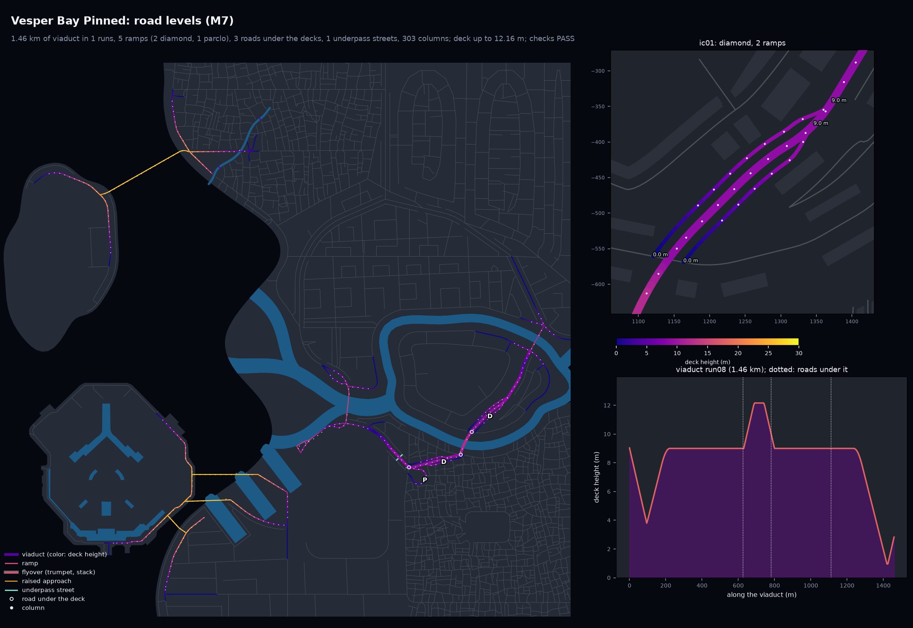
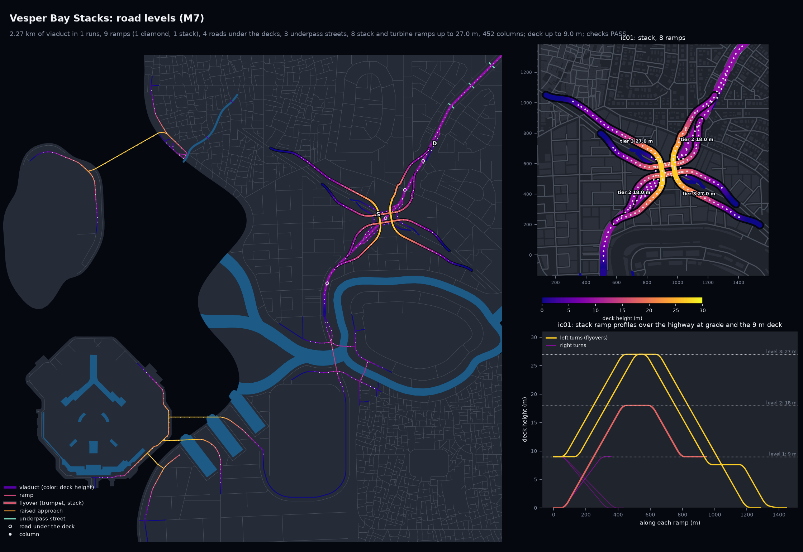
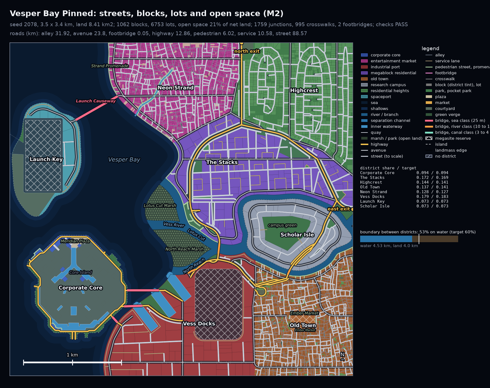
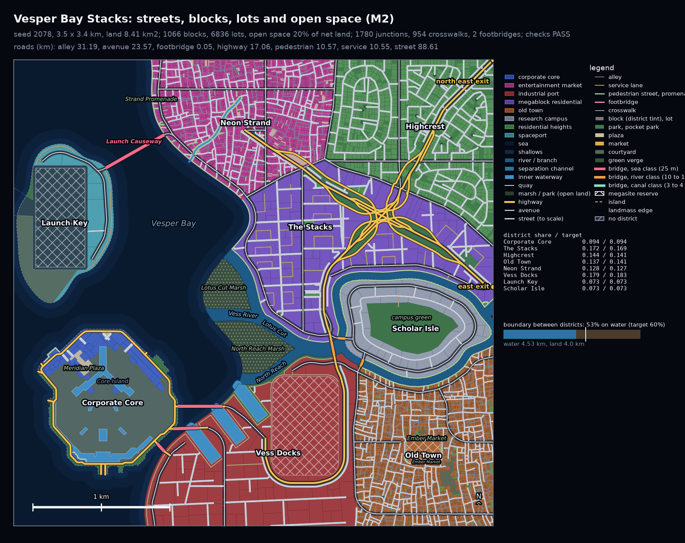
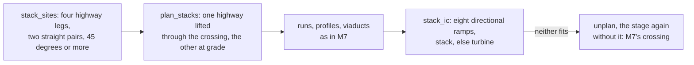

# M12: stack interchanges

Where two generated highways cross and the footprint fits, M12 builds a four-level stack:
the two highways (one at grade, one on a 9 m viaduct through the crossing) and eight one-way
directional ramps, the four left turns as flyovers on two tiers (18 m and 27 m) over the
core and the four right turns in their quadrants, with no loops. The turbine is the same
eight movements with the left turns swept wider round the core so their crossings fall
apart (no point has more than three levels); each is the other's fallback, and where neither
fits the crossing is built exactly as M7 builds it. Columns stand under every level as for
any raised road. Two new checks (`stack_ramps`, `stack_levels`, 77 in all).

None of the five samples or the pinned demo has two highways that cross with room for a
stack, so the stack is shown in a seventh city, **Vesper Bay Stacks**: the pinned demo with
only its highways changed (art direction, below). The five samples and the pinned demo are
byte-identical to M11 apart from `spec_sha256` (the filled spec gains the defaults of the two
new spec fields), and every city passes all 77 checks:

| City | Tries (M11, M12) | Interchanges | sha256 of `city_model.json` (M4 Mac and x86_64 Linux) | vs M11 |
|---|---|---|---|---|
| archipelago_free_port | 1, 1 | diamond | `e5780b722a035ca3edde143788a00e5f510828d8e632a2f1ede09f48b449c617` | same apart from the spec hash |
| delta_megacity | 1, 1 | none | `6feb38bd8c67a2cfde3989df90468bc6ad78437f2a349d6e8f494c4a2b91c6ae` | same apart from the spec hash |
| nexus_city | 3, 3 | diamond, diamond stub | `6757ba4121f32887a7a5082a314ed2b2c9fc01ecb3b64e899be21bf9811bd1ba` | same apart from the spec hash |
| peninsula_city | 1, 1 | none | `8456650dfca5bec4e9bcd65301822dd38849fd4dd8375599cfa437cfd5aeabb4` | same apart from the spec hash |
| vesper_bay | 1, 1 | diamond, parclo, trumpet | `2e5582be86c77054c3705fcd653851ad129bdf074b673f74651a17bfc144058d` | same apart from the spec hash |
| vesper_bay_pinned | 2, 2 | diamond (2), parclo | `b896bf87d4ebfc0139a458ff2bf214f5c1c298a55ab686bd3a5fdfb4ef8e975f` | same apart from the spec hash |
| vesper_bay_stacks | new, 1 | diamond, **stack** | `385dbd9a2df5811d71c51d6ddcd9c14094c242e8ee251a36a373e9908f218d67` | new (the stack demo) |

"Same apart from the spec hash": with `spec_sha256` set back to the hash of the spec dumped
without the new fields (and salted as the build salted it), the bytes equal the M11 golden
(the pinned demo: the M11 README's sha256). The blockout plans of the five samples are
unchanged (their goldens stand).

X86_NOTE

## The stack in Vesper Bay Stacks


The Stacks Crosstown (lifted, northeast to southwest) crosses the Bayline (at grade,
northwest to southeast) at 72 degrees in The Stacks, at (937.5, 562.5). The 8K close-up
above looks north-east over the crossing from 700 m up; the whole city is in
`vesper_bay_stacks/render_iso_city.jpg`.

| The pinned demo: ring and spine | Vesper Bay Stacks: two crosstowns and a stack |
|---|---|
|  |  |
|  |  |

The road-levels preview puts the stack in its inset (each left turn labeled with its tier
and crest) and the profiles of its eight ramps in the profile panel, over the 9, 18 and
27 m levels.

| Ramp | Turn | Level | Length | Crest | Columns |
|---|---|---|---|---|---|
| Bayline onto the Crosstown (two) | left | tier 2 | 948 m, 921 m | 18.0 m | 25, 24 |
| Crosstown onto the Bayline (two) | left | tier 3 | 1445 m, 1285 m | 27.0 m | 38, 35 |
| right turns (four) | right | level 1 | 358 to 435 m | 9.0 m | 7 to 9 |

6.14 km of ramp on 153 columns; the ramps reach 938 m from the crossing and cover 1.40 by
0.86 km. The tier-3 ramps come down to the ground highway, so they are the longest: 27 m at
5% is 540 m of grade before the tapers and vertical curves.

### Art direction: a stack demo beside the pinned demo

The pinned demo's ring and spine never cross with room (the ring bends at its crossings and
its inside is shallow above Scholar Isle's river), and no other sample has a crossing of two
highways with 700 m of dry, junction-free road on each arm either (Vesper Bay's one place
with room holds its trumpet, the M8d showcase that M9 also keeps). The smallest change that
gives a stack is to the pinned demo's `highways`, and only those
(`cities/vesper_bay_stacks/city_spec.json`, otherwise the pinned spec, seed 2078):

```json
"highways": {
  "pattern": "none",
  "exits": ["east", "north_east"],
  "named": [
    {"name": "Stacks Crosstown", "route": ["north_east_exit", "Vess Docks"], "reuse": false},
    {"name": "Bayline", "route": ["east_exit", "Neon Strand"], "reuse": false}
  ]
}
```

Two crosstowns that cross in The Stacks (the district the interchange is named for), from
the northeast corner down to the docks and from the east edge across to the strand. The new
`reuse: false` (`NamedHighway.reuse`) keeps a named route on its own line across the
highways it meets; with M1b's reuse discount the second route ran along the first instead of
crossing it. The network has one diamond (on the Crosstown's viaduct northeast of the stack)
and the stack; the north exit moved to the northeast corner.

It is a separate city rather than a change to the pinned demo because the pinned demo also
stands in the sweep at eight seeds, and the crosstowns are fragile away from seed 2078: the
Crosstown's end wraps the Vess Freight Terminal reserve with curves under 150 m at some
seeds, traced roads leaving Core Island meet no ring to join, a named route does not always
end exactly on its exit (the exit counts as not built), and in some road variants the two
crosstowns cross near the east exit with too short an arm. With the change in the pinned
demo, it failed at seeds 404 and 3141, two of the sweep seeds where it passes in M11. Other routes tried (the ring and spine
with crosstowns added, a crosstown from the north exit or to a south exit, routes through
Highcrest or The Stacks) crossed with an arm too short, with water within the ramps' reach,
or with an avenue where a ramp's column could not stand.

## How a stack is laid out

All in `citygen/elevated.py` (M7's stage, at the end of M1b).



1. **Sites** (`Elev.stack_sites`). A node where two generated highways cross: four highway
   legs and no other road, in two pairs that each run straight on (35 degrees at most) and
   cross at 45 degrees or more; not traced, not an exit.
2. **Plan** (`plan_stacks`, `_corridor`, `_window`). Each highway is followed through the
   crossing (on through nodes where it runs straightest, round a bend of up to 90 degrees
   where it is the only highway there) to its ends. The lifted one needs 640 m of ramp room
   both ways plus its run down beyond (or it stays up to the map edge), the one at grade
   700 m. No other highway may meet either within its window. The highway already up goes
   up, else the one that leaves the ground highway with fewer junctions near the crossing.
3. **Avenues under the lifted deck.** A node of avenues in the lifted window that would
   bring the viaduct down stays at grade under the deck (node kind `under`), and so does one
   whose own ramps do not fit among the stack's (it is tried first, as M7 would). An avenue
   that met the lifted highway from one side then ends 15 m clear of the deck
   (`UNDER_END_M`), so M2 does not join its end to the deck above it.
4. **Levels.** The lifted highway is a viaduct at 9 m (level 1) over the one at grade. The
   two left turns from the ground highway hold tier 2 (18 m) over the 200 m core, the two
   from the lifted one tier 3 (27 m) over them; ramps carry `attrs.template` `stack`,
   `turn`, `tier` and `crossing`, and `level` 2 or 3 for the left turns.
5. **Left turns** (`_sys_ramp`, `_sys_core`). Each leaves its highway on the right, swings
   out to a line 45 m beyond the highway's edge (over three times the offset, `_swing`),
   crosses the core on a diagonal between two turns of 150 m radius and swings in to the
   other highway's right lanes. The diagonal crosses the first highway 50 m before the
   crossing and the second 50 m after it (101 m and 152 m when the turns do not fit), so
   the two diagonals of a tier run side by side and never meet, and each tier-3 diagonal
   crosses both tier-2 diagonals over a highway: the fourth level. The diagonal is pinned to
   those points on the roads themselves, so a bend further out does not move it onto the
   crossing; the lines beside the highways take their direction from a 25 m chord, so a
   short jog in a highway cannot fold them back.
6. **Right turns.** One quadrant each, next to the highways (70 m radius), leaving each
   highway at least 75 m nearer the crossing than the left ramp from there and joining it as
   far before the left ramp into it, so their tapers never cross another ramp's lane. They
   pass under a left ramp where that is high enough, else over it.
7. **Profiles** (`_sys_needs`, `_sys_profile`), as for M8d's flyover: every road and ramp a
   ramp passes over needs 5.5 m plus the deck, a crest is a 40 m vertical curve, level
   between crests, no dip below the lower end, 5% grades, 6% at most. The approach and the
   departure grow until it climbs in time; the length it lacks goes half to each end, else
   all to one (`bias`), where the other is held by the left ramp beside it or would land on
   a road under the deck.
8. **Columns** (`_fly_span`). No stretch of a ramp without a spot for a column may exceed
   60 m, the supports' own longest span over a road; a ramp that has one swings out and in
   elsewhere (up to six tries). `road_supports` then places the columns under every level as
   for every raised road. A ramp also may not turn more than 140 degrees in all
   (`_winding`, the check's own measure).
9. **Turbine** (`TURBINE_SWING`): the same eight ramps, the left turns on lines 60 m out with
   200 m turns, the two pairs' diagonals 40 m and 130 m from the crossing, so each left ramp
   crosses each highway at a point of its own, as high as the roads under it need (below the
   stack's tier 3). It is the stack's fallback; `highways.crossings: "turbine"` asks for it
   first, with the stack as its fallback.
10. **Fallback.** Where neither fits, or a planned stack ends up not built for any reason,
    the plan is dropped and the stage runs again without it: the crossing is exactly what M7
    makes of it (test `test_no_room_keeps_the_old_crossing`).

Skew: the left turns of an acute angle cross each highway at half the angle, so their spans
over the roads lengthen as the crossing gets sharper; a stack fits down to about 70 degrees
(tested at 90, 80 and 70); at 65 degrees the test crossing gets the turbine.

## Checks (77 in all)

| check | what |
|---|---|
| `stack_ramps` | every stack and turbine has its eight directional ramps, four left and four right turns, one per movement, none a loop (at most 150 degrees of turning), each one-way, leaving one highway and joining the other on the right |
| `stack_levels` | four levels: a deck at 9 m over its crossing and the other highway at grade under it; a stack's left ramps crest at their tier (18 or 27 m, at most 29 m), each tier-3 ramp over the tier-2 ramps where they cross (5.5 m plus the deck); a turbine's left ramps cross each highway at least 15 m apart |

Grades, level continuity, deck clearance, ramp ends and column spacing are M7's checks as
before, now over every level of a stack. Elevated stats gain `stacks`, `turbines`,
`stack_ramps` and `max_stack_m`; the report's elevated line adds the directional ramps.

## Smaller changes

- `citygen/spec.py`: `Highways.crossings` (`stack` or `turbine`) and `NamedHighway.reuse`.
- `citygen/roads.py`: a named highway with `reuse: false` routes without M1b's discount on
  earlier highways (`_waypoint_route(reuse=...)`); unchanged otherwise.
- `citygen/streets.py`: M2 gives no gate link to the end of a traced road stopping on its
  bridge more than 3 m up (`link_dead_ends`). In the stack demo such a link crossed under
  the end of an avenue climbing to the Core Island bridge without clearance, and the city
  took nine full-city tries; the samples have no traced roads, and the pinned demo is
  unchanged by it.

SWEEP_SECTION

## Tests

`tests/test_stack.py` (19 tests) builds the M7 stage on a crossing of two straight highways
on open land: the site and the plan, the eight ramps and their attributes, the four levels,
grades and ends, clearances, the shared crossings of the fourth level, the turbine, each as
the other's fallback, the fallback to M7's crossing (byte for byte), water in the way,
skewed crossings at 80 and 70 degrees, determinism, column spans over the core, an avenue
junction on the lifted highway passing under the deck (and ending clear of it), a planned
stack that is never built, and the winding measure; one more builds the stack demo's roads
and checks its stack. The check counts (66 with no transit lines) and check ids are updated,
and `test_committed_reports_match` reads the M12 reports.

## Open items

- **Few stacks without art direction.** Stacks need two generated highways crossing with
  about 700 m of dry, junction-free road on every arm; the ring, spine and grid patterns
  rarely give one (M1b's reuse discount merges routes that would cross), so the samples get
  none unless a spec asks for crosstowns. A `highways.pattern` that lays crosstowns, or
  crossing placement that looks for stack room, would make them common.
- **Skew below about 70 degrees** falls back to the turbine, then to M7's crossing.
- **Footprint.** About 1.4 by 0.9 km in the demo (27 m at 5% is 540 m before tapers and
  curves); a tighter stack would need 6% grades or shorter tapers on the tier-3 ramps.
- **Avenues under the deck.** An avenue that met the lifted highway from one side ends short
  of it; M2's local streets may link it on, but it no longer reaches the highway there.
- **The Crosstown's southern end** wraps the Vess Freight Terminal reserve to reach the docks,
  as the pinned demo's ring does; at other seeds those curves fall under 150 m.
- **Named highways and exits.** A named route through an exit stop starts and ends at the
  exit's grid cell, not at the exit point, so at some seeds the exit counts as not built;
  routing it like the patterns' exit legs (`start_exit`, and the same for the end) fixes that
  but changes which road variant passes first, so it was left for a later milestone.
- **Stack demo at other seeds.** For these reasons the stack demo builds its stack at its own
  seed, not at 404 or 3141 (the two others tried); it is not in the sweep suite.
