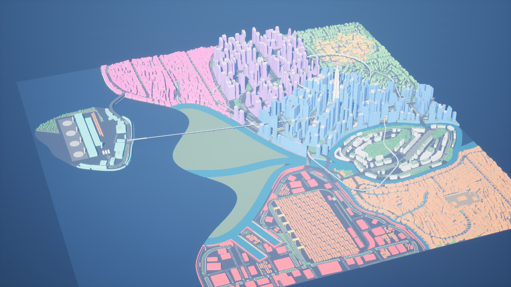
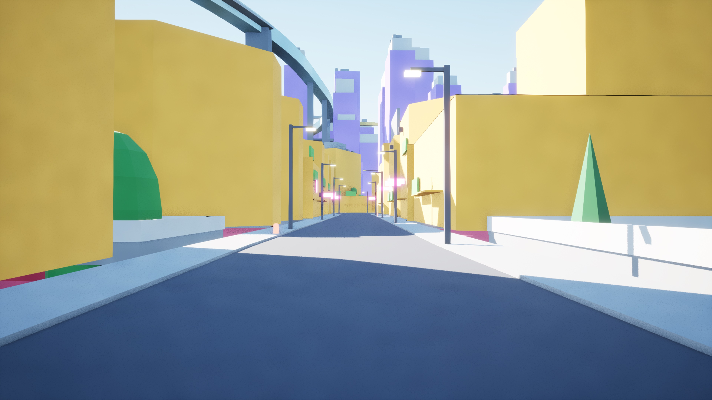
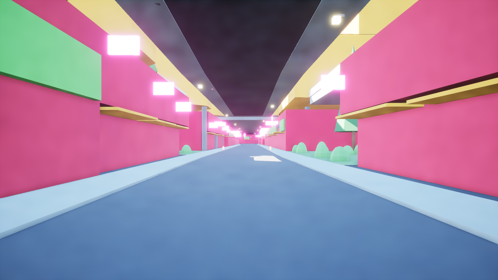
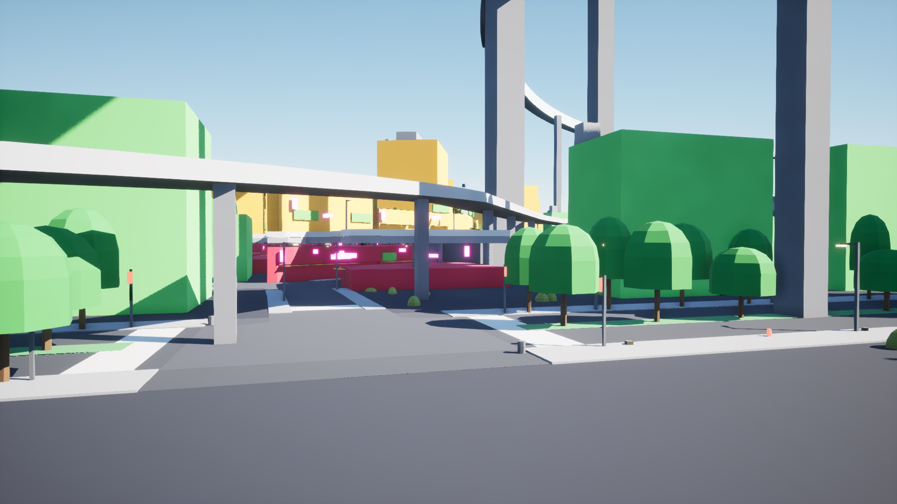
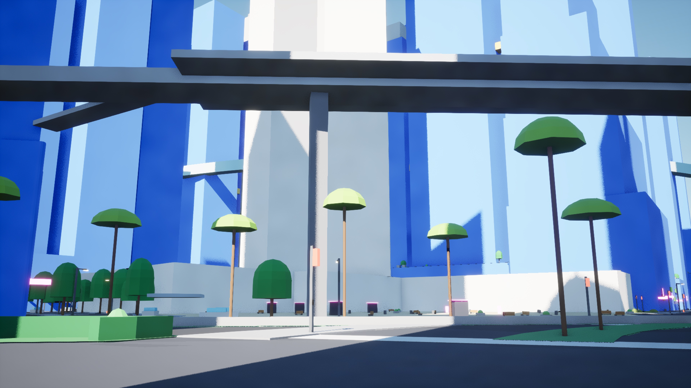
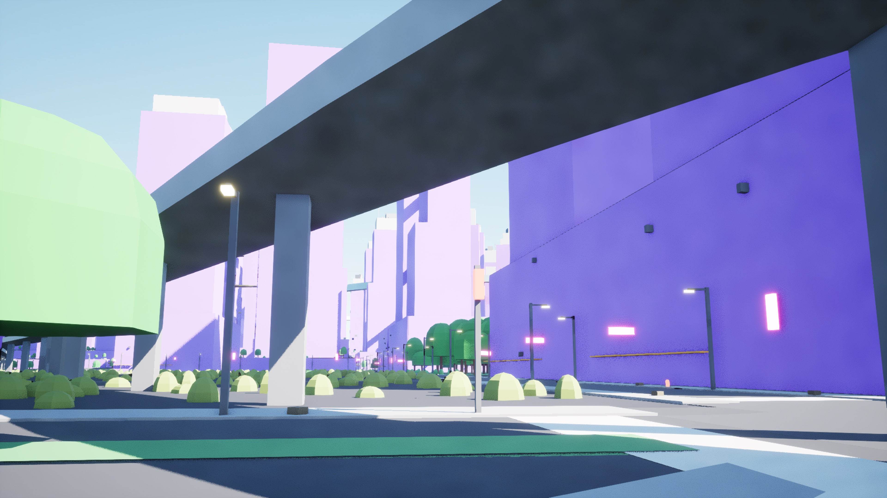
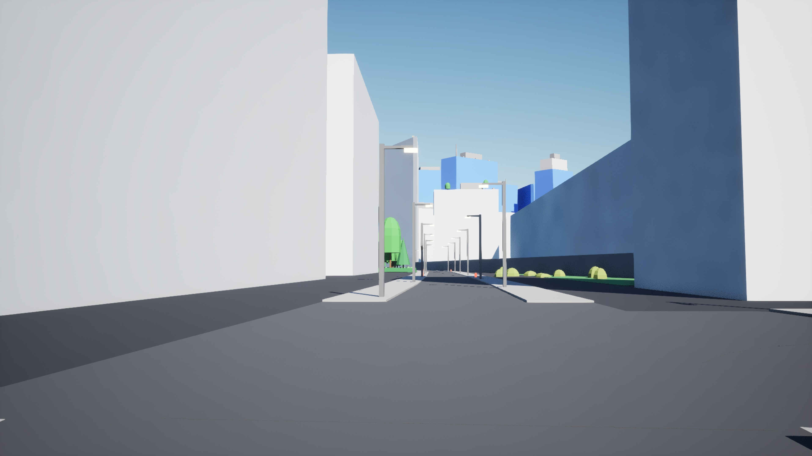

# M14 in Unreal: Vesper Bay Decks

The Unreal check of M14 (layered districts), after M14 merged: Vesper Bay Decks built from
`cities/vesper_bay_decks/city_spec.json` (all 91 checks pass), imported into the exporter's
throwaway test project (Unreal 5.8.4), imported again, checked with shots, and Vesper Bay
imported over its M15 import.

```bash
citygen build cities/vesper_bay_decks/city_spec.json out/vesper_bay_decks --blockout
citygen unreal out/vesper_bay_decks "<path>/<Project>.uproject"
citygen unreal out/vesper_bay_decks "<path>/<Project>.uproject" --check --shots out/vesper_bay_decks/shots \
  --view deck_street 1351.8 1081.8 10.7 1224.3 1083.5 13.0 24 \
  --view deck_edge 967.0 1118.6 8.0 1070.3 1083.3 6.0 22 \
  --view under_deck 1360.9 1081.9 1.7 1215.2 1083.6 2.5 20
```

## The deck in Unreal

| M14 adds | In Unreal | Key, for example |
|---|---|---|
| the slab, with its railing | one actor per deck and tile (8), tagged `cg.level=1` | `d03.deck.e1378n1225.slab.t+04+03` |
| the deck's streets, junctions and sidewalks | joined per district, category and tile like the ground's (8 of each), tagged `cg.level=1` | `city.deck_road.t+04+03`, `d03.deck_junction.t+04+03`, `city.deck_sidewalk.t+04+03` (open items) |
| the ramps | one actor each (2), tagged `cg.level=1` | `rs.e1532n1017.ramp` |
| the buildings on the deck | one actor each (158), tagged `cg.level=1` | `d03.lot.e1237n994.l1.bld` |
| the columns | joined per tile (8) | `d03.deck_column.t+04+03` |
| stairs and elevators | one actor each (2 and 2), on no level (they join the two) | `d03.deck.e1378n1225.st.e1187n1126`, `d03.deck.e1378n1225.el.e1188n1137` |
| the undercity | the buildings under the slab (164), material `bld_undercity` | `d03.lot.e1157n969.bld` |
| the manifest's `decks` | `d03.deck.e1378n1225`: level 1, top 9 m, district `d03`, its 8 slab keys | |
| levels in the graphs | `graphs.json` lanes (399 of 18470) and walkways (265 of 16553) at level 1; the flat graphs' `levels` and the data assets' `Levels` (`CORE_VERSION` 2) | |

192 actors carry `cg.level=1`; every other actor carries none, as on a city without decks.

| City | Tiles | Actors | Static meshes, instanced, always loaded | Props and plants | Meshes | First import | Imported again |
|---|---|---|---|---|---|---|---|
| Vesper Bay Decks | 196 | 10477 | 8535, 1938, 4 | 80275 | 8568 | 64 s | 24 s: 0 actors changed, 0 files saved, digests equal |

| City | Actors loaded at the start, after a teleport | Traces down | Roofs | Facades | Walk, on the ground | Check |
|---|---|---|---|---|---|---|
| Vesper Bay Decks | 313, 1179 | 676/676 | 48/48 | 48/48 | 260 m, 100%, reached its end | pass (292 s) |

The check's fourth spot is new: it traces on each deck (the middle of its busiest slab tile),
and 66 traces landed on the deck itself (slab 28, deck streets 18, deck junctions 12, deck
sidewalks 8), besides the buildings on it. The walk starts at the player start on the
ground, as before, and never takes an elevator.



Vesper Bay Decks in Unreal 5.8 (the blockout's isometric direction; the deck is over
Highcrest).

| A street on the deck (`l1.rs.e1288n1083`) | The same street under the slab | The deck's edge from a street beside it |
|---|---|---|
|  |  |  |

On the deck, its streets, sidewalks, lights and railings at 9 m among the deck's buildings;
under it, the ground street between the undercity's shopfronts, the slab overhead on its
columns, lights hung from it; at its edge, the slab over the undercity's neon with the deck's
buildings on top, behind an elevated highway. The edge shot comes from a later
`--check-only` run with the camera above; the first camera stood behind a building.

| Street view 1 | Street view 2 | Street view 3 |
|---|---|---|
|  |  |  |

## Fixed here

- **A road's own level is not a deck's.** M14's manifest took any object's `level` prop as
  its deck level, but the blockout's raised and sunk roads carry their road level there (M7's
  viaducts 1 and 2, M9's road tunnels -1), so 21 elevated highway actors in Vesper Bay Decks
  were tagged `cg.level=1` or `2`. Vesper Bay has 21 such actors too: a city without decks
  would have gained `cg.level` tags on a fresh import but not on an import over an earlier
  one (tags are applied when an actor's hash changes, and these hashes did not). Now only a deck's
  slab, streets and ramps and the buildings with a level stand on one (`unreal._level`,
  `tests/test_unreal.py::test_levels`, and the flat city's manifest has no `level`). No
  project had imported with the old rule except this check's first import, which was deleted
  and imported again, so `ACTOR_VERSION` stays 1.
- **The check traces on the deck** (above).

## `CORE_VERSION` 2 over an M15 project

The test project held the eight cities M15 imported, with the core assets at
`CORE_VERSION` 1. The first import here found them at 1 and brought them to 2 (the `Levels`
variable added to `BP_CityGenGraph`, both classes recompiled), and Vesper Bay was then
imported over its M15 import: it passed, with 10413 actors (6938 created, 3061 updated, 6961
deleted, 414 unchanged), 8089 meshes imported, 444 kept and 6864 deleted, and its three graph
data assets, made by the version 1 class, written again with `Levels` (empty). The changes are
that many because that import predates M10's stable ids (it named buildings
`d01.blk001.lot007.bld`), so nearly every building came back under a new key. It took 518 s,
440 of them deleting the old meshes. The editor log has no errors.

## Open items (generator, not fixed here)

- **The deck's streets have no district.** Its 70 segments (the upper streets and the ramps) have empty
  `district_ids` in the model, so the blockout joins their streets and sidewalks under `city`
  (`city.deck_road.<tile>`, `city.deck_sidewalk.<tile>`) and those actors carry an empty
  `cg.district=`; the deck's junctions, slab and buildings carry `d03`. Giving the twins and
  ramps their district in `decks.py` moves Vesper Bay Decks' model and plan. Fixed after
  M15: `d03.deck_road.<tile>`, `d03.deck_sidewalk.<tile>`
  ([`stage1_fixes`](../../stage1_fixes/)).

## Files

`import_result.json` (first import), `reimport_result.json` (imported again),
`check_result.json`, `vesper_bay_over_m15_result.json`, and the shots (3840 px).
