# M15: Unreal export

The last milestone of stage 1. `citygen unreal` puts a built city into an Unreal 5.8 project,
headless, as a World Partition level that streams and can be walked:

```bash
citygen build cities/vesper_bay/city_spec.json out/vesper_bay --blockout
citygen unreal out/vesper_bay "<path>/<Project>.uproject" --check --shots out/vesper_bay/shots
```

| What | Where in the project |
|---|---|
| a World Partition level | `/Game/CityGen/<City>/Maps/<City>` |
| a static mesh actor per blockout object of the glTF tiles (buildings, skybridges, bridge decks, megasite elements, ground, streets, sidewalks and water joined per category and 256 m tile, most also per district), complex collision | meshes in `/Game/CityGen/<City>/Meshes/<tile>/` |
| a material instance per blockout material (base color, roughness, emissive for lights and neon) | `/Game/CityGen/<City>/Materials/`, parent `/Game/CityGen/Core/M_CityGen` |
| props and plants as instanced meshes: one actor per kind and tile, a hierarchical instanced static mesh, the instances' citygen ids | `BP_CityGenInstances` actors, prototypes in `/Game/CityGen/<City>/Props/` |
| the lane, walkway and transit graphs as data assets for stage 4 | `/Game/CityGen/<City>/Data/DA_<City>_Lanes`, `_Walkways`, `_Transit` (`BP_CityGenGraph`) |
| a player start, a sun, a sky light and the sky atmosphere | always loaded |
| citygen ids and types as actor tags | `cg.city=`, `cg.key=`, `cg.hash=`, `cg.id=`, `cg.type=`, `cg.category=`, `cg.tile=`, `cg.district=` |

Importing a build again updates the level by key and content hash: the same build twice
writes no file, and a city regenerated with `citygen build --district` changes only the
actors of what changed (below).

The six samples (their M12 builds, from before M10 gave every entity a stable id; the
importer does not depend on the ids' form, and the district test below runs on M10's ids;
blockouts without renders), each imported into
the test project on the M4 Mac, imported again, and checked in play-in-editor, one
city at a time (Unreal 5.8.0; times are wall-clock with the editor's start and quit, on a
machine shared with other sessions' sweeps). Actors: one static mesh actor per blockout
object, one instanced actor per prop or plant kind and tile, and the player start, sun, sky
light and sky atmosphere, always loaded. Each city folder has the import, re-import and
check results (`import_result.json`, `reimport_result.json`, `check_result.json`), the 8K
isometric render and the street views. "Imported again" is the import of the same build
with the final importer, after the fixes below: nothing changed, and the digests equal the
first import's.

| City | Tiles | Actors | Static meshes, instanced, always loaded | Props and plants | Meshes | First import | Imported again |
|---|---|---|---|---|---|---|---|
| Vesper Bay | 196 | 10436 | 8511, 1921, 4 | 76415 | 8544 | 79 s | 24 s: 0 actors changed, 0 files saved, digests equal |
| Saltreach Free Port | 196 | 6179 | 4970, 1205, 4 | 43808 | 5001 | 43 s | 16 s: 0 actors changed, 0 files saved, digests equal |
| Greyhook | 192 | 5136 | 3933, 1199, 4 | 37085 | 3965 | 33 s | 15 s: 0 actors changed, 0 files saved, digests equal |
| Delta Megacity | 196 | 9915 | 8012, 1899, 4 | 75504 | 8045 | 63 s | 18 s: 0 actors changed, 0 files saved, digests equal |
| Nexus City | 196 | 11211 | 9097, 2110, 4 | 82587 | 9129 | 70 s | 19 s: 0 actors changed, 0 files saved, digests equal |
| Vesper Bay Pinned | 196 | 11036 | 9175, 1857, 4 | 75825 | 9208 | 78 s | 19 s: 0 actors changed, 0 files saved, digests equal |

| City | Actors loaded at the start, after a teleport | Traces down | Roofs | Facades | Walk, on the ground | Check |
|---|---|---|---|---|---|---|
| Vesper Bay | 354, 1283 | 507/507 | 36/36 | 36/36 | 252 m, 100% | pass (112 s) |
| Saltreach Free Port | 369, 1046 | 507/507 | 36/36 | 36/36 | 136 m, 100% | pass (88 s) |
| Greyhook | 237, 982 | 507/507 | 36/36 | 36/36 | 229 m, 100% | pass (88 s) |
| Delta Megacity | 388, 1305 | 507/507 | 36/36 | 36/36 | 132 m, 100% | pass (83 s) |
| Nexus City | 991, 1058 | 507/507 | 36/36 | 36/36 | 123 m, 100% | pass (68 s) |
| Vesper Bay Pinned | 506, 1364 | 507/507 | 36/36 | 36/36 | 124 m, 100% | pass (68 s) |

In the check: the actors loaded at the start and after a teleport to the busiest tile 600 m
or more away (the rest of the city stays unloaded), traces down on a 16 m grid around three
spots that hit something, roofs and facades of the 12 buildings nearest each spot, and the
distance walked along a sidewalk path in up to 60 s with the share of frames on the ground.


Vesper Bay in Unreal 5.8 (8K render from the editor, every World Partition actor loaded; the
view of the blockout's isometric direction).

The other samples in Unreal (8K, open one for full size):

| Nexus City | Vesper Bay Pinned (the traced Corporate Core) |
|---|---|
| 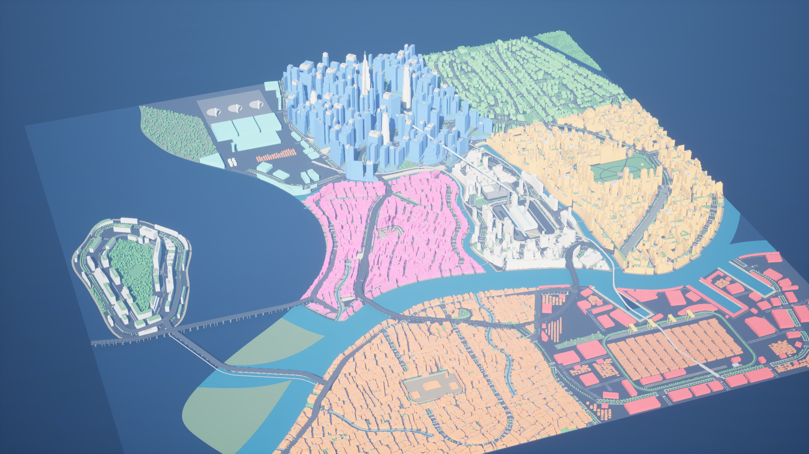 | 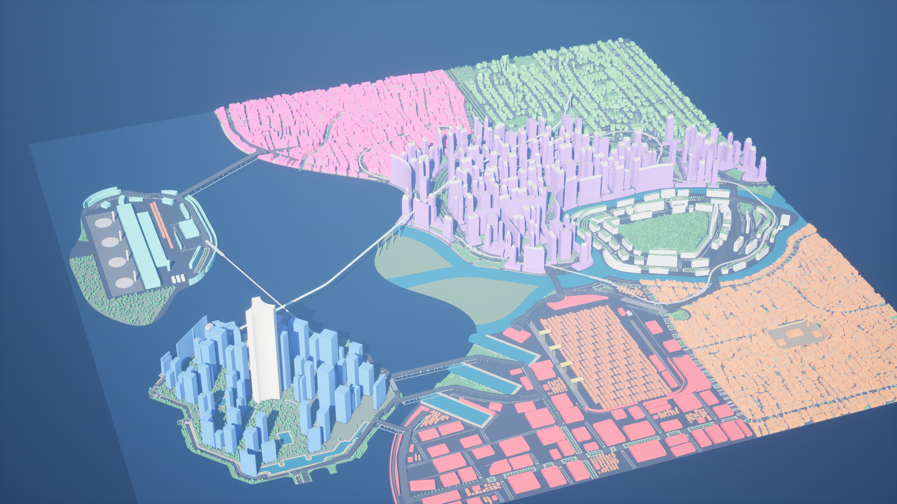 |

| Delta Megacity | Saltreach Free Port |
|---|---|
| 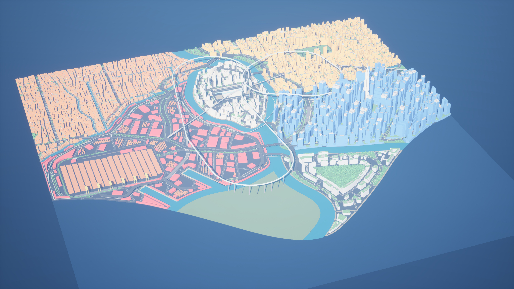 | 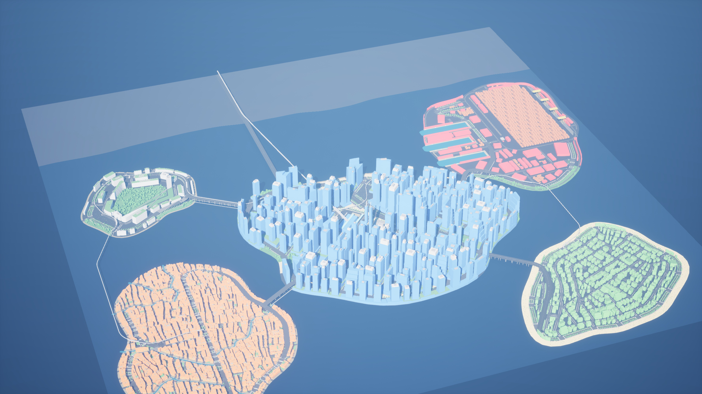 |

| Greyhook | Greyhook with Lantern Strip regenerated (M10, below) |
|---|---|
| 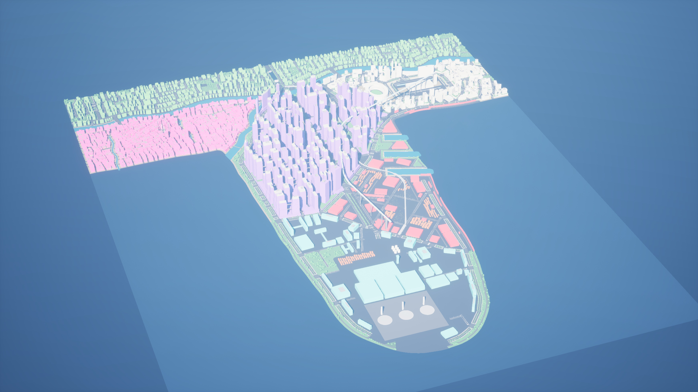 | 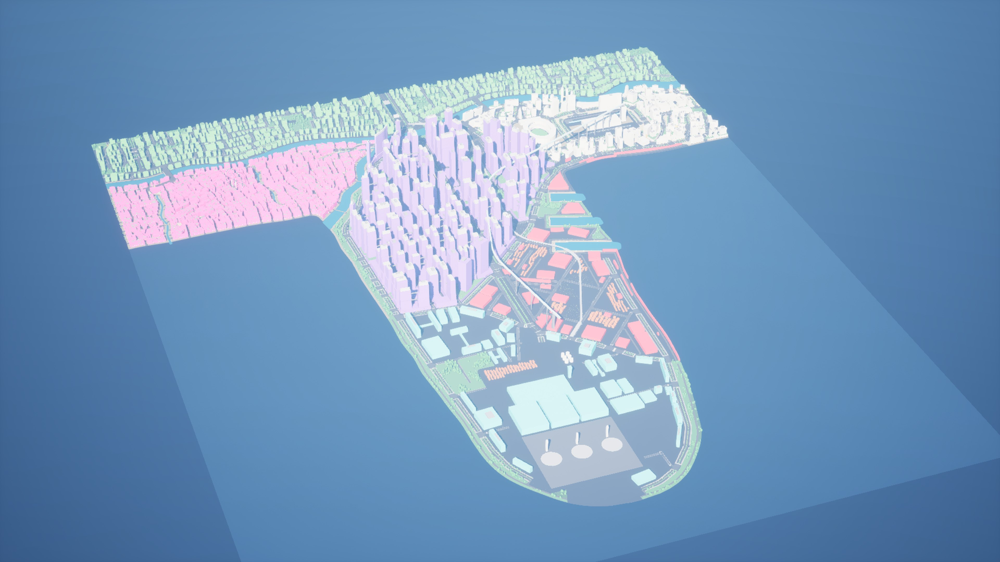 |

At street level: the blockout's street cameras in Blender (EEVEE, `render_street_<n>.jpg` of
the blockout) and the same cameras in Unreal (each city folder has all three of its views,
`blender_street_<n>.jpg` at the blockout's 1600 px and `unreal_street_<n>.jpg` at 3840 px;
the two shown in the root README are 8K):

| Blender blockout | Unreal 5.8 |
|---|---|
| 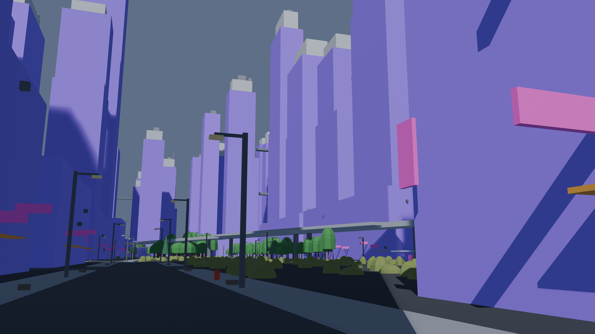 | 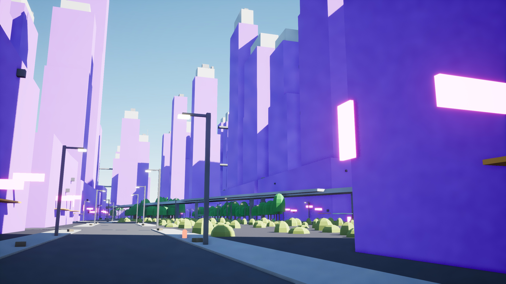 |
| 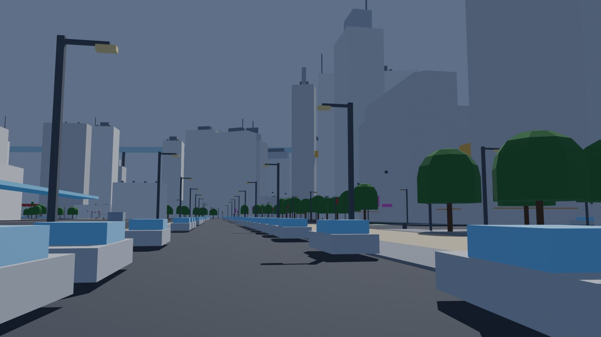 | 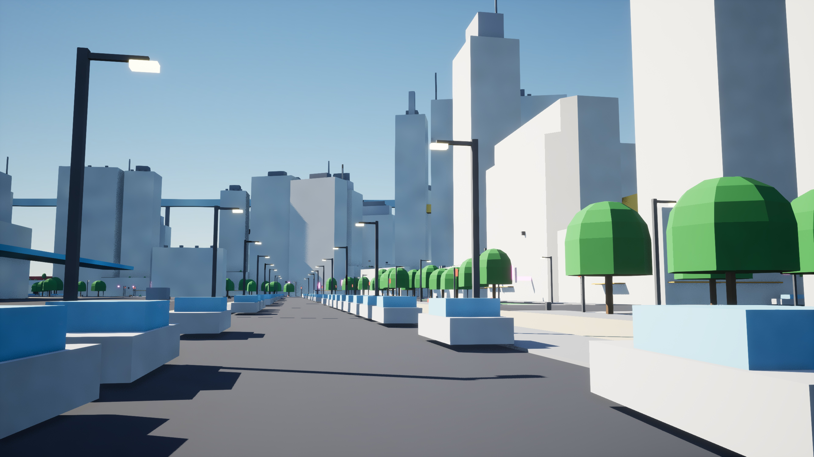 |
| 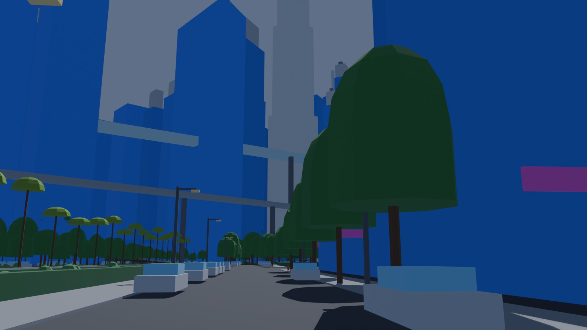 | 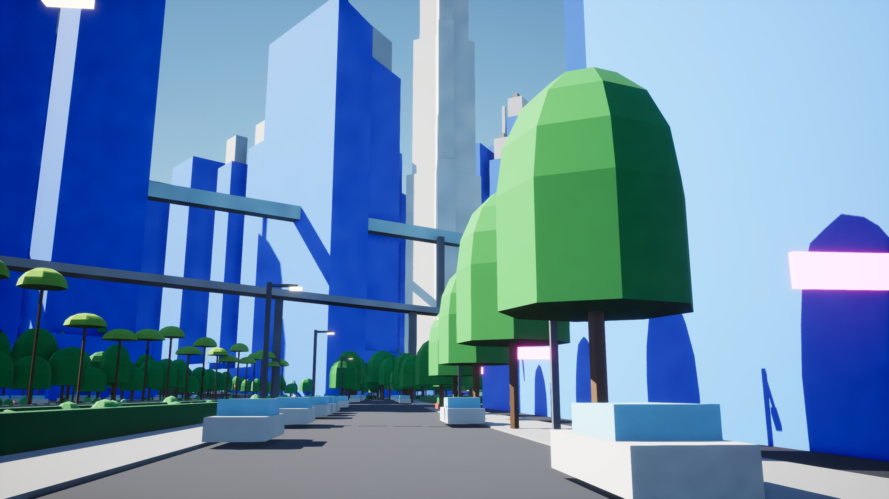 |
| 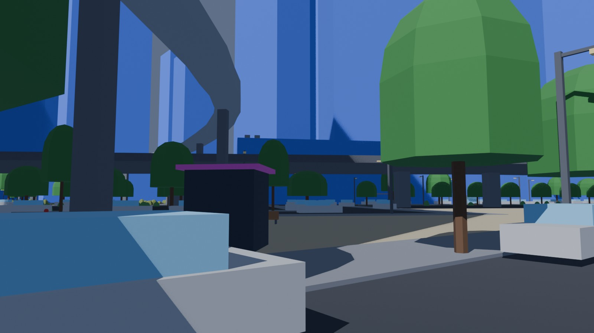 | 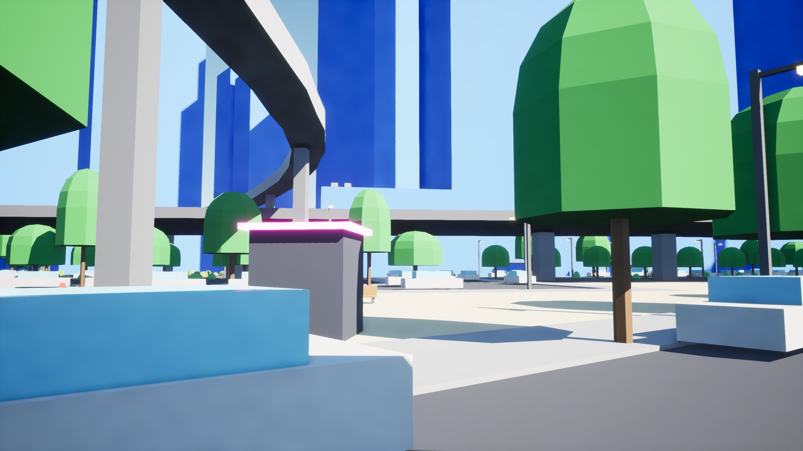 |
| 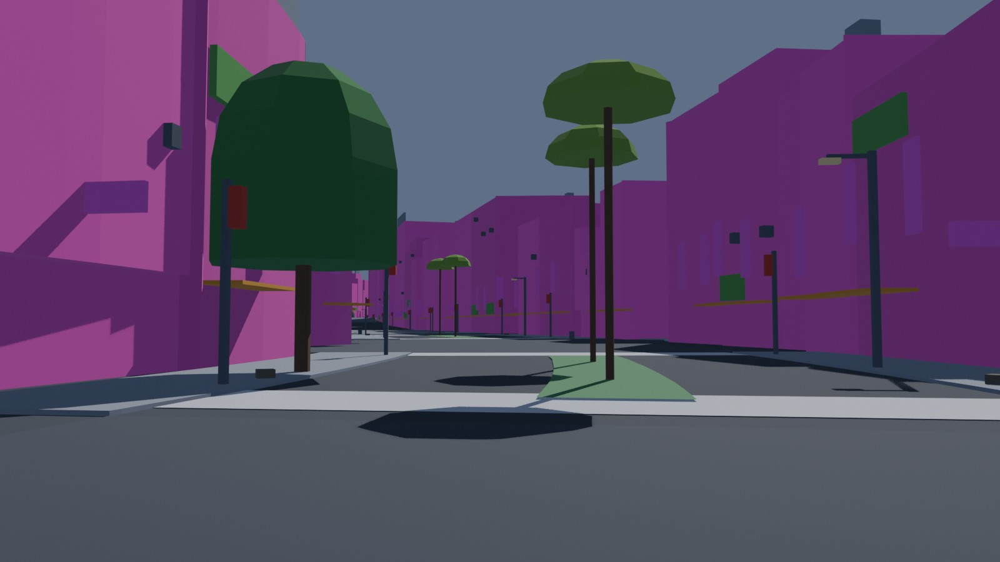 | 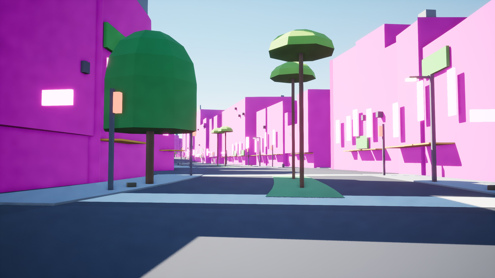 |
| 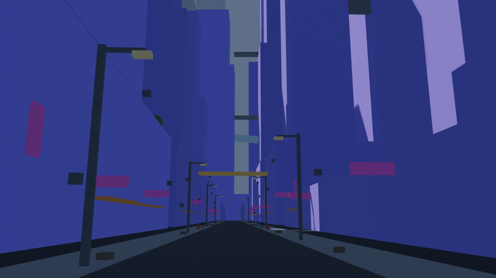 | 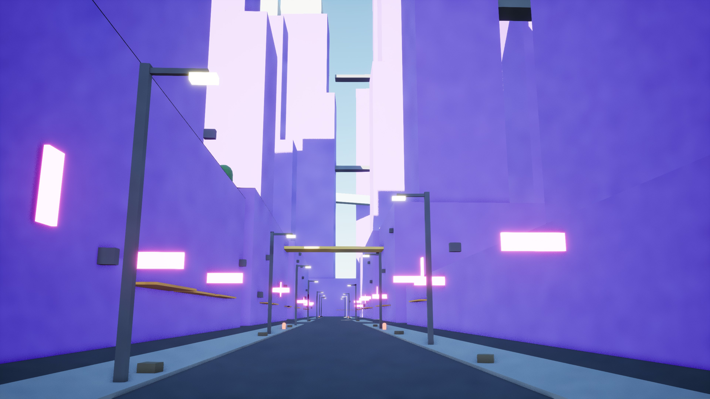 |

The Unreal views are lit by the level's default sun and sky (no fog, no exposure tuning);
the colors are the blockout's, per material, with the emissive ones (street lights, neon,
signs) glowing.

## How it works

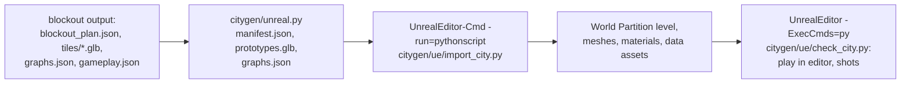

**The citygen side** (`citygen/unreal.py`, no Unreal needed, tested in pytest) reads the
blockout output and writes `BUILD/unreal/`:

- `manifest.json`: every object of the glTF tiles with its key (its blockout name: a
  building's id, or district, category and tile for joined ground pieces), its asset name
  (the name the glTF import gives its node), the 16-hex sha256 of its plan entry (the plan
  is the same bytes on every machine, so the hash is too), its category, type, district and
  citygen ids; the instanced kinds with every instance's position, yaw, scale and id; the
  materials (linear color from the plan's sRGB, roughness, emissive); the player start (on
  the walkway at the fast-travel point nearest the city's middle, facing the middle); the
  blockout cameras;
- `prototypes.glb`: one mesh per prop and plant kind, written by citygen from the plan's
  prototype parts (boxes, prisms, cones and domes; the glTF tiles leave props out);
- `graphs.json`: the lane (lanes and junction connectors, linked to their successors),
  walkway (linked to their neighbors) and transit graphs (lines and stations, linked to each
  other) as flat arrays: element `i` has `points[point_start[i]:point_start[i + 1]]` and
  `links[link_start[i]:link_start[i + 1]]`.

It enables `PythonScriptPlugin` and `EditorScriptingUtilities` in the .uproject and runs
`UnrealEditor-Cmd PROJECT -run=pythonscript -script=citygen/ue/import_city.py` with the job
in `$CITYGEN_UE_JOB`.

**The importer** (`citygen/ue/import_city.py`, stdlib and `unreal` only):

1. **Core assets**, shared by every city: `M_CityGen` (vector `BaseColor`, scalars
   `Roughness` and `Emissive`, two-sided), `BP_CityGenInstances` (an Actor with a
   hierarchical instanced static mesh and `Ids`, `Kind`) and `BP_CityGenGraph` (a primary
   data asset with the flat arrays). They are Blueprint classes made by the importer
   through `BlueprintEditorLibrary`, so a project needs no C++ module or compile for them,
   and they are runtime classes, so the data assets cook with the game.
2. **Materials**: `MI_<material>` per blockout material, parameters from the manifest.
3. **Meshes**: each tile's `.glb` through Interchange (no imported materials, no generated
   collision, Nanite on, no distance fields or Lumen cards), then each mesh's slots get the
   material instances by slot name, its body setup complex-as-simple collision, and its
   hash as `cg.hash` metadata. A tile's glTF is imported only when one of its objects is new
   or changed.
4. **The level**: `LevelEditorSubsystem.new_level(path, is_partitioned_world=True)`, or the
   existing one with all its actors loaded (`WorldPartitionBlueprintLibrary.load_actors`).
5. **Actors** by key: unchanged when the `cg.hash` tag matches, else updated in place (mesh,
   tags, instances; the actor marked modified, so it is saved even when its mesh asset is
   the same object), else spawned; actors of the city whose key the build no longer has are
   deleted (their meshes let go first).
6. **Graphs**: the three data assets, written when their hash changes.
7. **Save**: only when something is dirty.
8. **Meshes no object uses** are deleted, after the save and a garbage collection, in one
   batch (deleting an asset that the open level still names makes the editor reload the
   level, which drops what was not saved; one by one, each deletion is a garbage
   collection). The result reports the actors created, updated, deleted and unchanged with
   their keys, the meshes imported, kept and deleted, the files saved and a digest of every
   actor (tags, mesh, transform) and asset (path, hash).

Coordinates: citygen (x east, y north, z up, meters) is Unreal (100 x, -100 y, 100 z)
centimeters, as the glTF import of the tiles maps them; a citygen yaw is Unreal yaw -yaw.

**The check** (`citygen unreal ... --check`, `citygen/ue/check_city.py`) opens the full
editor (it needs frames: `UnrealEditor PROJECT -ExecCmds="py citygen/ue/check_city.py"`),
runs as a generator on the editor's tick and quits the editor when done:

- with `--shots`, renders the city in the editor world, every actor loaded: the isometric
  view from the blockout's iso direction and three of its street views
  (`AutomationLibrary.take_high_res_screenshot`, after shaders and streaming finish);
- plays the level in the editor with the project's game mode (in the test project, the First
  Person template's character) and checks:
  - **streaming**: the World Partition cells around the player load, the rest of the city
    does not, and a teleport to the busiest tile far from the start loads its neighborhood;
  - **collision**: line traces down on a 16 m grid around the start and the two busiest
    tiles (inside the city), down onto the roofs of the nearest buildings (at the manifest's
    point inside each one's highest footprint) and across onto their facades at 2 m;
  - **walking**: the player walked along a sidewalk path of the walkway graph from the start
    (only walkways with head room, see the open items; movement input every frame, stepping
    aside where a bench or a planter stops it), on the ground all the way.

  It waits for World Partition to finish streaming around a spot
  (`WorldPartitionSubsystem.is_streaming_completed`) before tracing there.

## Re-importing by id

Every actor carries its key (`cg.key=`, the blockout object's name: a building's citygen id,
or district, category and tile for a joined piece) and the content hash of what it was made
from (`cg.hash=`). An import loads every actor of the level and, key by key, leaves an actor
whose hash matches, updates one whose hash differs (its mesh, tags and instances, in place:
the actor stays the same object), spawns the keys it lacks and deletes the keys the build no
longer has, with the meshes no object uses. A tile's glTF is imported only when one of its
objects is new or changed. `citygen.unreal.manifest_changes(old, new)` computes, without
Unreal, exactly what an import over another will do, and the import result lists the keys
it created, updated and deleted (`keys`).

**The same build twice** (every sample above): no actor created, updated or deleted, no glTF
imported, no file saved, and the digests of every actor (tags, mesh, transform) and asset
(path, hash) equal.

**A district regenerated** (M10; run on M10's branch before it was merged here, the same
code as main's): Greyhook built with M10's code, then `citygen build ... --district "Lantern Strip" --base` (a new seed for
the district: 1,390 of its buildings replaced by 1,377 new ones, 7 changed in place;
`citygen model diff`: 29,521 entities added, 29,606 removed, 587 changed, of them 109
outside the district on its seam), both through the blockout, imported as "Greyhook M10":

| Import | Actors created, updated, deleted, unchanged | Meshes imported, deleted | glTF tiles | Files saved | Time | Keys equal to `manifest_changes` |
|---|---|---|---|---|---|---|
| 1. the base build into a new level | 5168, 0, 0, 0 | 3981, 0 | 193 | 5248 | 36 s | yes |
| 2. the base build again | 0, 0, 0, 5168 | 0, 0 | 0 | 0 | 15 s | yes |
| 3. the regenerated build over it | 1440, 344, 1462, 3362 | 1558, 1441 | 17 | 3246 | 100 s | yes |
| 4. the regenerated build again | 0, 0, 0, 5146 | 0, 0 | 0 | 0 | 15 s | yes |
| 5. back to the base build | 1462, 344, 1440, 3362 | 1572, 1427 | 18 | 3246 | 102 s | yes |
| 6. the regenerated build again | 1440, 344, 1462, 3362 | 1558, 1441 | 17 | 3246 | 102 s | yes |

The commands (M10's branch for the builds, this branch for the imports):

```bash
citygen build docs/progress/M1a2/peninsula_city/city_spec.json out/base --blockout
citygen build docs/progress/M1a2/peninsula_city/city_spec.json out/regen --district "Lantern Strip" --base out/base --blockout
citygen unreal out/base   "<project>.uproject" --name "Greyhook M10"
citygen unreal out/regen  "<project>.uproject" --name "Greyhook M10" --check
```

(The builds here ran `citygen blockout --no-render` on each model; `--name` gives the test
its own content folder beside the Greyhook sample.) The results of every step are in
[`district_regen/`](district_regen), with `manifest_changes.json` (the keys of step 3).

The actors each import created, updated and deleted are exactly `manifest_changes` of the
two manifests, key for key; the 3,362 others were not touched. What changed outside the
district is what its seam and its tiles share. Of the 344 updates, 213 are instance actors
(props and plants are one actor per kind and 256 m tile, so every tile the district touches
updates its instance actors) and 131 static mesh actors: 43 pieces of local streets, alleys and pedestrian streets and 15 of sidewalks
that are joined per tile for the whole city, the district's own joined pieces (junctions,
plazas, crosswalks, green roofs, lawns), 7 of its buildings that came back changed (`citygen
model diff` lists 7 changed buildings), and 9 avenue and sidewalk pieces of The Stacks on the
seam. The 1,440 created and 1,462 deleted are the district's buildings, skybridges, open
spaces, bridges, embankments and columns of its local streets, and the instance actors of
kinds that appear in or leave a tile. Steps 2 and 4 show that every change was saved.

`citygen model diff --png` of the two builds (removed red, added green, changed yellow) and
the regenerated city in Unreal after step 3 (passes the check: streaming, 507 of 507 traces
down, 36 of 36 roofs and facades, 233 m walked):

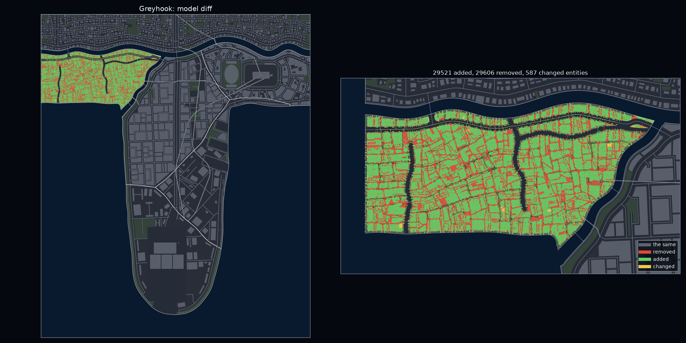

| Greyhook with Lantern Strip regenerated, in Unreal | A street of the new Lantern Strip |
|---|---|
|  | 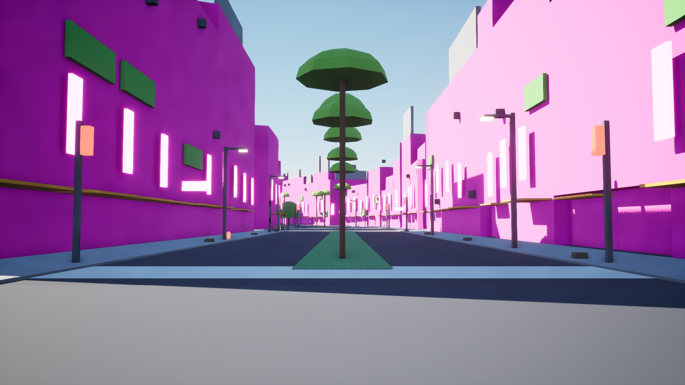 |

Before the fixes it took to get here, the same regeneration took 614 s and the next import
updated 131 actors again: deleting meshes one by one cost a garbage collection each, the
engine reloaded the level when a deleted mesh was still named by a destroyed actor (dropping
the unsaved changes), and an actor whose only change was its tags was never saved. The
importer now lets a destroyed actor's meshes go, saves, then deletes the unused meshes in one
batch, and marks an updated actor modified; the Unreal test imports a changed city twice.

## Terrain (M13): Cragmouth

M13 gives a city ground that rises and falls, with heights in the model relative to the
finished ground; the blockout makes them absolute, and the exporter takes the blockout's
objects as they are, so most of M13 arrives without importer changes. What M15 changed for
it: one blockout object per retaining wall (it joined them per tile before), the graphs with
absolute heights, and the check (below). Every new piece is keyed on M13's stable ids:

| M13 adds | In Unreal | Key, for example |
|---|---|---|
| the terrain height field | the ground of each 256 m tile as one heightfield mesh on the finished ground's 4 m grid (under water its bed), the open tunnel approaches left out; not flat, not a Landscape | `city.ground.t-03-01` |
| water at its own levels | the sea at 0 m, the river falling along its profile, basins at 2.75 and 2.91 m | `city.sea.<tile>`, `city.water.<tile>` |
| roads on grade lines | streets, sidewalks and junctions at their grade lines' heights | as before |
| retaining walls | one actor per wall (1280 in Cragmouth, 84 km) | `rs.w1686s915.wall.w1700s922` along a road, `wall.w927n729` elsewhere |
| bored tunnels | one actor per bore (7) | `bore.w487n577.tunnel` |
| terrain viaducts and their columns | one actor each | `rs.e814n566.viaduct.e814n566`, `rs.e814n566.tvcol.e766n565` |
| buildings on stepped plinths | the plinth in the building's own actor (4322 of them), material `plinth` | `d05.lot.e1259n510.bld` |
| hillside greens | joined open space per district, category and tile like every open space, the slope ids as `cg.id` tags | `d03.open_green.t-03-01`, tag `cg.id=d03.os.slope.w540s2` |
| heights in the graphs | `graphs.json` and the graph data assets in absolute meters (`"heights": "absolute"`); a walkway takes its road's grade line | |

| City | Tiles | Actors | Static meshes, instanced, always loaded | Props and plants | Meshes | First import | Imported again |
|---|---|---|---|---|---|---|---|
| Cragmouth | 168 | 11933 | 10102, 1827, 4 | 86778 | 10133 | 126 s | 20 s: 0 actors changed, 0 files saved, digests equal |

| City | Actors loaded at the start, after a teleport | Traces down | Roofs | Facades | Walk, on the ground | Check |
|---|---|---|---|---|---|---|
| Cragmouth | 467, 1607 | 507/507 | 36/36 | 36/36 | 143 m, 100% | pass (120 s) |

The traces down hit buildings 221 times, streets 74, the terrain ground 38, hillside and
other greens 33, junctions 35, avenues 27 and embankments 3; the ground runs from 0 to 95 m,
inside the traces' window (600 m down to 3 m below 0). Two check fixes for slopes: a facade
trace starts over the ground found by a trace down at its spot, clamped under the roof (from
a fixed height it began underground below a plateau, or above a house downhill: 30, then 31
of 36), and the walk measures a fall from its path's own height, not from where it started.
The walk stopped 4 m short of its end, held by a step at a corner (open items).

```bash
citygen build cities/cragmouth/city_spec.json out/cragmouth --blockout
citygen unreal out/cragmouth "<path>/<Project>.uproject"
citygen unreal out/cragmouth "<path>/<Project>.uproject" --check-only --shots out/cragmouth/shots \
  --shot-width 7680 --view hillside 450 -650 220 -150 250 50 35 --view ridgeback 1500 150 85 1170 500 75 30
```

`--view NAME EX EY EZ TX TY TZ [LENS]` adds a camera of one's own to the shots (eye and
target in citygen meters, absolute heights), as `citygen rerender --eye ... --target ...`
does in Blender.

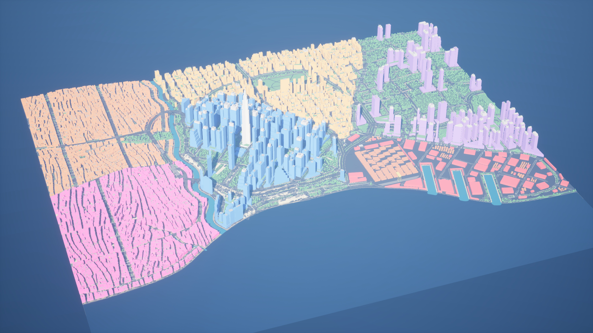

Cragmouth in Unreal 5.8 (8K, the blockout's isometric direction).

| Crown Heights over terraced slopes (8K) | Ridgeback's towers among hillside greens |
|---|---|
|  | 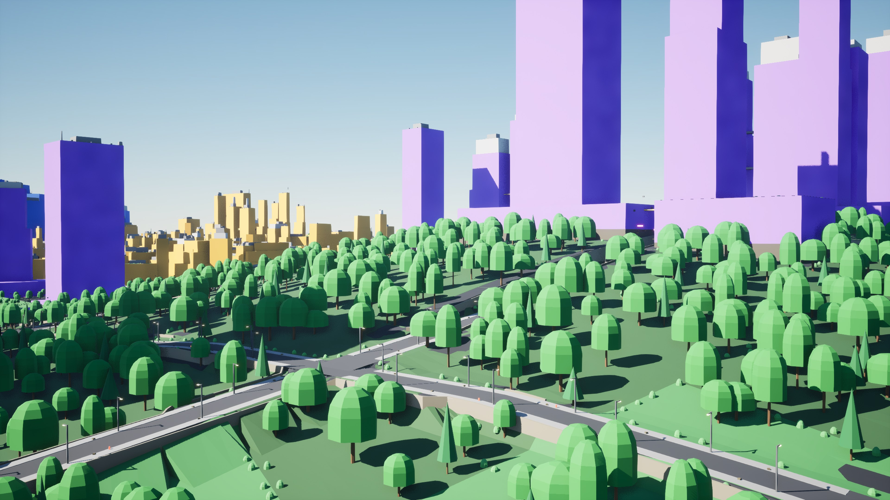 |

| Street view 1 | Street view 2 | Street view 3 |
|---|---|---|
| 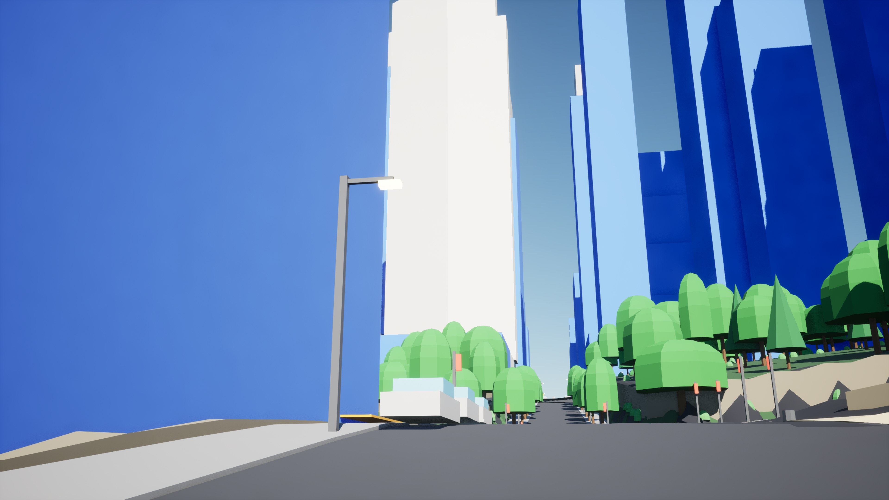 | 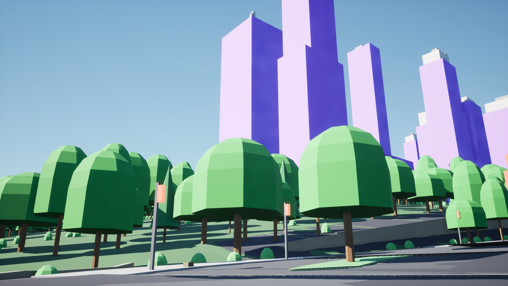 | 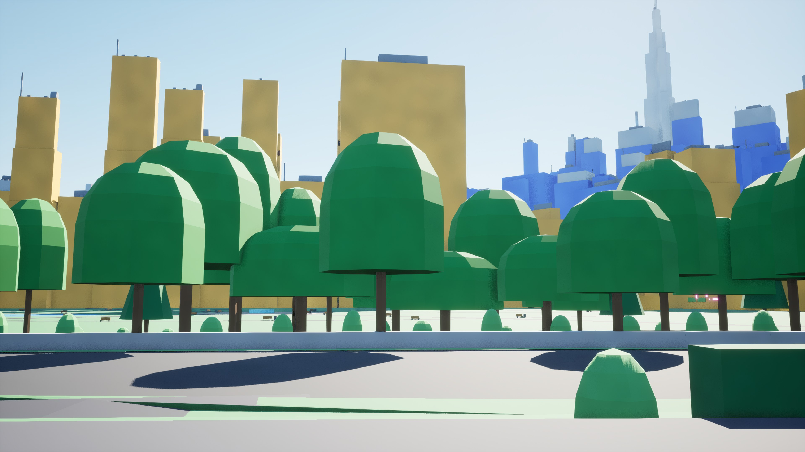 |

## Decisions (made without the owner, as asked)

- **Headless editor Python, the MCP plugin as the interactive route.** UE 5.8 ships the
  official Unreal MCP server (`Engine/Plugins/Experimental/ModelContextProtocol`, an HTTP
  server inside a running editor). citygen makes no network calls, so `citygen unreal`
  drives the editor through its own Python instead; a Claude session in a running editor with
  the MCP plugin can run the same two scripts.
- **Blueprint data assets, not a C++ plugin.** The graph and instance classes are made by the
  importer as Blueprints, so any project (Blueprint or C++) takes the import without
  compiling; stage 4 can read the arrays by reflection or wrap them in C++.
- **No distance fields or Lumen cards on the blockout meshes.** With them the editor spends an
  hour building data for thousands of meshes before its first frame; screen-space global
  illumination is enough for a blockout, and stage 2's meshes will bring their own settings.
- **Meshes in world space, actors at the origin.** The glTF tiles carry world coordinates
  without node transforms, so every mesh's pivot is the city origin and its actor stands
  there; World Partition places actors by their bounds, so streaming is unaffected. Stage 2
  replaces these meshes per building with their own pivots.
- **Default lighting in the level.** A sun, a sky light and the sky atmosphere, so the level
  reads when played; atmosgen (stage 3) replaces them.
- **Collision everywhere, water included.** Every blockout mesh has complex collision (water
  and sea surfaces too, so the player stands on them instead of falling; a water volume is
  stage 3's).
- **A test project outside the repo.** `/Users/swag/Projects/Unreal Projects/CyberGenImportTest`,
  made from the First Person template and its shared packs exactly as the New Project
  dialog makes it (`citygen unreal --new-project` does the same); no other project was
  touched.

## On the combined code (M15 with M10 and main)

M15 adds the exporter and changes no generator file, so the cities are the same bytes as
M10's:

- **x86:** the five samples, the pinned demo and the stack demo built in the x86_64 Linux
  container (`citygen-x86`, `CITYGEN_WORKERS=3`): every `city_model.json` has the
  `model_sha256` of M10's lock (`docs/progress/M10/<city>/city.lock.json`), and every stage
  trace is identical to M10's (`citygen trace diff`).
- **Sweep:** `citygen sweep --suite m8a --workers 4` passes 58 of 68, build for build as
  M10's (`docs/progress/M10/sweep.json`: the same status, failing checks, variants, retries,
  layout salt and sha256 for all 68); [`sweep.md`](sweep.md), [`sweep.json`](sweep.json).
- **Locks:** the new files change citygen's code hash, so `citygen lock` refuses a build
  made before M15 ("built with other citygen code ... build it again with this citygen") and
  `citygen lock --verify` of an earlier lock notes the other code; the models it rebuilds
  are the same bytes.
- **Ids:** the import keys are M10's stable ids (`d04.lot.w1478n875.bld`,
  `rs.w1295n954.deck`; joined pieces by district, category and tile); M15 adds no model
  collection or field, so `ids.REFS` is unchanged.

## Tests

`tests/test_unreal.py`: the manifest covers the plan (every object once, keys unique, asset
names unique per tile, materials, prototypes, instances with their ids, the player start in
the city), is deterministic, and a changed object changes only its own hash and its tile's;
`prototypes.glb` is valid glTF 2.0 (header, chunks, unit normals, a street light 8 m tall)
with citygen's axes (a box east and north of the origin lands at +x and -z); the flat graphs
are consistent (offsets, links in range, a lane's successors); `manifest_changes` lists
exactly the objects added, moved and removed between two manifests; a district of the
small city regenerated with M10 (`edit.regenerate`, what `citygen build --district` runs)
changes only objects of tiles within 250 m of it and no building of another district;
`--manifest-only`, project preparation, engine discovery and names.
`test_unreal_import_small_city` (skipped without Unreal or Blender) builds the test suite's
small city, makes a fresh project from the First Person template, imports, imports again
(nothing changes, same digests), regenerates its Old Quarter (blockout run again), imports
that over it (the actors created, updated and deleted are exactly `manifest_changes`, the
rest unchanged), imports it again (nothing changes, nothing saved: the changes were saved)
and runs the check on it (6 min on the M4 Mac). Also: every building's roof point lies inside its highest footprint,
and the interior point of a U and of a square with a hole lies inside them.
`test_terrain_city` (M13's hilly test city): `graphs.json` heights are absolute (a walkway on
its road's grade line, the player start over the ground), the ground is one keyed object per
tile, every retaining wall, bored tunnel, terrain viaduct and column is an object keyed by
its own id, and the plinth and wall materials are in the manifest.

## Open items

- **Sidewalks on raised roads (generator, not the importer).** A road segment that climbs
  onto a bridge or a viaduct approach keeps its sidewalks and their walkways at z 0 in the
  model (`walkways[].line` z, `sidewalks[]` have no height), and the blockout draws them at
  curb height under the deck, which spans the road's full width: 66 to 134 such sidewalks
  per sample (Vesper Bay 108, Saltreach 134, Greyhook 66, Delta 125, Nexus 112, the pinned
  demo 74). In Unreal a player walks on the deck, so the city stays walkable, but the copy at
  grade runs into the underside where a ramp comes down: the walk found one in Delta
  Megacity (`rs00237`, an avenue rising to 11 m, its sidewalk `sw000406` at grade under it),
  and the walk now keeps to walkways with head room (two skipped there). Stage 4's crowds
  would walk the at-grade copy. Fix in the generator: sidewalks and walkways of a raised
  segment take its height profile, and the blockout draws them on the deck; it changes every
  sample's model, so it is a milestone of its own.
- **Meshes in world space.** Every blockout mesh has its pivot at the city origin (the glTF
  tiles carry world coordinates). Fine for a blockout and for streaming; stage 2's unique
  buildings come with their own pivots and replace these per key.
- **Deleting meshes is the slow part of a re-import.** The engine's batched force delete
  takes about 50 ms a mesh (75 of the 102 s of the district re-import above, for 1,441
  meshes). Deleting the package files after the save and rescanning the folders would be
  faster, at the cost of going around the editor's asset tools.
- **Joined ground pieces.** Streets, sidewalks, junctions, ground and water are joined per
  category and 256 m tile as in the blockout (avenues, junctions, crosswalks and part of the
  sidewalks also per district; local streets, alleys, ground, sea and water for the whole
  city), so changing one street updates its whole piece, an actor of up to 256 m; stage 2's
  road meshes may split them finer.
- **Complex collision everywhere.** Every mesh collides with its own triangles. Simple
  collision (boxes for prism buildings) would be cheaper for physics in a dense city; to
  measure when crowds and traffic run (stage 4).
- **No lighting build, Lumen or distance fields.** The level has a movable sun, a sky light
  and the sky atmosphere and nothing baked; the meshes build no distance fields or Lumen
  cards (an hour of editor time on thousands of meshes before the first frame). Stage 3
  (atmosgen) owns lighting.
- **Water is a floor.** Sea, rivers and canals are flat meshes with collision; no water
  volume, swimming or buoyancy (stage 3 or 4).
- **The check runs the full editor.** The import is headless (`UnrealEditor-Cmd`), but play
  in editor needs frames, so `--check` starts the editor with `-RenderOffscreen` (no window
  is shown; it needs the GPU). A packaged-game check (cook, run the game) is not done.
- **Only on the Mac.** The engine paths for Windows and Linux are in `citygen/unreal.py`,
  untested; the heavy city work is meant to move to the Windows PC.
- **The MCP route is documented, not automated.** A Claude session with the Unreal MCP
  plugin running in the editor can run the same two scripts; there is no MCP driver in the
  repo (citygen makes no network calls).
- **A step where two grade lines meet.** Cragmouth's walk stopped 4 m short at (-55, -7):
  a corner where the grade lines of `rs.w15n19` (54.6 m) and `rs.w109n31` (56.2 m) meet
  1.6 m apart, and the terrain ground between their sidewalks (55.9 m) stands above the
  lower one. The importer draws what the blockout gives; a smooth corner is M13's (the
  junction's corner heights), so it is a generator item.
- **The ground is a mesh, not a Landscape.** Each tile's ground is the blockout's
  heightfield mesh on the terrain's 4 m grid, the open tunnel approaches left out, keyed and
  re-imported like every other object. An Unreal Landscape would add sculpting, paint layers
  and its own level of detail, but needs a heightmap at the engine's component sizes and a
  visibility layer for the approaches, and changes as one actor; a later exporter update (or
  stage 3) can make one from the same grid.
