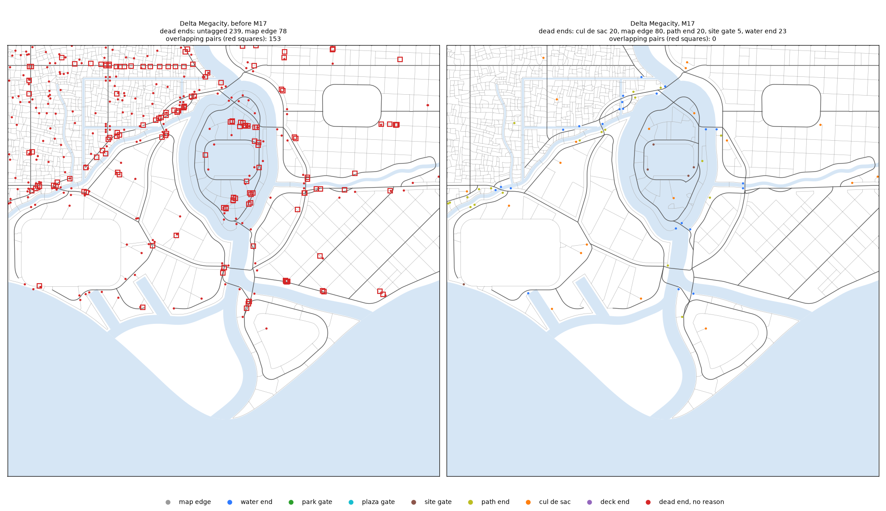

# M17: road network repair

From the first run-through (`docs/run_through_1.md`): roads that stop at random and roads that
overlap on straight stretches; bridges apart and roads clear of buildings, which were clean in
the model, now guarded by checks.

## What changed

**Dead ends** (`citygen/streets.py`, `settle_dead_ends`, the last step of the street
clean-up, on the noded network, in rounds):

- a local road's dead end runs on to the road straight ahead (within 60 m) where that road
  takes a junction, or to a junction of it within 20 m (8 m for a path), turning at most 35
  degrees and meeting the roads there at the junction angle of the district it is in (legs
  measured 10 m out, as `fix_angles` and the check `junction_angles` measure), on land, off
  parks, reserves and
  traced buildings, crossing no other road (a path may pass under a deck 4.5 m up, a street
  under a viaduct 7.8 m up, and go on to the road beyond); two dead ends facing each other
  within 30 m are joined; an avenue or a highway that stops short of the road ahead runs on to
  it as a short street (`end_link`; the M1b road itself never moves);
- a dead end that stays says what it is: `RoadNode.attrs.dead_end` is `map_edge`,
  `water_end`, `park_gate`, `plaza_gate` (within 8 m past its half width of the water or open
  land; 30 m for an avenue or a highway, with a promenade and a quay between it and the
  water), `site_gate` (within 40 m of a megasite reserve: the road `megasite_access` asks
  for), `path_end` (a pedestrian path), `cul_de_sac` with a turning bulb
  (`attrs.turning_head_m`: street 12 m, service lane 10 m, alley 8 m, a primary road its half
  width and 4 m; drawn by `junctions.build` as before, now wherever it fits), `deck_end`
  (M14's deck spokes) or `traced_end` (a traced road ends where it was drawn);
- anything else goes back to its last junction: a vehicle road shorter than 40 m from it, or
  one with no room for its bulb;
- a dead end reaching into another road's right of way is cut back clear of it, and a primary
  road's dead end cuts the local road it reaches into; a local road laid along another
  (rights of way overlapping by more than 10 m2 away from the nodes they share) goes, the
  lesser one, unless that parts the vehicle network; the street clean-ups (`fix_angles`,
  `fix_duplicates`) run again after the run-ons,
  and lanes reached only over paths become paths (`pedestrianize_islands`) after the repair;
  a cut-back never takes a primary road.

**Junctions** (`citygen/junctions.py`):

- each leg's cut-back reaches past where its right of way overlaps another leg's
  (`overlap_cuts`): acute corners, legs that bend inside the junction, gores;
- a road's two junctions share 0.9 of it by need (`share_cuts`; each end had 0.45 before), so
  a big junction next to a small one reaches past its overlaps on a short road;
- a degree-2 node where two roads meet at an angle (an avenue that ends in a street, a street
  that goes on as a promenade) is a `bend` junction (new `Junction.shape`) cut back like the
  others;
- where two legs' rights of way still overlap past their cuts (a fork, a crossing at a small
  angle, a corner with no room for its fillet) the junction polygon takes that shared
  pavement (`shared_pavement`), and two primary roads that go on sharing pavement past the
  next junction of one of them, or two roads at a node they share (the two legs of a
  hairpin), give the leftover overlap to the junction it touches or to their node's
  (`absorb_shared`).

**Checks** (`citygen/network_checks.py`, four more):

| Check | Rule |
|---|---|
| `road_dead_ends` | every dead end tagged, and the tag true of where it is (at the map edge, by the water, at an open space, plaza or megasite, on a path, a cul-de-sac with its bulb, on a deck, on a traced road) |
| `road_overlaps` | two roads within 4 m in height overlap by no more than 25 m2 outside every junction polygon (the run-through's measure, on the 1 cm grid) |
| `bridge_clash` | road and pedestrian bridges (decks and approaches) apart from each other and from transit bridges in plan, or the lower one's clearance under the upper deck where they cross (5.5 m under a road or transit deck, 2.5 m under a pedestrian one, plus the upper deck: 1.5 m for a road, M7's 7 m between crossing road decks); transit against transit is M19's `transit_clearance` |
| `road_building_clash` | no road right of way over a building mass at the road's own height (5 m of headroom over a vehicle road, 2.5 m over a path; a ferris wheel's rim measured where it is) |

`road_dead_ends` and `road_overlaps` run with the street checks (on the M2 model during the
build), `bridge_clash` and `road_building_clash` after the building checks; `check_all` (M10's
regeneration and overrides) runs all four. Heights are over the ground (M13): a road's surface
is its grade line plus its z profile, a building's masses stand on its base.

## Decisions

- **M1b as it was**: parting primary forks and dropping primary lenses in M1b removed the
  overlaps at their source, but it changes which road network each city's search picks
  (Delta and Vesper Bay then failed every try on their new networks: short avenue pieces, a
  waterfront avenue ending in a one-way off-ramp); the shared pavement goes into the
  junction polygons instead, and M1b's networks are byte for byte what they were.

- **The run-through's 308 dead ends**: 69 of them are local streets that run off the map
  (their nodes are `end`, not `edge`, so the run-through's script counts them); they are
  `map_edge` now. Of the 239 inside the map, 206 had a road within 60 m ahead.
- **Dead ends that stay with a road ahead**: the run-through's script counts a dead end with
  any road within 60 m straight ahead. Most left are paths and streets ending short of a deck
  they pass under or a highway, a bridge or a raised approach that takes no junction; they
  are tagged (water end, path end, cul-de-sac with its bulb).
- **Cul-de-sac or cut back**: the scope's list has the cul-de-sac with a turning head as a
  deliberate dead end, and its rule cuts back the rest. A vehicle dead end 40 m or more from
  its junction with room for its bulb is a cul-de-sac (a long dead-end street serves its
  lots); a shorter one, or one with no room, is cut back.
- **Overlap tolerance**: the check keeps the run-through's 25 m2 (two sidewalks meeting at a
  corner overlap outside the carriageway polygon).
- **GEOS**: GEOS's floating overlay (shapely 2.2, GEOS 3.14) takes two corridors that meet end
  to end on a 45 degree line for one inside the other (Cragmouth's and Vesper Bay's 45 degree
  grids); the check and the measures here use fixed-precision overlays on the 1 cm grid. The
  run-through's script uses floating overlays and can report such false pairs.
- **Clearances**: `bridge_clash` asks for the clearance the generators keep (M7's 7 m between
  crossing road decks, 5.5 m plus the deck for transit over a road); a road under a ferris
  wheel is measured under its rim, which is a circle, not the mass's lowest point.

## Before and after

Builds on this Windows PC at each city's own seed, before (main at M15 plus the stage 1 fixes)
and with M17 (`builds/M17/before`, `builds/M17/final`; the run-through's measure in
`measures/`, the cities' reports, previews and 8K renders here). Dead ends and overlaps are
the run-through's measure (`measure_runthrough.py`, which leaves out highway exits); tags from
the model's `RoadNode.attrs.dead_end`.

| City | Dead ends | With a road within 60 m ahead | Overlapping pairs | Full-city tries | Checks |
|---|---|---|---|---|---|
| Delta Megacity | 308 to 139 | 206 to 46 | 149 to 0 | 1 to 1 | 90 of 90 |
| Saltreach Free Port | 175 to 68 | 154 to 51 | 85 to 1 (a GEOS float pair; 0 on the 1 cm grid) | 1 to 1 | 90 of 90 |
| Nexus City | 405 to 156 | 306 to 74 | 194 to 0 | 1 to 1 | 90 of 90 |
| Greyhook | 165 to 80 | 83 to 16 | 73 to 0 | 1 to 2 | 90 of 90 |
| Vesper Bay | 380 to 152 | 246 to 38 | 130 to 0 | 1 to 1 | 90 of 90 |
| Vesper Bay Pinned | 395 to 162 | 255 to 45 | 114 to 0 | 2 to 2 | 90 of 90 |
| Vesper Bay Stacks | 412 to 138 | 257 to 29 | 110 to 0 | 1 to 2 | 90 of 90 |
| Vesper Bay Decks | 357 to 158 | 248 to 68 | 134 to 0 | 2 to 6 | 95 of 95 |
| Cragmouth | 406 to 116 | 279 to 43 | 147 to 0 | 1 to 2 | 90 of 90 |

**Delta Megacity** (the run-through's city): 308 dead ends, 69 of them local streets running
off the map and 239 inside it, none tagged, 206 with another road within 60 m straight ahead;
now 139, every one tagged: 71 at the map edge (`map_edge`; with the 9 highway exits, 80), 23
`water_end`, 20 `path_end`, 20 `cul_de_sac` with their bulbs, 5 `site_gate`. The 46 the
measure still sees with a road ahead (31 paths, 11 streets, 4 alleys) are ones the run-on
turned down (the road ahead takes no junction there, or the link would cross water, a park, a
lot, a building or another road, or meet the roads at less than the district's junction
angle); all of them tagged. 149 overlapping pairs (highway and
avenue, avenue and street, street and street along each other) to 0. Bridges apart and roads
clear of buildings before and after.

Tags on the other cities (model nodes of degree 1, highway exits in `map_edge`): Saltreach 28
water end, 17 path end, 17 cul-de-sac, 5 site gate, 1 map edge; Nexus 54 map edge, 35 water
end, 31 path end, 27 cul-de-sac, 13 site gate, 2 park gate; Greyhook 31, 13, 3, 20, 17; Vesper
Bay 93, 14, 18, 34, 7; Pinned 77, 17, 27, 40, 10; Stacks 87, 11, 12, 31, 7 and its traced
crosstown's `traced_end`; Decks 78, 16, 25, 35, 8 and 12 `deck_end`; Cragmouth 66, 16, 12, 29,
5 and a park gate (map edge, water end, path end, cul-de-sac, site gate).

The run-through measure's other residue is its own: Saltreach's one pair is GEOS's floating
overlay (0 on the 1 cm grid, the check's measure), Nexus City has one bridge pair over each
other in plan 7 m apart in height (M7's clearance, which `bridge_clash` accepts), and Greyhook's
five road and mass overlaps are the ferris wheel's box over the streets under its rim (the rim
clears them; `road_building_clash` measures the rim).

**Sweep** (`citygen sweep --suite m8a --extra 0`, each spec at its own seed, `sweep/`): 9 of 10
before and 9 of 10 with M17; `test_minimal` fails `placement` in both. Greyhook takes a second
layout salt (one try more); Vesper Bay Pinned passes on its second salt, as before.

**Regeneration**: Vesper Bay's Old Town regenerates with every check passing (one reseed);
`tests/test_edit.py` keeps every held road and junction outside the district (366 of 366).

**Tries**: three cities take a try more (Greyhook, Vesper Bay Stacks, Cragmouth), Vesper Bay
Decks four more (each of its first road network's four layout salts fails one or two checks;
it builds on road variant 1, salt 1). Cragmouth's first layout fails `cut_fill` by 0.1 m
(18.1 m of fill), `retaining_walls` and two small `road_overlaps`, and passes on the second.

## Open items

- `tests/test_edit.py::test_regeneration_of_the_first_district_keeps_the_ones_after_it`: a
  regeneration of the first district changes a few walkways far from it (an extra walkway link
  between walkway islands, which the build links over the whole city); roads and junctions
  outside the district are kept.
- `tests/assetgen/data/golden_props.json` was not rewritten: its pack bytes differ on Windows
  (known), so it wants `tests/assetgen/props_goldens.py --builds DIR` on the Mac.
- Vesper Bay Stacks' traced crosstown ends 23 m up on M12's stack (tagged `traced_end`; M12's
  as drawn).
- Mac = x86 for the new goldens waits for the deferred determinism check.
- **Park paths through lots** (found by assetgen's `asset_access` on M17's Testport, since
  M2): `local.open_paths` draws a straight 3 m path from a park's, plaza's or promenade's
  middle to every walkway node within 30 m of it, across whatever lies between. In M17's
  builds 342 to 801 such paths per city cross a lot and 287 to 711 run through a building;
  before M17 the counts were about the same (Delta 538 and 498, Vesper Bay 442 and 372). On
  Testport one villa's main entrance faces such a path behind its neighbor, and
  `asset_access` failed the door. Kept out of M17: keeping the paths off lots (tried: 431
  of Testport's 726 paths go, 0 then cross a lot) leaves 121 of its 293 open spaces with no
  path at all, parks the lots enclose, which need an access of their own. For M17
  `asset_access` counts a door whose only walkway ahead lies inside another building as
  unreachable, the city's to change, as its rule for a city-made problem says.
- **About 3% of building entrances** link to their walkway by a straight line through another
  building (Delta 199 of 6,724 with M17, 211 before); assetgen relinks them, as before.

## Two changes to the assetgen tests and check

- `tests/assetgen/agtools._alive` (main's new temp-dir sweep) called `os.kill(pid, 0)`, which
  on Windows sends Ctrl+C to process group `pid` or raises WinError 87, so any test run that met
  another run's `ag_small_<pid>_*` dir broke its assetgen tests; it now asks `OpenProcess`
  and `GetExitCodeProcess` on Windows.
- `assetgen/asset_checks.access`: as above, a walkway that is ahead of a door only inside
  another building does not make the door a failure.
