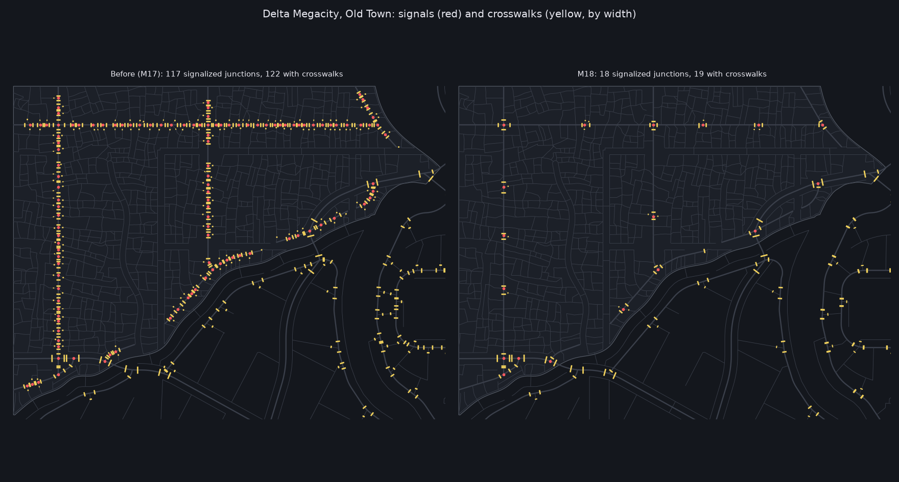

# M18: junctions and ramps

From the first run-through (`docs/run_through_1.md`): intersections with a vertical gap
(worst where roads are not flat), shallow ramps leaving dead space under them, trees poking
through the low ends of raised roads, and a crosswalk and signals at every junction.

## What changed

**Grades** (`citygen/elevated.py`; spec `highways.grades`, `spec.Grades`):

| | Design | At most | Before |
|---|---|---|---|
| viaduct runs (where they come down) | 6% | 7% | 5%, 6% |
| ramps, loops, flyovers, stack ramps | 7% | 8% | 5%, 6% |
| bridge approaches | 6.5% | 7% (where a junction on one is levelled) | 5.5% |
| vertical curves | 30 m | | 40 m |

`elevated.grades(gr)` sets them for one road stage (`roads.build_roads`). A ramp's search
still runs as far as an M7 ramp at 5% and a loop is as big (`SEARCH_GRADE`): a steeper ramp
descends sooner within it, so the trumpet's loop no longer shrinks to its minimum radius into
the near ramps beside it; `_ramp` tries a longer span where the shortest runs into another
ramp. A two-way highway one direction of which no lane can enter carries the other only
(`junctions.one_way_stranded`: Vesper Bay's trumpet stem past its flyover's landing, where
its near off ramp now lands in the next interchange's on ramp).

**Junction levels** (`citygen/junctions.py`, `level_legs`, in M2 once the polygons are
made): every leg of a junction is held at its node's height out to where it leaves the
polygon and 10 m beyond (at most half of it), then rejoins its own profile at the catch-up
grade (a run's 7% on primary roads, a ramp's 8% on ramps and local streets): the profile
clamped between cones from the held stretches. A leg whose levelling would move a bridge span
or a road crossing over or under it keeps its slope at that end; its junction is then raised
to its highest leg (at most 2.5 m, M7's 3 m at a local junction, never under another road),
else it keeps the slope. On a terrain city the grade lines hold primary roads too (at most 2%
over a junction and 10 m past it, where the natural ground there is no steeper than 4%), and
the grade-line solver's edges are directed (`terrain.grade`), so a steep ramp or approach on
a hill no longer leaves its stretch no room.

**Surfaces** (`junctions.surfaces`, after the grading): a junction not flat at its node's
height carries `Junction.edge_z`, the height of every exterior vertex over the node's
ground: a vertex on a leg's cut line at the leg's height where it leaves, the curb between two
legs linear along the ring. The blockout draws such a junction as a face through its vertices
(every junction on a terrain city) and cuts its roads back to where they leave it; AG7's
junction piece takes its vertex heights from it (a small change that removes the step now;
AG14 draws the rest).

**Embankments** (`elevated.road_embankments`): retained fill (structure `embankment`) under
every raised road over land lower than 4.5 m: ramp feet, the ends of approaches and viaducts,
streets ramping up to a raised junction, raised junctions' legs. Road columns stand only where
a deck is higher. The blockout fills under them in the road's deck object; AG7's road piece
covers them.

**Crossings by need** (`junctions.plan_signals`, `plan_crossings`; per district
`junctions.signals` and `junctions.crosswalks`: auto, fewer, none):

- signals where two primary roads meet; where a street meets a primary road, or at a
  four-way street crossing in the corporate core, transit hub and midtown, only where no
  signalized junction is within 120 m along either road (200 m in the old town and
  entertainment market, the old town and slum archetypes; twice that for "fewer");
- crosswalks on every approach of a signalized junction (none across alleys and service
  roads), and across an unsignalized junction's avenue where no signalized junction or other
  marked crossing is within the spacing; unmarked crossings in the walkway graph elsewhere;
- widths by the class crossed: street 3 m, avenue and highway 4 m, 5 m on a downtown avenue.

**Checks** (three more: 98 in all with M21's two and M16's three, 103 with decks):

| Check | Rule |
|---|---|
| `ramp_grades` | ramps, loops, flyovers and stack ramps at most 8%, viaduct runs and bridge approaches 7% (`road_grades` caps every road at 8%) |
| `junction_levels` | every junction one surface (its `edge_z`, else flat at its node) meeting each leg within 2 cm where the leg leaves it, level across the leg there within its class's cross slope (2.5% primary, 3% else), its curb between two legs running evenly from one's height to the other's (footbridge stairs stand on it) |
| `crossing_spacing` | signals only where called for and spaced as above, marked crossings at unsignalized junctions only across avenues and spaced, crosswalk widths by class |

## Decisions

- **Signals by need**: the scope's rule spaces street crossings; Old Town's 117 signals were
  all on its avenues (every junction with a side street was signalized), so a street meeting
  a primary road is spaced as well (120 m, 200 m in the old town and entertainment market,
  the two shanty-stack archetypes); two primary roads meeting are always signalized. Alleys
  and service roads never get signals or crosswalks. Downtown is the corporate core and the
  transit hub (5 m crosswalks across their avenues). "Across avenues" is read as a marked
  crossing of the avenue at an unsignalized junction where none is within the spacing.
  Candidates are taken from the west, not by build-order id, so a district regeneration
  decides the same away from its district.
- **Junction surfaces**: the scope's "within its class's cross slope" is read across each leg
  where it meets the surface (2.5% on primary roads, 3% else: by construction level), and the
  curb between two legs runs evenly from one's height to the other's. Where a leg cannot be
  held level (a bridge or a crossing locks it) the curb between it and its neighbor is as
  steep as their heights make it: the steepest 9% to 24% a city on the flat samples,
  35% over a few meters on Cragmouth's steepest primary junctions (sharp corners between legs
  at different grade-line heights); they draw with no step, and AG14 can soften the corner.
- **Levelling on a slope**: every leg is held out to where it leaves its polygon and 10 m
  beyond, at its node's height, rejoining its profile at a run's maximum (7%) on primary
  roads and a ramp's (8%) on ramps and local streets (M7's raised joins); a leg the hold
  would move at a bridge span or a crossing keeps its slope, and its junction is raised to
  that leg's height instead (at most 2.5 m, 3 m at a local junction: M7's limit). Footbridge
  stairs stand on their junction (`junction_levels` leaves them out).
- **Terrain**: holding local roads 10 m past their junctions, and local legs at junctions
  with primary roads, flattened Cragmouth's hillside street networks (fills of 26 m); local
  roads keep M13's runs. Primary roads are held at 2% only where the natural ground at the
  junction is no steeper than 4% and the grade lines without the runs stay within 4 m of it.
  The grade-line solver's symmetric caps went to zero wherever a z profile climbs at the
  class grade or more (the steeper approaches and catch-ups), chaining whole hillsides flat;
  its edges are directed now, which only loosens edges where a z profile changes.
- **Loops and ramp search**: at 7% the trumpet's loop shrank from 45 m to the 35 m minimum and
  its near off ramp ran into it; loops keep M7's size and ramps are searched as far as M7's,
  descending sooner within that length. Vesper Bay's near off ramp now meets the next
  interchange's on ramp, so its stem past the flyover's landing carries one direction
  (`one_way_stranded`; the lane graph had six unreachable lanes). Vesper Bay's parclo and
  Greyhook's become diamonds (the steeper diamond ramps now fit).
- **Embankments**: under a road surface lower than 4.5 m over land, columns only above
  (`SUPPORT_MIN_UNDER_M` 2.7 m, from 1 m); the blockout draws the fill inside the road's own
  deck object, so Unreal and AG7 see no new actors (AG7's road piece covers the structure).
- **AG7**: the junction piece takes its vertex heights from `edge_z` (a small change that
  removes the step now; AG14 draws the rest); the road piece fills under the model's
  embankments; a sidewalk corner pad that would fold over one drawn before it is left out
  (Nexus City's new layout has a junction whose corners crowd each other; `street_meshes`
  failed there with or without `edge_z`). AG7's street stage passes on all nine builds.
- **AG3**: a door `Band.rehome` moves to another facade now takes the place of the ground
  windows there, as documented (it filtered kind `window`; the windows are `win`): the
  small test city's new layout put a villa's entrance on a 0.3 m wall between two chamfers,
  and no door found room (`asset_access` failed). On the small city it also moves 64 doors
  off neighbors' walls and 115 off flush spots. `GEN_VERSION` ag5.2; assetgen goldens
  written again.
- **Found on the new layouts**: an M9 underpass passage through a transit column's footing
  (Vesper Bay's first layout); the passage now keeps off column footings. The test suite
  found two more: M10's `plaza` and `remove` edits left the walkways of a building's
  skybridge naming it (the small city's lot the test turns into a plaza now has a
  skybridge; `overrides._drop` takes them out of the graph), and a district regeneration
  brought a junction the old build had raised back at M1b's height under its held roads
  (`junctions._held_heights`: it takes the height they meet it at). The test that blocks
  diamond ramps runs its build in one process (the road variants ran in spawned workers,
  where the patch did not apply; it passed on main only because the small city's own
  crossings took loops). Props and plants took an embankment for something overhead with
  its underside on the ground (`vegetation.overhead` read its line), so no light stood on
  or beside a low raised road: the small city with radial highways lit 77% of Test Isle's
  sidewalks (99% on main); the props' headroom now leaves embankments out
  (`overhead(..., fill=False)`), and so do their ground structures, the road's own keep-outs
  covering it, while trees still keep off the fill (`overhead` with `fill`, also the
  tree-clearance check: it is that, not the shorter ramps, that takes the plants reaching a
  raised road's deck from 102 to 1 on Delta). M2's crossing locks used
  `terrain.crossings`, which projects with GEOS (it runs after M2 otherwise), and the
  overhead test GEOS's distance and projection: both on plain arithmetic now
  (`junctions._crossings`, `_overhead`; the ULP noise test). The stack test's avenue at
  600 m from the crossing now has room for its own, shorter ramps (from 500 m out); the
  test puts it at 400 m.
- **Merged with M21** (cyberpunk massing), **M16** (water and ground detail) and the assetgen
  fixes: every sample rebuilt on the merged code, the numbers below from those builds;
  `GEN_VERSION` m18.2. On the merged layout the small test city's deck put a skybridge a
  floor over the deck across one of its ramps (the deck's buildings saw only the deck's own
  streets), then, with the ramps in, through a ground building beside the deck: a deck's
  skybridges now clear its ramps (`Ctx.sky_roads`, from the deck top) and every level's keep
  out of the district's buildings on its other levels (`skybridges.Space(..., others)`);
  every sample is unchanged by it. Merged with AG13 too (no city model moves): its ground
  scatter cut each tile's grass by the desire lines of that tile's own pieces only, and M18's
  small test city put a lawn's worn path 0.15 m from a clump on the next tile
  (`ground_grass_clear`); a tile now also keeps clear of the desire lines of pieces off it
  that reach across its seam (`ground.gather` `desire_near`). The M18 notes for the citygen
  skill (`highways.grades`, a district's `junctions`) are left out of it for now (M16
  changed the same file), kept in the PR description.

## Before and after

Builds on this Windows PC at each city's own seed, before (main at M17, `builds/M18/before`)
and with M18 merged with M21 and M16 (`builds/M18/dev8`: the road numbers are those of the
build before the merges, `dev4`; M21 moves only sign slots, two transit lines and one plant,
M16 none of them); the run-through's measure in `measures/`. "Off level": the
run-through's count of junctions with a leg reaching the polygon at another height (now the
footbridge stairs and the junctions that carry a surface, which meet every leg with no step:
`junction_levels` passes everywhere). "Close crosswalks": junctions with crosswalks within
40 m of another.

| City | Tries | Checks | Signalized junctions | With crosswalks | Close crosswalks | Off level (with a surface) | Embankments | Road columns | Plants into a deck |
|---|---|---|---|---|---|---|---|---|---|
| Delta Megacity | 1 to 1 | 98 of 98 | 344 to 155 | 353 to 159 | 120 to 0 | 82 to 74 (50) | 120 (5.8 km) | 231 to 192 | 102 to 1 |
| Vesper Bay | 1 to 1 | 98 of 98 | 317 to 119 | 323 to 124 | 167 to 4 | 62 to 49 (42) | 91 (4.2 km) | 305 to 252 | 90 to 2 |
| Cragmouth | 2 to 2 | 98 of 98 | 400 to 129 | 405 to 135 | 168 to 0 | 432 to 437 (482) | 66 (2.9 km) | 64 to 41 | 52 to 1 |
| Nexus City | 1 to 1 | 98 of 98 | 344 to 144 | 358 to 152 | 162 to 0 | 85 to 80 (42) | 86 (3.6 km) | 278 to 231 | 58 to 1 |
| Vesper Bay Pinned | 2 to 2 | 98 of 98 | 293 to 100 | 297 to 110 | 175 to 6 | 49 to 30 (26) | 40 (2.1 km) | 325 to 274 | 38 to 0 |
| Vesper Bay Decks | 6 to 1 | 103 of 103 | 341 to 119 | 346 to 124 | 208 to 4 | 50 to 49 (44) | 91 (4.2 km) | 216 to 252 | 110 to 2 |
| Saltreach Free Port | 1 to 1 | 98 of 98 | 158 to 68 | 163 to 73 | 74 to 0 | 61 to 51 (41) | 88 (3.8 km) | 345 to 284 | 99 to 0 |
| Greyhook | 2 to 2 | 98 of 98 | 229 to 102 | 234 to 109 | 62 to 2 | 18 to 16 (12) | 24 (1.3 km) | 101 to 89 | 26 to 0 |
| Vesper Bay Stacks | 2 to 2 | 98 of 98 | 275 to 91 | 281 to 100 | 161 to 4 | 49 to 34 (33) | 56 (2.9 km) | 456 to 377 | 42 to 4 |

**Delta Megacity's Old Town**: 117 signalized junctions to 18, 122 with crosswalks to 19
(at most half was asked); along its avenues a signal about every 200 m instead of at every
side street. Every crosswalk was 4 m; Delta now has 245 at 3 m (streets), 205 at 4 m
(avenues and highways) and 97 at 5 m (the corporate core's and transit hub's avenues).

**Ramps**: the steepest ramp, flyover and stack ramp pieces measure 8.0%, viaduct runs 6.0%
to 6.5% (their vertical curves), approaches 7.0% where a junction on one is levelled (6.5%
elsewhere), local streets ramping to a raised junction 8.0% (`report.json`
`elevated.grades`). Ramp length: Vesper Bay 3.47 to 3.06 km, Nexus City 1.30 to 1.10, Vesper
Bay Stacks 6.40 to 5.48, Greyhook 1.13 to 0.94 (Vesper Bay Decks and Pinned build more ramps
on their new layouts). Vesper Bay keeps its trumpet flyover (16.6 m).

**Junction levels**: of Delta's 4,820 legs at junctions 4,800 are held level (28 junctions
raised, by at most 2.5 m), 20 keep their slope (a bridge or a crossing in the way); 50
junctions carry a surface. The remaining "off level" junctions are the 28 where a
footbridge's stairs rise inside the junction and those surfaces.
