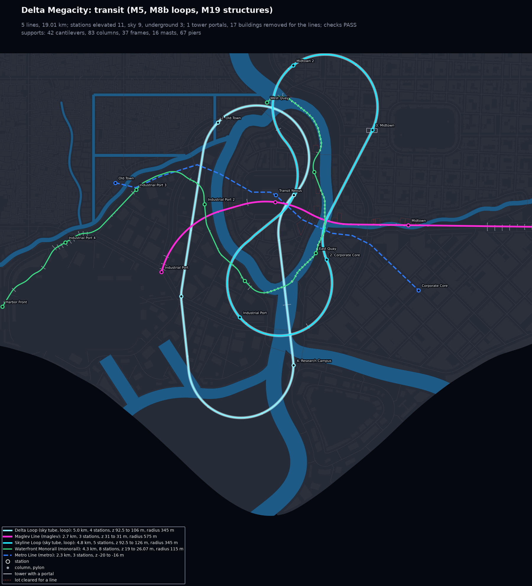
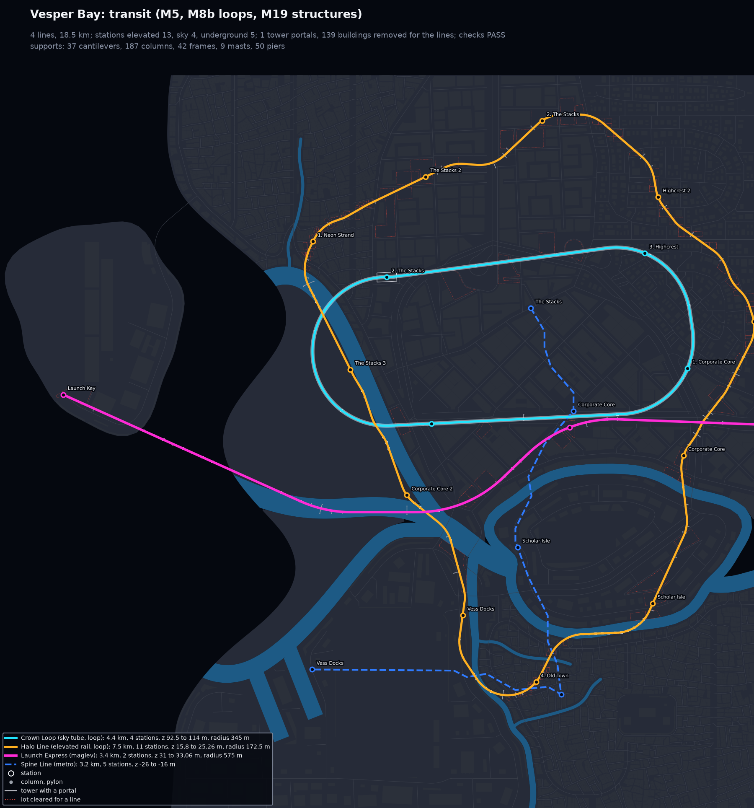
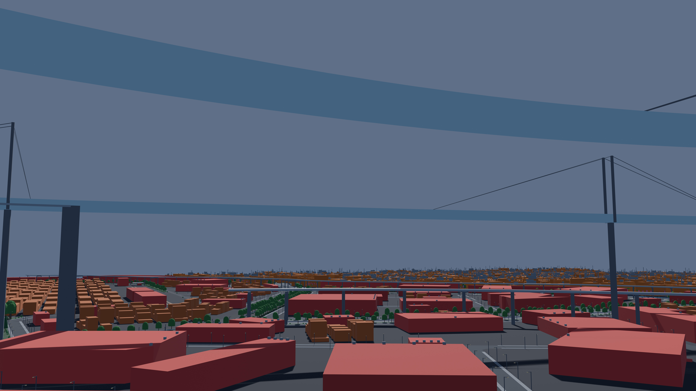
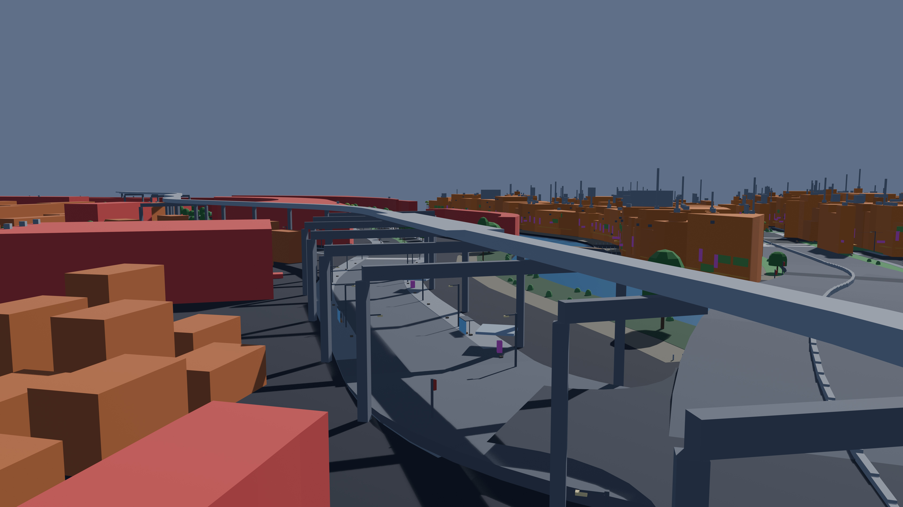

# M19: transit structures

From the first run-through (`docs/run_through_1.md`): supports that stood beside the line
instead of under it, long unsupported gaps (971 m on a sky tube over Delta Megacity's river),
sky tubes through towers that hosted no station, and lines too close to the roads, buildings
and each other. Spec: `docs/citygen_scope.md`, section 12, M19.

| Delta Megacity: transit (8K renders below) | Vesper Bay: transit |
|---|---|
|  |  |

| Sky tube masts with their stays (Delta Megacity, 8K) | Monorail on portal frames over a raised road (8K) |
|---|---|
|  |  |

## What changed

- **Supports under the structure.** Each line's supports are spaced evenly between its fixed
  points (an open line's ends, each platform's ends) and what carries it (a tower it passes
  through, a transit nexus platform, a sky station's elevator core, the ground), at the
  mode's span: elevated rail 30 m (longest 45), monorail 25 (40), maglev 50 (80), sky tube
  420 (600). Each moves at most 15% of its span to free ground and stands as, in turn:
  - a column under the line (its middle within 0.01 m of it in every sample);
  - a pier in the water, clear of the navigable channel (down the middle of a river or channel,
    at most half its width and 40 m wide, 120 m for a sea channel; the open sea has none);
  - a portal frame: a column each side within 30 m and a cap beam under the deck (a new
    structure kind, `beam`);
  - a cantilever bent: one column within 15 m, its arm reaching past the deck.
  Any gap still over the longest span is filled wherever a support stands; before the
  stations, a dry run takes out the low buildings that alone keep a support off a gap.
- **Sky tube masts.** Every sky tube pylon is a cable-stayed mast: two legs either side of the
  tube rising 12% of its longer span over it, stays fanned to 40% of each span.
- **Main spans.** Where nothing may stand, a navigable channel or a raised road (an
  interchange), a span may pass the longest, cable-stayed, up to 300 m (elevated rail), 250
  (monorail), 300 (maglev). Each line lists its truss and cable spans (`attrs.spans`).
- **Portals only at stations.** A sky tube through towers picks each stop's host tower
  before its route: a portal-sized tower in the stop's zone that a straight tube leaves with
  240 m clear on both sides (an edge tower of a dense core), along the line's way. Only hosts
  take a portal; every other tower is climbed over or gone round. Where neither works (Vesper
  Bay's Crown Loop, whose Corporate Core and The Stacks are walls of 130 to 216 m towers), the
  tube takes the removable towers in its way out (6 in Vesper Bay), as elevated lines take out
  what they cannot clear.
- **Clearances.** 6 m from buildings in plan (2 m before), or under the line by its
  clearance; the roof items a line passes too close over go. 8 m over a road or sidewalk
  under the deck and its cap beams (5.5 m before); 6.5 m over a raised road's deck (with room
  for a frame's cap beam over it) and between two lines; a line passing under a road deck
  keeps 6.5 m under it for its trains. Default altitudes: elevated rail 14 to 20 m (10 to
  16), monorail 16 to 26 m (12 to 22). Lines are profiled in order: each passes over or under
  the lines before it.
- **Checks.** `transit_supports` (a lone column within 0.5 m of its line, a frame's beam under
  it at the deck's underside, piers clear of the channel, no span over the longest but a
  main span, an end overhanging half of it at most) and `transit_clearance` (in 3D along the
  line: building masses and roof items, a portal only with a station in it, other lines'
  tracks, platforms, supports and canopies, the roads, raised decks, navigable water).
- **Blockout and stage 2.** Cap beams, masts with stays, pier footings; AG7 draws a beam as a
  plain box until AG14 draws the frames.

## Delta Megacity, before and after

Measured on the built models (`citygen.transit_checks.check_supports`; a frame or a
cantilever counts as one support, its columns not as columns off the line):

| Line | Supports before | Now | A column off its line, before | Now | Longest span, before | Now |
|---|---|---|---|---|---|---|
| Maglev Line | 43 | 54 (29 columns, 12 piers, 10 frames, 3 cantilevers) | 3.1 m (3 over 2 m) | 0.01 m | 270 m | 59 m |
| Skyline Loop (sky tube) | 19 | 9 (6 masts, 2 frames, 1 cantilever) | 13.1 m (4) | 0 m | 366 m | 476 m |
| Delta Loop (sky tube) | 39 | 12 (10 masts, 1 pier, 1 frame) | 9.9 m (2) | 0 m | 971 m | 577 m |
| Waterfront Monorail | 94 | 170 (54 columns, 54 piers, 38 cantilevers, 24 frames) | 13.5 m (53) | 0.01 m | 594 m | 39 m |

The run-through's script (`measure_runthrough.py`) counts every column, so on the new model
it reports the frames' and cantilevers' columns as off the line (by design: they stand at the
curbs under their beam) and the gaps across the tower the Skyline Loop passes through.

## Every sample

All checks pass on every sample (86; 91 on Vesper Bay Decks). Full-city tries, M15 then M19:

| City | Tries before | Now | Longest spans now (per line) |
|---|---|---|---|
| Delta Megacity | 1 | 1 | maglev 59, sky tubes 476 and 577, monorail 39 |
| Vesper Bay | 1 | 1 | elevated rail 189 (a cable span over the river fork), maglev 150 (cable, river), sky tube 435 |
| Nexus City | 1 | 1 | maglev 78, elevated rail 105 (cable, sea channel), sky tube 347 |
| Greyhook (peninsula_city) | 1 | 1 | sky tube 506, elevated rail 34 |
| Saltreach Free Port (archipelago) | 1 | 1 | monorail 39, maglev 56 |
| Vesper Bay Pinned | 2 | 2 | |
| Vesper Bay Stacks | 1 | 1 | |
| Vesper Bay Decks | 2 | 3 (see below) | elevated rail on cable spans across the deck city |
| Cragmouth (a metro only) | 1 | 1 (its model gains only its line's empty `attrs.spans`) | |

## Open items

- **Longer sky loops.** Keeping off every tower that hosts no station makes some sky tube
  loops longer and less round: Delta's Skyline Loop is now a 4.8 km figure-eight passing over
  itself 13.5 m clear (a 2.75 km ring before, through seven towers without a station),
  Vesper Bay's Crown Loop 4.4 km (2.3), Greyhook's Spine Tube 2.5 km (1.5). Routing it with
  no host towers at all gives the same length on Delta.
- **Two lines along one street** stack 8 m apart and the upper one's columns cannot stand
  beside the lower deck; where they share a stop for long, a frame wide enough to straddle
  both is needed (seen on the test city, not on the samples).
- **Supports in a regenerated district** (`citygen build --district`) are planned again along
  the whole line; outside the district they come back where they were when nothing near them
  changed, but a seam can shift a few supports next to it.
- AG14 draws the frames, masts, piers, trusses and cable spans as assets; AG7 draws beams as
  plain boxes and masts and piers as columns until then.
