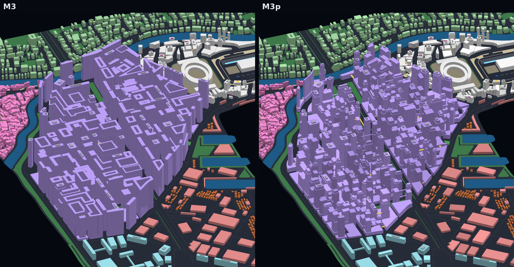
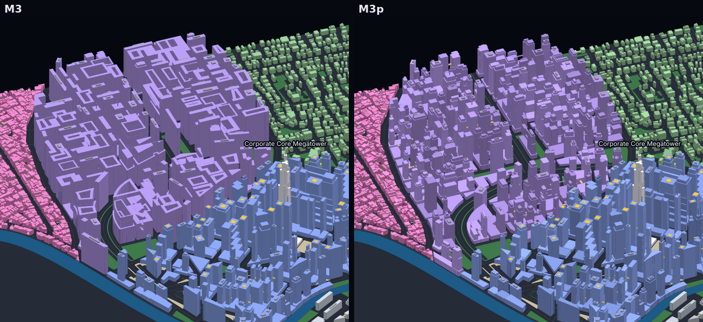
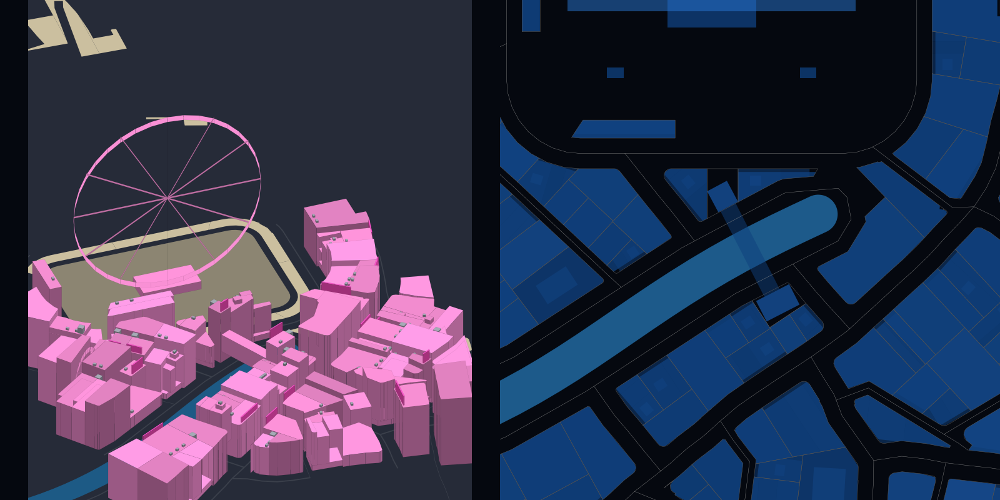

# M3p: polish of M3 (megablocks, complexes in place, canal straddles, boulevard skylines)

M3 passed every check but some of its results looked weak (`docs/progress/M3/README.md`,
"Still weak"). This pass fixes the four items asked for and one cheap extra:

1. **Megablocks** read as separate megabuildings instead of one wall.
2. **Complexes** stand on the lots M2 grouped for them (22 of 22, was 14 of 22).
3. **Straddle buildings** also span canals, at the navigable clearance.
4. **M1b bug**: `roads._merge_degree2` no longer breaks on a collapsed or drifted joint;
   reproduced on a sample spec and covered by regression tests.
5. **Boulevard ridge**: heights rise along the avenue through a district's center.

Each city folder holds `preview_heights.png`, `preview_massing.png`, `preview_map.png`,
`preview_detail.png`, `report.json`, `report.txt` and `trace.json`, as in M3 (the model is not
committed; a build regenerates it byte for byte). The specs are unchanged
(`docs/progress/M1a2/`, Nyxllor in `cities/nyxllor/`). All 44 checks pass on all five
cities. `compare/` holds before and after crops; `docs/progress/M3/` is untouched.

| City | Buildings | Floor area km2 (M3) | Tallest m | Skybridges (km), M3 | Complexes in place, M3 | Landmarks | Megasites |
|---|---|---|---|---|---|---|---|
| Nyxllor | 5887 | 24.0 (29.7) | 480 | 291 (3.61), 230 (2.57) | 5 of 5, 4 of 5 | 1 | 3 |
| Saltreach Free Port | 3182 | 14.2 (14.0) | 292 | 180 (1.95), 180 (1.95) | 2 of 2, 2 of 2 | 0 | 3 |
| Delta Megacity | 5457 | 23.2 (22.8) | 480 | 327 (3.78), 328 (3.78) | 4 of 4, 3 of 4 | 1 | 3 |
| Nexus City | 6424 | 20.1 (19.5) | 480 | 251 (3.01), 255 (3.04) | 6 of 6, 1 of 6 | 4 | 7 |
| Greyhook (peninsula) | 2455 | 15.1 (19.4) | 233.6 | 151 (2.60), 73 (1.03) | 5 of 5, 4 of 5 | 1 | 3 |

## 1. Megablocks: towers on podiums (`buildings.megabuilding`)

In M3 a megabuilding filled its lot to 120 to 250 m with an atrium and stepped tiers, so a
megablock district (Greyhook's and Nyxllor's The Stacks) read as one continuous purple mass
from afar. Now every megablock lot gets:

- **A podium** of five to eight floors (16 to 26 m) over the whole buildable lot, with a
  **court cut through it** (open to the sky down to the ground) when the lot is deep enough
  for two rows of towers.
- **Separate towers on the podium**: one or two rows (front and back) of one to three towers,
  spread to the corners and ends, 30 to 64 m long and 24 to 36 m deep, at least 16 to 22 m
  apart (the gap is a light well at sky level). One ring of four sometimes loses a tower.
  Curved lots try the region's own long axis; lots too small for two take one tower.
- **Height contrast**: the tallest tower reaches the lot's height (120 to 250 m from the
  district height field, which now weighs its smooth noise more, so tall lots cluster); the
  others step down to 64 to 94% of it, all far above the 16 to 26 m podium carpet. Every tower has a mid setback on one or two sides (at 42 to 66% of
  its rise) and a crown tier.
- **Elevated decks**: open decks (6 m wide) between neighboring towers of one building at
  one or two levels, and a street-scale deck network between buildings: open decks between
  neighboring podiums across streets and courts, a level below the lower podium's roof, at
  most two per building (`skybridges._podium_decks`), on top of the district's tower
  skybridges.
- Lots that cannot hold a rectangular tower (3 of 94 in Greyhook) get a tower that follows
  the lot 5 m in from the podium edge.

| City, district | Median / p90 / max height m | Coverage | FAR | Decks |
|---|---|---|---|---|
| Nyxllor, The Stacks, M3 | 156.8 / 182.4 / 233.6 | 53% | 20.9 | 27 skybridges, 28 atrium decks |
| Nyxllor, The Stacks, M3p | 153.6 / 182.4 / 224 | 77% | 13.1 | 61 podium decks + 27 tower skybridges, 131 decks between towers (163 towers on 98 megabuildings) |
| Greyhook, The Stacks, M3 | 160 / 185.6 / 236.8 | 53% | 19.6 | 39 skybridges, 18 atrium decks |
| Greyhook, The Stacks, M3p | 156.8 / 185.6 / 233.6 | 76% | 13.8 | 78 podium decks + 39 tower skybridges, 125 decks between towers (159 towers on 94 megabuildings) |

Coverage rises from about 53% to about 77% (the podiums), while the floor area ratio falls
from about 20 to about 13: the towers no longer fill the lot to full height. That is still a
very dense district (Hong Kong's densest blocks run about 10 to 12) with legible masses; the
lost floor area is the price of the gaps. The previews also tint every building a few
percent lighter or darker (by id), so neighbors separate in the massing views.

## 2. Complexes built where they were grouped (`blocks._merged_groups`, `complexes.probe`)

M2 picked a merged lot group by proximity alone (adjacent lots near the district center, or
two lots on one street), and M3 moved the complex to another block when the group could not
hold it: unions too narrow for towers, pairs offset along the street. Now M2 lists candidate
groups, best first, and **tries each with M3's own builder** for its complex (masses only, no
ground floor or roof items) on a district context built from M2's roads, junctions,
crosswalks, open space, water and flight cones (`blocks._probe_ctx`); the first that holds
the complex becomes the group. Candidates:

- **Tower groups** (twin towers, clusters, megabuilding campuses, campuses): seeds near the
  district center (biggest blocks preferred, as before), each grown both by its biggest
  neighbor and by the neighbor it shares the longest edge with.
- **Pairs** (bridged pairs, straddle buildings): two lots of different blocks on one street
  (among their first two frontages) whose frontages face each other along at least 10 m;
  for straddle buildings also two lots facing each other across a canal.

Straddle legs are now placed on the stretch where the two lots overlap, so offset lots still
face each other. At most 24 candidates are tried per complex. M3's relocation stays as the
fallback; no sample needs it now.

| City | Complexes | Built in place, M3 | Built in place, M3p |
|---|---|---|---|
| Nyxllor | 5 | 4 (straddle moved) | 5 |
| Saltreach Free Port | 2 | 2 | 2 |
| Delta Megacity | 4 | 3 (tower cluster moved) | 4 |
| Nexus City | 6 | 1 (two clusters, straddle, bridged pair, campus moved) | 6 |
| Greyhook (peninsula) | 5 | 4 (straddle moved) | 5 |
| **All** | **22** | **14 (64%)** | **22 (100%)** |

## 3. Straddle buildings over canals (`complexes.straddle_building`)

A straddle building's span may now cross a canal (an inner waterway, or a canal channel) and
the quay roads on both sides of it: the two lots face each other across the canal (their
frontages nearest each other, the line between their midpoints crossing the canal, at most
60 m apart), each leg stands on its lot's quay frontage, and the span (three floors, at most
50 m) starts on the first floor above both clearances: 5.5 m over every road it crosses and
the canal's navigable clearance (4 m), each plus the 1 m structure. Nothing else may lie
under it: no junction, no road but the two quay roads, no other water and no other lot. The first straddle
building of a district with canals goes over a canal, the next over a street, and so on.
All three samples with a straddle building (Nyxllor's Neon Strand, Nexus City's Neon Market,
Greyhook's Lantern Strip) now span a canal.

The footprint check verifies every span against what it crosses: the building lists them
in `span_crosses` (road and water ids, `span_over` the main one), every listed road must be
a street, alley, pedestrian street or service lane cleared by 5.5 m, every listed water body
cleared by its navigable clearance (canal 4 m, river 15 m, sea 25 m), no road or water
under the span may be missing from the list, and the span may pass over no lot but the two
of its property. (The last rule came from a test city, Budget Bay, where a canal span first
passed over a third lot and met its building.)

## 4. M1b bug: `roads._merge_degree2`

**Cause.** `_merge_degree2` joins two road pieces that meet at a node of degree 2 and refits
a sharp joint as a fillet curve (`_smooth_joint`). The arc builder drops points closer than
5 cm to the previous one, and two things follow. On pieces a few centimeters long (noding
leftovers) every point collapses and the result is an empty line; the next pass of the loop
reads its first point (`ln.coords[0]` in `_endpoints`) and raises IndexError. More often, the
joint's true end point is dropped because the arc's last tangent point lies within 5 cm of
it, so the merged road ends 1 to 5 cm off its node: the node loses a degree and a new dead
end appears 3 cm away, which `_drop_dangles` later removes, together with the road piece
that ended there.

**Reproducers.** Building the five sample specs' roads over seeds, district placement
mutations and all four road variants (273 road networks) hit the drifted end 11 times, for
example Greyhook with seed 5 (every road variant), Nyxllor with seed 4 and Nexus City with
seed 1; on Greyhook seed 5 the network had 23 segments and 11 dead ends instead of 24 and
10. The collapse to an empty line (the IndexError itself) did not occur in those runs; it is
reproduced directly with two 3 cm pieces at a right angle and a fitter that keeps the
corner.

**Fix.** `roads._on_ends`: a smoothed joint is kept only when it is a real line whose ends
lie within 10 cm of the two nodes, and its ends are then put exactly on the nodes; otherwise
the plain joint is kept. The five sample road networks are unchanged by it: every trace
entry up to the M2 walkways equals M3's, and the first difference is the M2 `blocks` entry
(the new merged groups), or for Saltreach (whose groups did not change) the first M3 entry.

**Tests** (`tests/test_polish.py`): the 3 cm joint (it raised IndexError before),
`_on_ends` on the drifted line from Nyxllor seed 9081 road variant 3, a normal joint still
smoothed, and Greyhook seed 5 built with a check that merging keeps every other node with
its degree (it fails on the old code at (1008.74, 1116.22)).

## 5. Boulevard ridge (`buildings.boulevards`)

The height field of the corporate core, megablocks, midtown and transit hubs gains a ridge:
the district's boulevard is the avenue that passes nearest its center (within 35% of its
radius) plus the avenues that continue it in a straight line (every vertex within 30 m of
its line, running along it), and lots rise toward it, falling off over 90 m. The term only
adds height (a share of the district range: 0.3 in the corporate core, 0.2 in megablocks and
midtown, 0.15 in transit hubs), so the rest of the district keeps its M3 heights. Distances
are plain Python arithmetic on the road vertices.

Median height of the district's buildings within 60 m of the boulevard, and of the rest
(megablocks: neither The Stacks has an avenue near its center, so no ridge there):

| City, district | Near the boulevard, M3 | Near, M3p | Elsewhere, M3 | Elsewhere, M3p |
|---|---|---|---|---|
| Nyxllor, Corporate Core | 184 m | 232 m | 128 m | 128 m |
| Delta Megacity, Corporate Core | 176 m | 222 m | 126 m | 128 m |
| Delta Megacity, Midtown | 77 m | 91 m | 42 m | 42 m |
| Nexus City, Corporate Core | 142 m | 198 m | 116 m | 120 m |
| Nexus City, Midtown | 52.5 m | 59.5 m | 38.5 m | 38.5 m |
| Saltreach Free Port, Crown Island | 148 m | 176 m | 128 m | 128 m |

The ridge is a modest change in the full-city previews (a line of taller towers along the
central avenue of each corporate core); it shows best in `preview_heights.png`.

## Determinism and speed

The new code follows the M2 and M3 rules: tower layouts and decks are rectangles in a lot
frame with spacing tested on their frame bounds in plain arithmetic, M2's candidate lists are
sorted by rounded scores and ids, STRtree hits are sorted, M2's tries run M3's builders inside
`geom.canonical()`, and the boulevard distances never touch GEOS.

Verification on the final code: all five models and every trace entry are identical between
the pinned x86_64 Linux wheels (libstdc++ GEOS) and GEOS 3.14.1 rebuilt with clang 18 against
libc++ (Ubuntu's source package of the same release, `geos_3.14.1.orig.tar.bz2`, sha256
`3c20919c...`, swapped into the shapely 2.2.0 wheel), and Greyhook gives the same bytes with
one worker and another `PYTHONHASHSEED` (`citygen trace diff`: no difference in any entry).

| City | Trace entries | Model sha256 (x86_64, libstdc++ GEOS) | libc++ GEOS |
|---|---|---|---|
| Nyxllor | 5908 | `b560152efa4cff7e00819d6097db499a5ca18775aa303007528e2324d1178a25` | same |
| Saltreach Free Port | 61 | `66c3803bd314ec7e25e454526bc113c5d66f9d6bd1104a681ed76ebdc15ea08e` | same |
| Delta Megacity | 2775 | `b23ae6ea83eb425ada5e0c06066761556ed800b88c3f39290f80f06ae0be5177` | same |
| Nexus City | 8556 | `efbd3ddc9d971b1a96ba510223235b908ec472db048f440dcafc337179a8a76b` | same |
| Greyhook | 253 | `181ee3aa143098d0acddb29a6885dc1d53c4ffb5dab94eff7d0dd92c4e2afb00` | same |

Speed. This cloud container is slower than the one M3 was measured on: M3 itself (the `main`
branch) builds Nexus City in 60.4 s under `tests/test_build.py` here (the M3 session measured
54 s), and M3p in 61.9 s, so the M3p cost is about 1.5 s (2.5%): M2's group picking (about
0.6 s, mostly the M3 builder tries) and the extra deck search. On the M3 session's machine
that projects to about 55.5 s, within the 60 s budget; on this container the budget assertion
fails for both M3 and M3p.

| City | CLI build here (with previews and `--trace`), M3p |
|---|---|
| Nyxllor | 84 s |
| Saltreach Free Port | 37 s |
| Delta Megacity | 77 s |
| Nexus City | 87 s |
| Greyhook | 35 s |

## Still weak

- **Megablock floor area.** The gaps cost floor area: FAR about 13 instead of 20. Taller
  towers would win it back but crowd the 250 m ceiling of the archetype range.
- **Tower shapes.** Megablock towers are rectangles with setbacks; cruciform, L and
  stepped-slab towers, and podium terraces would vary the silhouette further.
- **Straddle spans** are rectangles in the first leg's frame, so a span over a curving canal
  crosses it at a slant; legs only stand on the lots' quay frontage.
- **Boulevard ridge.** Only one straight boulevard per district; a district with no avenue
  near its center gets none (Nexus City's Transit Nexus), and there is no ridge along a
  waterfront or relation to stations yet (M5).
- **Collapsed road joints** (the IndexError) are reproduced only synthetically; the sample
  sweeps found the drifted case, which the same fix covers.
- The rest of M3's list still stands: facades on the best frontage, rectangles on curved
  lots, megasite templates in shrunk reserves, flight-cone caps, blockout roof items, wheels
  as rings.
