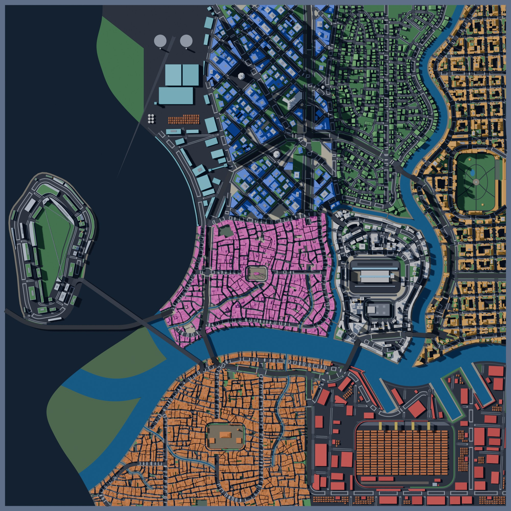
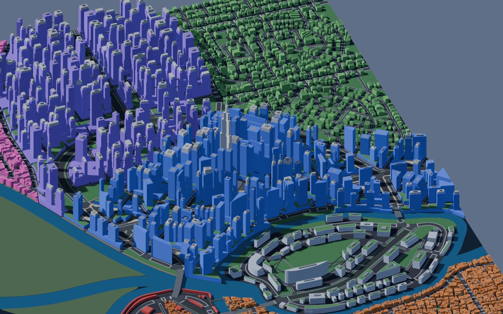
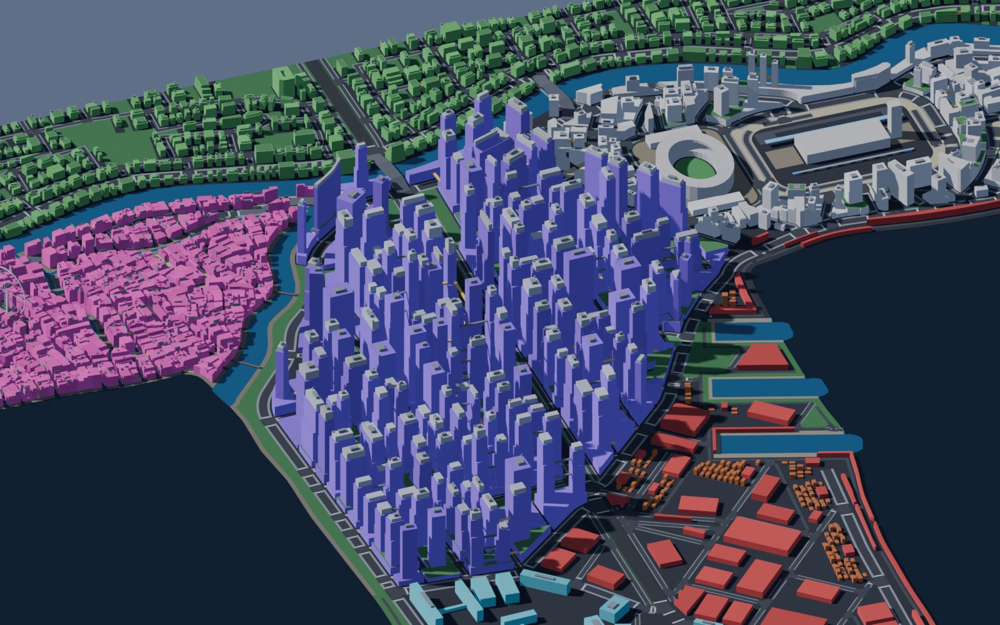
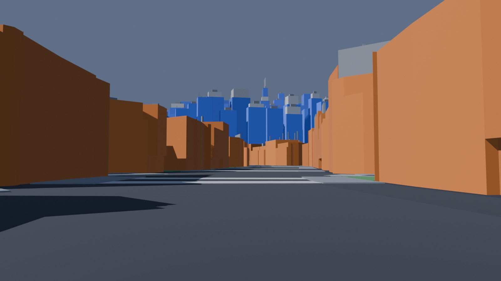

# M4: Blender blockout, renders, 2D map, exports

M4 closes the core pipeline: prompt, spec, `citygen build`, then `citygen blockout` gives a
full blockout city in Blender 5.2 with every district, street, building, skybridge, bridge
and megasite. It also writes USD for the whole city, one glTF file per 256 m tile, renders, a
layered 2D map and the exports later stages read (scope sections 7 and 8, M4 row of section
12).

```bash
.venv/bin/python -m citygen build cities/vesper_bay/city_spec.json out/vesper_bay --blockout
# or, on a built city:
.venv/bin/python -m citygen blockout out/vesper_bay/city_model.json out/vesper_bay
```

All five sample cities pass every blockout check. The largest, Nexus City, takes 72 s from
model to finished blockout on the M4 Mac, and about 100 s from spec. The budget is 10
minutes.

| Nexus City, from the top | Vesper Bay, Corporate Core |
|---|---|
|  |  |

| Greyhook, The Stacks | Saltreach, Westreef street toward Crown Island |
|---|---|
|  |  |

Each city folder holds:
- `render_top.jpg`: orthographic, straight down, the whole map.
- `render_iso_<district>.jpg`: one isometric view per district, from the south-south-west like
  `preview_massing.png`.
- `render_street_<n>.jpg`: eye level, 1.7 m. Up to three views look down an avenue at the
  tallest towers, with the line of sight checked against the buildings in between; the last
  view runs along an old town or market street.
- `map_2d.png` and `map_2d.svg`: the labeled 2D map.
- `blockout_report.txt` and `blockout_report.json`: checks, counts, sizes and timings.

These files are not committed, because a run regenerates them: `city.blend`, `city.usdc`,
`tiles/*.glb`, `blockout_plan.json`, `graphs.json`, `tiles.json`, `props.csv` and
`unreal/corporate_core_plan.json`.

## How it works

The work is split so that every geometric decision stays in the deterministic generator:

1. **Plan, in the venv** (`citygen/blockout.py`, `make_plan`). The city model becomes plain
   data, made of objects with parts. The part types are:
   - prisms: ring, holes, z0 and z1, plus the mass shape;
   - flats: ring, holes and z;
   - ribbons: left and right edges with z per vertex, and a thickness;
   - boxes: base center, size and yaw;
   - beams: two end points, width and height.

   The plan runs in `geom.canonical()`. Land and water are clipped to the tiles with the
   generator's own overlays. Everything else is plain arithmetic with no transcendentals,
   rounded to the 0.01 m grid. The plan is therefore the same bytes on every machine, and
   its sha256 sits next to the model's in `tests/data/golden_hashes.json` under
   `blockout_plans`.
2. **Blender** (`citygen/blender/build.py`, stdlib and bpy only, since citygen's dependencies
   do not exist inside Blender). It only builds meshes:
   - n-gon caps;
   - caps with holes, triangulated by `mathutils.geometry.tessellate_polygon`;
   - walls, ribbons, boxes and beams;
   - cones, domes and the vertical wheels (rim and spokes).

   It then saves `city.blend`, exports `city.usdc` and `tiles/<tile>.glb`, and renders with
   EEVEE.
3. **Verification.** The `.blend` is reopened in a fresh Blender process and its objects
   are counted.

### Objects

| Object | Granularity | Examples |
|---|---|---|
| Building, landmark | one per building: its masses and roof items | `d03.blk017.lot004.bld` |
| Skybridge | one per skybridge (enclosed and stack full height; open deck, catwalk and cable as thin slabs) | `d01.sky012` |
| Bridge and raised road deck | one per road segment: deck 1.2 m thick, road surface, piers every 40 m | `rs0412.deck` |
| Megasite element group | one per site, element kind and tile | `mg01.container_stack.t+02-03` |
| Streets, sidewalks, junctions, crosswalks, open space, green roofs, quays | joined per district, category and tile | `d03.road_street.t+01-02` |
| Ground slab, river and canal water, sea | per tile, clipped (ground 4 m deep, so canal and quay walls show) | `city.ground.t+01-02` |

Collections nest as city, then district (or "City" for shared roads and water), then
category: Buildings, Landmarks, Streets, Open space, Waterfront, Skybridges, Megasites,
Structures, Ground and Water.

Every object carries custom properties, which glTF exports as extras:
- `citygen_id` (or `citygen_ids` for joined objects, with `count`);
- `citygen_type`, `citygen_tile` and `citygen_category`;
- for buildings, also `use`, `height_m`, `floors`, `district`, `archetype`, `name`,
  `property_id`, `lot_id` and `megasite_id`.

Materials are flat colors by category, the same palette as the matplotlib previews. In the
renders each building's wall color is up to 20% lighter or darker (Object Info random), so
neighbors separate. USD and glTF keep the flat base color.

### Exports beside the blockout (`citygen/exports.py`)

- **`map_2d.svg`**: one Inkscape layer per kind, using the layer names of the hand-traced
  maps:
  - coast, water, park, plaza, pier;
  - highway, avenue, street and elevated road, plus new alley and pedestrian layers;
  - building and landmark;
  - new layers: sea, district, megasite (reserve outlines and site elements), transit
    (empty until M5), labels and legend.

  1 unit is 1 m, road stroke width is road width, and building height is the object label.
  `pipeline/svg_to_plan.py`, the converter of the traced Corporate Core, reads it as is: on
  Saltreach it finds all 3182 buildings with their heights from the labels, and gives no
  warnings (a test checks this). Swagnik can open the map in Inkscape and edit it with the
  old workflow.
- **`map_2d.png`**: the same layers, with district and place labels, a legend and a 500 m
  scale bar.
- **`unreal/corporate_core_plan.json`**: the box and cylinder format that
  `unreal/build_greybox_unreal.py` reads unchanged:
  - ground in 8 m strips;
  - road boxes per centerline piece, with raised ones as bridges;
  - one oriented box per building mass (podium, tower, lowrise or landmark);
  - parks, plazas and canals.

  The player start is the first street view's eye point.
- **`graphs.json`**: the lane graph (lanes and connectors with successors and adjacent lanes)
  and the pedestrian graph (walkways with neighbors), plus transit lines and stations (none
  before M5), for ZoneGraph and Mass traffic and crowds later.
- **`tiles.json`**: the 256 m tiles (name, index, bounds) the plan uses.
- **`props.csv`**: prop instances, one row per prop with its tile. It is header-only until
  M6 places props.

## Checks (`blockout_report.txt`)

| Check | What it verifies |
|---|---|
| `blender_build` | Blender finished and wrote its report |
| `blend_opens` | `city.blend` reopens in a fresh Blender |
| `blend_objects` | the reopened file holds every object of the plan |
| `blend_buildings` | one building object for every building of the model with masses |
| `gltf_tiles` | one non-empty `.glb` per tile with objects |
| `usd_export` | `city.usdc` written |
| `renders` | the top view, one isometric view per district and the street views |
| `blender_budget` | the Blender run is under 10 minutes |

## Results (M4 Mac, Blender 5.2.0, 4 workers)

| City | Objects | Buildings | Tiles | Vertices | Faces | .blend MB | USD MB | glTF MB | Renders | Blender | Blockout total |
|---|---|---|---|---|---|---|---|---|---|---|---|
| Vesper Bay | 7745 | 5887 | 196 | 0.74 M | 0.29 M | 9.8 | 26.1 | 42.5 | 13 | 55 s | 62 s |
| Saltreach Free Port | 4450 | 3182 | 196 | 0.42 M | 0.16 M | 5.7 | 14.8 | 24.0 | 9 | 27 s | 32 s |
| Delta Megacity | 7353 | 5457 | 196 | 0.73 M | 0.28 M | 9.5 | 25.5 | 41.2 | 11 | 51 s | 58 s |
| Nexus City | 8434 | 6424 | 196 | 0.81 M | 0.31 M | 10.7 | 28.2 | 45.9 | 14 | 63 s | 72 s |
| Greyhook (peninsula) | 3661 | 2455 | 192 | 0.31 M | 0.12 M | 4.3 | 10.9 | 18.1 | 10 | 22 s | 26 s |

The Blender column covers building the meshes, saving, USD export, the glTF tiles and the
renders. Building the meshes takes about 1 s. About half the time is the 196 glTF exports;
the renders (EEVEE, 16 samples, 1600 px) take most of the rest. The blockout total adds
the plan (2.5 s for Vesper Bay), the 2D maps and exports, and the reopen check.

The city models are unchanged against M3p (same golden hashes): M4 only reads them.

## Determinism

- `blockout_plan.json` is byte-identical on macOS arm64 and x86_64 Linux: the five golden
  plan hashes pass on the Mac and in the `linux/amd64` container.
- The plan uses only canonical overlays (exact predicates, grid-snapped output), sorted
  STRtree hits (for the street-view line of sight), and products, quotients and square
  roots.
- Blender's output (`.blend`, USD, glTF, renders) is not compared byte for byte. It is
  checked structurally: object, building and tile counts, and that the files and renders
  exist.

## Tests

`tests/test_blockout.py`:
- ribbon offsets and miters;
- z-profile interpolation;
- plan coverage: every building, skybridge and sidewalk is in an object; rings are oriented,
  holes are clockwise, and coordinates stay in bounds;
- cameras;
- determinism, and the golden plan hashes;
- SVG layers, building height labels, and the traced-map converter reading the map;
- the PNG map, the legacy Unreal plan, the graphs and the prop CSV;
- a full Blender run on the small test city (skipped when Blender is not installed).

## Still weak

- **Street views** are chosen automatically and are only as good as the spot found: some
  stand at a junction with a bridge ramp or a podium wall filling half the frame.
- **Flat materials.** No facade detail, windows or neon. Emitters and looks are stage 3.
- **Tiles are a grouping, not a cut.** Land and water are clipped to the tiles. Every other
  object goes to the tile of its center, so a long deck or a megabuilding overhangs its tile.
  `CityModel.tiles` stays empty: the tiles live in the plan and `tiles.json`.
- **USD for the whole city only.** Per tile there is glTF; a per-tile USD export is a small
  addition when Unreal needs it.
- **Not built yet, by milestone:**
  - transit lines, stations and sky tubes (M5);
  - props, vegetation, signs and awnings: ground-floor units carry `sign` and `awning_m`
    for M6 (M6);
  - elevated highways with real ramps and interchanges (M7; raised road decks have simple
    piers now).
- **Blender's exit message** "Not freed memory blocks" appears in `blender_log.txt` on every
  run. It comes from Blender itself, is harmless, and changes nothing.
