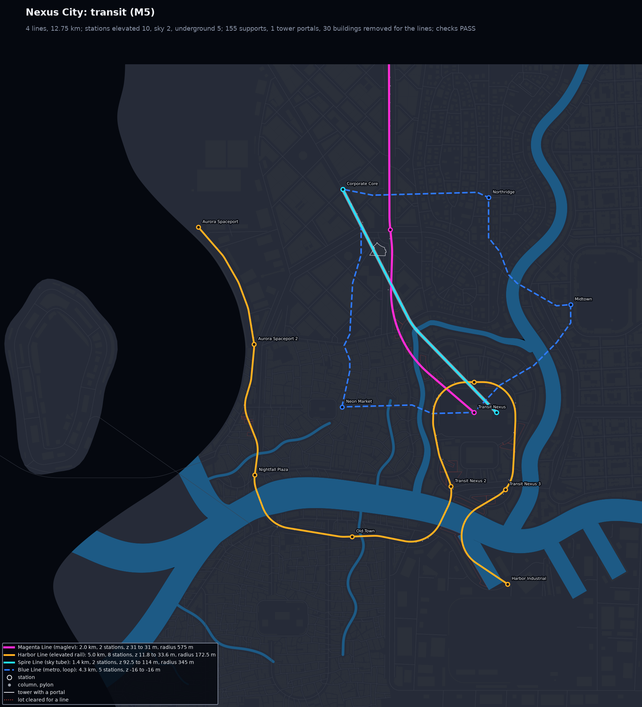
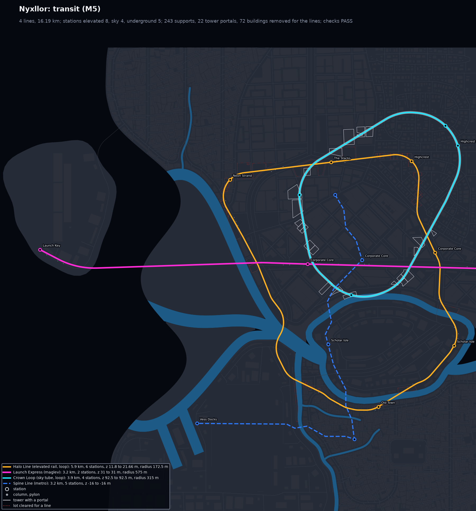
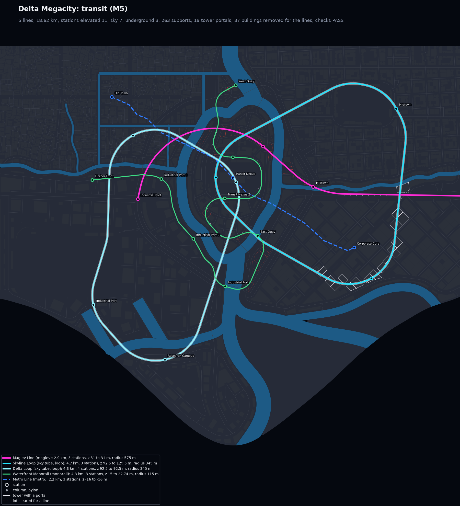
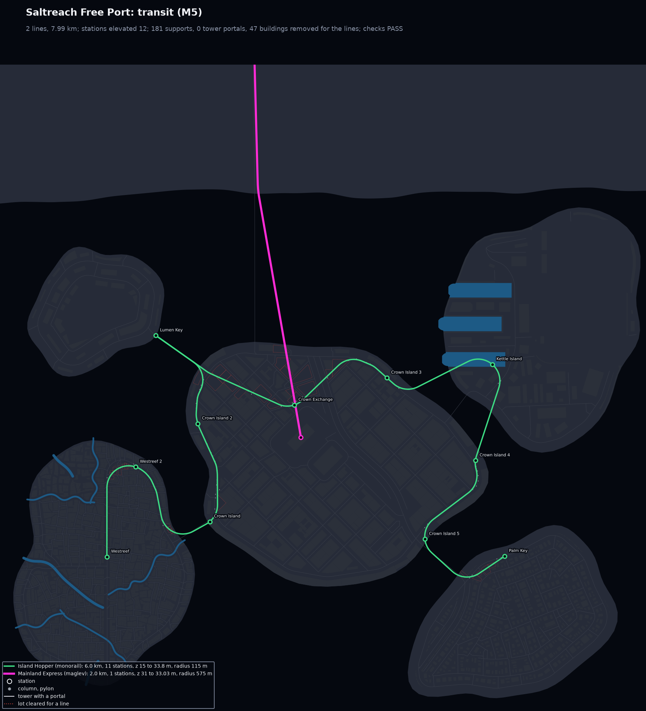
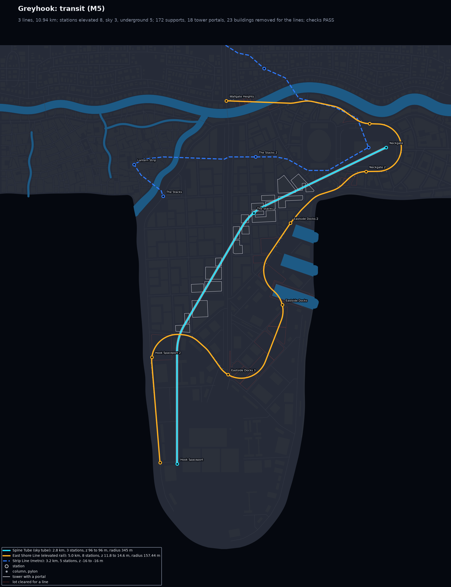
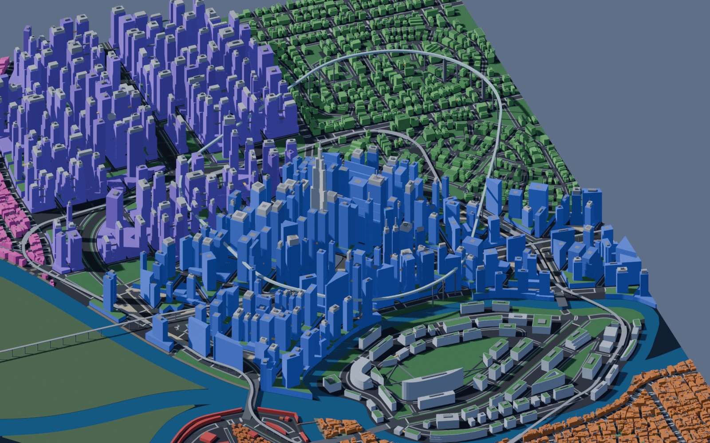
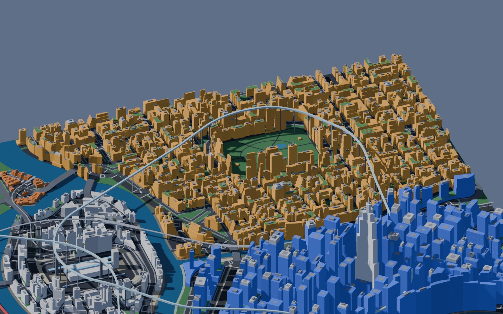

# M5: Transit

M5 adds the transit layer to `citygen build` (scope sections 5 and 9, M5 row of section 12).
It covers metro lines with underground stations, elevated rail and monorail along the
avenues, maglev, and sky tubes that pass through towers with sky stations. Each station has
stairs, elevators and canopies to the street, and elevated walkways join the pedestrian
graph. Skybridges in the way of a line are removed, and the skybridges of complexes are
passed over or under.

```bash
.venv/bin/python -m citygen build cities/nyxllor/city_spec.json out/nyxllor --blockout
```

All five sample cities pass all 54 checks, 10 of them new. Every model is byte-identical on
the M4 Mac and in the x86 Linux container. A build from spec takes about 15 to 50 s on the
Mac.

| Nexus City | Nyxllor |
|---|---|
|  |  |

| Delta Megacity | Saltreach Free Port | Greyhook |
|---|---|---|
|  |  |  |

Blender blockout (M4 renderer) with the decks, tubes, columns and station canopies:

| Nyxllor, Corporate Core | Delta Megacity, Midtown |
|---|---|
|  |  |

Each city folder holds:
- `preview_transit.png`: every line in its color over the plan. Metro lines are dashed, sky
  tubes have a light casing, stations are rings with their names, and supports are dots.
  Towers with a portal are outlined, and lots cleared for a line are dotted red.
- `preview_massing.png`: the isometric massing, now with the decks, tubes and supports.
- `render_top.jpg` and `render_iso_<district>.jpg`: the Blender blockout.
- `report.txt` and `report.json`: the build report with the transit stats.
- `trace.json`: the stage hashes (`citygen trace diff`).

## The samples

| City | Lines | km | Stations | Supports | Portals | Buildings removed |
|---|---|---|---|---|---|---|
| Saltreach Free Port | monorail, maglev | 8.4 | 13 elevated | 201 | 0 | 47 |
| Delta Megacity | metro, maglev, 2 sky tubes, monorail | 18.6 | 11 elevated, 7 sky, 3 underground | 263 | 19 | 37 |
| Nexus City | metro, maglev, elevated rail, sky tube | 12.8 | 10 elevated, 2 sky, 5 underground | 155 | 1 | 30 |
| Greyhook | sky tube, elevated rail, metro | 10.9 | 8 elevated, 3 sky, 5 underground | 172 | 18 | 23 |
| Nyxllor | elevated rail, metro, maglev, sky tube | 16.2 | 8 elevated, 4 sky, 5 underground | 243 | 22 | 72 |

Every line meets its mode's limits:
- curve radius: elevated rail 150 m, monorail 100 m, maglev 500 m, sky tube 300 m;
- grade: 4%, 6%, 10% and 8%;
- altitude range.

The fitted curves come out at 1.15 times the minimum radius where there is room.

## How it works

The stage runs after the buildings (`citygen/transit.py`), on the M3 model, inside
`geom.canonical()`.

1. **Stops.** Each name in a line's `route` becomes a point:
   - a district gives the avenue junction nearest its middle;
   - a district between two other stops gives the junction nearest the line's way, so the
     line serves it in passing instead of detouring to its middle;
   - a transit nexus gives its platform for that mode, or its sky tower;
   - a megasite, place or island gives a point in it;
   - an exit gives its road node.

   A station serves a stop when it stands in the district, or within 150 m of the site,
   place or island.
2. **Routes.**
   - Elevated rail and monorail follow the avenues. The route is a Dijkstra search on the
     road graph with a turn penalty, starting in the direction the last leg arrived.
   - Maglev, sky tubes and metro use A* on a 15 m cost raster with 16 move directions and a
     turn penalty.
   - The raster prices each cell by what the line passes over: land, open space, water,
     roads by class, removable buildings, buildings it must climb, and forbidden cells.
     Forbidden cells are flight cones, towers it can neither clear nor pass through, and
     complex skybridges.
   - Reusing an earlier leg costs more, so a line does not double back.
3. **Curves.** The route is simplified between stops, then fitted with straight runs and
   arcs. Corners turning the same way merge into one wider curve, and a vertex whose arcs do
   not fit goes. Every change must keep the line clear of what it cannot pass, arcs
   included; an arc cutting inside a corner drops to the tightest allowed curve. A stop the
   curves cut away is pinned and the line refitted. A loop whose stop order makes its turns
   too tight is drawn around its stops instead, but only when that still serves every stop.
   Where the line still meets a building it cannot pass, it is rerouted up to three times,
   each time farther from it.
4. **Corridor.**
   - Elevated lines take out the removable buildings in their way. Landmarks, complexes and
     megasite buildings are not removable.
   - Sky tubes with `through_towers` pass through towers wide enough. Elsewhere they climb
     over a building or pass through a portal, whichever stays nearer the base altitude.
   - A skybridge in the way of a line goes, and so does one between removed buildings.
5. **Height profile.** The profile has two envelopes, both limited to 95% of the mode's
   grade:
   - from below: navigable water (its clearance), road decks (5.5 m under the deck, at the
     deck's height where the line crosses it), the roofs under the line, nexus platforms and
     the skybridges of complexes passed over;
   - from above: the towers a tube passes through (8 m of headroom) and the skybridges
     passed under.

   The track takes the base altitude, clamped between the two envelopes. Where they cross,
   the lowest portal tower that no longer fits is dropped and the line climbs over it, one
   tower at a time.
6. **Stations.** Stations stand at every stop and at the mode's spacing between them, off
   the water. Stations between stops are named after a place within 250 m, else their
   district.
   - Metro stations get a concourse at -8 m and two entrances with canopies.
   - Elevated stations get a platform deck, stairs at both ends, an elevator core and stair
     canopies.
   - A sky station sits in the nexus station tower or in the portal tower nearest its stop
     within 200 m, else on a platform with a walkway to the nearest tower.

   Stairs and elevators meet the sidewalks at their foot; the sidewalk is split there so
   the walkway graph stays connected.
7. **Structures.** Decks and tubes come in pieces of 400 m. Supports stand at the mode's
   spacing:
   - in the median when it is wide enough;
   - else just inside both curbs (a bent, one column for a monorail), only where 1.8 m of
     sidewalk stays clear behind it;
   - else off the street.

   Supports never stand in lanes, buildings, water or on road decks.

The model gets `transit_lines` (with stats in `attrs`), `stations`, `structures` and the new
walkways. Buildings get their `portals`, lots cleared for a line get
`attrs.transit_corridor`, and removed buildings, properties, green roofs and skybridges are
dropped.

## Checks

| Check | What it tests |
|---|---|
| `transit_routes` | every line of the spec built, every leg found |
| `transit_stops` | every stop served by a station; a line to an exit reaches it |
| `transit_curves` | radius on 30 m chords at least 98% of the mode minimum |
| `transit_grades` | grade at most the mode maximum |
| `transit_altitude` | within the mode's range, higher only on the ramps up to water or a road deck |
| `transit_clearance` | 2 m over the roofs under an elevated deck, 10 m for sky tubes or a declared portal, navigable clearance over water, 5.5 m over road decks |
| `transit_supports` | columns and pylons off lanes, buildings, water and road decks, 1.8 m of sidewalk clear |
| `station_access` | stairs or an elevator at every station, joined to the street walkways |
| `transit_skybridges` | no skybridge within a track's corridor and 3 m of its height |
| `transit_hubs` | every hub on a line; megasites that need transit have a station of their mode (notes) |

`tests/test_transit.py` builds a small city with a metro, an elevated rail line and a sky
tube through towers. It checks the result, fails every check on a broken copy of the model,
tests the curve fitting, the sky-tube pass rule and the deck heights, and makes sure that
neither the number of workers nor 2-ULP noise in GEOS changes the transit stage.

## Spec changes

The spec route order matters for the fast modes (the skill now says so). Five sample routes
were changed where the old order made the line turn back or cut a stop:

- **Nexus City**
  - Magenta Line (maglev): was Neon Market, Transit Nexus, Midtown, east exit. That route
    turns back at Midtown, and the Neon Wheel blocks the straight way to the nexus. It now
    runs from the north exit through Corporate Core to the nexus.
  - Harbor Line (elevated rail): Neon Market dropped. The line looped 1.5 km around it; the
    metro serves it.
  - Spire Loop (sky tube): became the Spire Line, Corporate Core to Transit Nexus. The loop
    collapsed into a thin triangle, and the spaceport's flight cone forced curves tighter
    than 300 m.
- **Delta Megacity**
  - Maglev Line: starts at the east exit instead of the north exit, so it no longer zigzags
    through Midtown.
  - Delta Loop: visits its stops in order around them: Old Town, Industrial Port, Research
    Campus.
- **Nyxllor**
  - Launch Express (maglev): east exit, Corporate Core, Launch Key. Neon Strand was a 79
    degree turn off the way; the Halo Line serves it.
- **Saltreach Free Port**
  - Island Hopper (monorail): starts at Westreef. Westreef and Lumen Key are dead-end
    islands, so one of them must be a terminus; from Westreef the line no longer loops
    through the old town.

The upstream stages only read which modes visit a hub and their altitudes, so the M1 to M3
parts of every model are unchanged.

## Determinism

The new stage follows the rules of M1b_det:
- `dmath` for the trigonometry;
- every coordinate on the 0.01 m grid;
- decisions on exact measures and grid-snapped overlays;
- sorted candidates with explicit tie breaks.

`tests/data/golden_hashes.json` holds the new model hashes. They were built on the Mac and in
the x86 container (`scratchpad/compare.sh`), and all five match.
