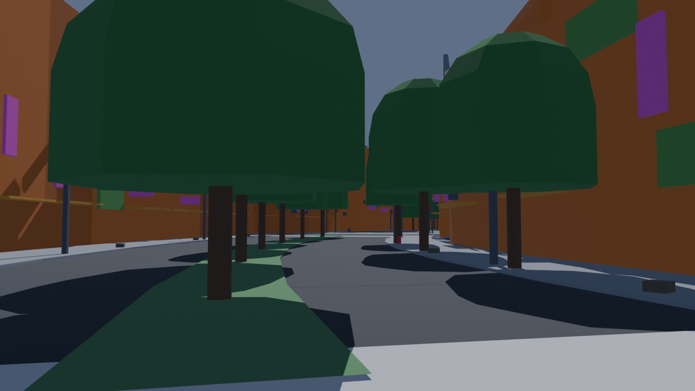
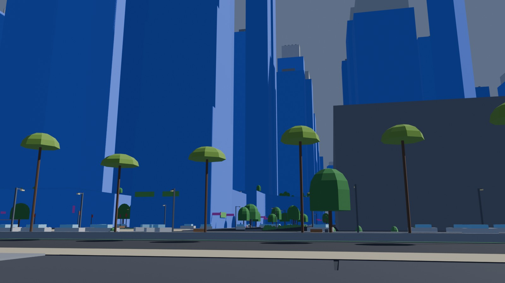
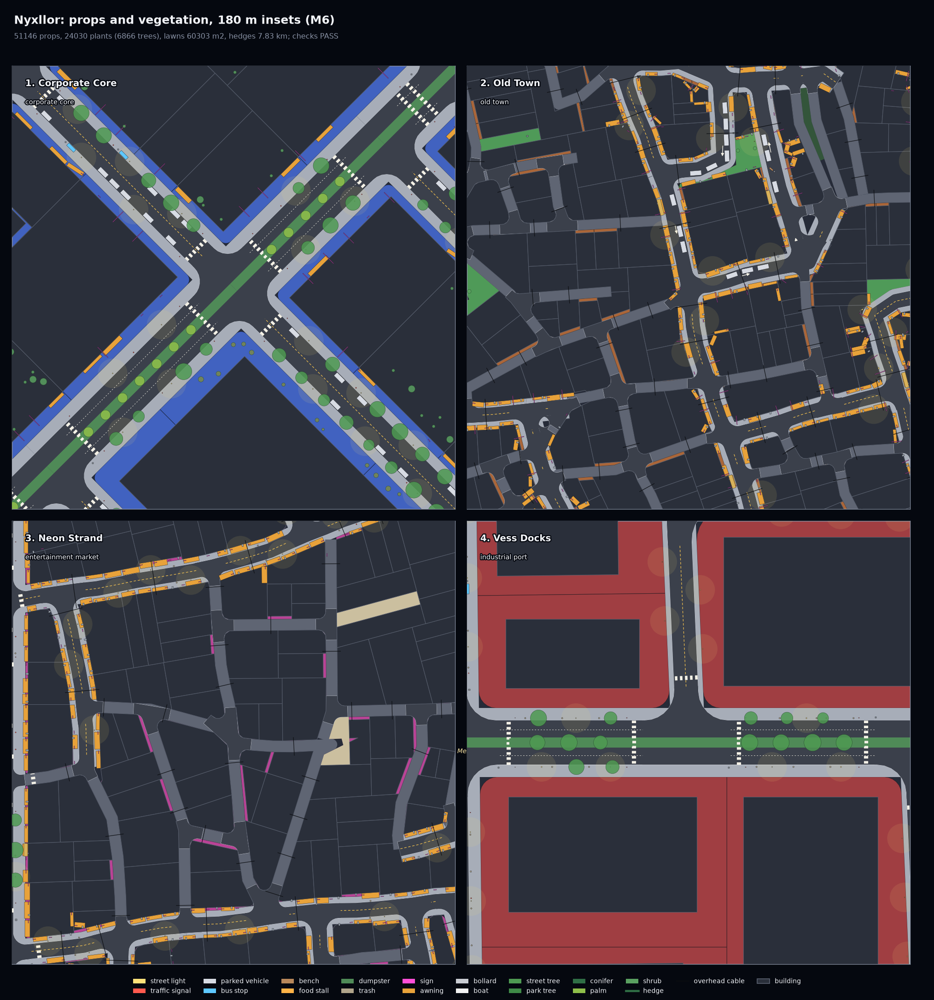

# M6: Props, vegetation and ground clutter

M6 dresses the built city (scope sections 5.6 and 5.8, M6 row of section 12). It adds the
street furniture, the clutter and the plants, and the blockout draws all of them as
instances.

```bash
.venv/bin/python -m citygen build cities/vesper_bay/city_spec.json out/vesper_bay --blockout
```

All five sample cities pass all 60 checks, six of them new. Every model is byte-identical on
the M4 Mac and in the x86 Linux container. The stage takes 2 to 3 s per city. In Blender,
Nexus City's 82,700 instances take 1.9 s to build. A synthetic run of 100,000 instances on one
object built in 0.03 s, and its USD export as a point instancer took 0.9 s.

| Vesper Bay at street level | Saltreach, Crown Island |
|---|---|
|  |  |



Each city folder holds:
- `preview_props.png`: four 180 m insets at street level (the districts of
  `preview_detail.png`). Every prop is drawn to its size and yaw, with a glow around the
  lights, and every plant crown at its true radius.
- `render_top.jpg`, `render_iso_d01.jpg` and `render_street_<n>.jpg`: the Blender blockout
  with the instances.
- `report.txt` and `report.json`: the build report, with props and plants by kind.
- `blockout_report.txt`: the blockout report.
- `trace.json`: the stage hashes.

## The samples

| City | Props | Plants | Trees | Instances | Median lawns | Park hedges |
|---|---|---|---|---|---|---|
| Saltreach Free Port | 31,594 | 13,733 | 4,341 | 45,327 | 3.8 ha | 4.1 km |
| Delta Megacity | 54,135 | 21,712 | 7,098 | 75,847 | 6.4 ha | 10.9 km |
| Nexus City | 59,333 | 23,367 | 8,277 | 82,700 | 6.8 ha | 5.4 km |
| Greyhook | 24,196 | 13,626 | 3,804 | 37,822 | 3.9 ha | 2.1 km |
| Vesper Bay | 51,146 | 24,030 | 6,866 | 75,176 | 6.0 ha | 7.8 km |

Most instances are ground-floor dressing: signs, awnings and facade AC units, about 60%
of the props. After them come street lights, litter, parked cars, barriers, cables, bollards,
railings and signals.

## How it works

The stage is `citygen/props.py` and `citygen/vegetation.py`. It runs last, on the city with
its buildings and transit, inside `geom.canonical()`.

1. **Candidates.** Every generator proposes candidates. A candidate has a kind, a position,
   a yaw, a ground radius and the keep-outs it must respect. The generators:
   - **street lights:** in the furniture zone every 25 to 35 m, staggered across the street.
     Where a sidewalk is too narrow for a pole and 1.8 m of clear path, the pole goes 0.6 m
     behind the property line. Where a facade stands there instead, the light is a wall lamp
     4.5 m up. This is how old towns and docks are lit.
   - **traffic signals:** at both ends of every crosswalk of a signalized junction.
   - **bus shelters:** on avenues and wide streets, about every 350 m per side, each with a
     trash can.
   - **hydrants:** every 100 m.
   - **trash cans:** beside crosswalks.
   - **bollards:** across both ends of every pedestrian street.
   - **station props:** vending machines at the feet of station stairs.
   - **plazas:** benches, planters, kiosks, vending machines, and food stalls in market and
     entertainment districts.
   - **markets:** rows of stalls.
   - **parks:** benches beside the paths.
   - **parked cars:** in the parking lanes. The lane width comes from the cross section, and
     occupancy is 55 to 85% per street.
   - **dumpsters:** at building backs along alleys and service lanes.
   - **litter:** bags, boxes and cans in alleys and on grimy sidewalks, by `grime`.
   - **quays:** railings along every quay edge and benches inland. Boats are moored at
     canals, basins and marinas, with the hull checked to lie in the water and clear of
     bridges.
   - **barriers:** jersey barriers along highway medians.
   - **overhead cables:** across alleys and narrow streets, between facades on both sides,
     by `grime`.
   - **ground-floor dressing:** unit signs, blade signs by `neon`, awnings, and AC units on
     residential and old facades by `grime`.
   - **scaffolding:** on about 1% of the low buildings.
   - **gates:** a gate at each market place.
   - **vegetation:**
     - street trees every 8 to 15 m (closer with more `greenery`) where the furniture zone
       is at least 1.2 m wide;
     - median trees on avenue medians of 2 m or more, palms on waterfront, corporate and
       spaceport avenues;
     - promenade trees, palms by the water;
     - park trees clustered by 32 m value noise, so parks have groves and clearings;
       conifers in residential and campus districts;
     - linear parks get a row of trees along the middle;
     - shrubs along park edges; roof plants on green roofs; facade greenery in old towns
       and on terraces; scrub on vacant lots.
2. **Keep-outs, in bulk.** STRtree queries and vectorized distances test the candidates
   against:
   - lanes and crosswalks;
   - junction areas;
   - buildings and ground structures;
   - water;
   - entrances (3 m for driveways);
   - park paths and quay edges;
   - the sidewalk clear path: a thing on a sidewalk must leave at least 1.8 m clear (or the
     whole clear path, where it is narrower) between itself and the property line.

   Every thing on the ground must respect the core set; the generator asserts this, and the
   checks use the same set.
3. **Occupancy.** A 4 m grid of accepted circles. Candidates are accepted one by one in a
   fixed order, so what the street needs comes first and clutter last; nothing overlaps
   anything placed before.
4. **Trees.**
   - **Crowns:** each crown is narrowed to stay 1 m from the facades. Each tree's top is
     capped 1 m under any transit deck, tube, skybridge, raised road, overhang or station
     platform above it.
   - **Trunks:** kept 6 m from junction areas (sight lines) and 3 m from station stairs,
     metro entrances and bus stops.
5. **Randomness.** Every random number is a blake2b hash of the element's ids (`props._u`).
   Results therefore depend on nothing but the model, the same on every machine and in every
   process.

The model gets `props` (type, position, yaw, scale, attrs) and `plants` (type, position,
height, crown radius, species). It also gets new `green_areas`: lawns on avenue medians and
hedge lines around parks, broken where a path crosses.

## Blockout

- **Prototypes:** the plan lists one prototype per kind (`blockout.PROTOTYPES`: boxes and
  prisms in the thing's own frame). Then it has one instancing object per kind and tile,
  with a point per instance (position, yaw, scale).
- **Blender:** builds each prototype once, 5 km under the city and out of the renders. A
  geometry-nodes group per kind instances it on the points, so the .blend stays light
  (12 to 14 MB).
- **USD:** writes the instances as point instancers.
- **glTF:** the tiles leave them out (the exporter takes 80 s per 100,000 instances).
  Instead, `props.csv` lists every prop and plant (position, yaw, scale, height, crown,
  species, tile) for instanced meshes in an engine.
- **Check:** the new `blend_instances` blockout check counts the instances the reopened
  .blend evaluates against the plan.

## Checks

| Check | What it tests |
|---|---|
| `props_keepout` | props, trunks and shrubs out of lanes, crosswalks, junctions, buildings, water, entrances and driveways, ground structures and the sidewalk clear path |
| `props_overlap` | nothing on the ground overlaps anything else |
| `tree_clearance` | crowns 1 m from facades; tops 1 m under decks, tubes, skybridges, raised roads and overhangs; trunks off junction sight lines; nothing over station stairs, metro entrances or bus stops |
| `street_lighting` | street or wall lights within 25 m of at least 85% of every district's sidewalks |
| `park_planting` | every park, pocket park and garden of 800 m2 or more and at least 6 m wide has plants |
| `boats_afloat` | every boat hull in its waterway |

`tests/test_props.py` builds the small test city and checks the result. It also:
- fails every check on a broken copy of the model;
- pins the hash generator to a fixed value;
- tests the furniture zone geometry and the instancing plan;
- makes sure 2-ULP noise in GEOS does not change the stage.
