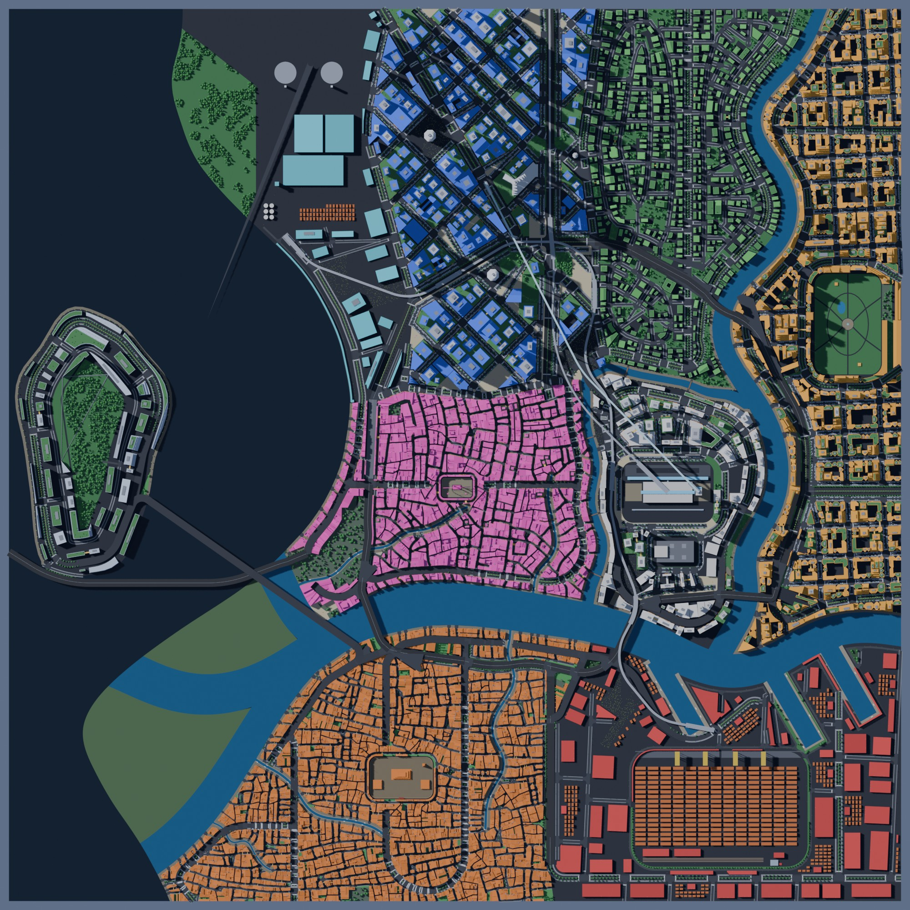
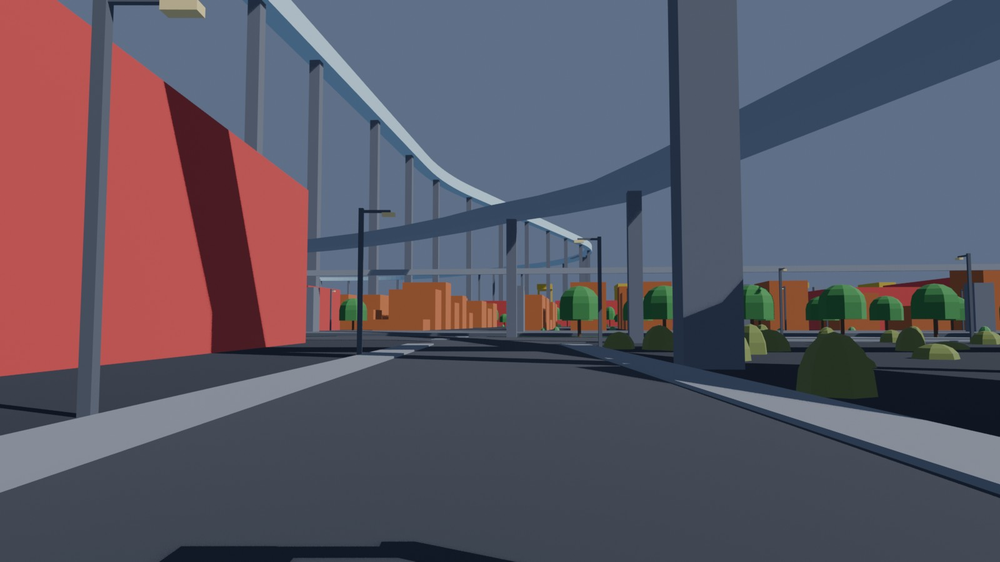
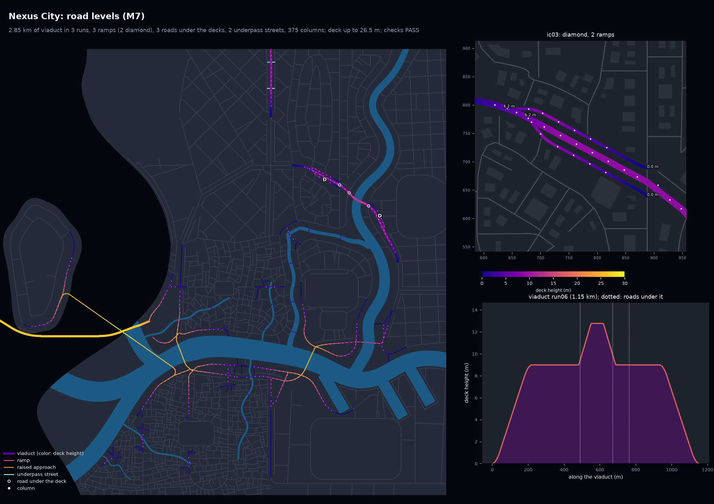

# M7a: Elevated highways, ramps and interchanges

M7a lifts the busiest highway stretches onto viaducts (scope sections 5.2 and 9, M7 row of
section 12). Ramps join them to the avenues, other roads pass under, columns hold up every
raised deck, and the blockout draws it all. M7b (next) adds the trumpet and partial
cloverleaf templates, the art-direction loop and the Corporate Core pinned import.

```bash
.venv/bin/python -m citygen build cities/vesper_bay/city_spec.json out/vesper_bay --blockout
```

All five sample cities pass all 65 checks, five of them new. Every model is byte-identical
on the M4 Mac and in the x86 Linux container.

| Nexus City from above | Beside the viaduct (Delta Megacity) |
|---|---|
|  |  |



Each city folder holds:
- `preview_elevated.png`: the road levels. The map colors every raised road by its deck
  height, marks the interchanges (D diamond, T tee stub, B direct branch, O overpass), the
  columns and the underpass streets; an inset shows one interchange, and a profile shows the
  viaduct with the most roads under it.
- `render_top.jpg`, `render_iso_d01.jpg` and `render_street_<n>.jpg`: the Blender blockout.
  One street view now looks at a viaduct from a road beside it.
- `report.txt` and `report.json`: the build report, with an elevated-highway section.
- `blockout_report.txt`: the blockout report.
- `trace.json`: the stage hashes.

## The samples

| City | Viaduct | Runs | Ramps | Interchanges | Overpasses | Highest deck | Other raised roads | Underpass streets | Columns |
|---|---|---|---|---|---|---|---|---|---|
| Saltreach Free Port | 1.85 km | 2 | 1 | 1 diamond | 1 | 26.5 m | 12.97 km | 1 | 345 |
| Delta Megacity | 2.09 km | 2 | 2 | 1 diamond | 2 | 12.6 m | 14.83 km | 4 | 245 |
| Nexus City | 2.85 km | 3 | 3 | 2 diamond | 3 | 26.5 m | 14.70 km | 2 | 375 |
| Greyhook | 1.17 km | 1 | 0 | none | 0 | 10.3 m | 4.95 km | 4 | 106 |
| Vesper Bay | 1.25 km | 1 | 4 | 2 diamond | 2 | 9.0 m | 9.04 km | 0 | 200 |

"Other raised roads" are the bridge approaches and the streets ramping up to raised
junctions. Every report lists, in its notes, the ramps and underpass streets that could not
be built and why.

## How it works

The stage is `citygen/elevated.py`. It runs at the end of the primary road network (M1b), so
local streets, buildings, transit and props all see the final road heights.

1. **Selection.** Highways are chained into corridors, straight on through their nodes. Along
   each corridor, windows long enough for two end ramps are scored:
   - by how many ramps they could hold;
   - then by the density of the districts they serve (the tallest archetype height);
   - then by length.

   Windows are taken until `highways.elevated_share` of the highway length is up. The
   shortest window is
   $L_{\min} = 2\,L_{\text{ramp}}(9\,\text{m}) + 60\,\text{m} + 120\,\text{m}$, where
   $L_{\text{ramp}}(\Delta h) = 20\,\text{m} + \dfrac{\Delta h}{0.05} + 20\,\text{m}$
   (a landing, the climb at the 5% design grade, half a vertical curve).
2. **Nodes on a run.** Each node inside a run becomes one of:
   - **plain:** no other road;
   - **cross:** two avenue legs on opposite sides, nearly straight, at a skew of 35 degrees
     or more (a diamond, or an overpass where no ramps fit);
   - **tee:** one avenue leg (a diamond whose stub passes under the deck);
   - **branch:** another highway (it climbs on its own segment, a direct connection);
   - **split:** the run ends there.
3. **Profiles.** The deck top is at level 1 (9 m) between the ends:
   - a ground end ramps down; an edge end stays up; an end on another deck matches it;
   - vertical curves are a 40 m moving average; nothing is steeper than 6%;
   - the deck humps over raised roads it crosses (level 2) when its ends leave room;
     otherwise the other road rises over the run.
4. **Bridge approaches.** A network grade solver replaces M1b's placeholder ramps. Every
   bridge deck falls off at 5.5% along the roads in every direction, through the nodes (a
   max-plus envelope over the graph), so no road is steeper than that grade. Roads that cross
   without a node end up at least 7 m apart: the higher one rises over the other.
5. **Interchanges.** Diamonds: one-lane, one-way ramps, 7 m wide, right-hand traffic,
   leaving the deck over a 60 m taper. Each ramp follows the deck through the taper, takes
   the shortest span that reaches the ground, and lands on an avenue leg:
   - on dry land, at grade;
   - at least 30 m from the far node;
   - crossing it at a skew of at least $\sin^{-1} 0.7$.

   A node keeps both ramps or none, so no lane dead-ends.
6. **Re-noding.** The network is rebuilt from coordinates: runs split at their ramp gores,
   avenues split where the ramps land, overpass nodes removed (`attrs.overpass_at` keeps the
   points). Ramps are `road.highway.ramp` with `role`, `interchange` and `template` attrs.
7. **Local streets (M2).** Ramps get no frontage streets. Streets pass under decks with
   7.3 m or more of height. Underpass streets go under a viaduct every 200 m between its
   frontage streets. A local street may join a primary road at most 3 m up, ramping at 5%.
8. **Supports (after transit).** Columns every 32 m along every raised deck over land (2.5 m
   for highways, 2.2 m for avenues, 1.8 m otherwise). Each one is placed at the first free
   spot among offsets along and across the deck: never in the water, a building, a transit
   structure, a road or junction under the deck, or between tracks.
9. **Retries.** A city that fails a check is built again on the same roads with the local
   layout drawn again (three layout salts), then on other road networks; the best try is
   kept and the report says which.

The other stages adapt:
- **Transit:** routes see the overpasses as graph nodes and pass under high road decks where
  that is cheaper.
- **Buildings:** skybridges and straddle buildings clear the local road height.
- **Props:** street lights under a deck become lamps hung under it.
- **Trees:** capped under every raised road.

## Blockout

- **Viaducts:** decks drawn at their profile height on columns from the model.
- **Embankments:** raised streets up to 3 m are drawn as solid embankments.
- **Bridge piers:** only over water.
- **Collections:** an `Elevated` collection holds the viaducts, ramps and columns.
- **Views:** a street view from a road beside the longest viaduct, looking up at its deck.

## Checks

| Check | What it tests |
|---|---|
| `road_grades` | every road at most 6% steep along its z profile (footbridge stairs aside) |
| `level_continuity` | every road meets its nodes at their height |
| `deck_clearance` | where roads cross without a node, 5.5 m clear under the upper deck (3 m over a pedestrian street) |
| `ramps_land` | every ramp is one-way and joins a viaduct at deck height to a ground road at the ground |
| `road_supports` | columns under every raised deck over land, at most 60 m apart, none in a lane, a road or junction under the deck, a building, the water or a transit structure |

`tests/test_elevated.py` builds the small test city and checks the result. It also:
- fails every check on a broken copy of the model;
- tests the ramp length, the smoothed profile grades and the grade solver;
- checks that the blockout draws the viaducts and columns.

## Open items for M7b

- **Templates:** trumpet (highway meets highway) and partial cloverleaf (loop ramps where a
  diamond does not fit).
- **Interchange count:** many candidate ramps are lost to water, skewed legs or nearby nodes
  (see the report notes), so the samples have one or two diamonds each.
- **Art direction:** the art-direction loop and the Corporate Core pinned import.
