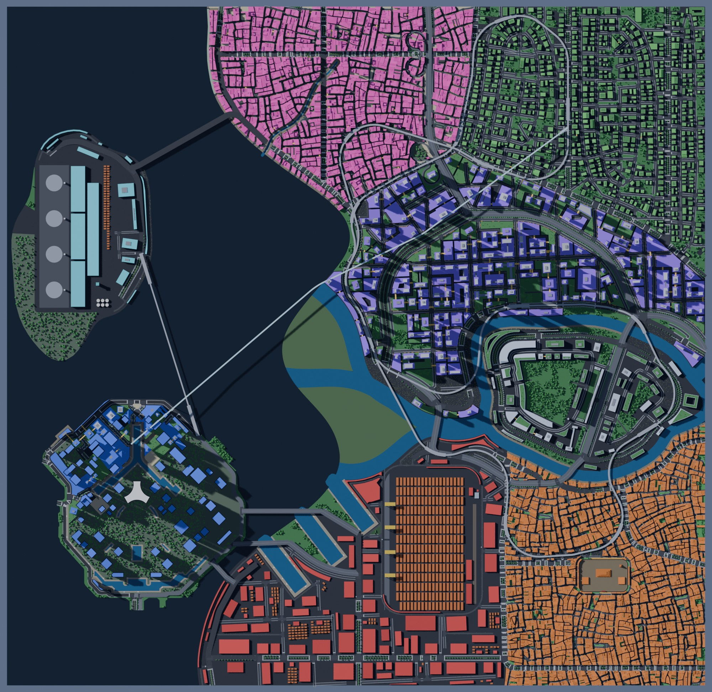
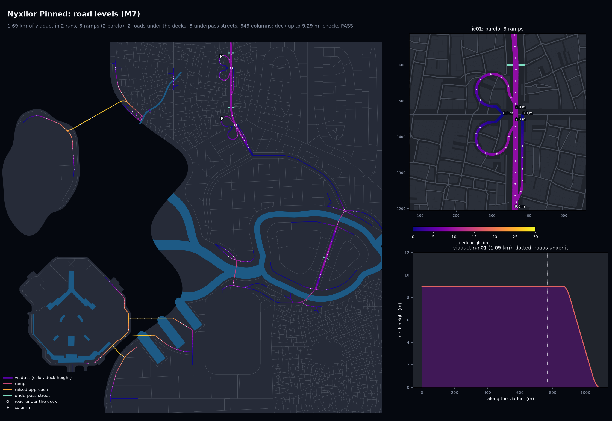
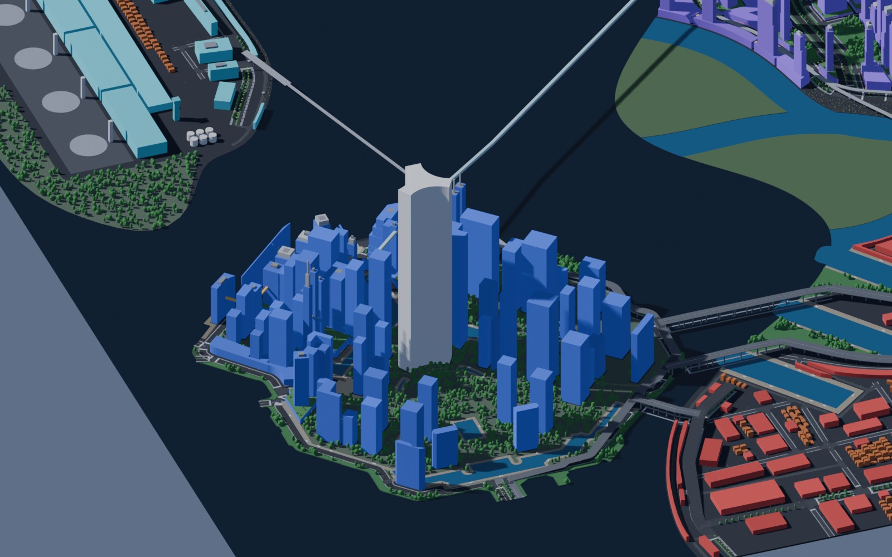
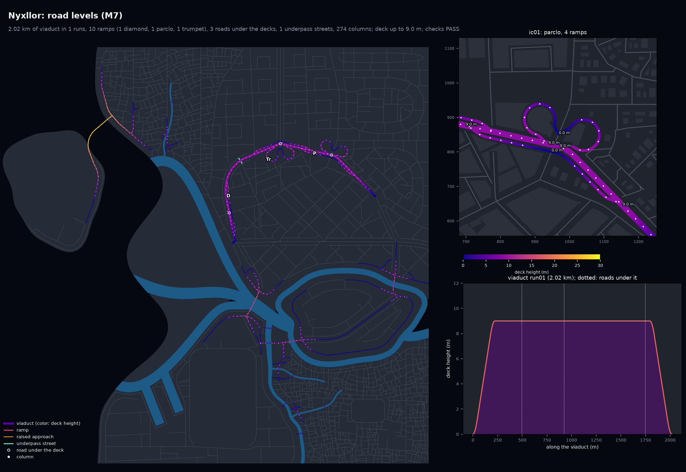
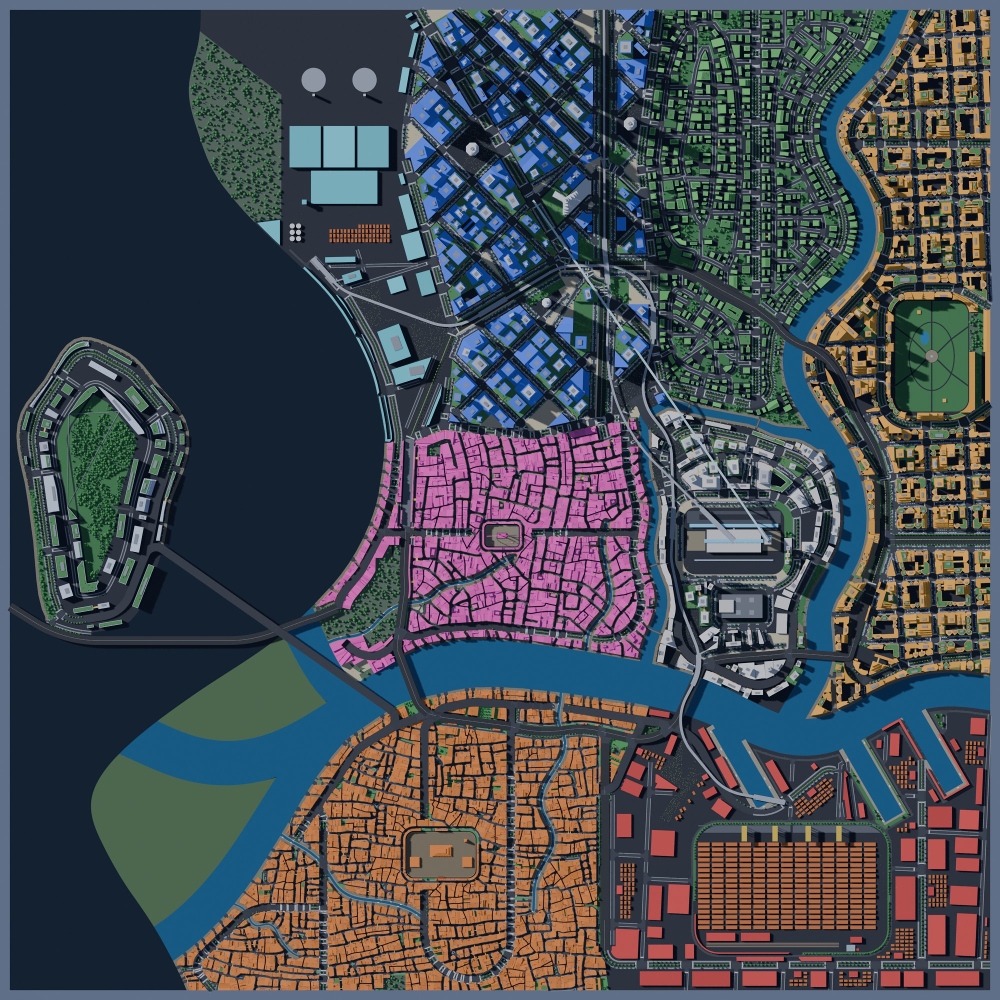
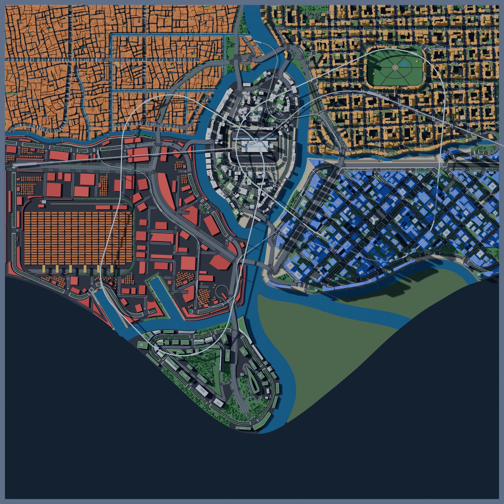
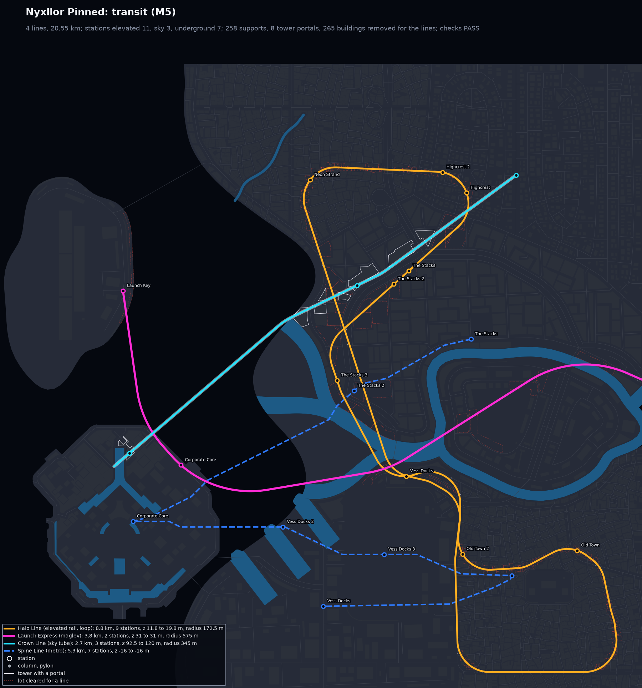
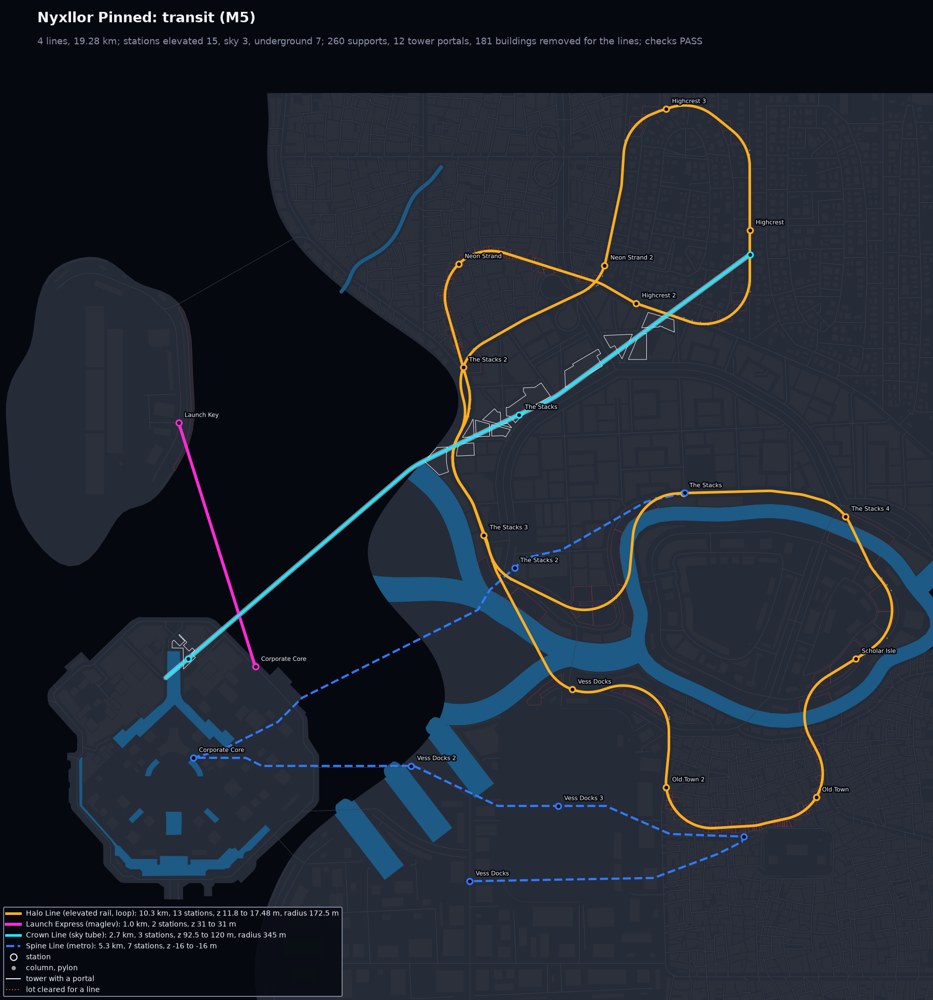

# M7b: Pinned import, loop interchanges and the art-direction loop

M7b completes the M7 row of the scope (sections 4.3, 5.2 and 9, M7 row of section 12):
- **Pinned import:** the hand-traced Corporate Core imported as fixed geometry, with the city
  built around it.
- **Interchanges:** two more templates, partial cloverleaf and trumpet.
- **Art-direction loop:** a review sheet per round.

```bash
.venv/bin/python -m citygen build docs/progress/M7b/nyxllor_pinned/city_spec.json out/pinned --blockout
.venv/bin/python -m citygen review out/pinned --spec docs/progress/M7b/nyxllor_pinned/city_spec.json
```

All six cities pass all 65 checks: the five samples and the pinned demo, so three or more
prompts pass the full validation suite. Every model is byte-identical on the M4 Mac and in
the x86 Linux container.

| Nyxllor with the traced Corporate Core (from above) | Its road levels |
|---|---|
|  |  |

The traced island in the blockout: the megatower, the traced towers and water pockets, the
sky tube and the maglev leaving it:



Nyxllor itself now has all three templates on one viaduct: a diamond (D), a partial
cloverleaf (P) and a trumpet (Tr):



| Nexus City from above | Delta Megacity from above |
|---|---|
|  |  |

Each city folder holds:
- `preview_elevated.png`: the road levels, now with P (partial cloverleaf) and Tr (trumpet)
  next to D, T, B and O.
- `render_top.jpg`, `render_iso_d01.jpg` and `render_street_<n>.jpg`: the Blender blockout.
- `report.txt` and `report.json`, `blockout_report.txt`, `trace.json`.

The pinned demo also has its spec (`city_spec.json`), `preview_map.png`,
`preview_heights.png`, `preview_transit.png` and the three art-direction sheets.

## The samples

| City | Viaduct | Runs | Ramps | Interchanges | Overpasses | Highest deck | Other raised roads | Underpass streets | Columns |
|---|---|---|---|---|---|---|---|---|---|
| Saltreach Free Port | 1.85 km | 2 | 1 | 1 diamond | 1 | 26.5 m | 12.97 km | 1 | 345 |
| Delta Megacity | 2.09 km | 2 | 3 | 1 diamond, 1 parclo | 2 | 12.6 m | 14.34 km | 4 | 256 |
| Nexus City | 2.85 km | 3 | 3 | 2 diamond | 3 | 26.5 m | 14.70 km | 2 | 375 |
| Greyhook | 1.17 km | 1 | 0 | none | 0 | 10.3 m | 4.95 km | 4 | 106 |
| Nyxllor | 2.02 km | 1 | 10 | 1 diamond, 1 parclo, 1 trumpet | 3 | 9.0 m | 10.66 km | 1 | 274 |
| Nyxllor Pinned | 1.69 km | 2 | 6 | 2 parclo | 2 | 9.3 m | 13.43 km | 3 | 343 |

Against M7a, Nyxllor goes from 4 ramps to 10, and Delta Megacity's second node, where no
diamond fit, is now a partial cloverleaf.

## Pinned import

A spec pins a traced district to an island:

```json
"islands": [{"name": "Core Island", "position": "south", "setting": "nearshore",
             "pinned": {"source": "maps/corporate_core_v1.0.1.svg", "rotation_deg": 0}}]
```

The district placed `on_island` there is the traced one. `citygen/pinned.py` reads the SVG in
the `maps/` conventions (layers matched by name). It has its own path parser (all of M, L, H,
V, C, S, Q, T, A and Z, absolute and relative; arcs through `dmath`, curves in 8 pieces), so
the import is the same bytes on every machine.
- **Frame:** the land's bounding box center is the origin, y up; the island is moved and
  turned onto the 0.01 m grid.
- **Land and water:** the coast path is the island, placed in the sea with its exact traced
  outline. The outline survives the land opening that rounds every other coast. Its holes
  (the water pockets) become ornamental basins.
- **Roads:** traced roads enter M1b as drawn, with role `pinned`. Every clean-up keeps them.
  The curve and segment checks skip them, and no viaduct is laid on them. A road drawn off
  the coast runs straight on, up to 900 m, to the next district land. There it joins a road
  within 120 m (snapping to a junction within 40 m), or runs 60 m on and is routed to the
  network. Routing never crosses the island, so generated roads reach it only by these
  traced spokes.
- **Streets:** traced highways are at grade, so M2 treats them as avenues: they take local
  junctions, sidewalks and crosswalks. Their cross section keeps the traced width, with two
  lanes each way and a median from 22 m.
- **Lots and buildings:** each traced building gets its own lot (`blk000`), and local
  streets keep 15 m from them. M3 builds them as prisms: the label height, else the legacy
  auto-height rule within the district's range, in 5 m steps. The `megatower` is the
  landmark at 480 m. Where two traced footprints overlap, the later one gives way (a report
  note). Transit never removes a traced building in a line's way.
- **Checks:** a traced district keeps all checks except those about generated layout (lot
  sizes and frontage, block size and open share, heights). They are listed in each check's
  text.

The demo keeps Nyxllor's prompt but moves the Corporate Core to a nearshore island in the
south, joined by the traced spokes:
- 57 traced buildings and 10 traced roads;
- one sky tube line from it through The Stacks to Highcrest.

Six traced spokes end in the sea, with no land within 900 m; the report lists them.

## Partial cloverleaf

Where a diamond ramp on one side of a cross node does not fit (water, a nearby node, a
skewed leg), that side gets two loop ramps instead, one in each quadrant.
- **Loop:** a 270 degree arc that leaves the run on its tangent. The radius comes from the
  climb:

$$R = \max\left(35\,\text{m},\ 5\left\lceil \frac{L_{\text{ramp}}(z) - 30\,\text{m}}{1.5\,\pi \cdot 5\,\text{m}} \right\rceil \text{m}\right)$$

  The arc is searched along the run in 5 m steps until it clears the run and the avenue.
- **Lead:** 10 m inward, then to a terminal on the avenue at lateral offset $o + R - 30$ m.
  Both loops of a side share the terminal.
- **Clearance:** checked on the loop body (the taper aside). The two arcs are checked
  against each other.

## Trumpet

At a T where the stem is a ground highway, a diamond would put a stub under the deck with
nowhere to turn. Instead:
- the stem passes under the deck to a stub end;
- on the far side, two loops climb from the stub end to the deck, one per direction;
- on the near side, diamond ramps.

This is a simplification of the textbook trumpet (one loop and one flyover): two far loops
keep every ramp single-lane and at grade where it lands.

## Art-direction loop

citygen makes no model call, so the loop is run by the Claude Code session through the
skill (step 6). For each round:
1. **Build:** `citygen build`.
2. **Review sheet:** `citygen review <out> --spec <spec> [--prev <previous out>]` writes
   `review.md` and `review.json`:
   - the checks;
   - the key numbers for the city and each district, next to the previous round's;
   - the spec changes since that round (`citygen spec diff A B`);
   - the previews to open;
   - a table from what a reviewer may see to the spec parameters that change it.
3. **Change the spec:** the session reads the previews against the prompt and the concept
   image and changes spec parameters, never code.

Three rounds at most. The last round says what is still off.

The pinned demo used all three rounds. In `nyxllor_pinned/`, `review_round<n>.md` is each
round's sheet and `review_round<n>_transit.png` its transit map (round 3's is
`preview_transit.png`):
- **Round 1:** every check passed, but the Launch Express (maglev) turned back. It came in
  from the east exit, hooked around the island's corner to its station, and turned north to
  the spaceport on Launch Key.
- **Round 2:** the maglev became Corporate Core to Launch Key, one straight run across the
  bay. But the Halo Line (elevated rail, stops Neon Strand, The Stacks, Highcrest, Old Town)
  no longer closed and looped back on itself near The Stacks.
- **Round 3:** the Halo Line runs clockwise instead (Neon Strand, Highcrest, Old Town, The
  Stacks), and the loop closes. Every check passes.

Still off after the last round: the Halo Line crosses itself twice, near Neon Strand and near
The Stacks.

| Round 1 | Round 2 | Round 3 |
|---|---|---|
|  |  |  |

## Fixes found in review

- **Junction polygons at ramp gores:** a ramp leaves its deck at a few degrees, so the
  corner fillet's tangent run $r\,(1 + \cos\varphi)/\sin\varphi$ ran for hundreds of meters.
  Some junction polygons in the M7a samples reached 150 to 450 m, and one avenue junction in
  Nexus City reached 979 m. Each corner is now chosen in order:
  - the fillet, when its run fits $\min(0.45\,L, 60\,\text{m})$ on both legs;
  - else the sharp corner where the curb lines meet, when that fits;
  - else the node itself (a gore).

  `tests/test_elevated.py` keeps every junction within 120 m of its node.
- **Columns:** a gap-filling pass adds a column wherever two along a deck are more than 60 m
  apart (crowded parclo crossings, short overpass segments with a road under their whole
  length). It searches ±30 m along the deck and across it, past the segment's end nodes onto
  the raised segments there.
- **Traced buildings and transit:** an elevated line no longer removes a traced building in
  its way.

## Open items

- **Hand-tracing work:** the Corporate Core tracing has no avenues, streets, plazas or parks
  yet (see CLAUDE.md), so the traced island is its ring and spoke highways and its
  buildings. The generator adds no local streets on the island, only a few buildings on
  leftover ground.
- **Highway hooks at the map edge:** some new specs show these at other seeds (M1b); the
  samples do not.
- **Trumpet flyover:** a true one-loop-and-flyover trumpet would need a two-level ramp.
- **Elevated rail loops:** a loop line can cross itself where a district's stations are
  far apart, and its route moves with unrelated lines (the pinned demo's Halo Line changed
  when only the maglev route changed). Transit routing (M5) could keep a loop simple.
