# M8a: Robustness sweep

M8a builds many cities at many seeds, groups the failures by cause and fixes the causes in the
generator. Specs are never edited.

```bash
.venv/bin/python -m citygen sweep --out out/sweep --workers 4          # the m8a suite
.venv/bin/python -m citygen sweep cities/nyxllor/city_spec.json --seeds 11,404 --out out/s
```

`citygen sweep` (`citygen/sweep.py`) runs one build per worker process (`CITYGEN_WORKERS=1`
inside it, so `--workers` is the whole CPU budget). Each build is listed with:
- pass or fail;
- the failing checks with their first failure;
- the retries it used: hydrology variant (hv), road variant (rv), the full-city tries with the
  failure count of each (from the report's new `city_tries` stat), the layout salt;
- build time and the sha256 of `city_model.json`;
- the traceback when it crashed.

It writes `sweep.md` and `sweep.json` after every build, plus each build's report and previews.
The `m8a` suite has 68 builds:
- the five sample cities and the pinned demo, each at its own seed and at seven more
  (11, 404, 1999, 3141, 5077, 8128, 27182);
- the test specs `SMALL`, `MINIMAL`, `PINNED` and `DELTA`, each at its own seed and four more.

## Results

| | before (main + PR 14) | after (M8a) |
|---|---|---|
| builds passing every check | 33 of 68 (49%) | 49 of 68 (72%) |
| passing apart from transit checks (M8b's area) | 37 (54%) | 57 (84%) |
| crashes | 1 | 0 |
| samples and pinned demo at their own seed | 6 of 6 | 6 of 6 |

Full tables: [`sweep_before.md`](sweep_before.md) and [`sweep_after.md`](sweep_after.md).

Builds passing every check, per spec:

| spec | before | after |
|---|---|---|
| archipelago_free_port | 4 of 8 | 6 of 8 |
| delta_megacity | 3 of 8 | 3 of 8 |
| nexus_city | 1 of 8 | 6 of 8 |
| peninsula_city | 5 of 8 | 6 of 8 |
| nyxllor | 5 of 8 | 7 of 8 |
| nyxllor_pinned | 3 of 8 | 4 of 8 |
| test_small | 4 of 5 | 5 of 5 |
| test_minimal | 0 of 5 | 2 of 5 |
| test_pinned | 3 of 5 | 5 of 5 |
| test_delta | 5 of 5 | 5 of 5 |

18 builds were fixed and 2 broke (archipelago s1999 and s27182, see the open items).

Failing checks, builds per check:

| failing check | before | after |
|---|---|---|
| transit_curves | 9 | 9 |
| placement | 10 | 5 |
| curve_radius | 12 | 3 |
| open_space_share | 3 | 3 |
| road_graph | 3 | 3 |
| level_continuity | 4 | 2 |
| transit_stops | 3 | 2 |
| bridge_clearance | 3 | 1 |
| transit_altitude | 2 | 1 |
| districts_served | 1 | 1 |
| lot_block_sizes | 1 | 1 |
| megasite_access | 0 | 1 |
| walkway_graph | 0 | 1 |
| megasite_contents | 7 | 0 |
| named_bridges | 6 | 0 |
| district_shares | 3 | 0 |
| island_sizes | 3 | 0 |
| building_clear_zones | 2 | 0 |
| road_avoidance | 1 | 0 |
| road_duplicates | 1 | 0 |
| (crash) | 1 | 0 |

All six cities pass all 65 checks. Each `city_model.json` is byte-identical on the M4 Mac and in
the x86_64 Linux container (`citygen-x86`):

| city | sha256 of city_model.json | tries to pass |
|---|---|---|
| archipelago_free_port | `7440ed69bd8b…` | 1 |
| delta_megacity | `e2ad9fda68bf…` | 9 (hv0 rv3, after hv12 rv3 and hv0 rv0 with four layouts each) |
| nexus_city | `21ff683f3863…` | 3 |
| nyxllor | `4b12c6f1becb…` | 8 |
| nyxllor_pinned | `cc7835adef66…` | 2 |
| peninsula_city | `be876b719918…` | 1 |

`tests/data/golden_hashes.json` holds the new hashes of the five samples and their blockout
plans. Delta Megacity and Nyxllor pass only because a failing city now tries more layouts and
road networks (`CITY_RETRIES` 4 to 8); with 4 they would fail. The report does not record which
checks the earlier tries failed. M8b reports that with its transit polish both cities pass on
their first layout on its own base; Delta Megacity has to be checked again after stacking,
since M8a moves it to another hydrology variant.

## Fixes

| Defect (sweep evidence) | Cause | Fix |
|---|---|---|
| **Highway hooks at the map edge** (delta s5077; curve_radius 44 to 119 m at exits) | An exit lies on the map border, which `contains()` leaves out, so the route took its own start for water. It built a "crossing" from the exit to a bank point further along the edge, and the road ran along the edge before turning in. | The route's own ends use `covers()`. Every route from an exit enters square to the edge: a fixed straight of the approach plus the turn tangent, as at a bridge bank (`Fitter._edge_entry`). Exits prefer edge points with 150 m of clear land inland. Spine waypoints snapped next to the start exit are dropped. |
| **Bridge landing kinks** (archipelago s404, 12 m avenue curve) | The shortest crossing landed beside a port slip, with no room for its straight approach. | A crossing whose bank has no room on the bridge axis (approach plus a quarter of the class minimum radius) is taken only when nothing else crosses. |
| **Islands not built** (archipelago s11, s3141, s8128) | A 1 km² island at its drawn proportions did not fit in the strip beside the central island. Its district fell back onto the mainland. | An island that would otherwise not be built is tried as the same area, longer (axis ratio 1.4, then 1.65), in eight directions. Placement then retries with each missed island first. Tries rank by islands left out, then bearing misses. Islands that were built before keep their exact shape. |
| **Island cut off from the roads** (nexus s404, s8128: Silver Island empty) | Several causes together. Roads crossing out on the water counted as meeting (`_road_groups`), so no connector was built. A bridge clipping the island's tip counted as reaching the island. The named bridge was taken as built where another bridge only crossed it, and it landed on that clipped tip. | Road groups meet only on land. A landmass counts where a road runs on it for more than 45 m. Named bridges end 40 m inland and split only at roads on land. They are matched to bridges by alignment. A span over a district's tip is a last resort. |
| **Junction out on the water** (nexus s404) | `_unnode_water` grade-separated a four-way water crossing only when its pieces came from two source roads. | When the pieces come from more roads, the straightest continuations are paired. |
| **Crash `KeyError: -1`** (nexus s8128) | A cross interchange side with loops only (its diamond terminal failed) has no terminal. | Sides without a terminal are skipped. |
| **Level step under a viaduct** (archipelago s8128, 9 m) | At a tee where ramps land on the avenue and nothing continues under the deck, the avenue's tail past the ramp terminal ended exactly under the viaduct. M2's exact noding then joined it to the deck. | The tail is trimmed at the nearest ramp terminal. |
| **Level step on a loop road** (archipelago s11, delta s5077; 11.5 m) | M2 split a closed waterfront loop. The piece at the loop's seam projected to s = 0 instead of the loop length and got the whole z-profile. | The seam end takes whichever value keeps the piece its own length. |
| **Footbridge level steps** (archipelago s404, delta s4412) | Footbridges were left out of M7's local grades, so a lifted node met a footbridge end at 0 m. Water reaching a footbridge's end also kept the deck height at the end node. | Footbridge ends follow their nodes. Both ends of the stair profile stand on the ground. |
| **Service ring over water** (test_small s404) | The 0.5 m clip margin let a reserve ring graze a river bank. | The clip region leaves the water out. |
| **Duplicate primary roads** (peninsula s11) | A connector and a waterfront avenue left one node side by side for 286 m. | `roads._merge_forks`: the lesser road branches off the other 50 m before they part. |
| **Freight terminal without rail** (delta s11, s8128, nyxllor s11, MINIMAL) | The rail yard was tried at one span only. | Shorter yards where the reserve's land side is cut back. |
| **Placement failing in every variant** (MINIMAL s404) | Relation repair only swapped seeds. Also, `partition` moves the seeds it is given, so the kept partition was not the trial that passed. | Seeds also move apart along the asked direction, or the district is placed along it from the other one. Trials run on a copy. A repair is kept only when the final partition has fewer failures. |
| **No road network on the chosen variant** (MINIMAL s11, s1999: an exit edge without land) | The variant search stops at the first good variant, even when no road network on it passes. | The next variants are tried in index order; the first that passes with its roads wins. |
| **curve_radius at an elevated tee** (nexus s8128) | The check joined M7's split pieces through a junction and measured the junction's kink. | Junctions inside a joined chain count as junction areas, as the check describes. |

Tests: `tests/test_m8a.py` pins each defect to the seed that showed it. It also covers the
footbridge profile and the sweep table.

| Exit hook at the map edge, before and after (delta s5077) | Kettle Island now built (archipelago s8128) |
|---|---|
| 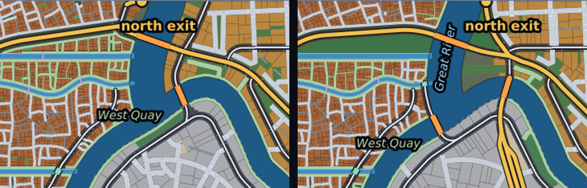 | 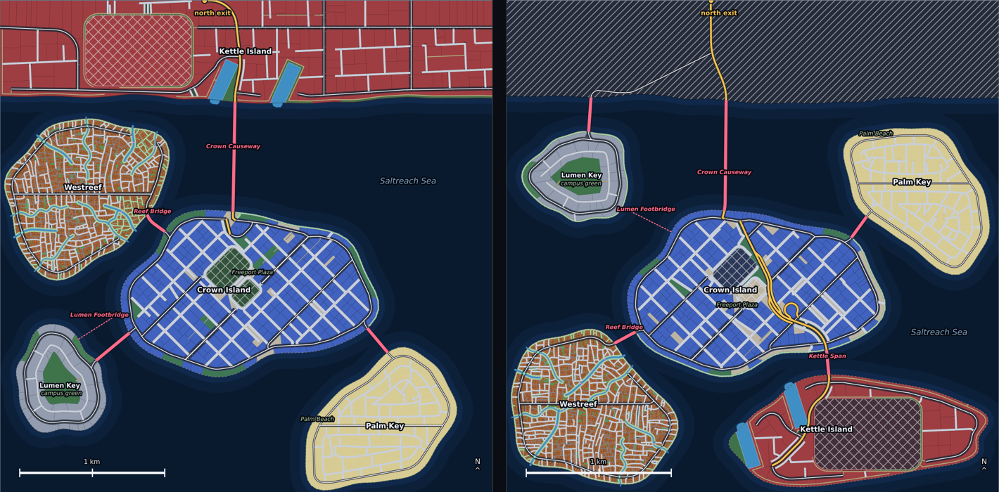 |

| Silver Island reached and built (nexus s404) | Bridge landing with room (archipelago s404) |
|---|---|
| 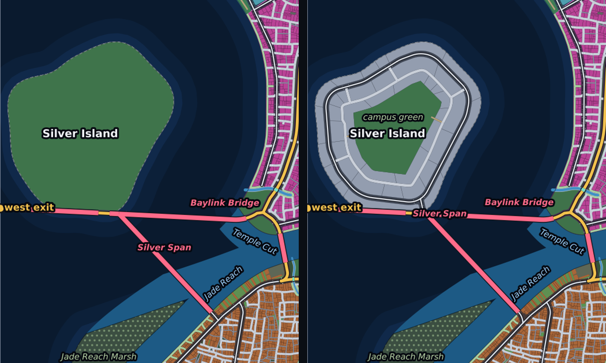 | 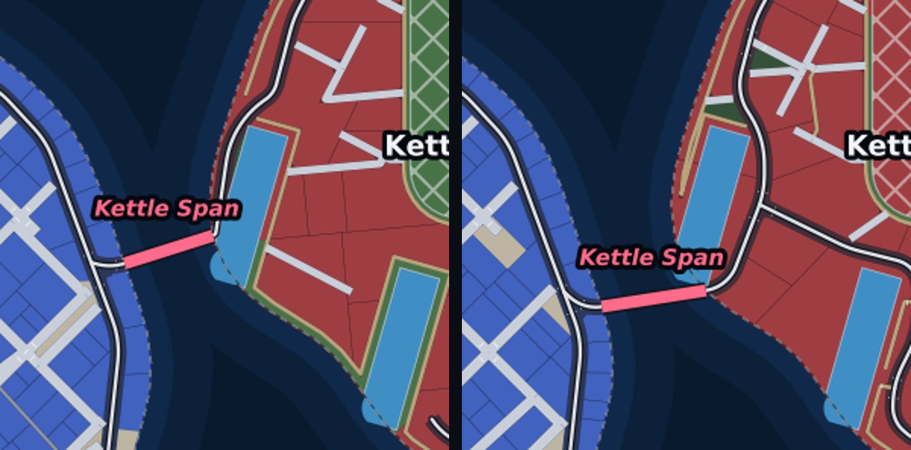 |

Side-by-side roads merged into one branch (peninsula s11):

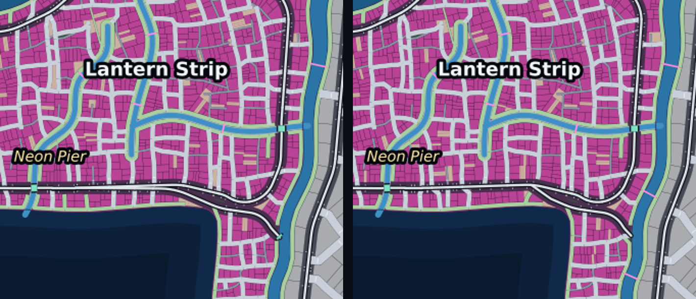

## The six cities

| Nexus City | Nyxllor |
|---|---|
| 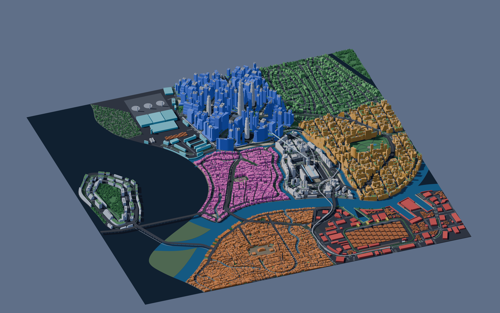 | 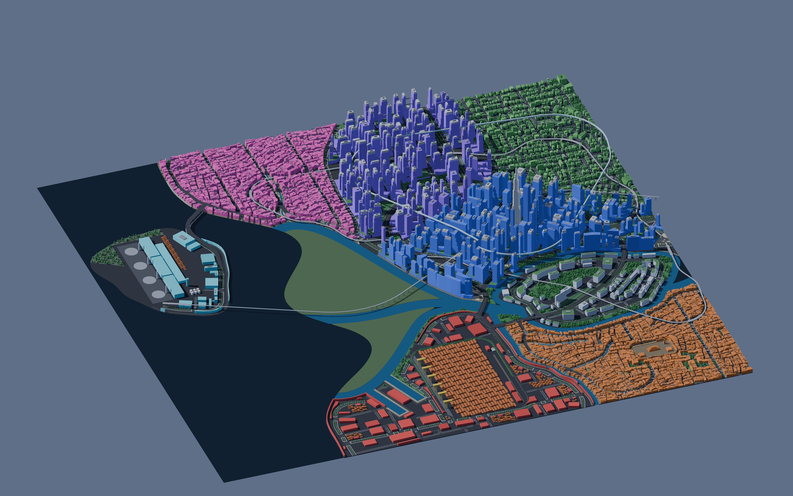 |

| Nyxllor with the traced Corporate Core | Delta Megacity |
|---|---|
| 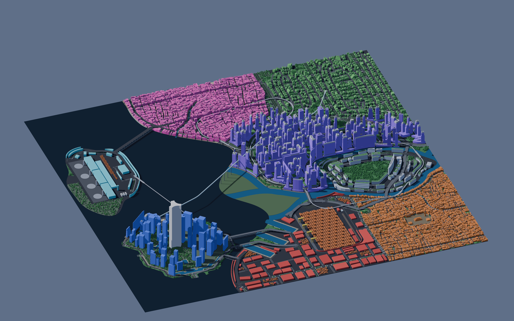 | 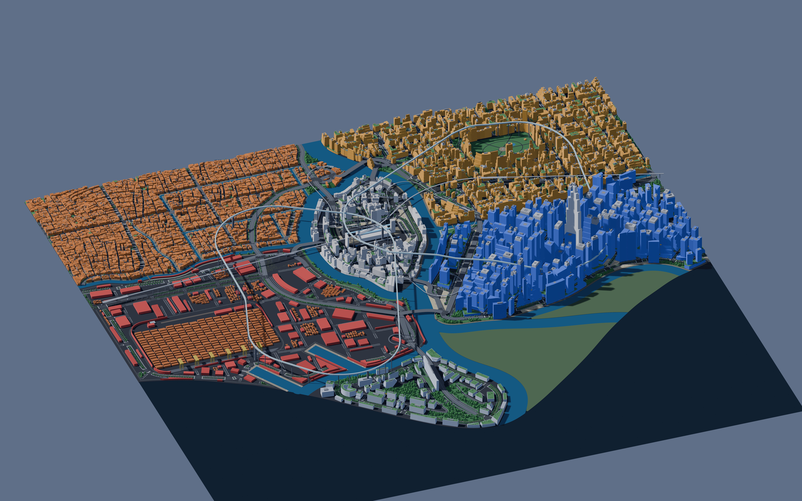 |

| Saltreach Free Port (archipelago) | Greyhook (peninsula) |
|---|---|
| 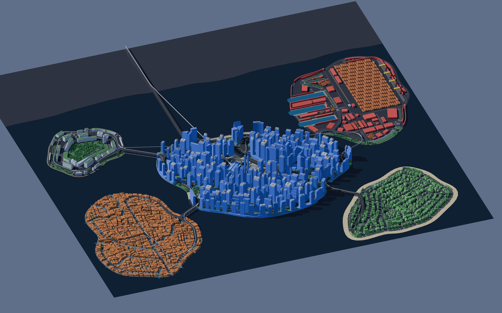 | 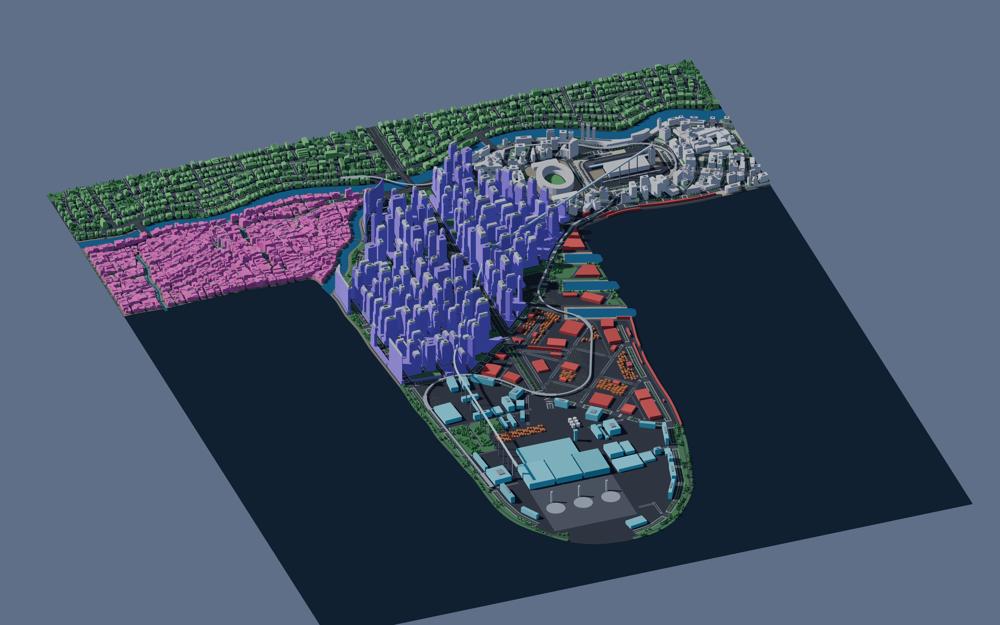 |

Each city folder has the previews, the build report, `trace.json`, `blockout_report.txt` and the
blockout renders (`render_iso_city.jpg` at 8K).

## Open items

- **Transit (M8b's area, 8 builds):** the Delta Loop sky tube at delta s11, s3141, s5077, s8128
  and s27182 (radius 15 to 187 m against 300 m; s3141 and s8128 also leave a district without a
  station); the East Shore Line at peninsula s8128 and s27182 (radius 41 and 107 m against 150 m;
  20.15 m altitude at s27182); the Island Hopper monorail at archipelago s27182 (12 m). No change
  was made to `citygen/transit.py`.
- **archipelago s1999 (broken by M8a):** after the island layout change an exit causeway clips
  Palm Key's tip, and no road reaches the island (road_graph, districts_served,
  open_space_share 100%). Two fixes in `connect_landmasses` were tried and reverted, since they
  changed passing cities.
- **archipelago s27182 (broken by M8a):** the island change moves the Island Hopper's stops; its
  transit radius is the only failure.
- **Highways squeezed at a coast:** curve_radius on nexus s11 (133 m), pinned s11 (111 m) and
  pinned s1999 (51 m on Launch Key, between the reserve and the coast). Pinned s11 also keeps a
  junction on a bridge beside the port slips.
- **Placement left after relation repair:** nexus s11 (Neon Market west of the Transit Nexus),
  pinned s5077 (Neon Strand on the coast), pinned s8128 (Highcrest east of The Stacks, across two
  landmasses), MINIMAL s42 and s3141 (Core at the center).
- **Level steps:** nexus s5077 (8.22 m where a street meets a raised node; before M8a this seed
  had no west exit, now a later hydrology variant has one) and pinned s5077 (11.87 against
  7.69 m).
- **Spaceport open share:** nyxllor s3141 (Launch Key 74% open against 50%), also MINIMAL
  s3141.
- **MINIMAL s404 and s3141:** the west exit is not built on any variant; s404 also has a
  one-node walkway component.
- **Build time:** Delta Megacity and Nyxllor take 5 to 7 minutes with `CITYGEN_WORKERS` 2 to 4
  (9 and 8 full-city tries), so the sample build-time test allows 600 s instead of 300 s.
- **Visual review:** previews were looked at for the failing builds and the known defects (the
  hook at the map edge, now pinned by a test); passing builds were not reviewed one by one, so
  visual defects that no check measures may remain.
- **One unexplained test failure:** one full `pytest` run failed `test_committed_reports_match`
  on archipelago_free_port (report `checks` and `stats` differed from the committed report while
  the model hash matched). It did not come back in three later runs (the test alone, after a
  SMALL build in the same process, and the full suite: 359 passed, 1 skipped).
