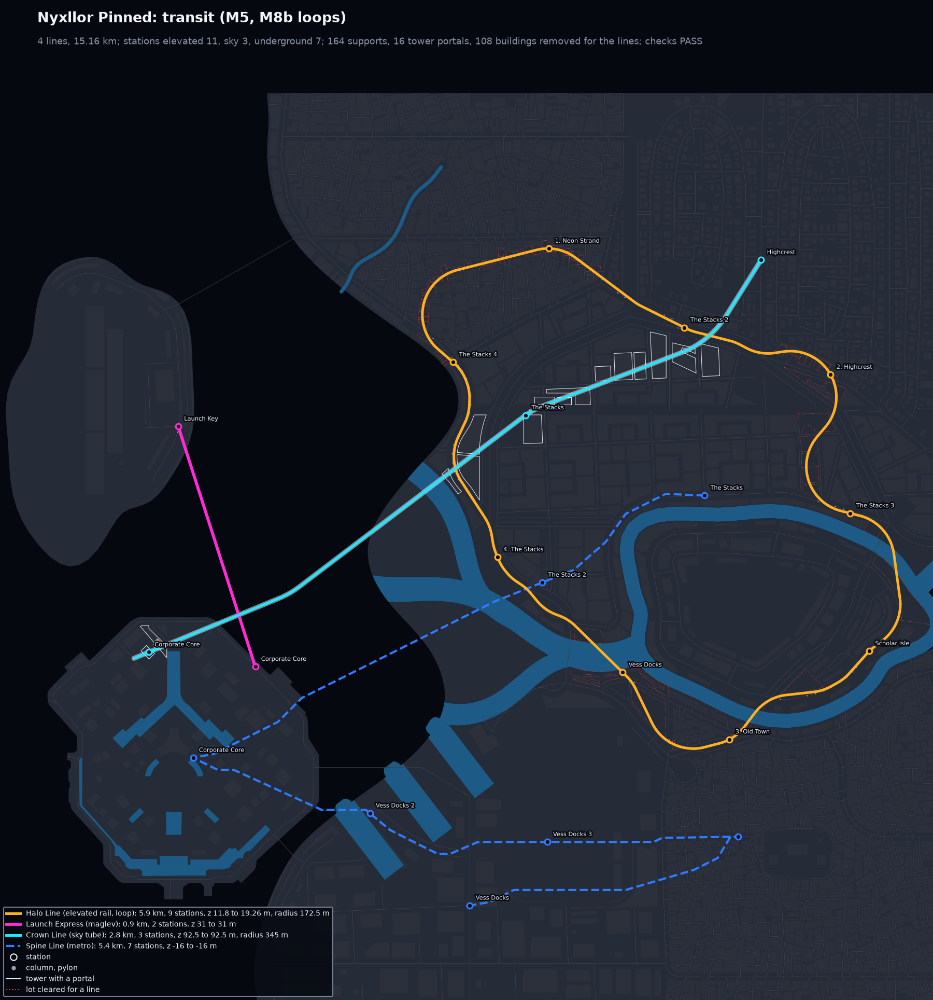
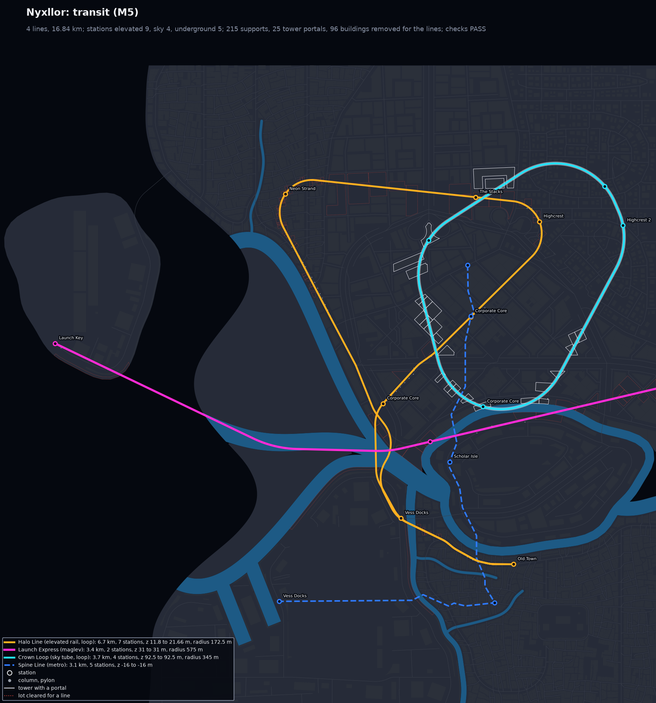
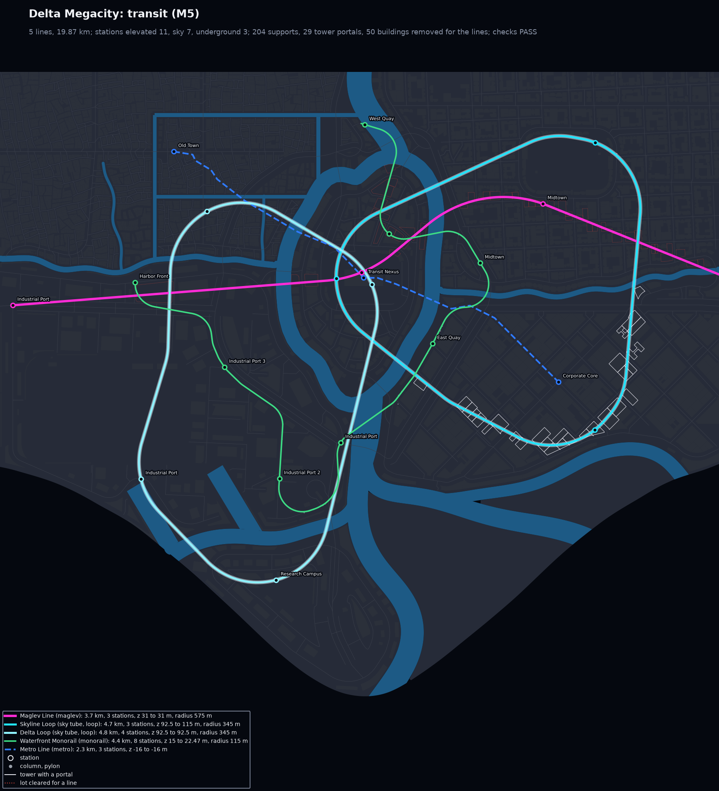
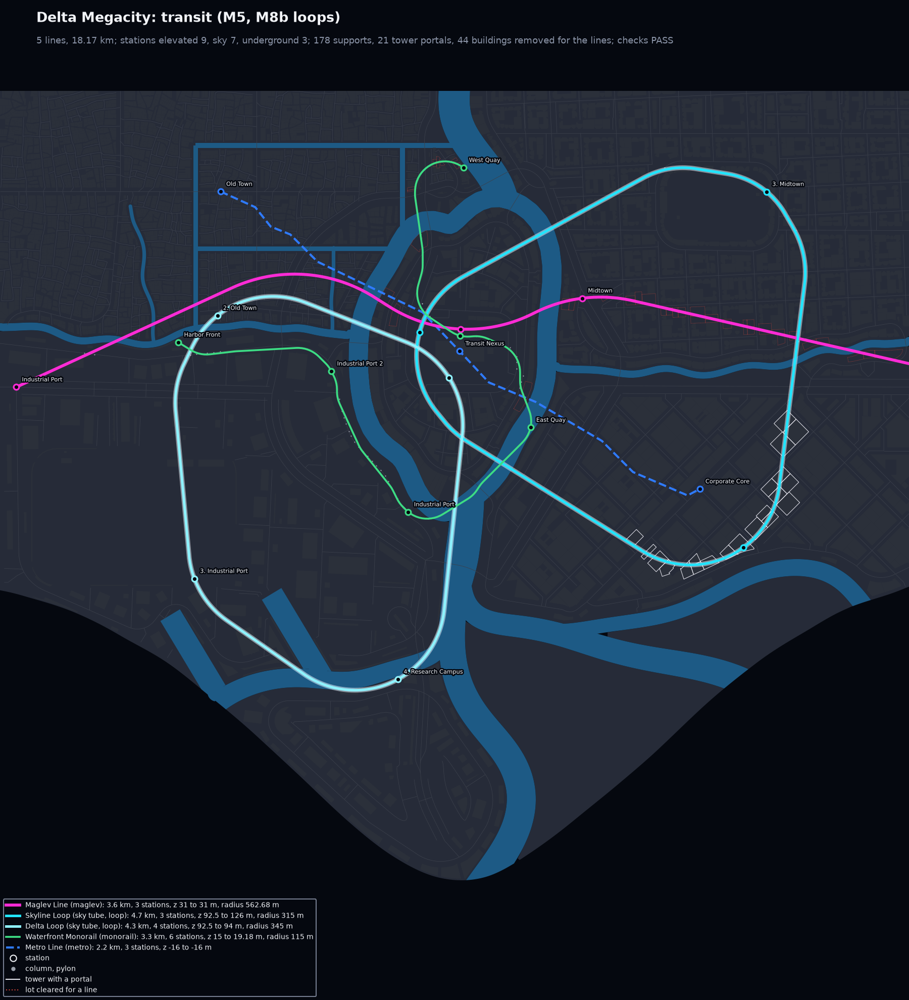
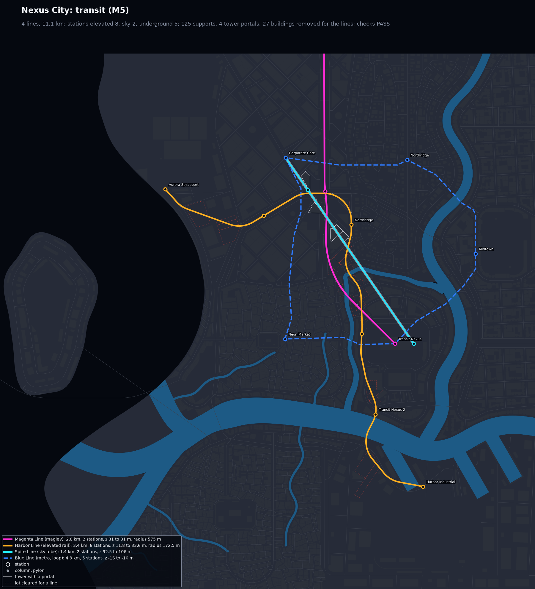
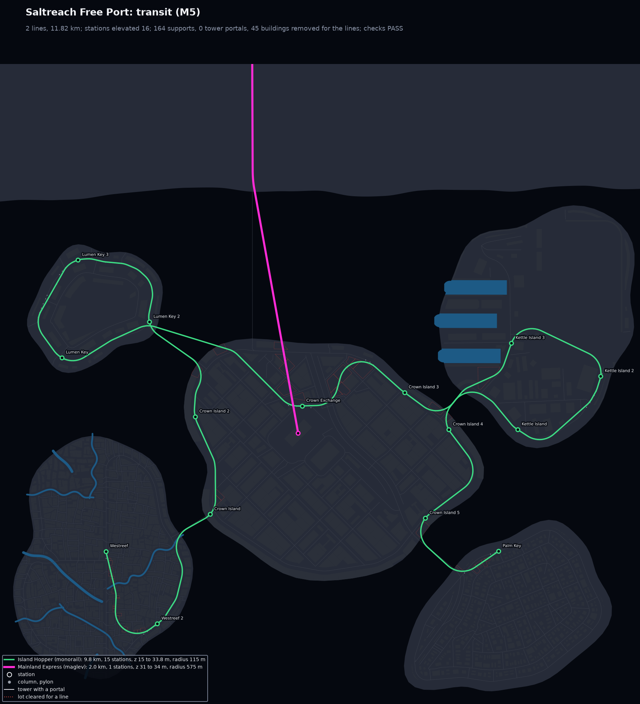
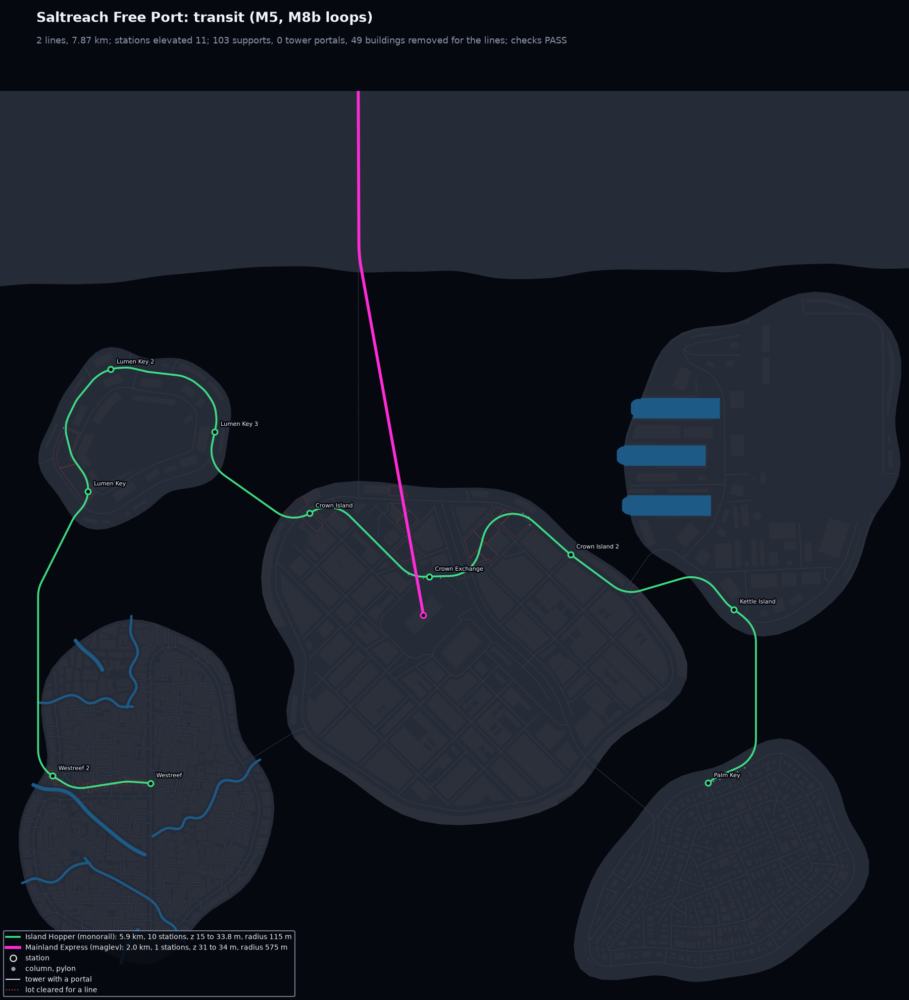
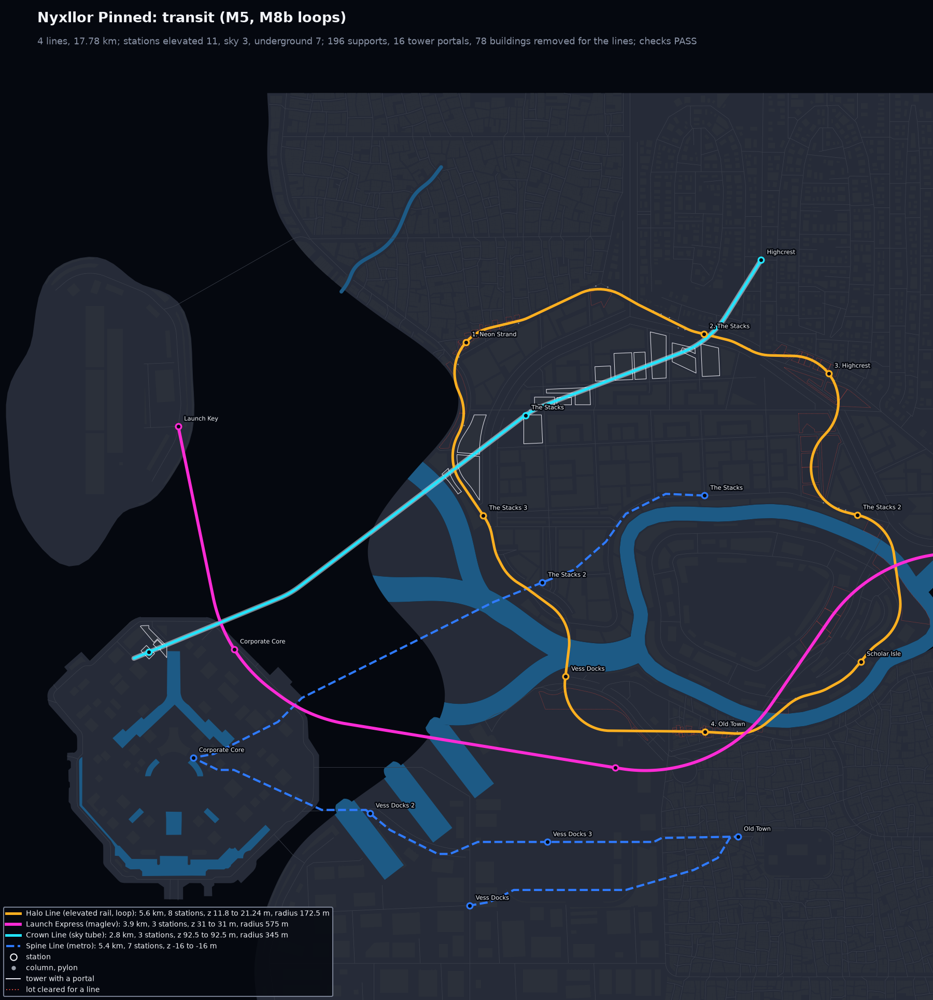

# M8b: transit loops

M8b polishes how citygen routes transit loops (M5, `citygen/transit.py`). A loop line is now
one simple closed ring through its stops in route order. Its stations follow that order, and
a line's track no longer depends on the other lines. The new check `transit_self_crossing`
(66 checks in all) and red crosses on `preview_transit.png` show any place where a line
meets itself.

M8b is stacked on M8a (`claude/m8a-robustness-24d520`, PR 16): merge order PR 14, PR 16,
PR 15. Every build below is made with the combined code and passes all 66 checks. Each
`city_model.json` is byte-identical on the M4 Mac (arm64) and on x86_64 Linux (docker,
`linux/amd64`, `CITYGEN_WORKERS=4`):

| City | sha256 of `city_model.json` (both machines) |
|---|---|
| archipelago_free_port | `dd2b22763893110783337b21b9f58b6e1b46900461144684fe42cb532dbe641a` |
| delta_megacity | `3800f2104d3183d5d606912e617365f80e51e63f5115f2af18a3a05251f508fb` |
| nexus_city | `f97e5177e235278914648449f39fa922b37f16d67fc833a3291eb6b7e1be1d76` |
| nyxllor | `29a57fe579da2683dd0a993f9b12e2fbb4af3716cab129b5a13bf9f58c6ea31c` |
| peninsula_city | `0e6533f5821182e12fc690f788032c197230aaa2e2448d58e016b916255db5b2` |
| nyxllor_pinned (M7b demo, round 3 order) | `fb773f4e722378be5eb972ecb67eb9adbc7f921fca51598c8e413325f1493afb` |
| nyxllor_pinned_round1 (round 1 maglev) | `d1d2eb0da7860e87124ea78cde270dd42d62f0105169d4c7e55ca93f83d13c79` |
| nyxllor_pinned_round2 (round 2 order) | `7ef74e76d156d0e0bfb172bc291de672a10f5999737a27de70c68d9a57354f9d` |

The PR has three parts: the loop rings (first review), a polish round after it (fast lines
on their first layout, transit time, Greyhook's East Shore Line), both measured on PR 14's
code, and the stack on M8a with its sweep ([Stacked on M8a](#stacked-on-m8a)). The images
are from the combined code; the "before" maps and the figures of the first two parts are
from PR 14's base, where the layouts differ slightly.

## Before and after

In each pair, "before" is the same spec built with the code before M8b (commit `510dc70`,
which reproduces the M7b golden hashes). The "before" maps are in each folder as
`before_transit.png`.

### The pinned demo, Halo Line in its round 2 order

Neon Strand, The Stacks, Highcrest, Old Town, Neon Strand
(`nyxllor_pinned_round2/city_spec.json`):

| Before: doubles back through The Stacks, meets itself in 31 places | After: one ring, stations in route order |
|---|---|
|  |  |

### The pinned demo, round 3 order

Neon Strand, Highcrest, Old Town, The Stacks, Neon Strand (the M7b demo spec):

| Before: closes, but winds round Highcrest and crosses itself (13 places) | After |
|---|---|
|  |  |

### Nyxllor sample

Its Halo Line is in the round 2 order:

| Before: 17 places | After |
|---|---|
|  |  |

### Delta Megacity, Nexus City and Saltreach (archipelago)

| Delta Megacity before | Delta Megacity after |
|---|---|
|  |  |

| Nexus City before | Nexus City after |
|---|---|
|  |  |

| Saltreach before: Lumen Key as a spur, back over the same bridge | Saltreach after |
|---|---|
|  |  |

Greyhook (peninsula) has no loop. Its open lines changed in the polish round (see below).

### Per line

Each figure is the number of places where the line meets itself at the same level (the
`transit_self_crossing` rule), then the length.

| City | Line | Before (PR 14 base) | After, PR 14 base | After, on M8a |
|---|---|---|---|---|
| pinned, round 2 | Halo Line (loop) | 31, 8.3 km | 0, 5.0 km | 0, 5.6 km |
| pinned, round 3 | Halo Line (loop) | 13, 10.3 km | 0, 6.3 km | 0, 5.9 km |
| nyxllor | Halo Line (loop) | 17, 6.7 km | 0, 7.6 km | 0, 7.8 km |
| nyxllor | Crown Loop (sky tube loop) | 0, 3.7 km | 0, 4.7 km | 0, 4.8 km |
| delta_megacity | Skyline Loop, Delta Loop (sky tube loops) | 0, 4.7 and 4.8 km | 0, 4.9 and 4.3 km | 0, 4.7 and 4.3 km |
| nexus_city | Blue Line (metro loop) | 0, 4.3 km | 0, 4.1 km | 0, 4.3 km |
| archipelago_free_port | Island Hopper (monorail) | 3, 9.8 km | 0, 5.9 km | 0, 5.9 km |
| peninsula_city | East Shore Line (elevated rail, open) | 0, 5.3 km | 0, 3.9 km | 0, 3.9 km |
| peninsula_city | Spine Tube (sky tube, open) | 0, 2.8 km | 0, 2.2 km | 0, 2.2 km |

In M7b, a loop's last stop shared the vertex of its first, so the stops of the delta and
nexus loops read as out of order. In M8b a loop's track starts at its first stop and ends
back there.

## Causes

1. **Stops at the district middles.** A district stop of a loop sat at the avenue junction
   nearest its district's middle. (Lines move a middle stop toward the chord between its
   neighbors, but loops were left out, because that chord crosses the loop.) Taken in the
   round 2 order, those middles make a polygon that crosses itself: The Stacks' middle lies
   south, outside the turn from Neon Strand to Highcrest.
2. **Legs that turn back.** Each leg ran on the road graph from one exact junction to the
   next, and a train may not turn more than 120 degrees at a node. A stop at a road's end
   (The Stacks' junction ended a road; at Highcrest a leg arrived on a 17 m link off an
   overpass) forced the next leg round the blocks: 2.2 to 6.5 km legs for 1 km chords. A
   leg could run along or across the line's own earlier legs. Its only penalty was 2x the
   cost on a reused road edge.
3. **One bridge both ways.** On the pinned map the road graph crosses the river between the
   north and south landmasses in one place. A road-only ring had to use it twice.
4. **Curves cutting the spurs.** The arc fitting removes a vertex where the route turns back.
   It cut whole excursions, the stop included, and left the track crossing itself.
5. **Stations by distance alone.** Each stop's station was the track vertex nearest the stop
   point, so in a district the line passes twice (The Stacks), stations came out of route
   order (vertices `[481, 136, 505, 960, 481]` in round 2). With them, the mid stations
   between stops went wrong too.
6. **Coupled lines: whole-city retries.** `build_city` draws the whole city again (a new
   layout salt, then the next road network) whenever the full city fails any check. Round
   1's maglev (`east_exit`, Corporate Core, Launch Key) turns back and failed
   `transit_curves` and `transit_altitude`, so round 1 kept retrying. It ended on a
   different layout from round 2, with different buildings, so every line moved. Within one
   build, the lines never depended on each other's tracks. (Both rounds also fail
   `level_continuity` on their first layout, `rs01479` at 0.16 m, an M8a matter, so both
   retry once.)

## Fixes (in `citygen/transit.py`)

- **Ring placement (`_loop_points`).** A loop's district stops move to junctions of their
  districts that come in route order around the middle of the stops, within one turn. Such
  a star-shaped polygon is simple. A dynamic program over one junction per 10 degree sector
  tries both ways round and keeps the stops near one circle and evenly spaced. A stop that
  is a nexus platform, site or place stays put.
- **Stops deep enough for the curves (`_deepen`).** Where the 1.15 r_min curve at a stop's
  corner would cut out of its district (it cuts the corner by
  $r\,(1/\cos(\theta/2) - 1)$ for a turn $\theta$), the stop moves to a junction where the
  apex stays 30 m inside. A loop routed off the roads that still misses a stop tries again
  with that stop 60 m deeper (up to three tries).
- **Legs keep off the line (`_keep_off`).** Every leg keeps off the line's earlier legs,
  except within 60 m of its own start and, when it closes a loop, of the loop's start. On
  the roads, such edges are left out (`RoadGraph.touching`). On the raster, such cells are
  forbidden.
- **Road legs end near the stop (`RoadGraph.targets`).** A road leg may end at any junction
  within 150 m of a district stop, inside the district, and the next leg starts there. A
  loop's last leg must arrive in a direction its first leg can continue from.
- **Off the roads where needed.** A road leg the roads cannot keep off the line (one bridge
  both ways) runs on the raster instead, with its own viaduct and avenues still cheapest.
  So does a leg that winds round the blocks (longer than 1.5 times its chord plus 300 m)
  when the raster leg is 1.3 times shorter. A road-mode loop is also routed fully off the
  roads (`_off_roads`). That route is kept when it serves more stops or meets itself less,
  or when the road ring is 1.35 times longer.
- **Guide ring (`_guide_loop`).** A loop off the roads is also drawn along its guide ring:
  the ordered stop polygon with arcs, with waypoints every 120 m on the raster. The better
  of the two is kept, judged in order by stops served in order, places where it meets
  itself, then curves too tight. The hull fallback now only runs for a curve the check
  would fail, or for a loop that meets itself. It must keep the route's direction round,
  and it widens from 1.1 to 1.25 r_min when still tight.
- **Stations in route order (`ordered_stops`).** A loop's track starts at its first stop.
  Each stop's station is the nearest vertex in its district after the previous stop's.
- **Heights round the seam (`_graded`).** A loop's height envelopes are graded round the
  seam, so the track has no step where it closes. The altitude check grades the same way.
- **Station names.** A mid station that lands outside every district (a bank between two
  river arms) takes the nearest district's name instead of the line's.
- **Check `transit_self_crossing`** (in `transit_checks.py`). Two parts of a line more than
  100 m apart along it stay its structure width apart in plan, or pass at least 5.5 m plus
  the structure apart in height. A loop closes, and its stop vertices come in route order.
- **Preview.** A red cross marks a place where a line meets itself, and a loop's stops are
  numbered in route order.
- **Tests** (`tests/test_transit.py`):
  - a four-stop elevated loop in the test city (Harbor, Old Quarter, Uptown, Core), checked
    for one simple ring, stations in order inside their districts and no step at the seam;
  - failing cases for the new check (a line back along itself, a loop left open, stations
    reversed) and a passing case (12 m over itself);
  - each line built alone gives the same track as with all lines;
  - `self_meets` on a figure eight and a circle, and the seam grading.

The determinism rules hold. Every angle comes from `dmath`. Junction and edge sets are only
used for membership tests, tree hits are sorted, and no GEOS output order reaches a
decision (the ULP noise test still passes).

## Polish round

After the first review, three items from the open list: fast lines that pass on the first
layout (so a spec edit to one line no longer retries the whole city), the transit stage's
time, and Greyhook's East Shore Line. All in `citygen/transit.py`; `build.py` is unchanged.

### Fast lines on their first layout

In the first review, delta_megacity's maglev failed on its first layout and passed only
through `build_city`'s whole-city retry, and round 1 of the pinned demo (its maglev ordered
`east_exit`, Corporate Core, Launch Key) failed `transit_curves` and `transit_altitude` and
moved to another layout, so every line in it moved. Causes:

- **A middle stop off the way.** A maglev's middle stop sat at the avenue junction of its
  district nearest the chord between its neighbors, even where the 575 m curve there cut
  out of the district (delta's Midtown stop, 250 m inset). The raster route then had to
  bend through it and the fitting kept a 130 m curve.
- **Turning back at a stop.** Where the stops make a sharp turn (round 1: in from the east,
  out to Launch Key in the north-west), no junction of Corporate Core leaves room for the
  curve inside the district.

Fixes:

- **`_fast_point`.** For a fast line (maglev, sky tube: r_min at least 300 m) a middle stop
  takes the junction nearest the chord where the curve's apex stays inside the district
  (`_apex_in`) and the curve is clear. Failing that, it takes a corner on a 60 m grid within
  two radii of the district, nearest the way, whose guide (the straight runs and the
  curve) is clear and runs a station length 40 m inside the district; the station goes in
  the middle of that stretch, and the line turns beside the district (over the water, say).
- **`_guide_line`.** A fast open line is also drawn along its guide line: the stops with
  arcs at those corners, densified, split at the stations, with waypoints every 120 m on
  the raster. Its stations are pinned so the fitting cannot cut them away. It is kept when
  better by `_line_key` (stops in order, places where it meets itself, curves too tight,
  corridor conflicts); the report notes "drawn along its stops with 500 m curves".

| City | Line | Base code (`510dc70`) | First review | Polish round |
|---|---|---|---|---|
| delta_megacity | Maglev Line | city passes on layout salt 2 | 130 m curve on layout 1; passes on salt 1 | 539 m on layout 1 |
| nyxllor | Launch Express | city passes on layout salt 3 | 508 m on layout 1 | 611 m on layout 1 |
| pinned, round 1 | Launch Express | 548 m, but the city passes on layout salt 4 (Halo Line meets itself in 6 places) | fails `transit_curves` and `transit_altitude`; city moves to another layout | 550 m, same layout as rounds 2 and 3 |

On PR 14's base, no sample city retried for transit after the polish round: delta_megacity,
nyxllor and the three other samples built on their first layout, and the pinned demo
retried once in all three rounds for `level_continuity` (`rs01479` at 0.16 m), so all three
ended on the same layout. M8a changes the layouts, and on the combined code Delta and Nexus
retry for transit again ([Stacked on M8a](#stacked-on-m8a)).

**Rounds 1 and 2 of the pinned demo differ only in the maglev** (on the combined code too:
both retry once, round 1's maglev passes on layout salt 1, as in round 2). Their roads, districts,
lots, buildings and the Halo, Spine and Crown lines are identical, in plan and in height.
What differs is Launch Express itself (track, its stations, their walkways and supports),
the buildings its corridor removes (and their green areas, plants and props), the corridor
marks on those lots, and the ids of the stations and walkways numbered after it (one
sequence per kind). On the combined code that is 3 buildings and 3 lots; round 1's maglev
has three stations, round 2's one.

| Round 1: maglev `east_exit`, Corporate Core, Launch Key | Round 2 |
|---|---|
|  |  |

Before, round 1 for comparison: `nyxllor_pinned_round1/before_transit.png`.

### Transit stage time

Profiled on the pickled models just before transit (same layout for each column), seconds
for `transit.build`:

| City | Base code (`510dc70`) | First review | Now |
|---|---|---|---|
| pinned, round 2 | 6.3 | 34.6 | 8.6 |
| pinned, round 1 (layout 1) | 48.7 | 79.6 | 9.5 |
| delta_megacity | 22.4 | 22.6 | 7.1 |
| nyxllor | 53.3 | 66.7 | 9.1 |
| peninsula_city | 2.8 | 6.3 | 2.9 |
| archipelago_free_port | 2.0 | 6.5 | 3.5 |

Where the time went: the raster A* (`search`). Its states were tuples in dicts, and its
heuristic, the straight distance times the cheapest cell cost, is far below the real cost
over built-up ground, so a long leg expanded most of the map. A leg whose end could not be
reached (keep-off cells closing it in) searched every state before giving up. The first
review's loops search many such legs: on and off the roads, the guide ring, the hull and
the deeper stops.

The search now uses integer states (flat arrays for a long search, a sparse table for a
short one); over 600 m its heuristic is the exact turn-free cost to go (`_togo`, a numpy
relaxation, admissible since turns only add cost), and after 20000 steps a flood fill
(`reachable`) stops it at once when the end cannot be reached. The paths have the same
cost as before (`test_search_cost_to_go`); only ties may go another way.

The 8.6 s on the pinned demo against 6.3 s before: about 1.5 s builds the context
(rasters, road graph), about 0.3 s per long search computes `_togo`, and the rest is the
loop's extra routes (off the roads, along the guide ring) that the first part of M8b added.
Those are what draw a simple ring, so I kept them.

### Greyhook's East Shore Line

The line wound round the south of the peninsula because its end stop, Hook Spaceport, sat
at the site's middle, inside the terminal, which the line cannot cross: the route went
round the site to reach a point it could not get to. A line that ends at a megasite now ends
where the site's zone begins (`_site_point`: the passable cell 30 m inside the zone nearest
the neighbor stop; on the roads, `RoadGraph.targets` takes any major junction in that
zone). East Shore Line: 5.3 to 3.9 km; Spine Tube, which also ends there: 2.8 to 2.2 km.

The turn round Neckgate stays: Neckgate is the transit nexus, and its platform is at the
east end of the neck, so a line from Wallgate Heights to Eastside Docks has to go east to it
and come back. That is the spec's order, not the routing.

## Stacked on M8a

The branch is rebased onto M8a (`claude/m8a-robustness-24d520`, PR 16). The only conflict
in code was `build.py`, where M8b's net change is nothing (a retry change tried in the first
part was reverted); it is M8a's. Goldens, the README and CLAUDE.md keep both milestones.

### Full-city tries per sample

From each report's `city_tries` stat (one try per layout salt and road network):

| City | M8a alone | M8a + M8b |
|---|---|---|
| archipelago_free_port | 1 | 1 |
| delta_megacity | 9 | 9 |
| nexus_city | 3 | 4 |
| nyxllor | 8 | 1 |
| nyxllor_pinned | 2 | 2 |
| peninsula_city | 1 | 1 |

What each failing try failed on, with the combined code:

- **delta_megacity** (all transit but one): Delta Loop curve 276, 231 and 228 m (sky tube,
  minimum 300) on layouts 1 to 3, with Waterfront Monorail 74 m and 56.5 m altitude; then
  a podium on open space (`building_clear_zones`); Delta Loop missing Research Campus
  (317 m); Skyline Loop at an 8.3% grade; Skyline Loop missing the Transit Nexus platform
  (103 and 176 m). Layout 9 passes.
- **nexus_city:** `level_continuity` on layouts 1 and 2 (M8a's area), with the Magenta Line
  at 489 m and the Harbor Line at 121 m on layout 2; the Harbor Line at 117 m on layout 3.
- **nyxllor:** none. Its first layout failed only the Crown Loop's altitude before the fix
  below.
- **nyxllor_pinned** (all three rounds): `junction_placement` on layout 1 (a segment 12 m
  over its node, M8a's area); round 1's maglev also climbs to 60.8 m there.

So the transit fixes bring nyxllor from 8 tries to 1 (about 50 s instead of 7 min). Delta
still needs 9, mostly for its two sky tube loops and the monorail on M8a's new layouts.

### Fixes for the combined code

- **Tight portals (`_fit_portals`).** A sky tube through towers dropped the portal of a
  tower its profile left less than 8 m of headroom in, and climbed over it. Each climb
  lifted the neighbors out of their portals, one after another: nyxllor's Crown Loop rose
  to 183 m on M8a's first layout (check limit 150 m). A tower the line could not climb
  within its altitude range now keeps its portal with 3 m of headroom (the clearance check
  asks only that the tube be inside the portal).
- **Spurs back along the line (`_spurs`).** An open road line still under its minimum
  radius after `_restop` is routed once more with its legs free to run back along the line
  (as before M8b; the curves then cut the spur), and kept only when it serves as many stops,
  meets itself no more and has wider curves. On peninsula s11 this fixes the East Shore
  Line on the first layout (108 m), not on the third (139 m, a loop the road graph's turn
  rule makes at the Neckgate hub).

Tried and left out: corners beside a narrow district for sky tube loops, guide rings whose
arcs pass through the stops, and rerouting the fast guide line around its corridor
conflicts. Each fixed one Delta layout and broke another (raster detours round the guide
made tighter jogs), so none is in.

### Sweep

`citygen sweep --suite m8a --workers 4` on the combined code, next to M8a's
(`docs/progress/M8a/sweep_after.md`). The full table is
[`sweep_on_m8a.md`](sweep_on_m8a.md).

| | M8a alone | M8a + M8b |
|---|---|---|
| builds passing every check | 49 of 68 (72%) | 51 of 68 (75%) |
| passing apart from transit checks | 57 (84%) | 57 (84%) |
| builds with a transit failure | 9 | 6 |
| crashes | 0 | 0 |
| full-city tries, all 68 builds | 282 | 261 |
| build time, all 68 builds (one process each) | 10733 s | 8634 s |

Passing builds per spec (the test specs pass the same 17 of 20 in both):

| spec | M8a alone | M8a + M8b |
|---|---|---|
| archipelago_free_port | 6 of 8 | 5 of 8 |
| delta_megacity | 3 of 8 | 4 of 8 |
| nexus_city | 6 of 8 | 7 of 8 |
| peninsula_city | 6 of 8 | 7 of 8 |
| nyxllor | 7 of 8 | 7 of 8 |
| nyxllor_pinned | 4 of 8 | 4 of 8 |

Changed builds:
- **Fixed:** delta s11 (Delta Loop radius; now on its first try), nexus s5077 (passes on
  its first try; on M8a alone its best try kept a `level_continuity` step), peninsula
  s8128 and s27182 (East Shore Line radius and altitude).
- **Broken:** archipelago s3141 (Island Hopper hooks at the Crown Exchange hub, 26 m, on
  every layout; M8a alone passed on its second try, where M8b's route hooks too) and
  peninsula s11 (its best try now fails `building_overlaps`, a wheel and a megasite leg,
  M8a's area; the East Shore Line still loops at the Neckgate hub on two of its layouts).

Transit failures left: the Island Hopper at archipelago s3141 and s27182 (26 and 32 m, a
monorail hooking at a hub platform), Delta's Maglev Line at s3141 (484 m against 500), and
the Delta Loop at s5077, s8128 and s27182 (168, 83 and 46 m).

## Coupling, what is left

Within one build, a line's track (in plan) does not depend on the other lines (a test checks
this). Its heights do see the buildings other lines remove from its corridor, which is a
physical dependence. A spec edit that makes any line fail a check still moves every line,
through the whole-city retry. On PR 14's base no sample line failed on its first layout;
on M8a's layouts Delta and Nexus still retry for transit, and the pinned demo's rounds
retry once for a road check, so they still share their layout.

## Open items

- **Retry coupling, in general.** A spec whose line fails a check still retries the whole
  city. Options: pin the previous round's layout salt and road variant in the
  art-direction loop (`citygen review`), or retry only the transit stage for transit-only
  failures.
- **Delta's sky tube loops and monorail on M8a's layouts.** Eight of Delta's nine tries
  fail, seven of them on transit (see above); the Delta Loop's turn at the narrow Research
  Campus tongue and the monorail's hook at the hub are the main ones. Fixing them would
  take Delta from about 6 minutes to under one.
- **A road-mode loop off the roads.** When the roads cannot make a ring (the pinned Halo
  Line), the ring runs across blocks and the river on its own viaducts. More buildings come
  out of its corridor than along the avenues.
- **The guide ring's stops.** A loop's station sits where the ring passes through the
  district, often near its edge.
- **A fast line's corner beside a district.** Round 1's Corporate Core maglev station is at
  the island's north-east edge, where the guide corner leaves room for the curve.
- **Other seeds.** The transit failures left in the sweep on the combined code are listed
  there.

## Files

`<city>/` holds the previews (`preview_transit.png` first), `before_transit.png`,
`report.txt` and `report.json`, `trace.json` (and `city_spec.json` for the two extra demo
rounds) and, for the five samples and the demo,
`blockout_report.txt` and the blockout renders. The 8K renders are `render_iso_city.jpg` for
every blockout city, plus `nyxllor_pinned/render_iso_d01.jpg` and `render_street_4.jpg` for
delta_megacity and nyxllor. Work in progress: `wip/`.
