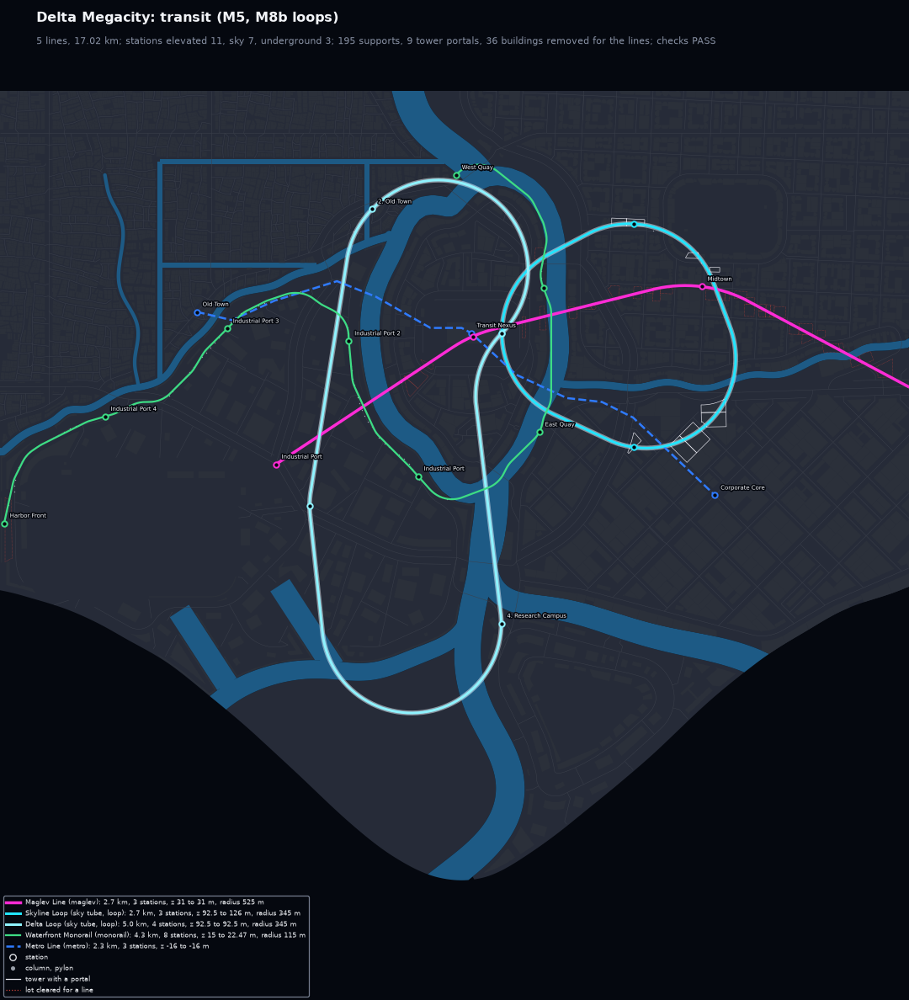
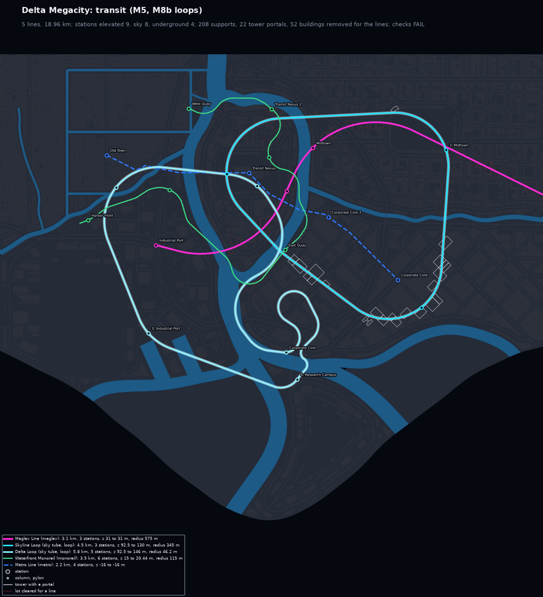
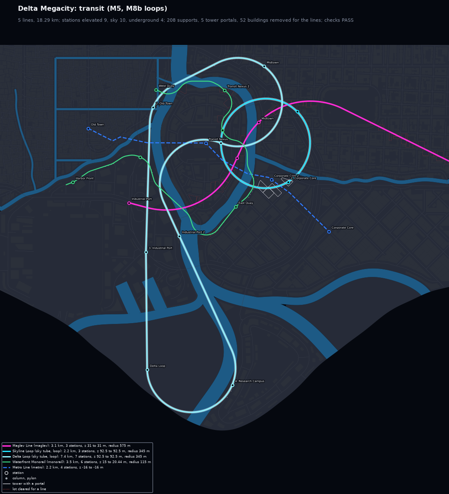
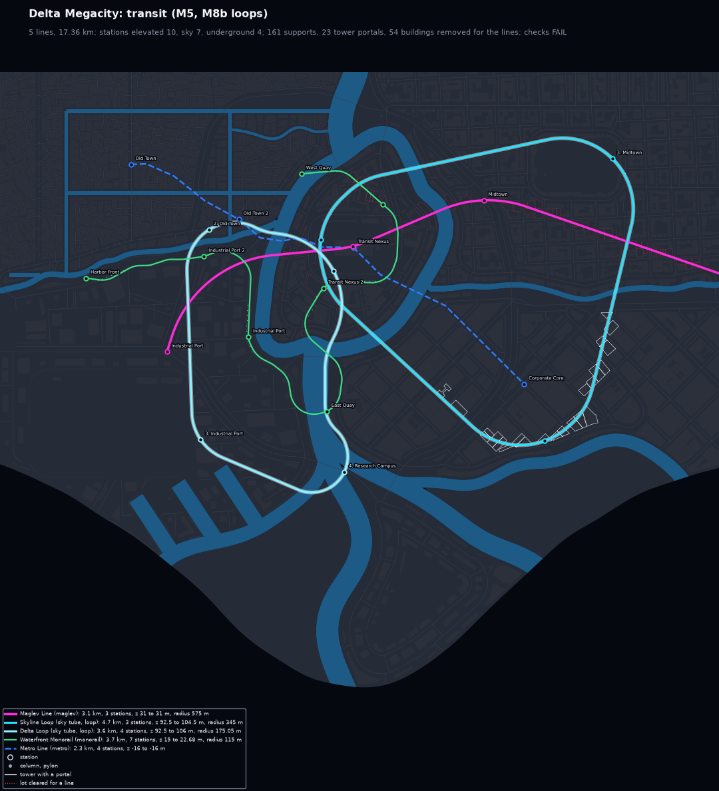
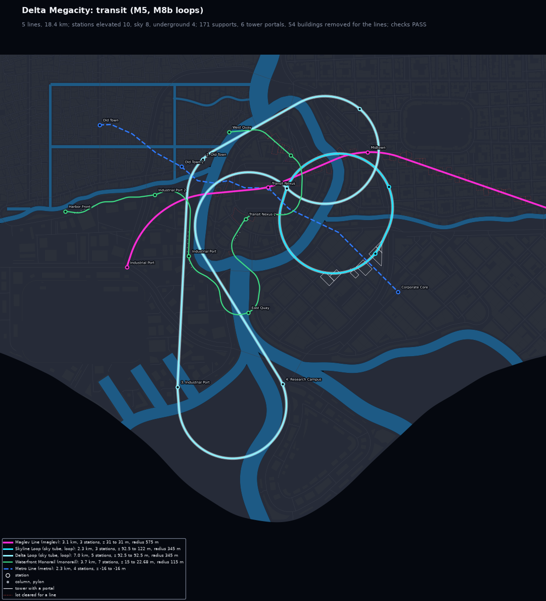
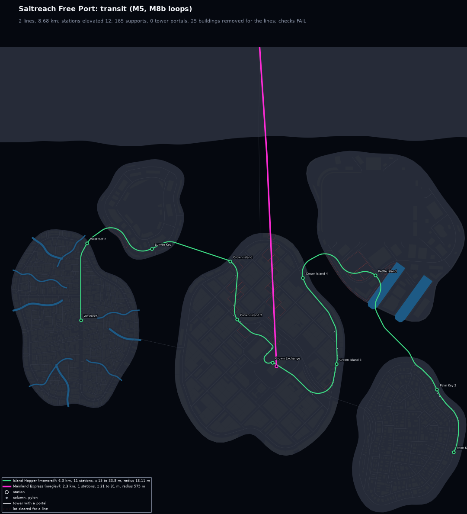
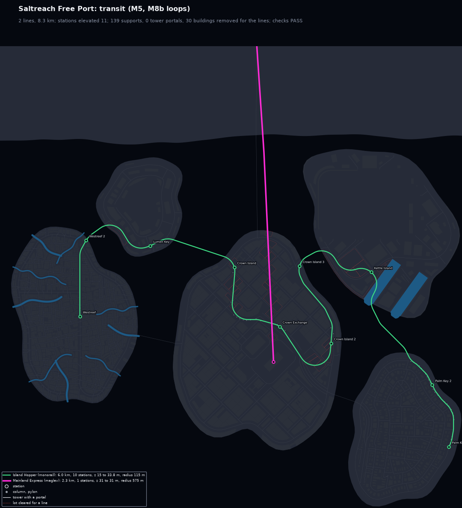
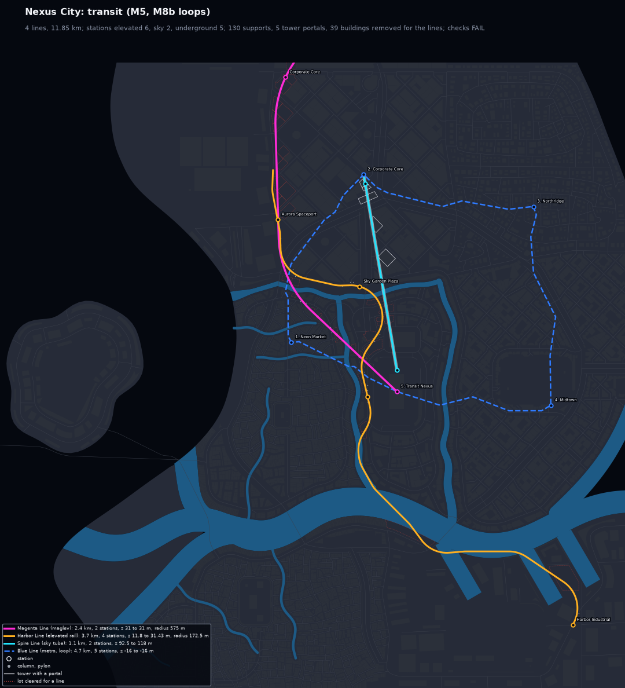
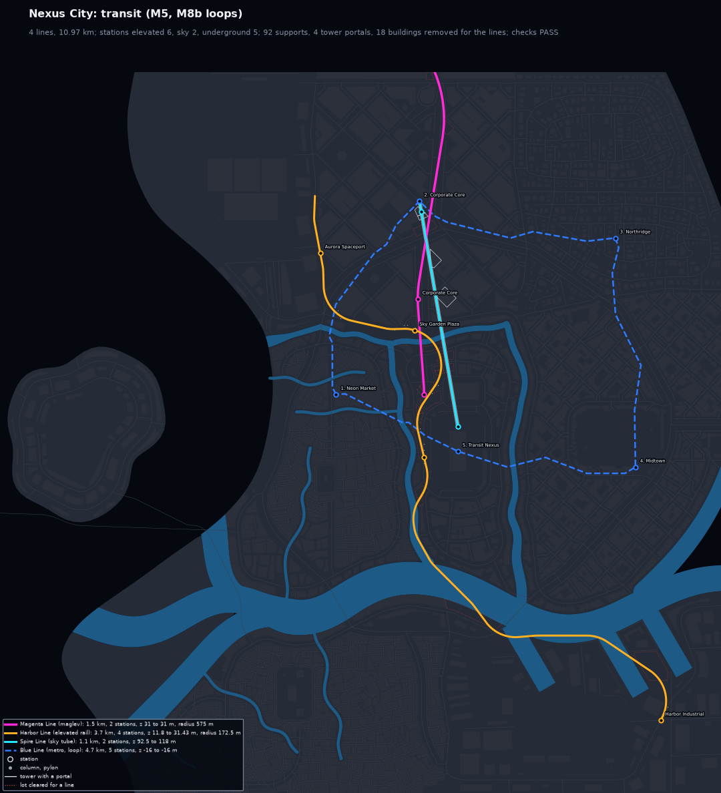
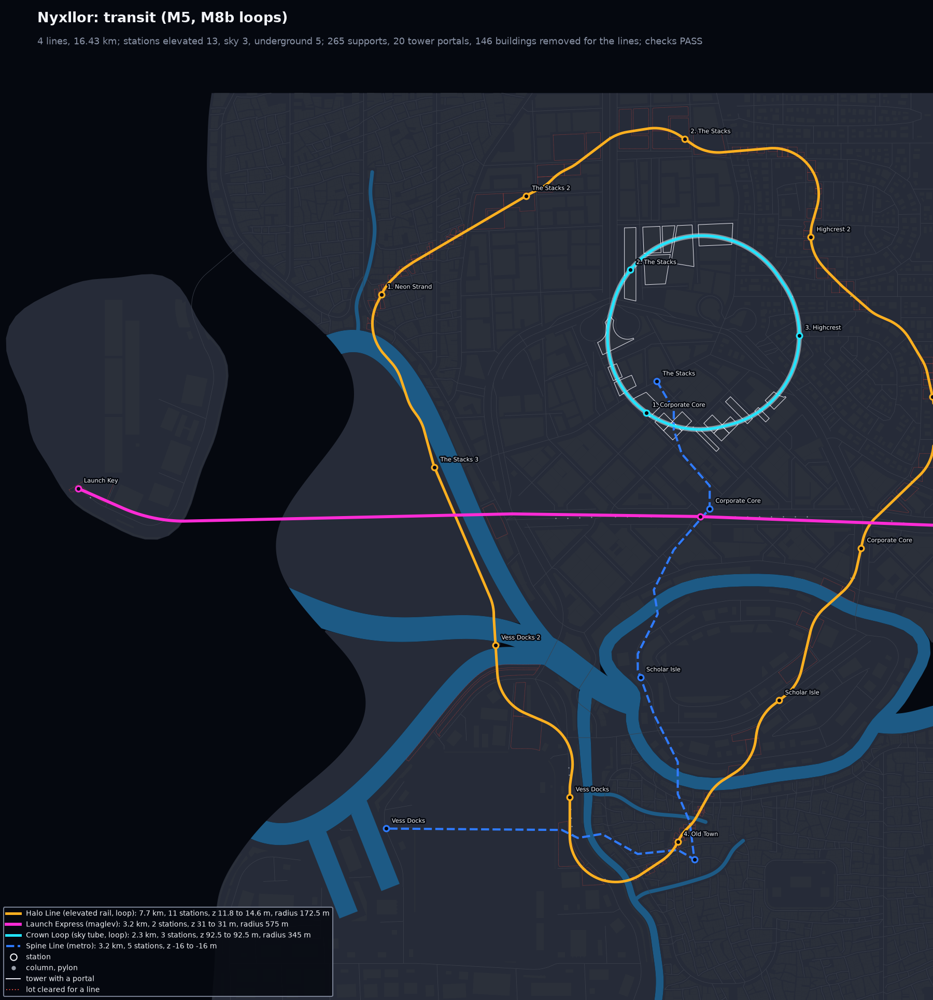

# M8c: transit on a city's first layout

M8c makes the transit stage (`citygen/transit.py`) pass on the layout a city is first built
on, so a failing line no longer sends the whole city round `build_city`'s retry loop. Delta
Megacity, which needed 9 full-city tries on M8a and M8b (about 6 minutes), now builds on its
first try in about a minute. The sweep passes 58 of 68 builds (M8b on M8a: 51), and no build
in it fails a transit check any more.

Every build below passes all 66 checks, and each `city_model.json` is byte-identical on the
M4 Mac (arm64) and on x86_64 Linux (docker, `linux/amd64`, `CITYGEN_WORKERS=4`):

| City | Full-city tries (M8b, M8c) | sha256 of `city_model.json` (both machines) |
|---|---|---|
| archipelago_free_port | 1, 1 | `dd2b22763893110783337b21b9f58b6e1b46900461144684fe42cb532dbe641a` (unchanged) |
| delta_megacity | 9, 1 | `91266cfe8240c7b6028e50d8112e3a78393c3c43a302cd0534e49560bd018a9a` |
| nexus_city | 4, 3 | `4a146cb5d6bdf59a128c06e9955652f4fd358b3dc3b9864fe7210f247bbfb452` |
| nyxllor | 1, 1 | `3291c3d08bb0a0ed4385f8bf7fdec724415c76db767f073d48c072d1dd2346aa` |
| peninsula_city | 1, 1 | `f3bb6ffb5d8160dad20d6983159837e706c40c1411264ecafbbc4cef095679b3` |
| nyxllor_pinned (M7b demo) | 2, 2 | `0fb851e3c4261ad6c803f6560d186c09a4c37fc0c7f87e9914b3588e158a9d00` |

Nexus City's first two tries and the pinned demo's first fail road checks
(`level_continuity`, `junction_placement`), not transit. The sample build-time limit in
`tests/test_build.py` is back to 300 s (M8a had raised it to 600 s for Delta and Nyxllor).

## How it was found

Each full-city try of Delta Megacity, of the failing sweep seeds and of the other samples was
saved just before the transit stage (the model with its buildings), so the transit stage and
its checks could be run again on exactly those layouts in about 10 s instead of a 6 minute
build. 81 tries in all (Delta at its own seed and at 3141, 5077, 8128 and 27182, archipelago
at 3141 and 27182, and the other samples). Transit checks failed on 67 of them with M8b's
code, on 2 with M8c's.

| Line | Tries it failed (M8b) | Cause |
|---|---|---|
| Delta Loop (sky tube loop) | 34 curves, 9 stops, 7 altitude | the ring's corner at Research Campus, a narrow tongue across a river arm: a 345 m curve there cuts out of the district; the legs between the stops wind between towers the line cannot clear (no `through_towers`) |
| Skyline Loop (sky tube loop) | 9 stops, 4 altitude, 2 curves | the curve at the Transit Nexus corner cuts past the nexus tower; the station moved to a portal tower outside its district |
| Waterfront Monorail | 6 curves, 3 altitude, 1 stop | the road route turns 120 degrees at a bridge foot beside buildings it cannot take out (74 m); its road to the hub platform runs past the hub's site buildings, which it climbs over (81 m, limit 30) |
| Island Hopper (archipelago monorail) | 18 curves | a hook at the Crown Exchange hub platform (26 to 32 m) |
| Maglev Line (Delta), Mainland Express, Magenta Line (Nexus) | 5 curves | the fast line's guide corner, a few percent under 500 m |
| Magenta Line (Nexus maglev) | 3 stops | the guide corner beside Corporate Core at the north edge: the 575 m curve swings off the map and the track ends 303 m from its exit, which the routing counted as served |
| Harbor Line, East Shore Line | 3 curves | road lines that turn back at a stop |
| Blue Line (Nexus metro) | 1 station access | both concourse ends right on a walkway, so no stairs |

## Fixes (in `citygen/transit.py`)

- **Flying loops as Dubins rings (`_dubins_track`).** A sky tube or maglev loop is one ring of
  Dubins paths, the shortest paths of curvature at most $1/\rho$ between two poses (straight
  runs and arcs of exactly $\rho$, Shkel and Lumelsky's six words, every angle from `dmath`),
  with $\rho = 1.15\,r_{min}$ (then $1.06\,r_{min}$). Each stop is passed at a pose: a point
  30 m inside its zone (a sky tube's nexus inside its tower) and one of 16 headings. The
  poses are searched in turn (coordinate descent from the `_loop_points` ring, cheaper paths
  first, a lower bound prunes the rest), keeping the ring over the fewest cells the line
  cannot pass, then the cheapest over the raster costs plus its curve length (a ring that
  loops round a stop costs more). A ring still blocked adds up to two free poses beside the
  blocked stretch. A ring is only kept when it keeps clear of itself (`meets`). Its radius
  holds by construction, so the corner fitting that cut Research Campus or wound between the
  towers is no longer needed; when no clean ring exists the loop falls back to M8b's routes.
- **Open road lines off the roads (`_off_roads_line`).** An open elevated rail or monorail
  line still flawed after M8b's retries (a stop missed, a curve under its radius, a building
  in its corridor it can neither take out nor climb) is routed again with its legs on the
  raster, then with its middle stops at a site, place or island moved to where their zone
  meets the line's way (`_way_point`); the best route wins (`_line_score`).
- **Dubins tracks for open lines (`_dubins_line`).** An open line still flawed after that
  is drawn as Dubins paths from stop to stop (an exit is passed at its point heading off the
  map), and kept only when it scores better. A stop the line must turn back at gets a loop
  of the mode's radius instead of a hairpin the curves cut. It draws Nexus City's Harbor
  Line in the sample build, and on one saved archipelago layout (s27182, second try) the
  Island Hopper straight across the water.
- **Exits.** A line to an exit counts as missing it unless an end of the track is within
  250 m of it (`_served`; the check allows 300 m), so the routing sees the Magenta Line's
  problem and the fallbacks fix it.
- **Sky stations.** A sky station moves only to a portal tower vertex that still serves its
  stop (`Builder._tower_for`).
- **Metro stairs.** Where a concourse end sits on a walkway, its stairs run 12 m along the
  concourse instead of being left out (`Builder._metro`).
- **Tests** (`tests/test_transit.py`): Dubins paths reach their end pose with no curve under
  the radius (S-bend, U-turn, a three-arc word, a pose behind); a Dubins ring on the test
  city is closed, clear of itself and of blocked cells, at its radius, with its stops in
  route order in their districts; exits count as served only near an end of the track.

The determinism rules hold: Dubins paths use `dmath` angles and plain arithmetic, every point
is on the 0.01 m grid, the insets use mitre joins (no arcs, so no libm trigonometry in GEOS),
the via search area is an exact distance test, and every choice is sorted on rounded keys.
The ULP noise test and the two-hash-seed test pass.

## Before and after, on the same layouts

Each pair is the transit stage of M8b (commit `86daae2`) and of M8c run on the same saved
model (same districts, roads and buildings). The maps are in [`same_layout/`](same_layout).

Delta Megacity, its first layout (the one M8c builds on): Delta Loop 276 m and Waterfront
Monorail 74 m before.

| M8b | M8c |
|---|---|
|  |  |

Delta at seed 27182, first layout: the Delta Loop winds between the Corporate Core towers
(46 m); the ring runs between the river and the towers.

| M8b | M8c |
|---|---|
|  |  |

Delta at seed 5077, third layout (168 m before). The ring loops round the nexus island: the
towers south of the nexus leave it no other way to pass the tower going west.

| M8b | M8c |
|---|---|
|  |  |

Saltreach (archipelago) at seed 3141: the Island Hopper's hook at the Crown Exchange hub
(26 m).

| M8b | M8c |
|---|---|
|  |  |

Nexus City at seed 27182, second layout: the Magenta Line ends 303 m from `north_exit`.

| M8b | M8c |
|---|---|
|  |  |

The samples as built (each folder also has `before_transit.png`, M8b's map of the same
spec, built on its own layout):

| Delta Megacity | Nyxllor |
|---|---|
|  |  |

Nyxllor's Crown Loop (three stops close together) is now a 2.3 km circle at 345 m, the
shortest ring through its stops (4.8 km in M8b). Greyhook's East Shore Line passes Hook
Spaceport on its way (2.5 km, 3.9 in M8b).

## Sweep

`citygen sweep --suite m8a --workers 4`, next to M8b's on M8a
([`../M8b/sweep_on_m8a.md`](../M8b/sweep_on_m8a.md)). The full table is
[`sweep.md`](sweep.md) (`sweep.json`). The run was interrupted after 42 builds by another
session's `pkill`; the other 26 were built with the same code and the tables merged.

| | M8b on M8a | M8c |
|---|---|---|
| builds passing every check | 51 of 68 (75%) | 58 of 68 (85%) |
| passing apart from transit checks | 57 | 58 |
| builds with a transit failure | 6 | 0 |
| crashes | 0 | 0 |
| full-city tries, all 68 builds | 261 | 178 |
| build time, all 68 builds (one process each) | 8634 s | 7399 s |

Passing builds per spec (the test specs pass the same 17 of 20):

| spec | M8b on M8a | M8c |
|---|---|---|
| archipelago_free_port | 5 of 8 | 7 of 8 |
| delta_megacity | 4 of 8 | 8 of 8 |
| nexus_city | 7 of 8 | 7 of 8 |
| peninsula_city | 7 of 8 | 8 of 8 |
| nyxllor | 7 of 8 | 7 of 8 |
| nyxllor_pinned | 4 of 8 | 4 of 8 |

Fixed: archipelago s3141 and s27182 (Island Hopper), delta s3141 (Maglev Line), s5077, s8128
and s27182 (Delta Loop), and peninsula s11 (it now passes on its third try, the second
layout on the same roads; M8b's best of nine tries kept a building overlap). None broke. The ten builds that fail are all outside
transit (M8a's road and placement open items: archipelago s1999, nexus s11, nyxllor s3141,
pinned s11, s1999, s5077 and s8128, MINIMAL s42, s404 and s3141). The pinned builds ran while
other builds and renders shared the machine, so their times are longer than M8b's.

## Open items

- **Sky tube portals in tower fields.** Where a sky tube through towers meets a 96 m tower
  next to taller ones, `_fit_portals` drops one portal at a time and climbs, which lifts the
  neighbors out of theirs (one saved Delta try climbs to 162 m, limit 150). A profile that
  chooses over or through for every tower together (a dynamic program on the track's
  heights) would settle it.
- **Rings with no clear way.** On one saved Delta layout (s27182, seventh try) the free
  poses cannot find a ring round the Corporate Core towers; the loop keeps M8b's route
  (56 m).
- **Lines that cross other lines.** Delta's two sky tube loops cross each other in plan at
  the same altitude near the nexus (as in M8b); lines are routed independently and no check
  compares two lines.
- **Dubins tracks for road lines.** The last-resort track of a road line ignores the roads
  (the Island Hopper across the water above, Nexus's Harbor Line), and clears the buildings
  on its way.

## Files

`<city>/` holds the previews (`preview_transit.png` first), `before_transit.png` (M8b),
`report.txt` and `report.json`, `trace.json`, `blockout_report.txt`, `render_top.jpg` and
the 8K renders (`render_iso_city.jpg` for every city, `nyxllor_pinned/render_iso_d01.jpg`,
`render_street_4.jpg` for delta_megacity and nyxllor). `same_layout/` holds the before and
after maps above; `sweep.md` and `sweep.json` the sweep.
