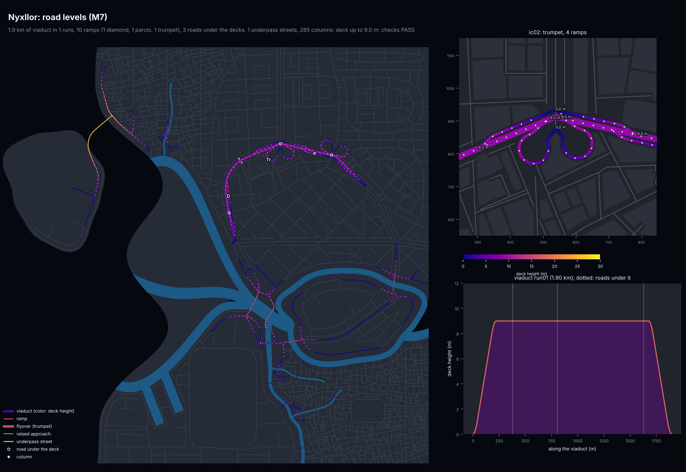
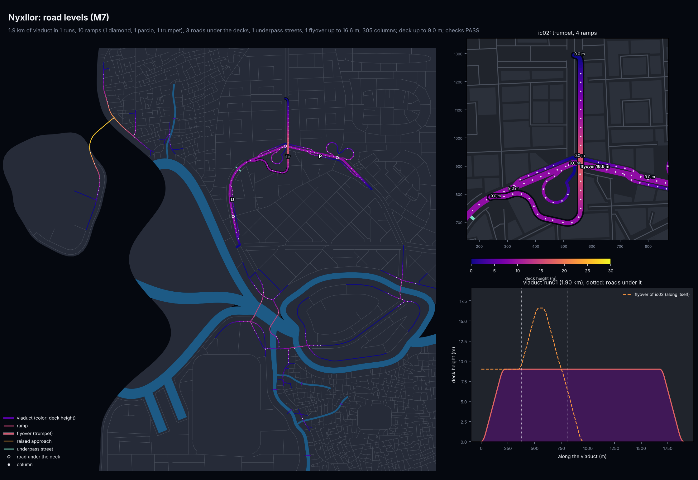
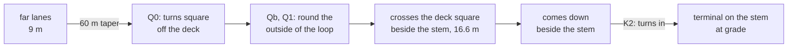

# M8d: the trumpet's flyover

M7b built a trumpet (a ground highway stem meeting an elevated run at a T) with two far
loops, because one ramp could not fly over another. M8d builds the textbook form instead:
one loop and one flyover for the two left turns. The two-loop form stays as the fallback
where the flyover does not fit.

Only Nyxllor among the samples has a trumpet, so it is the only city that changes. The other
four samples and the pinned demo are byte-identical to M8b. With the flyover switched off,
Nyxllor also reproduces M8b's model byte for byte (`29a57fe5...`), so the fallback is exactly
the M7b form.

| City | sha256 of `city_model.json` (x86_64 Linux) | vs M8b |
|---|---|---|
| archipelago_free_port | `dd2b22763893110783337b21b9f58b6e1b46900461144684fe42cb532dbe641a` | same |
| delta_megacity | `3800f2104d3183d5d606912e617365f80e51e63f5115f2af18a3a05251f508fb` | same |
| nexus_city | `f97e5177e235278914648449f39fa922b37f16d67fc833a3291eb6b7e1be1d76` | same |
| nyxllor | `23bfe34f8529cbae3de4a19fec793a2cc3c515d9934527d0eb4be5354b2fe60a` | new |
| peninsula_city | `0e6533f5821182e12fc690f788032c197230aaa2e2448d58e016b916255db5b2` | same |
| nyxllor_pinned | `fb773f4e722378be5eb972ecb67eb9adbc7f921fca51598c8e413325f1493afb` | same |

Every build passes all 66 checks. The Mac's byte-identity is still to be confirmed by the lead
session: every city folder has its `trace.json` (`citygen trace diff` finds the first stage
where two machines part).

## Before and after

Nyxllor's trumpet (ic02), road levels with the trumpet at street scale:

| Before: two far loops on a stub under the deck | After: one loop and one flyover |
|---|---|
|  |  |

The ramps of the trumpet, before and after:

| Ramp | Before (M7b) | After (M8d) |
|---|---|---|
| near lanes to the stem, stem to the near lanes | diamond ramps to the stem's near terminal | the same |
| far lanes to the stem | loop down to the stub end | flyover, 957 m, crest 16.6 m, on 27 columns |
| stem to the far lanes | loop up from the stub end | loop, 405 m: from the near terminal under the deck, then round its quadrant |
| stem | runs on under the deck to the stub end | ends at its near terminal |

## How the flyover is laid out

All in `citygen/elevated.py` (`Elev._trumpet_flyover`, `_flyover`, `_fly_fit`).

1. **Near side.** Unchanged: the diamond ramps of the near lanes land at the stem's near
   terminal $T_n$.
2. **Loop.** The M7b loop for one left turn, on the far side. Its terminal was on the stub
   past the deck. The loop now runs on from there under the deck along the stem to $T_n$, as
   a one-way ramp at grade, so the stem ends at $T_n$. No two-way stub is left with lanes
   that lead nowhere.
3. **Flyover.** It takes the other left turn and lies in the same far quadrant as the loop
   (in a trumpet both left turns do), so it wraps round the loop's outside:
   - It leaves the far lanes before the stem, with a 60 m taper on the deck, then runs beside
     the deck.
   - **Q0:** it turns square off the deck ($r = 60$ m) at a corner 25 m short of the loop.
   - **Qb, Q1:** it runs round the loop's outside, 20 m past it ($r = 45$ m), onto a line
     beside the stem on the side away from the loop. That line is half the stem, half the
     ramp and 3 m from the stem's centerline.
   - It crosses the deck square.
   - **K2:** it comes down beside the stem and turns into it ($r$ = the offset less 1 m) at
     a terminal $T_f$ (a signalized junction in M2).

   The trumpet tries the on loop with the off flyover first, then the reverse. An on flyover
   is the same path built backwards.
4. **Other shape.** A second shape, a diagonal from the deck over the loop to Q1, is tried
   if the bell does not fit.
5. **Heights.** Every road, viaduct and ramp under the path sets a need. Sampled every
   2.5 m, a need is its deck height plus the 5.5 m clearance, the 1.8 m deck and a 0.3 m
   margin; a ramp counts when it lies within its width plus 1 m (a road: 2 m).
   - The profile follows the deck along the taper.
   - It puts a 40 m crest on each need, with 5% flanks, and stays level between crests.
   - It ends with a 20 m flat landing at the terminal.
   - It is smoothed by the same 40 m vertical curves as every ramp. It must stay at most 6%
     steep everywhere and at most 22 m high.
6. **Room.** The landing is placed as near the deck as the fall allows. The diverge is
   placed as near as the climb allows (20 or 40 m further where another node is in the
   way). The path must keep off the water, reserves and the map edge. The terminal must
   stand on dry ground at grade, 30 m from the stem's far end.
7. **Columns.** The longest stretch over roads, ramps and junctions (a disc at each ground
   node near it) with no spot for a column must be at most 50 m. `road_supports` then puts
   its columns (none in the deck, a lane or a junction under it, so the check's 60 m span
   holds).
8. **Fallback.** If neither pairing fits, the two-loop trumpet of M7b is built, unchanged.
9. **Other ramps.** Ramps built later and the loops of other interchanges test a flyover in
   height (`_apart_in_z`): crossing it is fine with 7.3 m between the decks. Every other
   ramp pair still keeps 8 m apart in plan.

Determinism: every angle comes from `dmath` (`atan2`, `tan`, `sin`, `cos`), points are
snapped to the 0.01 m grid, distances are plain arithmetic rounded to 1e-6 m (`_near`,
numpy elementwise, the first segment on a tie), STRtree hits are sorted, and no set or dict
order reaches a decision.

## The model, previews and blockout

- **Model.** The flyover is a ramp segment like the others (`road.highway.ramp`, one lane,
  one-way), with `attrs.flyover` true and `level` 2. The report's elevated stats gain
  `flyovers` and `max_flyover_m`.
- **`preview_elevated.png`.**
  - The flyover has a dark casing, so it reads on top of the deck.
  - The street-scale inset prefers a trumpet with a flyover (template label "Tr" on the map)
    and marks the flyover's crest.
  - The profile panel adds the flyover's own profile (dashed) to the viaduct's.
- **Blockout.** The plan draws the flyover as an elevated deck at its heights, like every
  ramp; its columns are model structures (`tests/test_elevated.py` checks the plan).
  **Blender is not available in this cloud container** (download.blender.org is blocked by
  the network policy), so the `.blend`, the glTF tiles and the 8K renders of M8d are left to
  the lead session. The blockout plan hashes in `tests/data/golden_hashes.json` are updated
  (only Nyxllor's changes).

## Tests

In `tests/test_elevated.py`:
- `test_trumpet_flyover_geometry`: Nyxllor's roads alone.
  - The trumpet has one loop and one flyover on the far side, in opposite directions.
  - The loop and the near ramps share the stem's near terminal, and the stem ends there.
  - The flyover starts on the deck at its height and lands on the stem at grade, at most 6%
    steep.
  - It clears the run by the clearance and both decks wherever it is over it, and it keeps
    off the loop in plan.
- `test_trumpet_falls_back_to_two_loops`: with no room for a flyover, the two far loops
  share the stub's end, as in M7b.
- `test_flyover_in_the_city`: the built city.
  - The flyover is one-way, one lane, level 2, on its own columns (14.6 m the tallest).
  - Every M7 check passes, and the blockout plan has its deck.
- `test_flyover_checks_fail_on_a_broken_copy`: each M7 check fails on a broken copy.
  - deck clearance: the crest lowered onto the deck;
  - grades: a 30 m spike;
  - level continuity: the deck end's node lifted;
  - ramps land: the ground end lifted 6 m;
  - supports: its columns removed.
- `test_trumpet_geometry`: the two-loop form, now through `_stub_leg` and `_trumpet`.

## Sweep

SWEEP_PLACEHOLDER

## Open items

- **Flyover length.** The flyover is long (957 m in Nyxllor): it climbs to 16.6 m and falls
  at the 5% design grade beside the stem. A run with interchanges close together, or a short
  stem, falls back to the two loops.
- **Crossing the stem.** In the bell the flyover passes over the deck, the near ramps and
  the stem's near terminal beside the stem. It only crosses the loop itself in the
  diagonal shape.
- **Renders.** The Blender blockout and the 8K renders are for the lead session (no Blender
  here). The root README keeps M8b's whole-city renders until then.
