# Visible lights (atmosgen runtime, after AT4)

Swagnik's notes after walking the packaged Delta (2026-11-12): the live set lit every light in a
circle round the player. Flying and in the free camera that is fine; on foot it should be the
lights the player can see, out to about four times the circle's radius, billboards included:
no light close but hidden, every light far but in sight. Built on the Windows PC (RTX 4070 Ti),
2026-11-13, on main after the play fixes (#213). Spec: `docs/unreal_export.md`, "Visible
lights"; `docs/atmosgen_scope.md` 6.1 and 9.

## What changed

| Part | Where | What |
|---|---|---|
| Sight raster | `atmosgen/sight.py`, the plan's `sight`, `sight.png` | the lux check's occluders (masses 0.5 m in, deck slabs) and the raised roads (a viaduct's deck from its underside to its parapet, ramp feet and embankments from the ground) on 2 m cells, every rounding toward seeing; Delta's 1,750 x 1,750 cells, 20% occupied, 0.2 MB |
| Tiers | `presets.TIERS["sight"]`, the plan's `tiers.sight_m`, `sight_max` | 1,200 m (four times the mid tier's 300 m), 512 |
| Exporter | `unreal_atmos.sight_settings`, `import_city.py` (`atmos5`) | the raster on the controller as runs; the cells always loaded (their lights reach past World Partition's 768 m) |
| Runtime | `CityGenAtmosActor.cpp` | round a walker the live set by sight, swept on a worker thread; fades in time in both modes; fixtures and plumes made near the view only |
| Benchmark | `bench.job`, `UCityGenBench` | each segment's console commands: by sight on the walks and the drive, the circle in the flight |
| Check | `check_city.py` | `*_sight` and `*_circle` views, their live sets in `sight_views` |
| Player start | `unreal.player_start`, `_start_spot` | moved to an open, lit sidewalk |

## How the visibility is tested, and why this way

Delta has 50,300 lights; within 1,200 m of a street in the core there are 13,000 to 19,000 on at
night. Three ways were weighed:

- **Line traces against the level's collision** (budgeted, round-robin): the obvious engine
  route, but past World Partition's 768 m loading range there is no collision to hit (the far
  city is HLODs without it), so every far light would count as seen; and a trace per light per
  sweep is game-thread work (async traces still resolve on the game thread's physics scene).
- **The engine's occlusion results** for a light's fixture or a sign's face: a light has no
  primitive of its own to query (the plan's lights are data; the fixtures are stage 2 meshes,
  a sign's face part of its building's mesh), and occlusion queries answer only for what is
  loaded and in the view frustum, so turning round would make the set pop.
- **A precomputed raster from the plan's own occluders**, marched per light on a worker
  thread: what was built. It knows the whole city whatever is streamed, does not depend on
  the view's direction, is deterministic (the plan writes it, the check and the runtime read the
  same cells: `sight.visible` in Python is `FCityGenSight::Visible` in C++), and costs one
  thread a few milliseconds a sweep. A precomputed visibility per walkway cell was the third
  option of the brief; a per-cell list of visible lights would have been large (Delta's
  walkways at 16 m cells times hundreds of lights each, tens of MB) and stale between cells,
  where the raster is 0.2 MB and exact at the eye.

The march: the 2 m cells a segment from the camera crosses in plan, its height span in each
against the cell's (the ground below, the occupant's bottom to top), the eye's own cell, the
first 0.5 m and the last 1 m left out. A light counts as seen when the segment to the light, or
to where its light lands (a spot's pool on the ground, the floor under a point, a patch in front
of a face or along a flood's aim), is clear; so a lamp round a corner whose pool shows on the
cross street stays. A sweep runs every 0.2 s, a light stays seen 0.6 s after the last sweep
that saw it, and every light fades in and out over 0.5 s.

Measured in the game (the check's views and the benchmark's segment states): a sweep tests 7,000
to 19,500 lights with 13,000 to 34,000 segments in 2 to 14 ms on its worker thread; gathering
them on the game thread takes 0.3 to 0.7 ms every 0.2 s.

## What it lights

The live set round a walker by AT1's circle (left) and by sight (right), from the plan's lights
and the sight raster (the runtime's rules in Python; yellow live, red within 300 m but out of
sight, the dashed circle 300 m, the dotted 1,200 m):

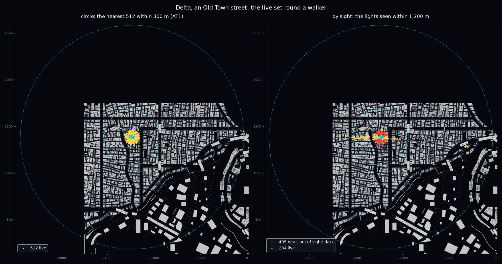

In Old Town the circle's 512 nearest reach only 74 m: nine in ten of them behind the next
buildings. By sight 234 lights are live, the street ahead lit 380 m out.

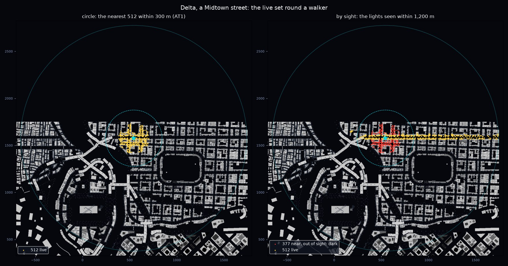

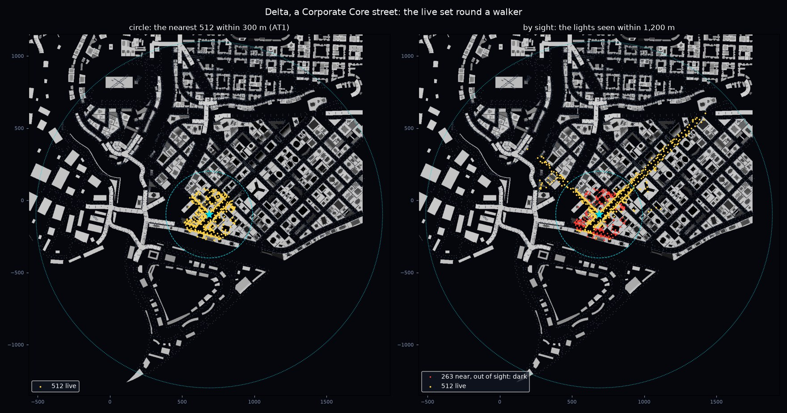

In Midtown and the Corporate Core the street's 512 by sight reach the end of the avenue, 1.2 km
out (274 and 174 of them past 300 m), and leave out the 377 and 263 lights behind the blocks
round the walker.

In Unreal (the check's views by night, 1920 x 1080, the same view by the circle and by sight;
the counts are the controller's at the shot):

| View | Live by the circle | Live by sight | of them high (floods, searchlights) |
|---|---|---|---|
| Old Town street | 512 | 193 | 0 / 0 |
| Corporate Core street | 560 | 558 | 48 / 48 |
| Midtown street | 560 | 486 | 48 / 7 |
| The avenue west through Old Town | 560 | 515 | 48 / 3 |

**A long street whose far lamps and billboards are lit** (Old Town, the far end 2x):

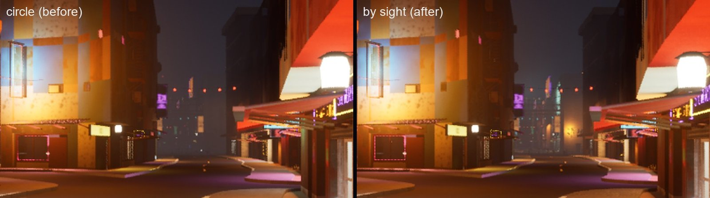

| Circle | By sight |
|---|---|
| 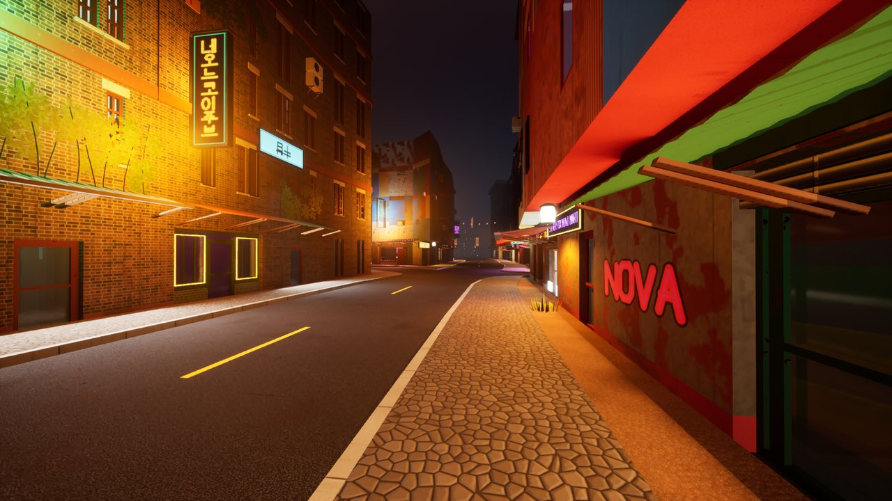 | 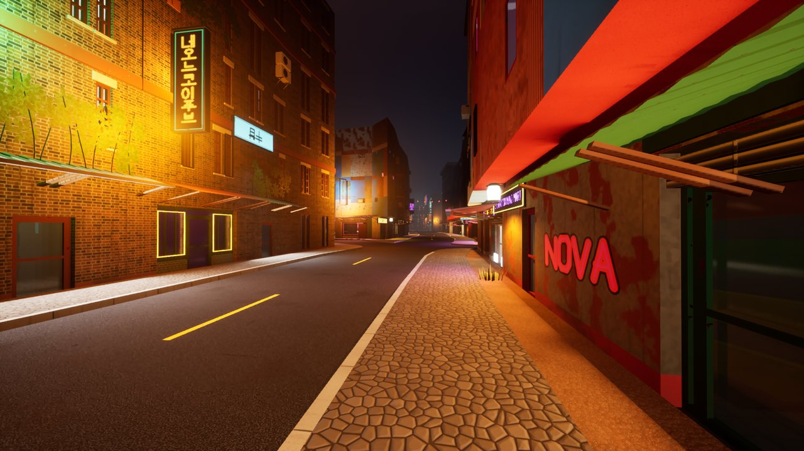 |

The near street looks the same with 193 lights as with 512: the 319 left out were behind the
buildings. The far end, dark by the circle, has its shop signs, spill and street lights.

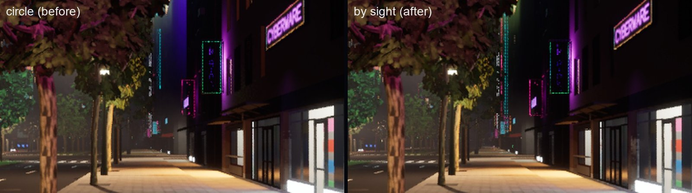

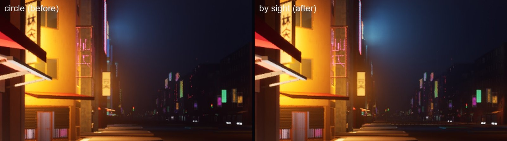

**A spot whose lights behind a building are out** (the same Old Town spot, facing the wall
across the street; 405 of the lights within 300 m out of sight): by the circle the wall's face
had green and purple patches from lights the walker cannot see (an unshadowed light shades
whatever is in its reach, through what stands between); by sight they are out, and the wall
shows the lights in front of it.

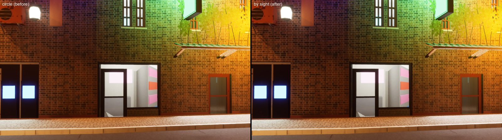

## The player start

Delta's start (the fast-travel point nearest the middle, `stn.industrial_port.fast_travel`)
stood under the Industrial Port's sky tube station deck, dark even by day. The exporter now
moves it to the nearest sidewalk point with nothing raised within 10 m and a street or wall light
within 20 m, facing along the sidewalk toward the middle: 108 m along the sidewalk, facing east
toward the core.

| By day | By night (the play window at the start) |
|---|---|
| 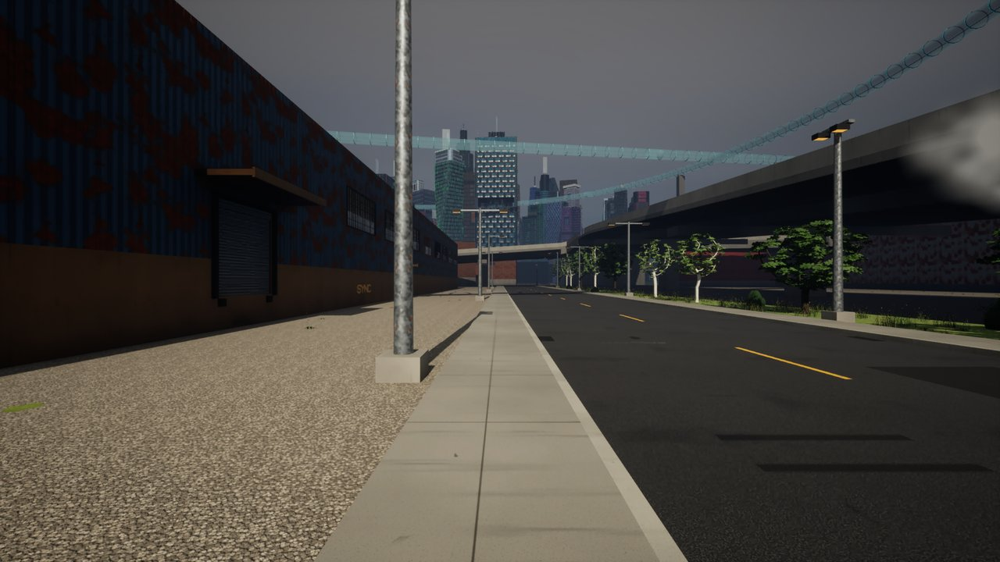 | 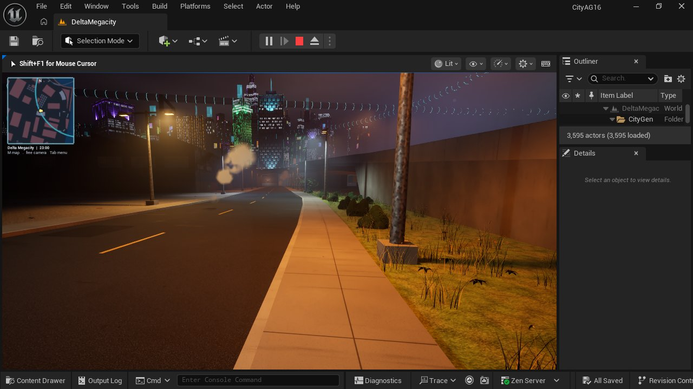 |

## The night's frame time

The lean benchmark once (`--bench-atmos`, `night_plan_all`, `bench/`), the walks and the drive
by sight, the flight by the circle, not flagged (the game held the foreground, other processes
0.4 cores):

| Route | p95 before (the play fixes) | p95 after | GPU p95 after | p50 after |
|---|---|---|---|---|
| walk | 15.6 | **14.6** | 13.3 | 13.1 |
| drive | 15.3 | **14.9** | 13.6 | 13.4 |
| fly | 15.7 | **15.1** | 11.6 | 11.2 |
| all | 15.5 | **14.9** | 13.3 | 12.4 |

(ms, 2560 x 1440.) The night is 1.8 ms under the 16.7 ms budget. On foot the live set is mostly
smaller than the circle's (the walk's live set 138 to 392 at its states, the circle's 512): the
lights behind the blocks cost the deferred light pass their reach's screen area (they shaded the
walls and streets in front of them through the buildings) and are gone, and the far lights in
sight each cover a few pixels.

**Quick GPU profiles at fixed viewpoints** (`viewprof/`: one standalone game at 2560 x 1440,
`night_plan_all`, each view a 3 m walk at 0.5 m/s twice, by the circle and by sight, after a
warm-up pass over the same views; ms):

| View | Live, circle / sight | GPU p50, circle / sight | GPU p95, circle / sight | Frame p50, circle / sight |
|---|---|---|---|---|
| Old Town street | 512 / 193 | 12.21 / 11.51 | 12.45 / 11.77 | 13.04 / 12.20 |
| Corporate Core street | 560 / 559 | 12.81 / 12.79 | 13.13 / 13.08 | 13.64 / 13.61 |
| Midtown street | 560 / 486 | 13.56 / 13.28 | 13.82 / 13.53 | 14.35 / 14.07 |
| Avenue west through Old Town | 560 / 515 | 11.78 / 11.32 | 12.04 / 11.57 | 12.53 / 12.04 |
| The player start | 318 / 295 | 12.98 / 13.00 | 13.24 / 13.25 | 13.76 / 13.77 |

By sight the GPU is the same or up to 0.7 ms faster at every view: where far lights in sight
join the set (Midtown and the Core: 274 and 174 of the street's 512 past 300 m), they cost less
than the near lights behind the blocks they replace. Gathering a sweep on the game thread takes
0.3 to 0.7 ms every 0.2 s (each light's landing point and each schedule's level cached; 1.1 to
2.4 ms in the benchmark's run before that cache), the sweep 3 to 5 ms on its worker thread. No
tuning was needed.

## The packaged game

CityAG16 mirrored into CityPackaged (robocopy without `Saved`, `Intermediate` and
`DerivedDataCache`) and packaged (Development, Win64) into
`C:/Users/swagn/CityGen/builds/packaged/Delta_lights/Windows/CityAG16.exe`, 3.0 GB. A smoke launch
(`-userdir=` outside the package, no `Saved/` left in it) loads the city with its controller,
the 518 cells' 50,300 lights and the 1,750 x 1,750 sight raster, nothing skipped.

The first try failed to link: the mirror copies each plugin's own `Intermediate` folder, whose
build files name CityAG16's paths, so the package's editor build linked the atmos plugin into
CityAG16's `Binaries` and found no `.pdb` of its own. With `Plugins/*/Intermediate` and
`Plugins/*/Binaries` cleared in CityPackaged it builds and cooks; a mirror for packaging should
leave those out as well.

## Validation

- Tests (logged, `-v -rfE --durations=25`): `tests/atmosgen/test_at_sight.py` (new),
  `tests/atmosgen/test_at_plan.py`, `tests/test_unreal_atmos.py`, `tests/test_bench.py`, and in
  `tests/test_unreal.py` the new `test_player_start_on_an_open_lit_sidewalk` and
  `test_inside_concave`: 37 passed.
- Delta's plan again (its sight raster; its lights, lux, faces and air checks as they were) and
  imported over the play fixes' import in CityAG16 (the controller and the 518 cells updated,
  nothing else); the city check by night passes (spawn on the ground at the new start, streaming,
  traces, the walk, the play features with 543 lights live at the start, the flight) with the
  views above.

## Open items

- **Props and trees occlude nothing** in the raster (nor do stage 2's balconies, fins and
  canopies past the model's masses): a light behind a dense row of trees counts as seen.
- **A light seen only through a gap the 2 m cells close** (a lane narrower than about 3 m between
  two buildings) counts as hidden; the raster leans to seeing at every rounding, but a gap under
  a cell's width is not one.
- **The far tier** past 1,200 m is still the play features' light pools (AT7's).
