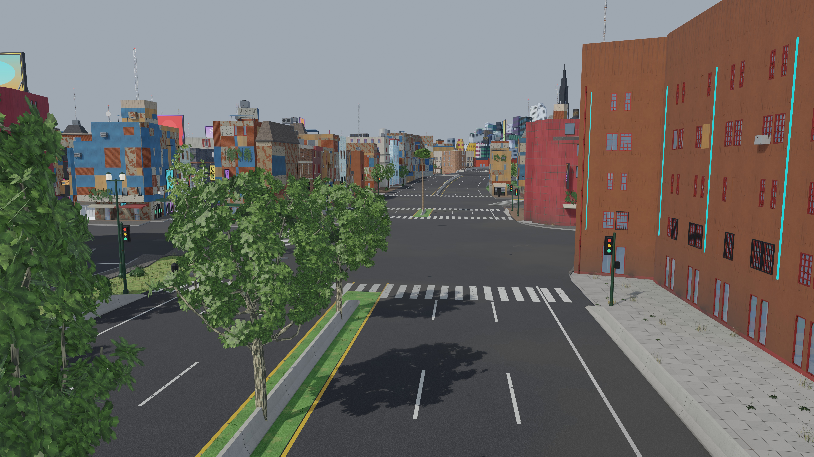

# Barriers and props at junctions (issue #95)

A fix between milestones, from run-through 2 (Delta Megacity in Unreal): road barriers and
props crossed the junctions, so it was hard to tell whether the road geometry itself was
still wrong. This fixes the barriers and the props only; the junction surfaces (#82, #89)
are not part of it. Code: `assetgen/streets/barriers.py` (AG7), `assetgen/fit/barriers.py`
(AG14's check), `assetgen/props/gather.py` (`_Fit`, AG8), `citygen/props.py`
(`_clear_of_roads`, M6). Log: `docs/assetgen_milestones.md`, "Fix: barriers and props at
junctions".

## What was crossing what, and why (Delta on main)

Measured with the new check (`assetgen fit`, `asset_clash`) on main's packs:

| | Count | Cause (by kind; one crossing can hold more than one kind) |
|---|---|---|
| Barriers in a junction | 139 | a raised road's parapets drawn the whole segment (`roads._deck`, 0 to L) through the junction at each end (97 in their own junction, 7 in the next); a footbridge's railings drawn its whole road (30); a highway's guard walls and median ending open at a skewed cut (6) |
| Barriers on a crosswalk | 75 | those parapets across the other legs' crosswalks (58); a highway's median barrier (57) and an at-grade highway's guard walls (10) swept cut to cut through the crosswalks of its signalized junctions |
| Barriers on another road's carriageway | 11 | parapets running on past a junction onto the next leg or a road beside it (8), guard walls (2), a footbridge's railing (1) |
| Barriers through each other | 10 | two legs' parapets crossing where they meet at a junction |
| Props on a carriageway, junction or crosswalk | 108 | M6's quay railings, which had no keep-outs at all, across a street's junction at the quay or a road ending at the water (93); AG8's variants larger than M6's placement radii (a bench 2.0 m to M6's 1.8, a dumpster 2.5 by 1.8 to 2.0 by 1.2, a bollard 0.5 to 0.2): 6 benches, 4 dumpsters, 3 bollards, a trash can, a traffic signal |
| Props through a barrier | 0 | |

Leads from the issue: AG7's `_median` (confirmed: medians and guard walls cut to cut, open
ends, through crosswalks); the raised decks' parapets (confirmed, the largest part); M14's
deck ramps (cut to cut with open ends, as the medians); citygen's `highway_barriers`
(corrected: it walked the centerline through the junctions, but AG8 drops every one of them
where AG7 draws the median, all of Delta's, so in the assets they never showed; the blockout
drew them).

## What changed

- **AG7 barrier runs** (`assetgen/streets/barriers.py`): each barrier is a run over spans
  its road's gather works out: cut to cut, less where it comes within 0.15 m of a junction
  at its ends that does not carry it on, of another leg's carriageway (a gore, an acute
  corner), of another junction or its corner pads at its height, or within 1 m of a
  crosswalk. Ends: a jersey (median, guard wall) slopes down to 12% of its height over 3 m,
  a parapet or a deck ramp's barrier is capped; a raised road's parapet ends on its cut edge,
  or on a sidewalk exactly where its junction's corner pad begins.
- **Junctions carry their own barriers**: a raised junction a parapet round each corner
  (along its drawn pads' outer edges, else its outline), an at-grade corner between two
  guard-walled highways a guard wall, and a median across where two median legs face each
  other and no connector lane crosses; each clipped clear of its legs' carriageways (as
  their road pieces draw them), its own lanes, its crosswalks, other roads and junctions
  near it at its height and the building masses there.
- **Footbridges**: railings and stone parapets end short of their junctions.
- **Props**: AG8 draws the first variant of a prop's family that keeps clear of every
  vehicle carriageway, junction and crosswalk at its height, else leaves it out; M6's quay
  railings stand at most 5 cm onto a vehicle junction or a road's carriageway and keep 1 m
  off a crosswalk (a railing at a promenade's edge stays), and the median barrier props keep
  off junctions and crosswalks (the blockout too).
- **Check**: AG14's `asset_clash` fails on any barrier on another road's carriageway, on a
  junction (a junction's own barriers in one of its lanes), on a crosswalk, or through
  another piece's barrier, and any standing prop on a carriageway, junction or crosswalk or
  through a barrier.

## Delta, before and after

| | Main | This fix |
|---|---|---|
| Barriers on another road's carriageway | 11 | 0 |
| Barriers in a junction | 139 | 0 |
| Barriers on a crosswalk | 75 | 0 |
| Barriers through each other | 10 | 0 |
| Props on a carriageway, junction or crosswalk | 108 | 0 |
| Props through a barrier | 0 | 0 |
| All | 343 | 0 |
| Full-city tries | 2 | 2 |

## Every sample

Each sample built with `citygen build` and `assetgen build` on this branch (Windows PC),
then measured with the check:

| Sample | Full-city tries (main, this fix) | Barrier and prop crossings | Other assetgen checks failing (on main too) |
|---|---|---|---|
| Delta Megacity | 2, 2 | 343 to 0 | none |
| Vesper Bay | 1, 1 | 372 to 0 | none |
| Nexus City | 1, 1 | 0 | `asset_unique` (two towers share a system), `asset_access` (2 doors blocked) |
| Greyhook | 2, 2 | 0 | none |
| Saltreach Free Port | 1, 1 | 0 | `asset_envelope` (one part over a road) |
| Vesper Bay Pinned | 2, 2 | 0 | `asset_grounded` (a 0.43 m step at `jn.e368s514`) |
| Vesper Bay Stacks | 2, 2 | 0 | `asset_grounded` (a 0.349 m step at `jn.e559s304`) |
| Vesper Bay Decks | 3, 3 | 0 | `asset_envelope` (`d05.lot.w576n1053.bld`) |
| Cragmouth | 2, 2 | 0 | `asset_access` (1 door blocked), `asset_mounts` (64 off their walls, 1 on glass) |

Every citygen check passes on every sample (102, 107 with decks). Main was measured on
Delta and Vesper Bay only; the failing checks in the last column are about buildings and
junction surfaces, which this fix does not touch (the briefs and building packs are as on
main).

## Renders

8K, before (main) and after, textured (`assetgen materials preview --eye --target`):

| View | Main | This fix |
|---|---|---|
| Delta, a highway crossing an avenue at grade (medians on both) | [before](delta_highway_junction_before.jpg) | [after](delta_highway_junction_after.jpg) |
| Delta, a raised junction of five legs (`jn.e217s328`) | [before](delta_raised_junction_before.jpg) | [after](delta_raised_junction_after.jpg) |
| Delta, a raised highway crossing an avenue (medians on both, `jn.e179n1530`) | [before](delta_raised_avenue_junction_before.jpg) | [after](delta_raised_avenue_junction_after.jpg) |
| Vesper Bay, an off-ramp's gore on a highway | [before](vesper_bay_ramp_gore_before.jpg) | [after](vesper_bay_ramp_gore_after.jpg) |

Top-down plans (barriers red, asphalt dark, paving tan, junction outlines blue, crosswalks
green, connector lanes magenta; `plot_plan.py`):

| View | Main | This fix |
|---|---|---|
| Highway junction | [before](plan_highway_junction_before.png) | [after](plan_highway_junction_after.png) |
| Raised junction | [before](plan_raised_junction_before.png) | [after](plan_raised_junction_after.png) |
| Raised avenue junction | [before](plan_raised_avenue_junction_before.png) | [after](plan_raised_avenue_junction_after.png) |
| Ramp gore | [before](plan_ramp_gore_before.png) | [after](plan_ramp_gore_after.png) |

## For the road recheck

What the barriers hid, or what they now leave open, for Swagnik's recheck of the roads
(none of it changed here):

- **Overlapping raised junctions:** Delta's five-leg `jn.e217s328` overlaps `jn.e170s444`;
  their corner pads and sidewalk slabs still cross each other (#82). The barriers keep off
  both.
- **Corner pads over turning lanes:** where a raised junction's corner pad is drawn over a
  connector lane (Delta's `jn.e179n1530`), that corner gets no parapet (one would stand in
  the lane), so the deck edge there is open until the pads are fixed.
- **Long junctions:** M17's long cuts make some junction polygons reach 30 m and more along
  a leg (an avenue exit 121 m), over sidewalks and carriageways; the legs' barriers end at
  them, so there are long gaps in the guard walls and parapets there.
- **Footbridge stairs** start inside their junctions; the railings now stop at the
  junction's edge.
- **Junction steps (on main too):** Vesper Bay Pinned's `jn.e368s514` (0.43 m to
  `rs.e312s524`) and Vesper Bay Stacks' `jn.e559s304` (0.349 m to `rs.e536s213`).
- **Alley hairpins:** AG7's mitre at a sharp bend bulges the carriageway (Vesper Bay
  Decks' `rs.e1681s1093`).
- **Deck girders:** a raised road's girder is still drawn its whole length, under its
  junctions.
