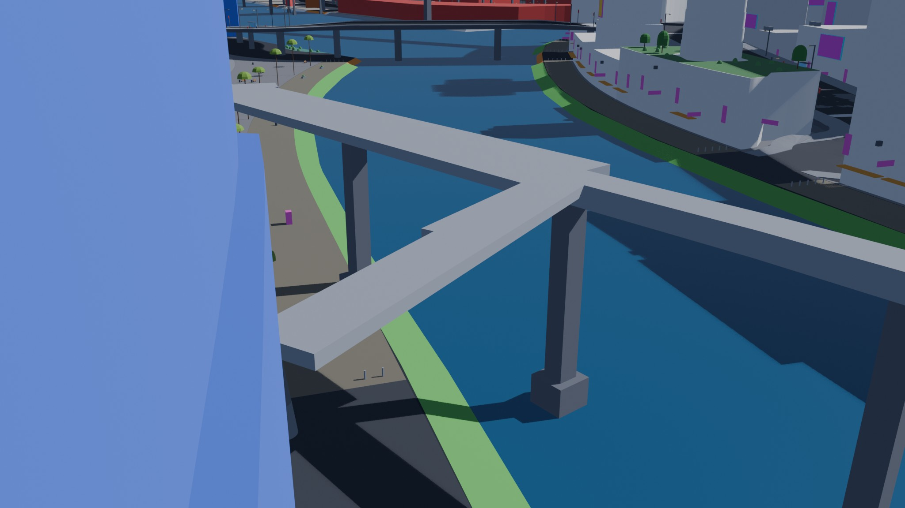

# The city open items (city_open_items)

Built on the Windows PC (2026-11-20). Four open items found on Delta Megacity after the
delta_rebuild and LG7, fixed where they come from, each with a check that fails on it. Delta was
built again on the branch (`C:/Users/swagn/CityGen/builds/delta_next`, the same steps as
`delta_main`: `citygen build --blockout --no-render`, `assetgen build --workers 2`, `atmosgen
plan`, `lifegen plan --atmos`); every stage passes.

| Part | Where | What |
|---|---|---|
| Station stairs at a stair's grade | `citygen/transit.py` (`Builder._elevated`, `_metro`, `STAIR_MAX_GRADE`, `STAIR_GRADE`), `transit_checks.check_station_access` | a stair too steep becomes a bridge at the platform's height and an elevator (elevated), or steps along the concourse (metro); the check fails a stair or escalator over 0.7 m a meter |
| Pads open to the sky | `citygen/buildings.py` (`_pad`, `pad_blocked`, `PAD_CLEAR_M`), `building_checks.check_roof_items` | a pad moves off its building's crown or is not laid; the check fails a pad under its building |
| Every pad flown | `lifegen/airwater.py` (`car_pairs`, `pad_route`) | an odd pad out joins the pair nearest it as a third stop |
| Slots at their walkway's height | `lifegen/places.py` (`level_slots`, `height_check`), `lifegen/plan.py` | a slot whose walkway is far above or below it takes one at its height within reach, else is left out; `slot_heights` fails one still off |
| Bridge piers out of the channel | `assetgen/streets/structures.py` (`pier_spots`, `channels`, `CLEAR_SPAN_M`, `CHANNEL_M`), `streets/checks.py` (`street_channels`) | short crossings spanned whole, longer ones keep their piers from the shores to the channel's edge; check `street_channels` |
| Moorings leave a way through | `citygen/props.py` (`boats_in_water`, `open_across`, `NAV_CLEAR_M`), `prop_checks.check_boats` | a boat moors only where it leaves 8 m of open water across its waterway; `boats_afloat` fails one that leaves less |
| Build log | `citygen/build.py` | a failing city try names its failing checks and their first failure in the progress line |
| Docs | `CLAUDE.md`, `docs/citygen_milestones.md`, `docs/lifegen_milestones.md`, `docs/assetgen_milestones.md` | |

## 1. Station stairs at a stair's grade

**Cause.** `transit.Builder._elevated` drew every elevated platform end whose sidewalk was a meter
or more away as one straight stair walkway from the platform (15.8 to 31 m up) to the sidewalk
point under it: Delta's Midtown stair rose 31 m over 18 m, and every elevated stair in Delta on
main rose 19 to 31 m over 3 to 17 m (60 to 80 degrees). Nothing drew the stairs, and lifegen's
people climbed through the air. A metro stair whose sidewalk point was 0.5 to 11 m from its
concourse end went down 8 m over that run too.

**Fix.** A stair rises at most `STAIR_MAX_GRADE` 0.7 m a meter of run (35 degrees, the steepest
stair built). Where an elevated platform end's straight stair would be steeper, the end gets a
bridge at the platform's height out over its sidewalk point (walkway `elevated`,
`attrs.lift_bridge`; a `skywalk` deck structure `<station>.lb<a|b>`, which the blockout draws as a
deck ribbon and AG7 as a glazed, roofed bridge) and an elevator down from its end; a bridge that
would pass through a building mass at its height (the check's own test) or within reach of
another line takes the elevator at the platform end and a path instead (as an end reached only
round the buildings did). A metro stair too steep steps its top along the concourse until its
run reaches `STAIR_GRADE` 0.62 (its landing goes on along the concourse to its end, where the walk
graph joins it), else an elevator straight down from the concourse end and a path; a stepped
stair that would pass through a building mass takes the elevator too. `station_access` fails a
station stair or escalator steeper than 0.7.

Delta: station stairs steeper than 0.7, 14 of 23 on main, none on the branch; 10 platform ends
take a bridge and an elevator, 12 stairs stay (metro stairs stepped to 0.62, and long elevated
ones under 0.7); 27 elevators (20 on main).

## 2. Slots at their walkway's height

**Cause.** `lifegen.places` took a slot's walkway as the nearest at its height where one was
within reach, else the nearest of any height; a place's slot (a bar's smokers, a club's queue)
took its door's walkway whatever its height. On Delta, 12 slots left from a walkway 2 to 31 m
above them: bars' and shops' doors on a raised road's sidewalk, a bench by a quay under a
viaduct, a vending machine at a station's foot beside its 31 m platform.

**Fix.** `level_slots` (after the slots are seated on their surface): a ground level slot whose
first point is more than `SLOT_STEP_M` (1.5 m) from its walkway's height where it leaves it takes
the nearest walkway at its height within `SLOT_REACH_M` (a gang's spot one on its own turf), else
is left out (`left_out.not_at_height`, `moved_to_height`). `slot_heights` fails a slot still more
than 1.5 m off.

Delta: 3 slots take a walkway at their height, 10 are left out; `slot_heights` passes with
none more than 1.5 m off (12 on main).

## 3. Pads open to the sky

**Cause.** M3's `rooftop` put a helipad or AV pad at the middle of the top roof, and M21's crowns
put a mast, a spire, a halo's ring and struts or an exo frame there too: 20 of Delta's 66 pads on
main had their own building's crown over them (LG7 left them out).

**Fix.** `buildings._pad` tries the roof's middle, then the spots toward its sides and corners
the roof holds, and keeps the first whose square grown by `PAD_CLEAR_M` (1 m) meets no mass of
the building above the roof (`pad_blocked`, an exact test on the grid's square); none, no pad (the
mechanical penthouse takes its place, as on a roof too small for one). `roof_items` fails a pad a
mass of its building stands over. lifegen pairs pads for flights; an odd one out was left
unflown, so it now joins the pair with the pad nearest it as a third stop of that tour
(`car_pairs`, `pad_route`).

Delta: 57 pads, every one open to the sky and every one flown (66 on main, 46 flown, 20 under
their own building's crown).

## 4. Bridge piers out of the channel, and a way past the moorings

**Cause.** AG7's `_piers` stood `max(1, run / 40 m)` piers evenly over every stretch of water a
bridge crosses, so every canal and river crossing under 80 m had one pier in its middle: on Delta
on main 19 piers, 9 of them in canals. LG7's boats on two canals (Old Town's `d04.ww.w337n1324`,
the western separation channel `sep.w992n779`) turned short of them. The Old Town canal LG7 left
without a boat (`d04.ww.w1281n1018`, 14 m between its 5 m quays) had no pier on this layout: its
17 moored boats, all along both quays, left 6 m of open water beside each, which lifegen's 4 m
water raster could not pass.

**Fix.** `pier_spots`: a stretch of water of `CLEAR_SPAN_M` (45 m) or less is spanned whole; a
longer one keeps its piers from each shore out to the navigable channel's edge, at most 40 m
apart, the channel one span (`CHANNEL_M`: river 40, canal 8 m, at most half the width, as
citygen's transit piers keep `transit.CHANNEL_M`; the open sea has none, its piers evenly as
before). AG7's check `street_channels` fails a pier in a channel or a short crossing. In
citygen, `props.boats_in_water` moors a boat only where the open water across its waterway
beside it (the waterway less the quays' bands and the moored hulls, on three lines square to its
hull) stays `NAV_CLEAR_M` (8 m: two boats' lanes, and room for lifegen's raster) wide, for it and
every boat moored near it; `boats_afloat` fails a boat that leaves less.

Delta: 14 bridge piers, none in a channel (19 on main, 7 in canals); moored boats 76 to 52; all
10 of LG7's boat routes run whole (on main the Old Town canal `d04.ww.w1281n1018` had none and
two routes were cut short of a pier).

## Delta on the branch

| Stage | Time | Checks |
|---|---|---|
| `citygen build` | 13m32s (the third layout, salt 2, as on main: tries 1 and 2 fail as they do on main) | 108 of 108 pass |
| `assetgen build` | 12m34s | every stage's checks pass (`street_channels` new) |
| `atmosgen plan` | 1m47s | pass |
| `lifegen plan --atmos` | 66 s | 37 of 37 pass |

The build is left at `C:/Users/swagn/CityGen/builds/delta_next` (its `build.sh` and logs beside
it) for the import and package.

## Cities whose models moved

Every city moves on purpose (`tests/data/golden_hashes.json`: the five samples', Cragmouth's
and Vesper Bay Decks' models and blockout plans, from builds of the branch in
`C:/Users/swagn/CityGen/builds/goldens_city_open_items`); every one builds on the same try as on
main and passes all its checks:

| City | Platform ends with a bridge and an elevator | Metro stairs stepped along the concourse | Pads | Moored boats |
|---|---|---|---|---|
| Archipelago Free Port | 15 | 0 | 60 | 16 |
| Cragmouth | 0 | 11 | 18 | 25 |
| Delta Megacity | 10 | 3 | 57 | 52 |
| Nexus City | 7 | 2 | 43 | 17 |
| Greyhook | 9 | 7 | 8 | 13 |
| Vesper Bay | 7 | 6 | 32 | 14 |
| Vesper Bay Decks | 7 | 6 | 42 | 14 |

assetgen's goldens (`tests/assetgen/data/`: the small test city's briefs, manifest, files and
materials, the five samples' briefs, its streets, water, props and ground) are written again
from the same builds (`tests/assetgen/goldens.py --builds`, `streets_goldens.py`,
`water_goldens.py`, `props_goldens.py`, `ground_goldens.py`): the small test city's model moves
with the pads and moorings, and every bridge's piers with `pier_spots`.

## Open items

- **Long stairs:** an elevated platform end whose sidewalk point is far enough away keeps a
  straight stair at a buildable grade, but the stairs of stations are still not drawn (nor their
  elevators, except a sky station's core): a 70 to 180 m stair from a 31 m platform is a straight
  walkway through the air at 0.2 to 0.45. A stair with landings and its geometry, or an
  elevator for every end past a run, is a later step.
- **Elevators at a sidewalk** have no shaft drawn; lifegen hides the people riding them.
- **Moorings:** Delta's moored boats 76 to 52 (the Old Town canal's 17 and the second side of the
  two 18 m canals where boats lay opposite each other).
