# The clothing fixes (lifegen, after LG8)

LG2's garment faults fixed and the people library rebuilt (`LIB_VERSION` lg2.2, hash
`5279ccbf5d436abe`; LG2's was `dd24b28ed929920b`), on the Windows PC (2026-11-17), on main
after LG8 (#237). The characters themselves were kept (the project's MetaHuman Characters and
their assembled bodies: no cloud request); their clothing was dressed again in Blender and the
looks, mid meshes and cards made again in the editor.

## What was wrong, and what changed

| Fault (LG2's open items and what the rebuild's checks found) | Cause | Fix |
|---|---|---|
| A long coat over trousers showed the layer under it at the waist while walking | the two layers skinned apart (each from the body or plain outfit nearest it), 4 mm apart | an inner layer's vertex within 4 cm under an outer garment's fitted parts takes that garment's nearest vertex's skin weights in the editor (wholly within 2 cm, `garments.follow_pairs`, `people_library.skin_garment`); its faces taken out where the outer garment runs within 3.5 cm and every ray from them, straight and tilted 30 degrees each way, meets it (`hide_covered`), but never within 6 cm of that garment's open edge (a hem, cuff or opening: walking lifts it, and a first build of this fix showed a hole under a jacket's back there); what still lay outside an outer garment pulled back under it (`layered`) |
| Coats' and raincoats' skirts: holes, steps, a weak front panel, on long-armed bodies hung off a sleeve | the skirt hung from the lowest open loop (on a long-armed body a sleeve's end), faces skipped where the loop's vertices were 6 cm apart, its radius stepping in and out between the legs, its faces wound inward (so `hide_covered` took them out where its rays met the trousers) | the skirt built from its own hem's outer vertices over the hips (`flare`: quads all the way, the legs' outline dilated and smoothed, the hands ignored, never narrower than the ring above), every face wound outward (`orient_out`), held at the hem in the drape |
| Tops and coats on heavy bodies folded under the belly and at the hem | the garment offset from the body tucked in under the belly and round the crotch | a top or coat hangs straight down from the widest point above (`curtain`, held where it leaves the body); a top whose hem is below the hips is cut at the hips and hangs straight (`TOP_FIT_M`, `TOP_FLARE`); coats and skirts flare from over the hips |
| Jagged collars, fronts and rims; plackets as ragged white lines | the cuts' open edges followed the 2 cm mannequin's faces; the front opening was the faces' steps snapped to a line; plackets of the garment's own textile undyed; trims picked by face | open edges merged, smoothed along themselves without shrinking (`tidy_edges`, `smooth_chains`), the front opening cut by planes (`front_slot`), trims cut along their own edges (`crisp_trims`), plackets dyed darker, zips metal and narrower; the drape's facets smoothed |
| A hood down thrown up off the shoulders | a free roll joined to nothing | held as built |
| One character's trousers torn through by the skin (found by the contact sheets; LG2's too) | the body's legs, open at the thighs where the creator took the skin out, remeshed into a lattice | the body's holes capped before the remesh |

## The garments

Every character's six looks drawn on its own body in Blender (the dressing's renders, three
colors of the look's group):

| Front, characters 0 to 11 | Front, characters 12 to 23 |
|---|---|
| [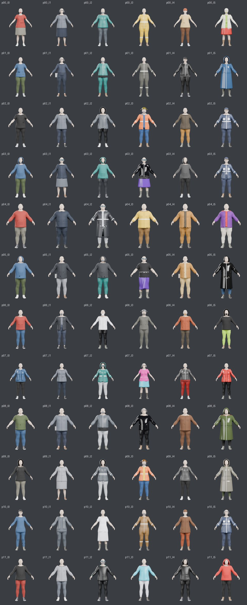](sheets/all_front_1.jpg) | [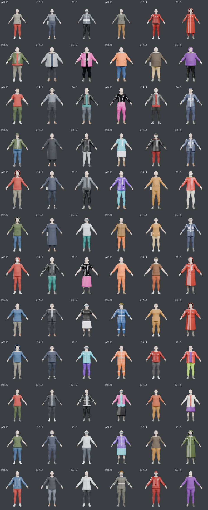](sheets/all_front_2.jpg) |
| **Three quarters, characters 0 to 11** | **Three quarters, characters 12 to 23** |
| [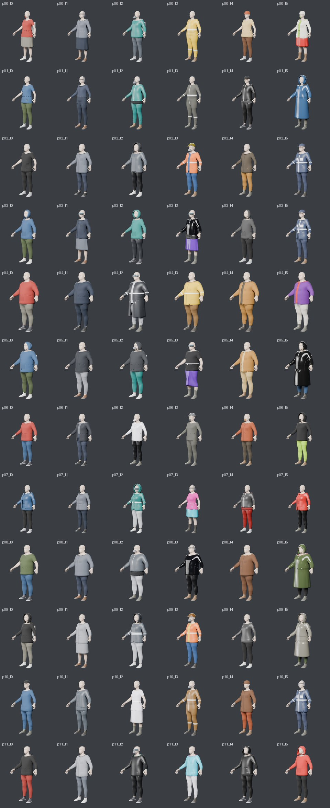](sheets/all_34_1.jpg) | [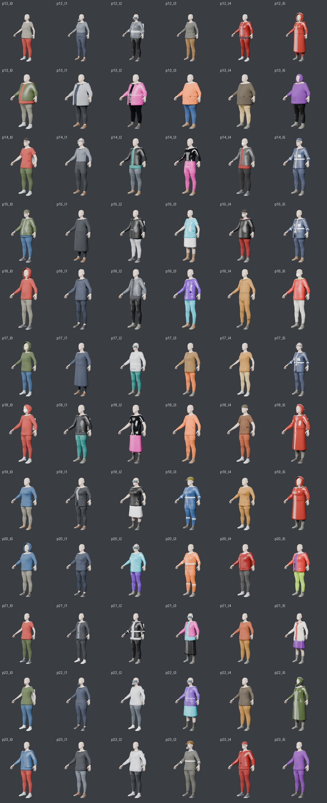](sheets/all_34_2.jpg) |

The heavy bodies, before (LG2) and after:

| Before | After |
|---|---|
| [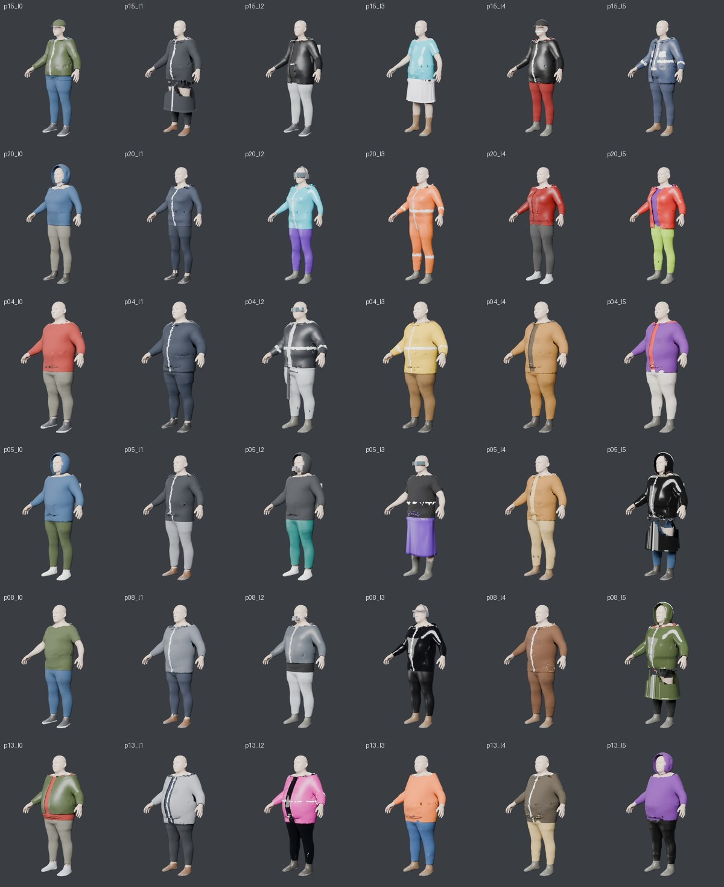](sheets/heavy_before_34.jpg) | [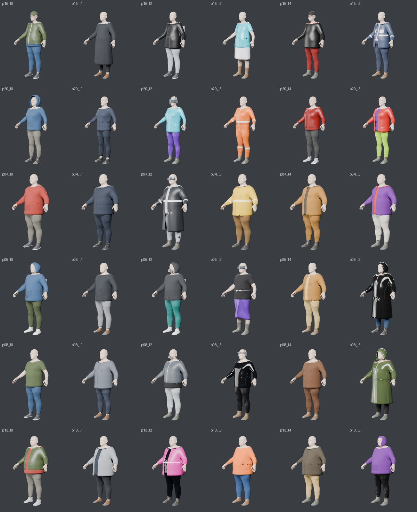](sheets/heavy_after_34.jpg) |

The garments' own numbers (the dressing's reports, every look): the drape no longer thrown
away whole (LG2 dropped 144 of 364 drapes, a vertex thrown past its limit; now 13), the looks'
near meshes 28,116 triangles on average (25,089: the inner layers' faces near an outer
garment's edges kept), the plain outfit's region covered 87.7% (87.9%).

## The coat's waist while walking: the look check

A check of its own (`lifegen/probes/look_export_ue.py`, `look_pose.py`): each of the 81 looks
with an outer layer exported from the project as Unreal skinned it (the look's garments with
their weights, the body, the walk), posed along the walk in Blender at 12 frames, and every
vertex of an inner piece that lies under another piece in the reference pose (its ray within
4 cm, not within 6 cm of that piece's open edge, where the layer under a hem shows rightly
when walking lifts it) counted where it comes more than 1.5 mm through that piece's posed
surface; the worst frame rendered from behind (inner pieces dark red, faces come through
yellow). Heavy bodies first.

| Looks | Paired vertices (LG2, now) | Come through, per frame per paired vertex: all (LG2, now) | In the waist's band (LG2, now) |
|---|---|---|---|
| all 81 | 8,118, 53,754 | 8.3%, 5.9% | 10.4%, 6.3% |
| trench coats (3) | 287, 2,441 | 12.2%, 5.0% | 23.3%, 6.5% |
| raincoats (8) | 758, 6,313 | 7.2%, 3.4% | 7.3%, 3.5% |
| jackets (48) | 5,532, 34,809 | 9.1%, 7.3% | 11.0%, 7.6% |
| bombers (22) | 1,541, 10,191 | 4.9%, 2.8% | 5.4%, 3.0% |
| the six heavy bodies' 21 | 2,132, 11,664 | 6.4%, 7.9% | 10.5%, 9.3% |

The counts are per paired vertex because the looks now keep far more of their inner layers
under an outer one (6.6 times the pairs: the faces within 6 cm of an outer garment's open edge
stay, and LG2's took out most of what a ray found covered); a first build that took those out
too halved the raw counts but left a hole under a jacket's back while walking. The heavy
bodies' rate over all their pairs rises (their shirts' and tees' sleeves and collars under a
jacket, now kept, graze it at the shoulders); at the waist it falls. The worst frames, before
and after (the coat skirts LG2 hung off a sleeve or left full of holes now hang from the hips;
the trousers' waistband no longer shows across the back):

[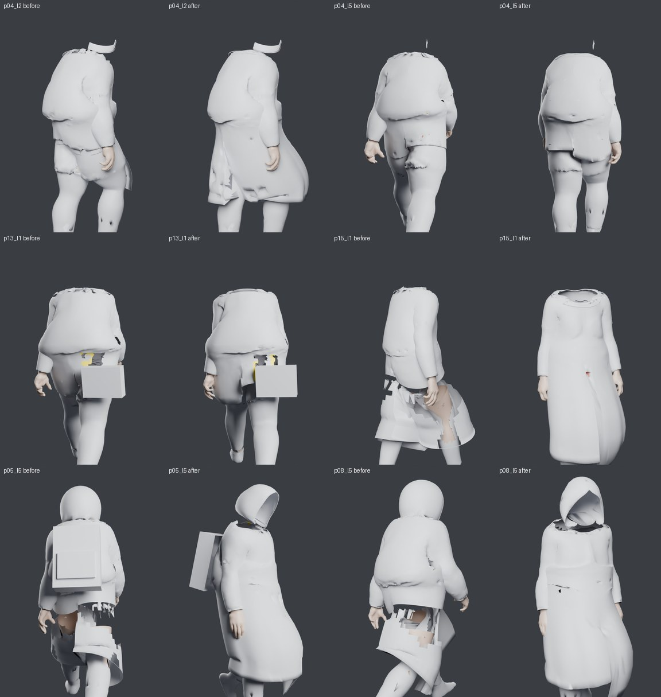](pose/coats_back_before_after.jpg)

Every look's counts, both libraries: [`pose/pose_reports.json`](pose/pose_reports.json).
Applied in the editor, each look's near mesh had on average 2,373 vertices following an outer
garment's weights (LOD 0 and LOD 1 alike).

## In Unreal: Delta

Delta imported over its import in `CityAG16` with the rebuilt library (the library built and
imported in one run: the bodies exported again, the dressing 25 minutes for 24 characters 4 at
once, the looks, mid meshes and cards about 40 minutes; the city's level unchanged but the life
actor, its HLODs unchanged). `--check` passes (spawn, streaming, collision, the walk and the
curb, sky, air, weather, look, far city, play features, fly). Near people by day (clear), by
night and in the rain (raincoats are drawn in rain):

| Old Town, day | Midtown, day |
|---|---|
| [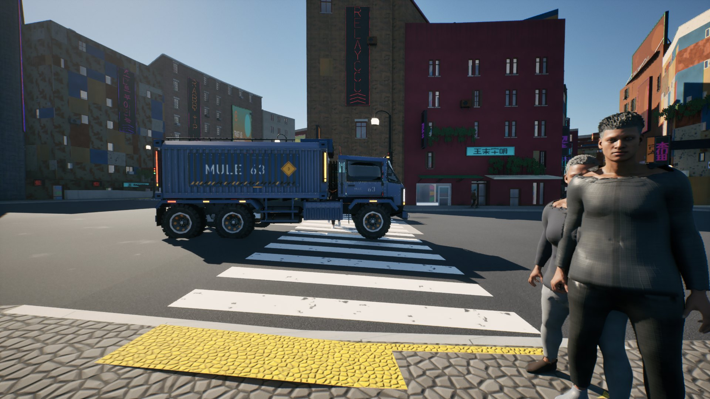](unreal/pday_cloth_d04__clear.jpg) | [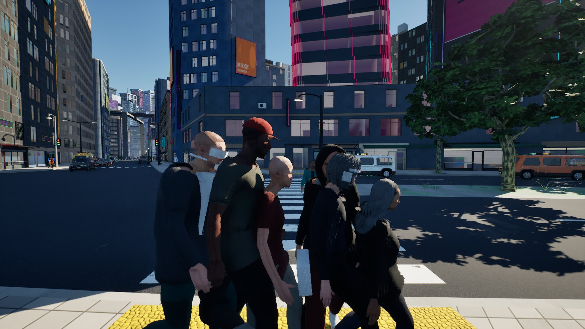](unreal/pday_cloth_d02__clear.jpg) |
| **Midtown, rain** | **The corporate core, day** |
| [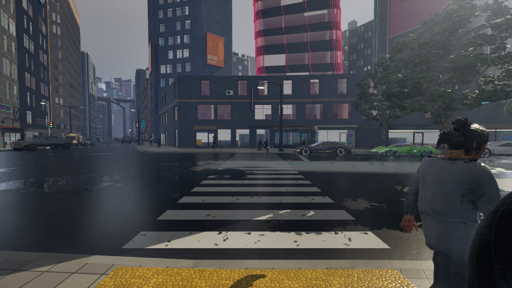](unreal/pday_cloth_d02_rain__rain.jpg) | [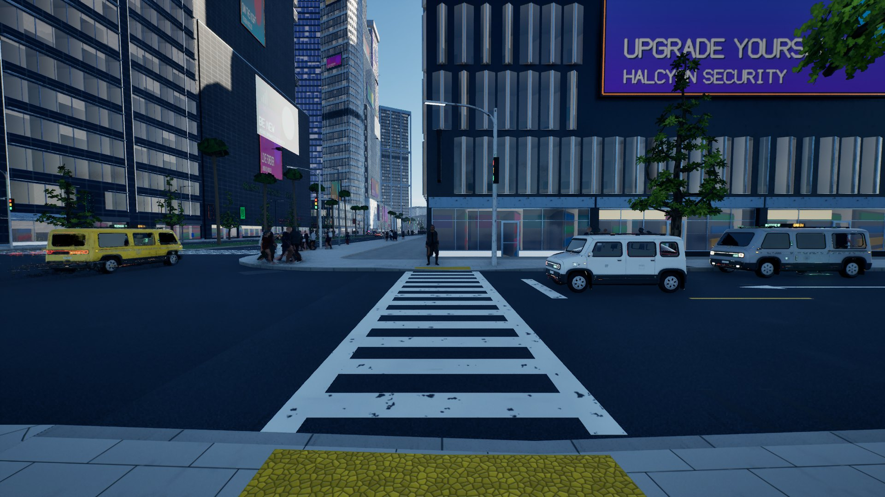](unreal/pday_cloth_d03__clear.jpg) |
| **Old Town, night** | **Midtown, night** |
|  | [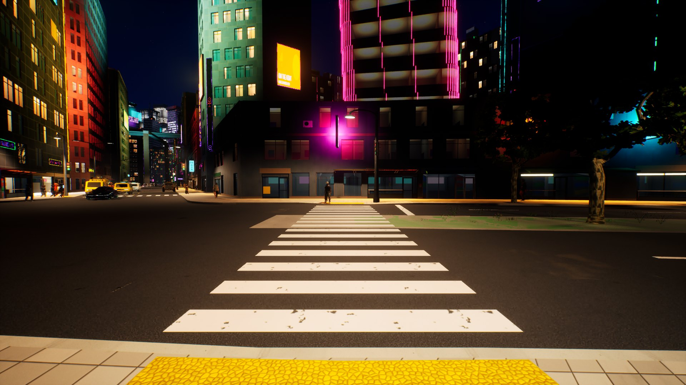](unreal/night_cloth_d02__clear.jpg) |
| **Old Town, night, rain** | |
| [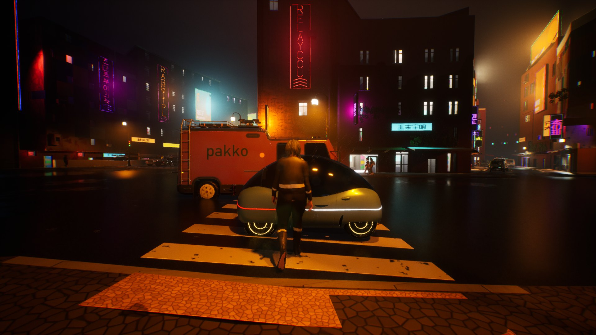](unreal/night_cloth_d04_rain__rain.jpg) | |

The lean benchmark (the near meshes carry 12% more triangles): `night_plan_all`, one run,
native 2560 x 1440, no DLSS pass ([`bench/bench.md`](bench/bench.md)): **20.6 ms p95** over
the route (walk 22.9, drive 20.7, fly 19.9; game-thread bound, draws 3,505 at the median),
against LG8's 21.8 (walk 23.0 under heavier load), with about 1.4 cores of other load. Still
over the 20 ms budget, as LG8 left it; the clothing costs no measurable frame time.

## The package

`builds/packaged/Delta_clothing` (Development, Win64, 5.1 GB; `package_clothing.cmd`, cooked
in place from `CityAG16` as LG8's, staged only, 10.6 minutes). Its smoke launch (the user
folder outside the package, no `Saved` folder left in it, the game process closed after) loads
Delta in 13.6 s with the library's 144 looks and the clothing on, the life controller ready
with 2,400 people and 1,800 cars. `Delta_lg8` was deleted before the cook (the disk), and
`CityAG16`'s `Saved/Cooked` and `Saved/StagedBuilds` after the smoke launch.

## Tests

`tests/lifegen/test_lg_clothing.py` (a new test: tops, coats and skirts hang from the hips,
plackets dyed, zips metal; `LIB_VERSION` in the spec) and `tests/lifegen/test_lg_people.py`:
17 passed. The Blender stage and the editor's skinning have no unit tests (bpy, unreal); they
are checked by the contact sheets, the look check and the Unreal check above.

## Open items

- A few small dents remain where a pocket's or band's planes cut a heavy body's belly, and a
  skirt's waistband under a short tee can show at its hem.
- A coat's skirt is skinned to the legs (the weights of the body nearest it): walking splits it
  at the back like trousers would. Cloth simulation (Chaos Cloth) is still not set up.
- A hood down is a roll held as built, not draped.
- Prints and logos, hair under hats: as LG2 left them.
