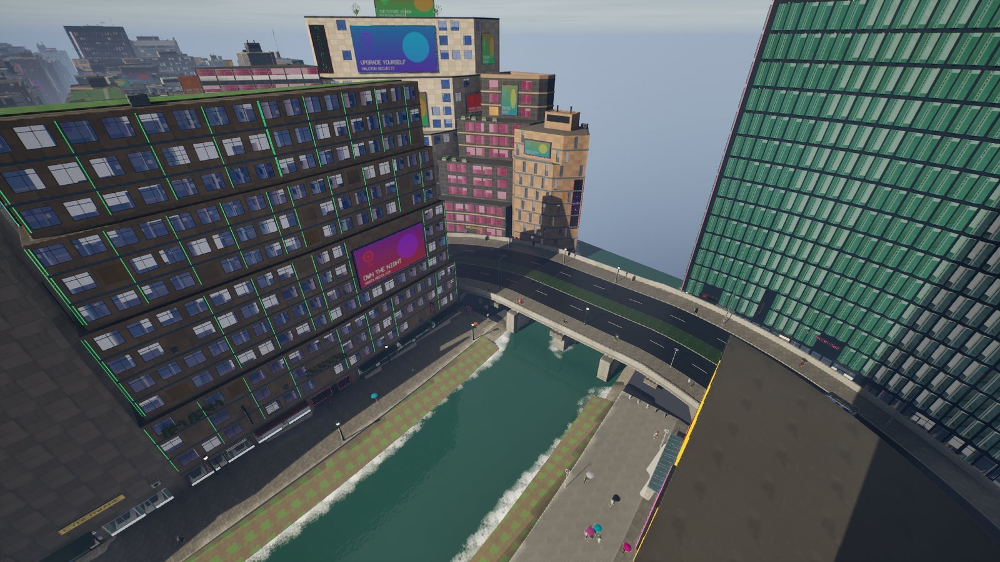
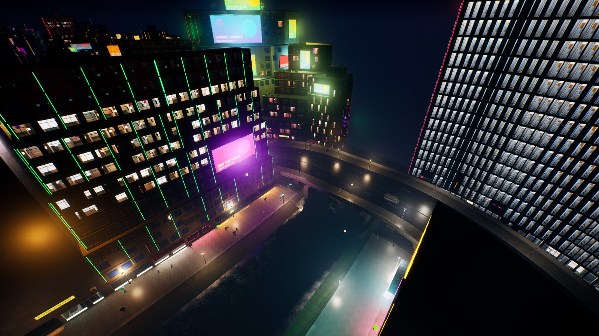
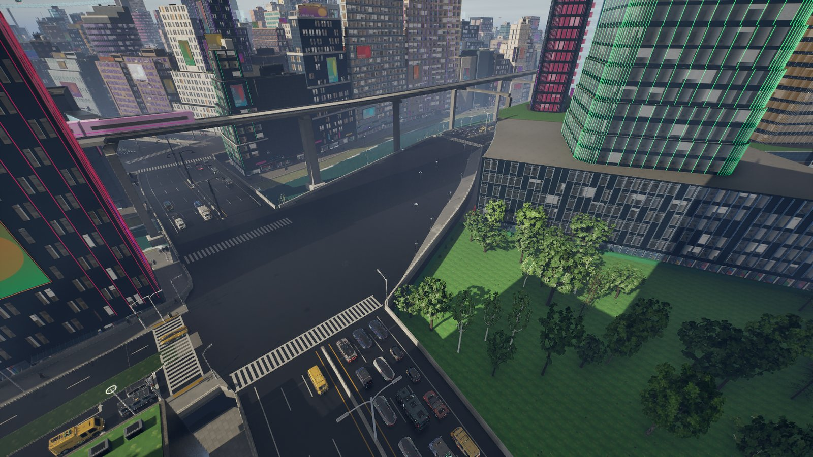
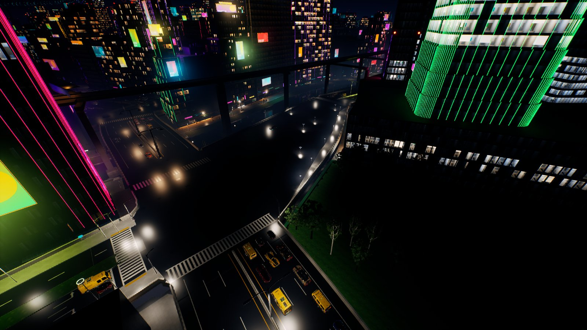
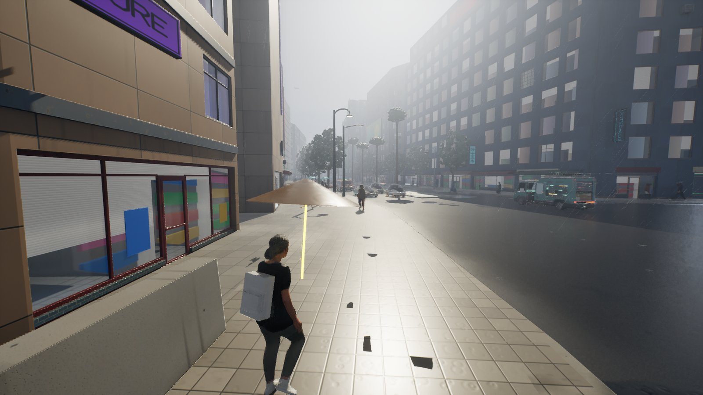
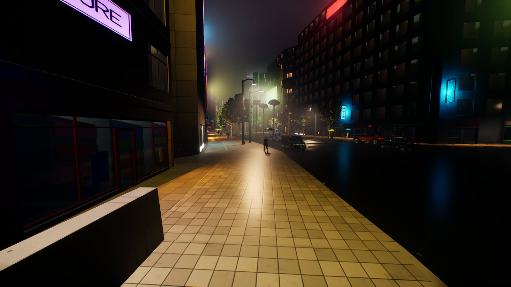
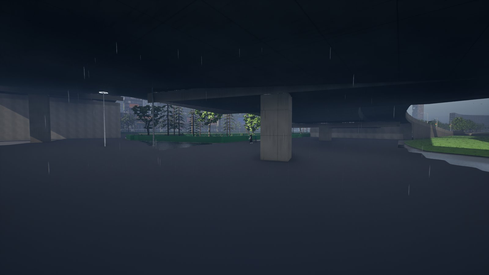
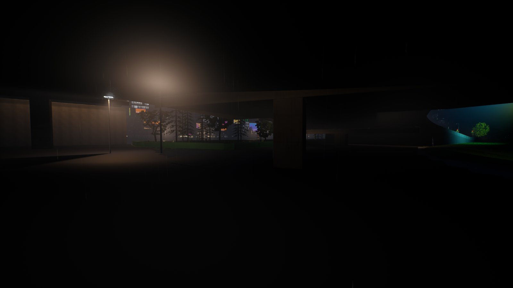
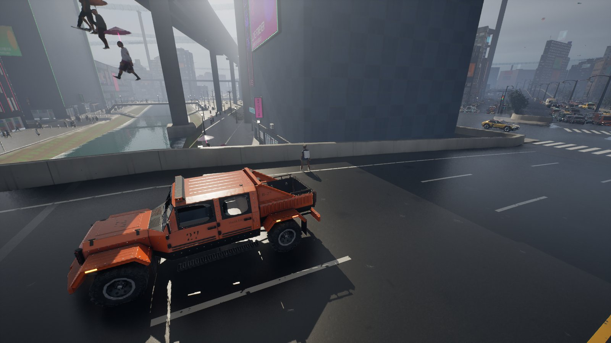

# Delta rebuilt on main (delta_rebuild)

Built on the Windows PC (2026-11-17). The live Delta build (`C:/Users/swagn/CityGen/builds/
delta_main`) predated the road curves fix (#239, every layout moved): Delta Megacity was built
again from main the same way (the spec `docs/progress/M1a2/delta_megacity/city_spec.json`,
`citygen build --blockout --no-render`, the full `assetgen build` with 2 workers and
`CITYGEN_WORKERS` 4, the vehicles from the packs' cache, `atmosgen plan`, `lifegen plan
--atmos`), imported into `CityAG16` with the people library, atmos, life and DLSS as before,
checked, benchmarked and packaged. Three faults the new layout showed were fixed on the way;
the two runtime faults asked for were looked into on the new build.

| Part | Where | What |
|---|---|---|
| Slots on their surface | `lifegen/places.py` (`Surface`, `seat_slots`, `height_check`, `WalkIndex.height`), `lifegen/plan.py`, `presets.py` (`SURFACE_LIFT_M`, `COVER_LIFT_M`, `SLOT_SURFACE_TOL_M`, `SLOT_STEP_M`), `planmodel.Slot.seated`; `citygen/unreal_life.py` (`slot_seated`, `PACK_VERSION` 10), `citygen/ue/import_city.py` (`LIFE_VERSION` life12), `CityGenLifePlaces.cpp`, `CityGenLifeProcessors.cpp` (`CgLife::PointAt`), `CityGenLifeActor.h`, `CityGenLifeProcessors.h` | every ground level slot's points on the surface stage 2 draws, a prop's slot leaving from a walkway at its height; check `slot_heights` |
| Atmos refill | `atmosgen/plan.py`, `atmosgen/fixtures.py` (`place(only)`) | the fill runs again after the fixtures drop lights |
| Arcade columns | `assetgen/buildings/shell.py` (`_column_at`), `GEN_VERSION` drebuild.1 | a column at an acute corner moves along its edge until it fits |
| Docs | `docs/unreal_export.md` ("Slots on their surface", the record), `CLAUDE.md` | |

## The rebuild

| Stage | Time | Checks |
|---|---|---|
| `citygen build` | 20m52s (the fifth layout, salt 4: tries 1 to 4 failed as #239 found) | 108 of 108 pass |
| `assetgen build` | 11m46s (13m12s the first try) | every check of every stage passes (buildings, streets, water, props, vehicles, ground, materials, fit) after the column fix; the first try failed `asset_envelope` on one building |
| `atmosgen plan` | 1m58s | lux, faces, air, weather, far and fixtures pass after the refill fix; the first plan failed the lux check (4 alley points dark) |
| `lifegen plan` | 56 to 71 s | 36 of 36 pass (`slot_heights` new) |

The build: 5,522 buildings, 51,611 lights, 60,817 people on the streets at the peak hour, 3,429
vehicles, 1,562 slots, 5 transit lines.

### What failed on the new layout, and the fixes

- **`asset_envelope`, one building** (`d02.lot.e275n1552.bld`, a terraced building on a wedge lot
  by a curved road): an arcade column 450 mm from an acute corner (the footprint's corner there
  is about 45 degrees) stood 0.22 m through the other facade at the ground. A column whose
  500 mm square (along its edge, into the wall) is not inside the arcade's ring moves along its
  edge toward its middle by 100 mm steps until it fits, else is left out
  (`ShellBuilder._column_at`; stats `columns_moved`, `columns_dropped`). Every column that
  fitted stands where it stood; `GEN_VERSION` drebuild.1, so every pack's generator string
  moves (the small city's and Vesper Bay's building goldens rewritten for it).
- **The lux check, 4 alley points dark** (an industrial port quay road's last stretch): the fill
  lights the dark stretches before the fixtures are placed; the quay road's last pole then found
  no clear spot for its fixture and was dropped, which left that stretch dark. The fill now runs
  again on what is left after the fixtures, its new lights given fixtures, until none is
  dropped (at most `FILL_ROUNDS`; the refill's lights are named from round 4 on, so ids stay
  unique). On Delta the refill added 4 alley, 66 carriageway and 181 sidewalk lights (the
  fixtures' moves onto their lenses had left those dark too).

## Import and check

- **Import** (`citygen unreal ... --people --atmos --life --dlss`, as people_idles'): actors
  7,033 created, 5,401 updated, 7,204 deleted, 2,080 unchanged (14,514); stage 2's 39,297
  actors, 11,784 meshes imported and 46,862 deleted; 30 minutes, then the HLODs (686 of 760
  built, 8.4 minutes). The first try stalled at its mesh builds: the disk ran down to 0.8 GB
  free while it built (Zen's DDC refused writes, the editor stopped logging); it was stopped,
  `builds/packaged/Delta_idles` deleted for room, and the import run again, keeping the meshes
  the first had saved.
- **`--check`: PASS** (spawn, streaming, collision 505 of 507 traces, 36 of 36 roofs, the walk
  and the curb, sky and time, air, weather, look, far city, play features, the flight; 22m45s).
- **The swap:** once the check passed, the old `delta_main` was deleted, `delta_next` renamed
  to `delta_main` and the import run again (nothing changed, 0 HLODs built), which rewrote the
  manifest's three absolute paths (the atmos and life plans, the fixtures' contribution).

## Shots near curved roads

From the check (`--view`, 2560 px): a curved avenue bridge over a canal in Midtown and a curved
road round a park in the Corporate Core, by day and by night; a street view along the Midtown
curve and a curved Research Campus street.

| Day | Night |
|---|---|
|  |  |
|  |  |
|  |  |
|  |  |

## Fault 1: people at a slot sunk to the hips

**Why.** A slot's points stood at its walkway lane's height where the slot leaves it (LG4,
`BuildPlaces`), plus the ground offset its user last traced while walking (`ZOff`). A point on
another surface than that lane stood at the wrong height: a bar's smokers and queue at a door
by a raised road's sidewalk, a vending machine on a raised road 5 m over the path it was given,
benches beside a skybridge (a prop's slot took the nearest walkway within 15 m whatever its
height, the skybridge 24 to 92 m up). Measured on the new build against the lanes Unreal walks
(`graphs.json`): 26 of 1,562 slots stood more than 0.3 m off their surface, 5 sunk (up to
5 m) and 21 in the air (up to 92 m). The old layout's ring in Old Town was a slot of this kind.

**Fix.** The plan stands every ground level slot's points on the surface stage 2 draws under
them (`Surface`: M22's pavement faces on the ground layer at their vertices' heights by mean
value coordinates, lifted as AG17 lifts them, 0.2 m on a curb, sidewalk, corner pad or median
island, else 0.05 m; off the map AG13's ground cover 0.1 m over the ground, else the ground),
marks the slot `seated` and checks it (`slot_heights`: every point within 3 cm of its surface).
A prop's slot leaves from the nearest walkway within 1.5 m of its surface in height (a
walkway's height its own or the face drawn there, so a raised road's sidewalk, which the model
keeps at the ground, counts at its face), else the nearest. The exporter packs `slot_seated`;
the controller puts a seated slot's points at their own z and a person there stands on it
without its walking ground offset (`CgLife::PointAt`, `FillSlot`). On Delta: 4,937 points
seated (3,294 on pavement, 1,632 on ground cover, 11 on bare ground); 13 slots stand more
than 0.3 m from their walkway where they leave it and 9 more than 1.5 m (no walkway at their
height within reach: their users climb or step down to the slot), which the check notes.

## Fault 2: the places' cost and the loads after teleports

A quick Unreal Insights profile at two fixed viewpoints (an Old Town and a Midtown sidewalk,
held 30 s after 10 s to settle), the game run as the benchmark runs it with `night_plan_all`
and `night_life_noplaces` (`profile/profile.py`, `profile/compare.py`,
[`profile/places_on_off.md`](profile/places_on_off.md)):

- **Places cost 0.36 to 0.47 ms of lifegen's step** (`CityGenLife_Tick` 3.69 against 3.33 ms
  in Old Town, 2.00 against 1.53 in Midtown), spread over everything the extra people cost:
  the slot users, gang members and police on foot are people the crowd would not have, so the
  ground traces (+0.1 to 0.2 ms), the instance updates (+0.2), the near skeletal meshes'
  updates (`MeshObject Update` +0.3 in Midtown) and the walk and drive steps (+0.04 each) grow
  with them. The Smart Objects themselves cost nothing measurable, and no step of the places
  stands out; nothing cheap to cut that is not the people themselves.
- **The loads after a teleport are not the places'**: 6.4 s (places on) against 6.1 s (off) in
  Midtown, 7.9 s in Old Town with places off (the first teleport of the game, 44.6 s, is the
  cold start). people_idles' 17.9 s was the three route segments' loads together in one run,
  and its places-off pass took 15.5 s: streaming under other load, not lifegen.

## Benchmark

The lean route, one run, native 2560 x 1440, no DLSS pass ([`bench/bench.md`](bench/bench.md));
not flagged (the foreground held, nothing starved; 1.5 cores of other load on average, 2.7 at
most: another session's citygen builds, which the run did not wait for).

| Pass | all p95 | walk | drive | fly | game p95 | hitches > 50 / > 100 ms | loads |
|---|---|---|---|---|---|---|---|
| `night_plan_all` | **18.0** | 19.3 | 18.7 | 16.6 | 15.9 | 15 / 4 | 14.2 s |
| `night_life_noplaces` | 18.1 | 19.8 | 18.8 | 16.8 | 15.2 | 23 / 6 | 12.8 s |
| `night_plan_all`, people_idles (old layout) | 19.2 | 21.1 | 20.4 | 17.0 | 17.7 | 36 / 11 | 17.9 s |

Under the 20 ms budget by 2.0 ms (no second run). Places on and off are within a run's noise
on the route (the game thread's p95 0.7 ms apart, as the profile's 0.4 to 0.5 ms). The loads
after the teleports (the route's three segment starts together) are 14.2 s with places and
12.8 s without, against people_idles' 17.9 and #240's 7.6 on the old layout: they follow the
streaming and the machine's other load, not the places.

## The package

Delta cooked and packaged (Development, Win64) from `CityAG16` as before (`builds/packaged/
package_curves.cmd`, 15.5 minutes), staged only and moved to `builds/packaged/Delta_curves`
(5.2 GB). `builds/packaged/Delta_idles` had been deleted for room during the import, and
`CityAG16`'s `Saved/Cooked` and `Saved/StagedBuilds` were deleted after the smoke launch. The
smoke launch (`builds/delta_main/smoke_curves.ps1`: its user folder outside the package, every
`CityAG16` game process closed after it, no `Saved` folder left in the package) loads Delta in
14.9 s and logs the five sit-downs, the stand-up and the life controller's status (2,400 people,
1,800 cars). The packaged game was not benchmarked.

## Tests

Only what changed (logs in `builds/delta_rebuild_tmp/tests/`):

- `tests/lifegen/test_lg_places.py`, `test_lg_plan.py`, `test_lg_weather.py`: 36 passed (new
  `test_slots_stand_on_their_surface`; the exporter's `slot_seated` in
  `test_exporter_packs_the_places`; the plan's schemas written again).
- `tests/atmosgen/test_at_plan.py`, `test_at_streets.py`: 19 passed (new
  `test_dropped_fixtures_are_filled_again`).
- `tests/assetgen/test_ag_facades.py`: 14 passed (new
  `test_arcade_columns_keep_inside_an_acute_corner`).
- The goldens `GEN_VERSION` moves (`tests/assetgen/goldens.py --sections ag1 ag6 vesper`), then
  `test_ag_build.py` (13 passed, the small city's and Vesper Bay's building goldens among
  them), `test_ag_determinism.py`'s small city briefs and Vesper Bay buildings goldens (3
  passed; the run was stopped at the five samples' briefs goldens, which a building's shell
  does not touch), `test_ag_materials.py`'s materials and library goldens (2 passed).

## Choices made

- **Surface heights in the plan, not by traces in the game:** a trace at a bench finds its
  seat, and a slot far from the view has nothing loaded to trace; the pavement map is what
  AG17 draws, so the plan knows the height exactly.
- **A slot keeps its walkway when none at its height is near** (9 on Delta), its users stepping
  to it, rather than losing the slot.
- **The refill fills every dark stretch left after the fixtures**, not only a dropped light's:
  the fixtures' moves onto their lenses leave stretches dark too, which the check measures.
- **`Delta_idles` deleted before the import**, not before the cook: the disk ran out during the
  first import try.
- **The benchmark did not wait for other heavy processes** (another session's citygen builds
  ran all evening); their CPU is recorded with the run.

## Open items

- **Walkway lanes between their vertices:** `graphs.json` gives a raised road's sidewalk its
  height only at the walkway's own vertices (AG7's lines), so a long sidewalk over a road's
  hump runs straight between them (a sidewalk at 2.3 m and 2.6 m at its ends over a 4.5 m
  crest): mid people there walk inside the embankment; near people trace the ground.
- **People walking in the air** in one shot (Midtown, by a viaduct, `pday_slot_vending`'s top
  left): an elevated station's stair walkway (`wk.e651n620`) rises 31 m over 18 m, from the
  platform at 31 m straight down to the sidewalk, with no stair drawn along it; its people
  climb through the air. A citygen station stair (M5's stairs, the platform's height); not
  looked into further.
- **9 slots with no walkway at their height within 15 m**: their users climb to the slot from
  their walkway.
