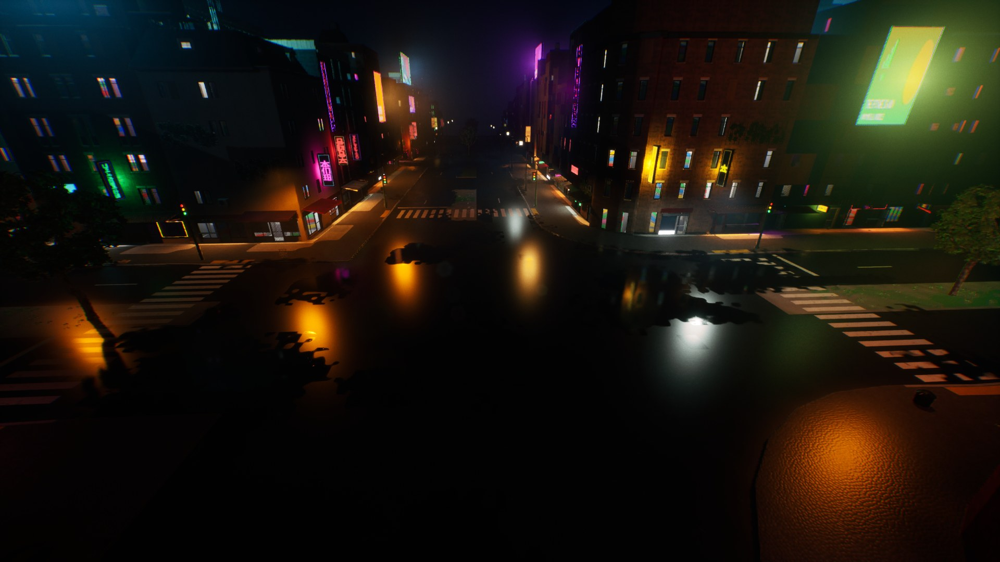
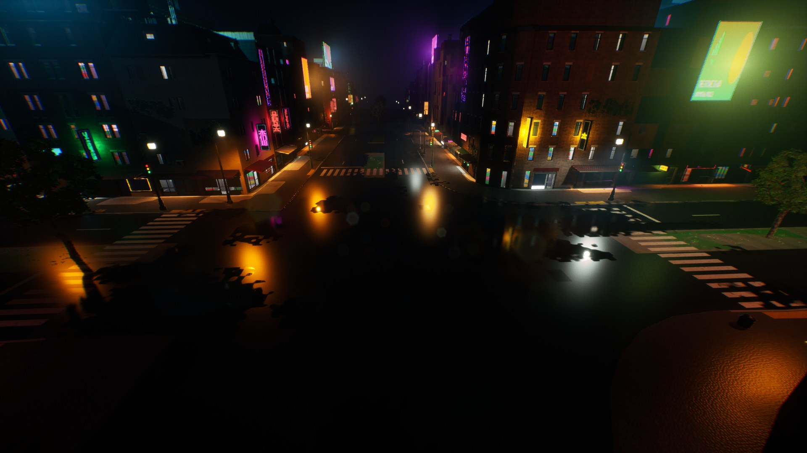
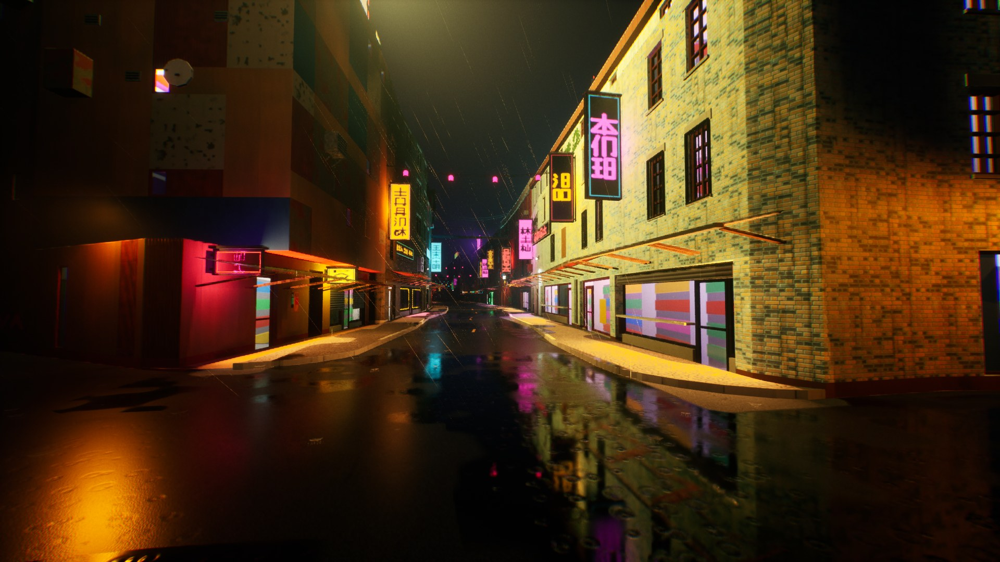
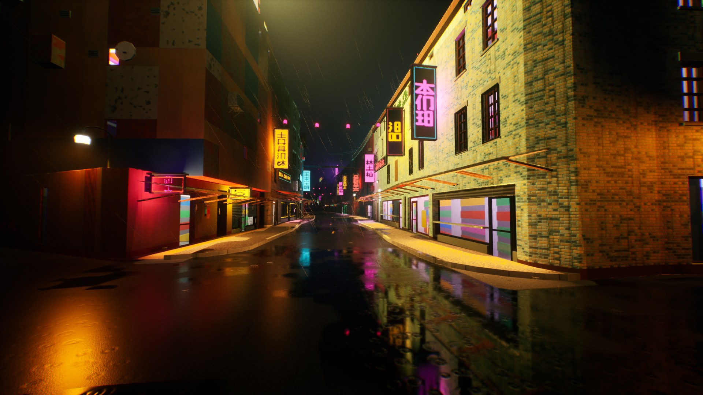
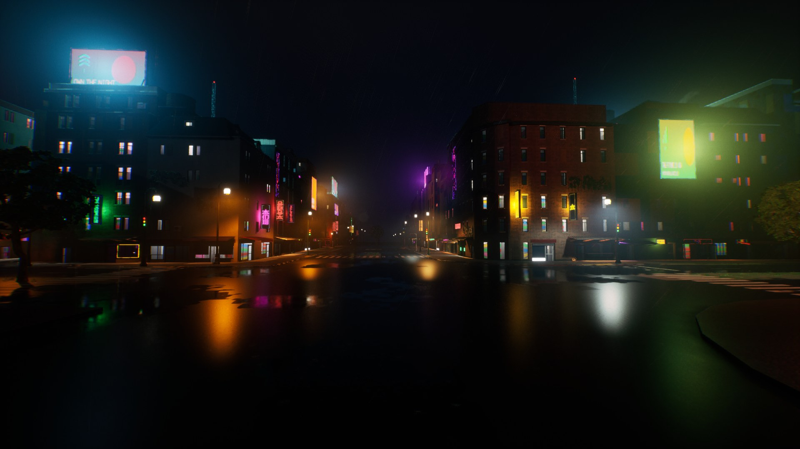
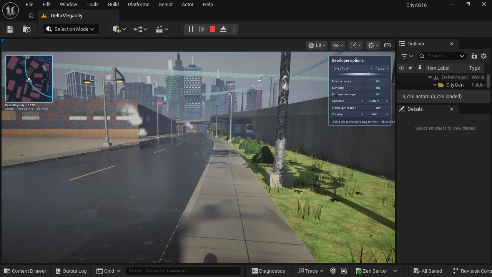
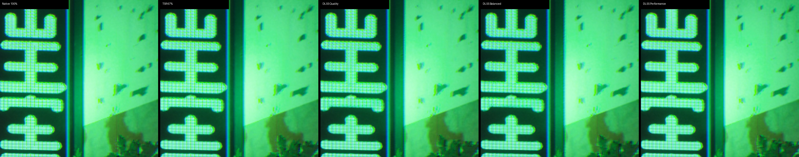
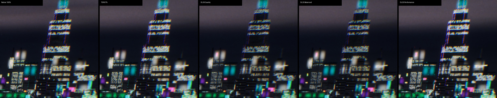

# DLSS, ghost lamps and fewer flickers (after LG0)

Three fixes from Swagnik's walk of the packaged Delta Megacity, in one pass on the Windows PC
(RTX 4070 Ti, 32 GB, UE 5.8), 2026-11-14, on main after LG0 (#222): NVIDIA's DLSS as an option
of the exporter and a row of the play features' menu, a fixture under every light that had none
("ghost lamps"), and ten times fewer flickering lights.

## 1. Ghost lamps

> "there seem to be quite a few ghost lamps, ie the light is there but theres no lamppost
> there"

**Cause.** AT1 and AT2 light what M6 leaves dark on fixtures they asked of stage 2
(`emitters.py`'s third and fourth asks, `Light.mount`): corner poles at dark junctions, the
signals' mast arms, highway, ramp, service road, pedestrian street and footbridge posts, alley
wall packs, port and apron high masts, crown floods out from their facades. Stage 2 never drew
them: 9,841 of Delta's lights hung in the air. The new check also found 380 of AT2's beacons and
searchlights off their buildings: they stood on the corners of a curved or odd footprint's
oriented box, metres off the footprint itself.

**Fix** (`atmosgen/fixtures.py`). The atmos plan draws a fixture under every such light from
AG8's own prop variants, so the style is the district's (sleek in the Corporate Core, old in Old
Town):

| Mount | Fixture | Delta |
|---|---|---|
| `pole` (corner poles, road, highway and ramp columns, service roads, pedestrian streets, footbridges, fill lights) | an AG8 street light at the pole's foot, turned so its arm reaches toward the head, scaled to the head's height (0.45 to 1.9), its arm stretched at most 1.6 times; a post top where the head is over its foot; a twin column in a median two back to back | 3,593 |
| `mast_arm` (a signal's) | an AG8 street light at the signal's own foot (AG8 draws the signal), its arm over the junction | 902 |
| `wall` (alley wall packs) | an AG8 wall light on the facade within 1.2 m behind the light, else a pole just off the alley with its arm over to it | 1,036 (798 on walls, 238 poles) |
| `mast` (high masts) | AG8's heavy street light's mast form, scaled to 30 m | 29 |
| `roof` (crown floods, uplights) | AG8's heavy wall light's flood form tilted up, on its setback, podium or the ground, or on an outrigger (AG8's bracket) from its facade | 1,515 (1,254 outriggers) |

Each light moves onto its fixture's lens (median 0.02 m; mast arms 3.3 m back toward their
signal, where AG8's arm, stretched, still falls short of the plan's 6 m one), and the lux check
runs on the moved lights (it passes: sidewalks 24.0 lx, 1.4% under their minimum; carriageways
14.3 lx, 0.8%; alleys 12.1 lx, none dark). A fixture keeps off every vehicle carriageway,
junction and crosswalk at its height as AG8's props do (`gather._Fit` on the pavement map),
pushed back from the road a quarter metre at a time and turned up to 90 degrees either way, out
to 4 m; 43 lights whose pole finds no clear spot are left out. Lights on what stage 2 draws need
nothing: M6's lamps, signs, shopfronts, AG10's soffits, AG7's tunnel strips, a station's roof, a
deck's slab, a crane's boom. AT2's beacons and searchlights now stand on their footprints
(`plan.corners_on`).

**Which stage: atmosgen's (layer 3).** The lights exist only in its plan, and stage 3 reads stage
2, not the other way: assetgen drawing them would make stage 2 read stage 3's plan. The fixtures
are only AG8's meshes placed again: the plan writes `fixtures.json` and
`unreal_contribution.fixtures.json` (an entry per 128 m cell, `atmos.fixtures.<tile>.<quarter>`,
instanced parts in AG8's `props` part, so the exporter imports AG8's meshes and materials once
for both), which `citygen unreal` layers with stage 2's contributions where the plan is delivered.

**Check** (`checks.fixtures`): every light on something at its height (its fixture's lens within
2 cm, stage 2's own fixture, a structure within 2 m, the ground) and every fixture clear of the
carriageways; a failing plan is not delivered. Delta: 50,257 lights, 7,075 on their fixtures,
40,969 on stage 2's, 2,213 on structures, none on nothing, none on a carriageway; 8,329 fixtures
(4,762 street lights, 2,313 wall lights and flood heads, 1,254 outrigger brackets).

| Before: the junction from 12 m, no pole under the mast arms' lights | After: AG8's street lights at the signals |
|---|---|
|  |  |
| **Before: an Old Town alley** | **After: its wall packs on poles and walls** |
|  |  |

## 2. Fewer flickers

> "there are quite a few places where lights flicker. they seem intentional, so if they are,
> please reduce the rate by which they occur by 10x."

They were intentional (AT2's moods: flicker shares by archetype, pulled up by danger, by kind;
broken signs dying in a deep flicker).

- **Ten times fewer** (`presets.FLICKER_SCALE` 0.1): the moods' flicker shares times 0.1, still
  times (0.5 + danger), and a broken sign dies flickering at that share (the rest burn steady,
  as their faces do).
- **Spaced out:** a flickering light flickered a third of every second, every second
  (independent 1/12 s steps). The runtime now flickers it in bursts (`ACityGenAtmos::InBurst`):
  a burst of 0.35 to 1 s once every 9 to 26 s, a dying tube's 0.8 to 2 s every 4 to 10 s, each
  light's own from its seed; steady between. Stateless, the same at any frame rate.

| Delta | Before (AT7's plan) | After |
|---|---|---|
| Flickering lights | 8,585 | 890 |
| shop signs / spill / signs / roads / wall lights / street lights / alleys / neon | 5,002 / 1,212 / 615 / 422 / 385 / 332 / 297 / 235 | 545 / 115 / 68 / 39 / 39 / 31 / 24 / 20 |
| Flickering 0.8 deep and more (mostly dying signs) | 2,171 | 234 |
| Broken (dark) lights | 2,008 | 2,005 |

## 3. DLSS

**The plugin.** NVIDIA's DLSS 4.5 plugin for UE 5.8, `DLSS4.5Plugin_v8.9.0` (2026-10-16;
`DLSS.uplugin` `8.9.0-NGX310.9.16`), extracted into `C:/Users/swagn/CityGen/downloads/dlss/`
(never the repo or the engine; nothing of it is in git). Its guides (`Getting Started`,
`DLSS_Super_Resolution_UE_Plugin_Guide`, `DLSS_FrameGeneration_Reflex_DynamicVibrance_UE_Plugins_Guide`)
set what the exporter does: the plugins go in the project's `Plugins/` (DLSS needs
`StreamlineNGXCommon`; Frame Generation `StreamlineCore`, `StreamlineDLSSG`, `StreamlineReflex`),
the engine stays in TSR mode (`r.AntiAliasingMethod 4`; DLSS takes the temporal upscaler's place),
a DLSS mode is `r.NGX.DLSS.Enable 1` plus its screen percentage (`GetDLSSModeInformation`:
Quality 66.7%, Balanced 58%, Performance 50% at 1440p, as the game logs them), Frame Generation
is `r.Streamline.DLSSG.Enable` (DX12, an RTX 40 or newer, hardware GPU scheduling: all on this
PC, driver 610.88).

**Exporter** (`citygen unreal ... --dlss DIR`, or `$CITYGEN_DLSS`; `citygen/unreal_dlss.py`):
copies those five plugins into the project (not NVIDIA's `Intermediate`: UnrealBuildTool builds
them for the project; again only when the download changes, a stamp in `Plugins/DLSS`), enables
them in the .uproject, sets DLSS's debug messages and Frame Generation's overlay off and TSR on,
and the play plugins' build stamp includes it so the editor build runs once more. Without the
option nothing changes. The import of Delta with it: plugins built in 54 s.

**Packaging:** the plugins are the project's, so `BuildCookRun` builds them from their source for
the game, cooks and stages them; the package has `nvngx_dlss.dll`, `nvngx_dlssg.dll` and
Streamline's DLLs under `CityAG16/Plugins/*/Binaries/ThirdParty/Win64` and logs `NVIDIA NGX DLSS
supported DLSS-SR=1` and `NVIDIA Streamline supported 1` at start.

**Tab menu** (CityGenPlay, `CityGenUpscaler`): an **Upscaler** row (`<` `>`: Native, TSR 67%,
DLSS Quality, Balanced, Performance; Default until one is picked, the engine's own as before) and
a **Frame generation** row (On, Off, or n/a where it does not run), shown where the plugin is in
the game; DLSS's modes only where it runs. The output stays at the window's size (the monitor's
native resolution in a packaged game). CityGenPlay reaches the plugin by its console variables and
by calling its Blueprint libraries by name (reflection), so it builds and runs the same without
it. `CityGen.MenuRow upscaler=NAME`, `framegen=1`; `CityGen.Status` gives the `upscaler`.

**Benchmark** (the lean rule: `night_plan_all` as delivered, the lean route, one run each, at
native 2560 x 1440 output on the PC alone; `bench/night`, the native pass again in
`bench/native2`, since its first run was within 0.3 ms of the 20 ms budget):

| Pass | Render | p95 (ms) | p50 | game p95 | GPU p95 | Shown fps (p50 / p5) | Game-to-render latency p50 (Reflex) |
|---|---|---|---|---|---|---|---|
| `night_plan_all` (native) | 100% | **20.0** (second run **18.8**) | 13.5 | 17.9 (16.4) | 14.0 (13.9) | - | 34.8 ms |
| `night_plan_all_tsr67` | TSR 67% | **16.2** | 9.8 | 15.2 | 9.0 | - | 28.6 ms |
| `night_plan_all_dlss_q` | DLSS Quality 66.7% | **16.1** | 9.5 | 15.1 | 8.6 | - | 27.6 ms |
| `night_plan_all_dlss_b` | DLSS Balanced 58% | **15.9** | 9.2 | 15.2 | 7.8 | - | 26.1 ms |
| `night_plan_all_dlss_p` | DLSS Performance 50% | **15.8** | 9.1 | 14.8 | 7.4 | - | 25.6 ms |
| `night_plan_all_dlss_q_fg` | DLSS Quality + Frame Gen | 18.1 | 12.0 | 16.4 | 8.9 | **163 / 120** (2 presented a frame) | 34.5 ms |
| `night_plan_all_dlss_b_fg` | DLSS Balanced + Frame Gen | 17.6 | 11.3 | 16.2 | 8.2 | **172 / 125** | 33.3 ms |
| `night_plan_all_dlss_p_fg` | DLSS Performance + Frame Gen | 17.3 | 11.0 | 16.0 | 7.8 | **177 / 126** | 33.4 ms |

(p95 and p50 over the route's moving frames, the engine's rendered frames; shown fps from the
plugin's `GetDLSSGFrameTiming`, latency from Reflex's `GetGameToRenderLatencyInMs`, both new
columns of the bench's frames.) What they say:

- **Every pass is within lifegen's 20 ms budget** (decision 7); native's second run is 18.8 ms.
  No tuning round.
- **The night is game-thread bound** (Delta with LG0's 2,000 stand-ins and 40 cars, the fixtures'
  8,329 instances): DLSS cuts the GPU's p95 from 14 ms to 7.4 to 8.6 ms, but the frame p95 only
  from 18.8 to 20 ms to 15.8 to 16.1, where the game thread (15 ms p95) holds it. At the same 67%,
  DLSS Quality costs no more than TSR (16.1 against 16.2 ms, GPU 8.6 against 9.0).
- **The best is DLSS Performance** by frame time (15.8 ms), with Balanced and Quality within
  0.3 ms of it: at this budget Quality is the one to play at (the best image for the same time).
- **Frame Generation** on top: the screen shows 163 to 177 frames a second (2 presented a
  rendered frame), but each rendered frame takes about 2 ms more (17.3 to 18.1 ms p95: the
  generated frame's own work and Reflex's pacing) and the game-to-render latency is back at
  native's (33 to 35 ms against 26 to 28 ms without it). Worth it on a high refresh monitor;
  the latency is the cost.

**Shimmer on thin neon** (`shimmer/`: the same view in each pass, the benchmark's own shot at
each segment's start once settled, cropped 200 px where the native frame has the most thin bright
saturated detail, shown at 3x):

| A neon sign's LED grid at street level | Lit tower floors and LED bands from 150 m |
|---|---|
|  |  |

Native keeps the hardest edges and the post's colored fringes along every LED line; TSR 67% and
DLSS Quality keep the LED grid of the sign at street level almost as native does; from the air
DLSS resolves the thin bright floor lines more steadily than TSR at the same 67% (less stair
stepping and fringing on the tower's bands), and Balanced and Performance soften them further.
These are still frames: the shimmer itself is temporal, and these show its cause (aliased,
fringed sub-pixel lines) more than its motion.

**The known issues** (forum reports on v8.7.x with early 5.8 builds: ghosting and broken super
resolution): neither shows on v8.9.0 here. Super resolution works: the game logs every quality
mode supported with its fraction, the image at 50 to 67% resolves as above, and the GPU time drops
with the mode. No ghost trails in the benchmark's moving shots (`bench/night/shots/*_moving.jpg`,
2 s into each segment's motion: the walk, the drive, the flight), nor smearing of the
rain or the neon. The plugin's guide also notes `r.NGX.DLSS.EnableAutoExposure 1` (its default)
against ghosting in dark scenes, which this night keeps.

## Validation

- `tests/atmosgen/test_at_streets.py` (a new fixtures test), `test_at_signs.py` (the flicker
  test at the new shares), `test_at_plan.py`, `tests/test_unreal_dlss.py` (new: the plugin's
  install, the build stamp, the bench passes and frame generation's columns, the launcher's
  download as busy, the fixtures' contribution only from a delivered plan): all pass.
- Delta's atmos plan with every check (lux, faces, air, weather, far, fixtures) passing.
- Delta imported over its AT7 and LG0 import in CityAG16 with `--dlss` (493 actors created, 505
  updated, 13 meshes imported, HLODs rebuilt), the check by night passing with the views above.
- Packaged (Development, Win64) with DLSS: CityAG16 mirrored into CityPackaged (without Saved,
  Intermediate, the derived data cache and every plugin's Intermediate and compiled binaries;
  NVIDIA's plugins kept their `Binaries/ThirdParty`, the runtime DLLs the package stages from
  there), `BuildCookRun` with `-ubtargs="-NoHotReloadFromIDE"` (an editor of Swagnik's with Live
  Coding open blocked the first build), built (the DLSS and Streamline modules compiled from their
  source for the game), cooked (the first cook ran out of memory beside another editor; the second
  passed) and staged: `builds/packaged/Delta_dlss/Windows/CityAG16.exe` (3.3 GB) with
  `nvngx_dlss.dll`, `nvngx_dlssg.dll` and Streamline's `sl.*.dll` under `CityAG16/Plugins`. The
  smoke launch (a user dir outside the package, 120 s): `NVIDIA NGX DLSS supported DLSS-SR=1`,
  `NVIDIA Streamline supported 1`, Reflex available; `CityGen.MenuRow upscaler=dlss_quality` and
  `framegen=1` from the command line gave `"mode": "dlss_quality", "screen_percentage": 66.70,
  "dlss_supported": true, "framegen_supported": true, "framegen_on": true`.

## Open items

- **Mast arms are short:** AG8's street light arms (1.2 to 2 m, stretched at most 1.6 times)
  reach 3.3 m less than the plan's mast arms (up to 6 m), so those lights sit nearer their signal
  (the lux check still passes). A long mast arm variant is an ask of AG8.
- **43 lights left out** (poles that found no spot clear of the carriageways within 4 m: fill
  posts on walkways inside a carriageway, corner poles on roads without sidewalks).
- **Platform downlights** count as on their station's roof (stations are AG5 buildings); no
  pendant is drawn. Beacons keep the runtime's red glow as their fixture (AT2), now on their
  footprints.
- **Packaging deviation:** the mirror into CityPackaged keeps NVIDIA's plugins'
  `Binaries/ThirdParty` (their runtime DLLs; without them the package has no DLSS) and leaves out
  only their compiled `Binaries/Win64` and `Intermediate`.
- **The plan's `code` field** predates `fixtures.py` joining the plan's code hash (`CODE_FILES`):
  the next `atmosgen plan` of Delta writes the same lights under a new code hash.
- **Shimmer** is compared on still frames (its cause, not its motion); a short captured clip per
  upscaler would show it moving.
- **The night is game-thread bound** (15 ms p95 with LG0's spike): the upscalers save GPU time
  the frame cannot use yet; lifegen's game thread is the lever.
- **The cook needed a full rebuild** of the derived data (the Zen cache evicted 16 GB when the
  disk ran low during the check) and the first cook ran out of memory beside an editor of
  Swagnik's; the second passed.
