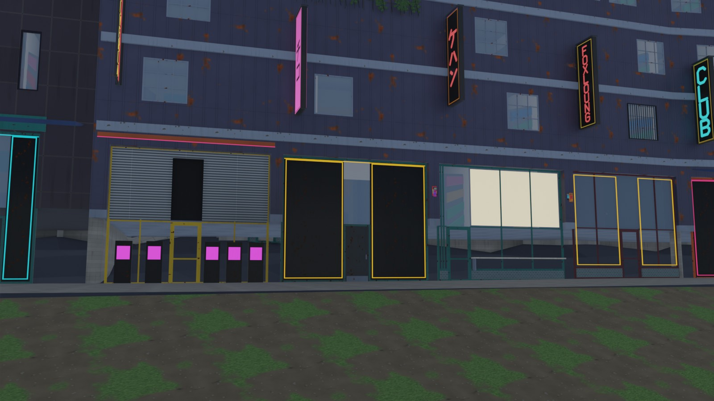
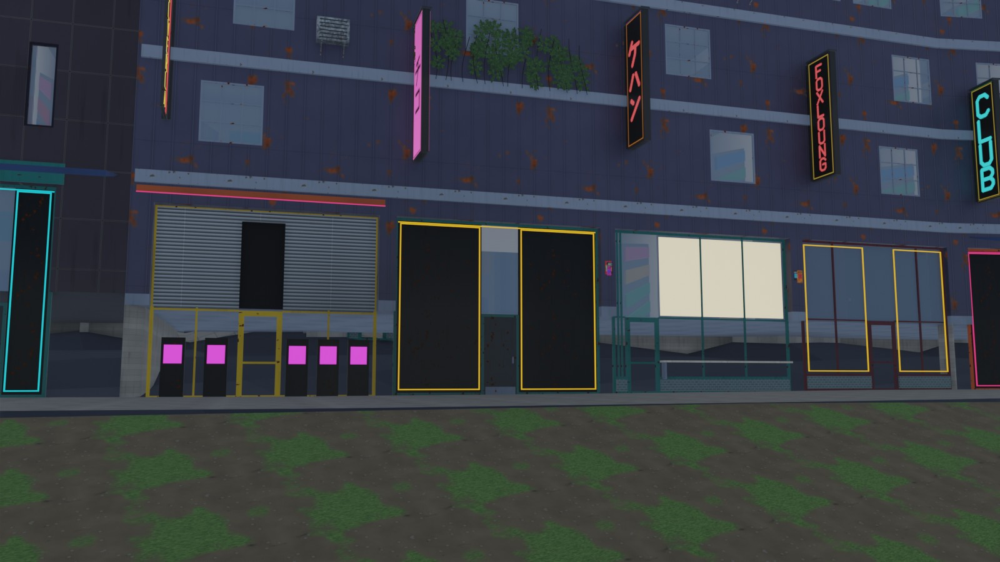

# Asset checks, AG15's follow-ups, roof traces and the Unreal tests (issues #83, #85, #88, #90)

A fix between milestones, from run-through 2's open items. Code: `assetgen/brief.py`,
`assetgen/props/gather.py`, `citygen/props.py` (wall mounts), `assetgen/buildings/fronts.py`,
`assetgen/asset_checks.py` (doors), `assetgen/buildings/genome.py`, `neighbors.py`,
`assetgen/build.py`, `assetgen/briefdiff.py` (the neighbor rule), `assetgen/buildings/shell.py`
(fins), `citygen/unreal_play.py`, `assetgen/materials/preview.py` (lights on terrain),
`citygen/ue/check_city.py`, `citygen/ue/import_city.py`, `tests/test_unreal.py` (Unreal). Log:
`docs/assetgen_milestones.md`, "Fix: asset checks, AG15's follow-ups, roof traces and the
Unreal tests".

## The cities (#88)

Each city built with `citygen build` (Cragmouth again, for M20's change; the others are
main's models byte for byte) and `assetgen build --workers 2`, on main and on this branch
(Windows PC). Main's Vesper Bay Decks is #106's layout, on which `d05.lot.w576n1053.bld` no
longer stands.

| City | Failing on main | Failing here | Doors blocked | Doors facing a neighbor (counted apart) | Mounts on glass |
|---|---|---|---|---|---|
| Cragmouth | `asset_access`, `asset_mounts` | none | 1 to 0 | 325 to 276 | 1 to 0 |
| Nexus City | `asset_access`, `asset_unique`, `asset_clash` | `asset_clash` (#104's, below) | 2 to 0 | 322 to 263 | 0 |
| Saltreach Free Port | `asset_envelope` (a fin over a lane) | none | 0 | 241 to 199 | 0 |
| Vesper Bay Decks | none | none | 0 | 374 to 302 | 0 |
| Delta Megacity | none (run-through 2) | none | 0 | 274 | 0 |

- **AC units and ivy on slopes** (Cragmouth): M20 hangs AC units and facade greenery on a
  floor's facade at a height over the ground where they hang; the briefs read those as heights
  over the building's base and AG8 lifted them by the base, so on a slope they stood off by
  the ground's rise from the base (the AC unit "on glass" hung 1.4 m low in front of a
  window; the 64 ivy patches "off their walls" were read over or under every wall). Now the
  briefs carry them in the building's frame and AG8 lifts them by the ground where they hang;
  M20 no longer puts 31 ivy patches and 12 AC units on walls the ground buries uphill of
  their base. The 68 counted off their walls now are ivy whose middle stands 1 to 4 mm over
  the top of the wall the brief locates it on (M20 hangs it at a floor equal to a mass's
  top), counted apart as before.

  | Main | This fix |
  |---|---|
  |  |  |

  A shopfront row on a downhill street (`d02.lot.w783s343.bld`, its base 2.5 m over the
  sidewalk): the ivy and the AC unit on its upper floors stand where M20 put them (on main
  they were drawn 2.5 m lower, under the band).
- **Signs, awnings, lights and cables on slopes** keep their heights over the base: M20
  measures them over the street too, but AG3 and AG5 build the shopfronts under them from the
  base (lowered to the street with their band opening kept), and at the street's heights a
  first try here cut those shopfronts on downhill facades (Cragmouth's flush doors 1,468 to
  2,274, and a lowered row lost its front). Matching the two is open.
- **Doors**: units whose nearest wall faces another building move to a facade facing their
  own street (Cragmouth's blocked door; 220 Cragmouth, 208 Nexus and 174 Decks buildings move
  a unit), Nexus's shanty's main entrance shares its arcade's shopfront door, and Nexus's site
  door no longer counts as blocked for a path grazing its party neighbor's corner. Flush
  doors fall with them (Cragmouth 1,468 to 1,278, Nexus 920 to 871, Saltreach 581 to 551,
  Decks 946 to 888).
- **Nexus City's spire** (`d01.lm.w98n1260.bld`, 166 m) went after a 192 m tower beside it
  and kept the curtain wall that tower had drawn: a landmark's system is its kind's. It now
  draws past its neighbors' systems within its kind's weights (fin wall here).
- **Saltreach's fin**: an angled fin at the end of a podium facade reached round the corner in
  front of a 2 m edge whose lane is 0.47 m out (no sidewalk), 4.25 m up; fins near a facade's
  end stay off where the next edge faces such a road.
- **Nexus City's `asset_clash`** (on main too, after #103 and #104, not in #104's six cities):
  the median of highway `rs.e230s1005` runs 0.3 m deep over asphalt its junction
  `jn.e211s944` paves up to 2.4 m past its outline (#82's connector lane runs). Left open: it
  is #104's junction drawing (issue draft in the PR).

FILL
