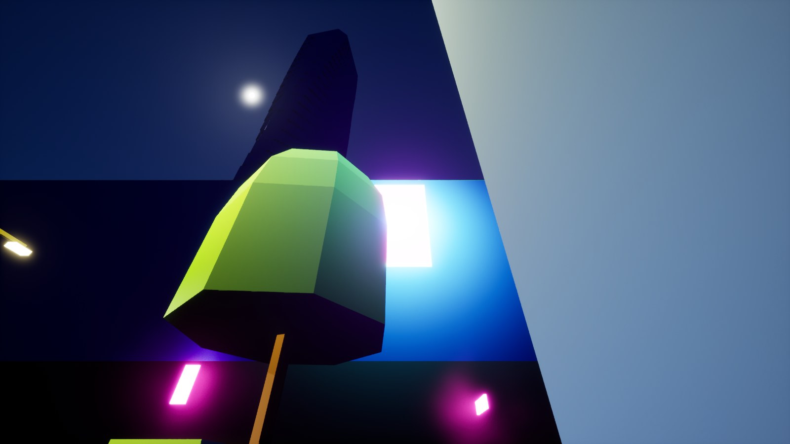
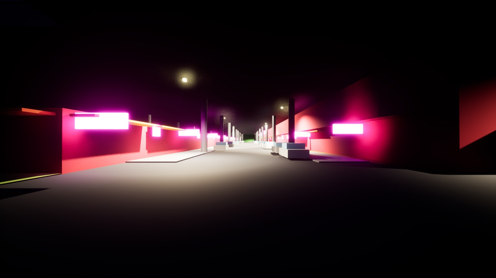
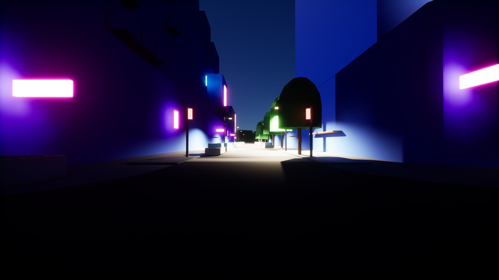

# Asset checks, AG15's follow-ups, roof traces and the Unreal tests (issues #83, #85, #88, #90)

A fix between milestones, from run-through 2's open items. Code: `assetgen/brief.py`,
`assetgen/props/gather.py`, `citygen/props.py` (wall mounts), `assetgen/buildings/fronts.py`,
`assetgen/asset_checks.py` (doors), `assetgen/buildings/genome.py`, `neighbors.py`,
`assetgen/build.py`, `assetgen/briefdiff.py` (the neighbor rule), `assetgen/buildings/shell.py`
(fins), `citygen/unreal_play.py`, `assetgen/materials/preview.py` (lights on terrain),
`citygen/ue/check_city.py`, `citygen/ue/import_city.py`, `tests/test_unreal.py` (Unreal). Log:
`docs/assetgen_milestones.md`, "Fix: asset checks, AG15's follow-ups, roof traces and the
Unreal tests".

## The cities (#88)

Each city built with `citygen build` (Cragmouth again, for M20's change; the others are
main's models byte for byte) and `assetgen build --workers 2`, on main and on this branch
(Windows PC). Main's Vesper Bay Decks is #106's layout, on which `d05.lot.w576n1053.bld` no
longer stands.

| City | Failing on main | Failing here | Doors blocked | Doors facing a neighbor (counted apart) | Mounts on glass |
|---|---|---|---|---|---|
| Cragmouth | `asset_access`, `asset_mounts` | none | 1 to 0 | 325 to 276 | 1 to 0 |
| Nexus City | `asset_access`, `asset_unique`, `asset_clash` | `asset_clash` until main's #117 (issue #114, below), merged here | 2 to 0 | 322 to 263 | 0 |
| Saltreach Free Port | `asset_envelope` (a fin over a lane) | none | 0 | 241 to 199 | 0 |
| Vesper Bay Decks | none | none | 0 | 374 to 302 | 0 |
| Delta Megacity | none (run-through 2) | none | 0 | 274 | 0 |

- **AC units and ivy on slopes** (Cragmouth): M20 hangs AC units and facade greenery on a
  floor's facade at a height over the ground where they hang; the briefs read those as heights
  over the building's base and AG8 lifted them by the base, so on a slope they stood off by
  the ground's rise from the base (the AC unit "on glass" hung 1.4 m low in front of a
  window; the 64 ivy patches "off their walls" were read over or under every wall). Now the
  briefs carry them in the building's frame and AG8 lifts them by the ground where they hang;
  M20 no longer puts 31 ivy patches and 12 AC units on walls the ground buries uphill of
  their base. The 68 counted off their walls now are ivy whose middle stands 1 to 4 mm over
  the top of the wall the brief locates it on (M20 hangs it at a floor equal to a mass's
  top), counted apart as before.

  | Main | This fix |
  |---|---|
  |  |  |

  A shopfront row on a downhill street (`d02.lot.w783s343.bld`, its base 2.5 m over the
  sidewalk): the ivy and the AC unit on its upper floors stand where M20 put them (on main
  they were drawn 2.5 m lower, under the band).
- **Signs, awnings, lights and cables on slopes** keep their heights over the base: M20
  measures them over the street too, but AG3 and AG5 build the shopfronts under them from the
  base (lowered to the street with their band opening kept), and at the street's heights a
  first try here cut those shopfronts on downhill facades (Cragmouth's flush doors 1,468 to
  2,274, and a lowered row lost its front). Matching the two is open.
- **Doors**: units whose nearest wall faces another building move to a facade facing their
  own street (Cragmouth's blocked door; 220 Cragmouth, 208 Nexus and 174 Decks buildings move
  a unit), Nexus's shanty's main entrance shares its arcade's shopfront door, and Nexus's site
  door no longer counts as blocked for a path grazing its party neighbor's corner. Flush
  doors fall with them (Cragmouth 1,468 to 1,278, Nexus 920 to 871, Saltreach 581 to 551,
  Decks 946 to 888).
- **Nexus City's spire** (`d01.lm.w98n1260.bld`, 166 m) went after a 192 m tower beside it
  and kept the curtain wall that tower had drawn: a landmark's system is its kind's. It now
  draws past its neighbors' systems within its kind's weights (fin wall here).
- **Saltreach's fin**: an angled fin at the end of a podium facade reached round the corner in
  front of a 2 m edge whose lane is 0.47 m out (no sidewalk), 4.25 m up; fins near a facade's
  end stay off where the next edge faces such a road.
- **Nexus City's `asset_clash`** (on main too, after #103 and #104): the median of highway
  `rs.e230s1005` ran 0.3 m deep over asphalt its junction `jn.e211s944` paves past its outline.
  That is issue #114, fixed on main by #117 while this branch was open; merged here.

## The neighbor rule in a regeneration (#90)

A tower's genome depends on its neighbors within 150 m, so a district regeneration could
redraw towers outside the district. In a city its `city_state.json` says a regeneration made,
every tower outside the last edit's district whose brief is unchanged now keeps the genome its
record has (drawn again past what it avoided, which the records keep), and the towers inside
avoid them. Nexus City with Midtown regenerated in place: 192 towers held, no genome changed
outside the district among the 5,746 buildings whose briefs are the same; with Corporate Core,
103 held. `assetgen brief seam BASE REGEN --district NAME` sorts the changes:

```
assetgen brief seam BASE REGEN --district Midtown
```

## Lights on terrain and decks by night (#90)

The play features' sign washes stood at their slot's height over 0; on a terrain city they now
stand over their building's base (the Blender previews' lamps, washes and sign pages too). The
lamp values were checked by night in Unreal on the test suite's small terrain and deck cities,
each imported (blockout) into a throwaway project of its own and checked with night views:
191 lamps lit and 768 light pools in each, every roof and facade trace hit (36 of 36 on the
hills, 48 of 48 on the deck). Street lamps 1500 cd, wall lamps 400, washes 600 and
`PoolStrength` 1.0 are kept: nothing blows out or stays dark.

| A billboard on a hillside building, washed at its own height | Under the deck |
|---|---|
|  |  |

On the deck: 

The check fails only on streaming on both (the small cities lie within the 1.5 km view range,
as #85 found for the small city's test).

## Roof traces (#83)

Run-through 2's five Industrial Port misses (four yards, one open shed beside the player start)
had their roof hulls: a stage 2 shell's actor starts at its street front's top, so a yard's roof
stood 2.5 m over its bounds' bottom and an open shed's shell is its roof slab alone, while the
check counted a hit only 3 m over that bottom. It now counts 3 m over the ground the building
stands on. Checked offline against Delta's packs (hulls, street fronts and shells traced at the
check's points): the old rule misses exactly those five of the 12 buildings around the start,
the new one none; Cragmouth 26 of 7,068 to none. Delta's own `--check` was not run: its stage 2
import goes past the PC's memory (#84). The stage 2 small city's `--check` passes.

## The Unreal tests (#85)

- `test_unreal_import_stage2_small_city`: an import back to the blockout updated stage 2's
  actors in place and kept what stage 2 had set on them (slot materials, collision profile,
  cull distances, shadow, HLOD, rotation); the importer now gives them the blockout's settings
  again, and the digests match (5,727 actors, every row the same).
- `test_unreal_import_small_city`: the small city (2.4 km) lies within the default view range
  from anywhere, so a teleport streamed nothing new; the test streams at 600 m.

Both pass on the Windows PC (42 and 10 minutes).

## What ran (Windows PC)

- `citygen build` of Cragmouth (M20's change) and, for the goldens, the five samples on the
  merged code; `assetgen build --workers 2` of Cragmouth, Nexus City, Saltreach Free Port,
  Vesper Bay Decks and Delta Megacity on main and on this branch.
- A Midtown and a Corporate Core regeneration of Nexus City, built with `assetgen build` and
  compared with `assetgen brief seam`.
- `citygen unreal` of the small terrain and deck cities (blockout, throwaway projects,
  `--check` with night views) and the two real-Unreal tests.
- The test files of the modules this fix touches: 207 pass; two fail as expected on Windows,
  the props golden (#92) and Nexus City's brief golden (since the moorings fix the Windows PC
  builds a Nexus City model other than its golden, main's code too; the Mac writes it).

## Open

- Shop signs, awnings, wall lights and cables on slopes keep their heights over the base
  (above); matching them with the street fronts on downhill facades is left for an issue.
- Delta's `--check` (#83's own city) waits for #84's memory limit.
- Nexus City's model on Windows differs from its golden since the moorings fix (main's code
  too, same blockout plan and report); its brief golden and the props golden (#92) are the
  Mac's to write.
- The small deck city fails `asset_decks` on two buildings cut through the slab, on main too.
- Nexus City's Corporate Core regeneration fails road checks at every seed it tries (stage 1),
  and the Midtown regeneration's assets fail `asset_envelope` on five Northridge villas' green
  roofs (main's assetgen too).
