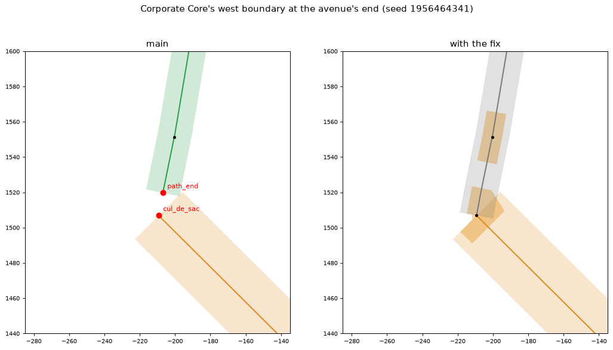
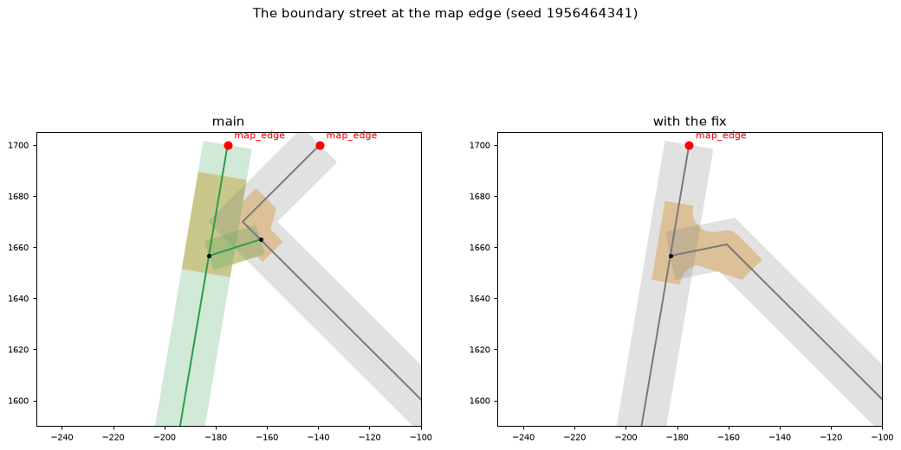

# Corporate Core regeneration fix (#126)

A fix between milestones. Regenerating Nexus City's Corporate Core failed at every seed:

```bash
.venv/bin/python -m citygen build docs/progress/M1a2/nexus_city/city_spec.json OUT --district "Corporate Core" --base NEXUS
```

The run tries up to four seeds and keeps the one with the fewest failures. On main the kept seed
(1956464341) fails `road_dead_ends` at the end of the axis avenue. When the issue was filed it
also failed `road_overlaps` beside the boundary street at the map edge; on main today a
pedestrian link happens to lay junctions over that overlap.

Both failures come from M10's rule that a district regeneration lays the other districts' roads
as they were and lets the district's new streets meet them only at their old nodes.

## What was wrong

**The avenue's dead end.**
- In the old city, the boundary street `rs.w205n1529` runs down Corporate Core's west side to
  the end of the axis avenue `rs.w146n1444` at (-209, 1507). Its last 13 m come from M17's
  run-on (`settle_dead_ends`).
- In the regeneration, the shared frame lays the boundary street as it was before the
  clean-up, ending 13 m short of the avenue.
- The district's new streets no longer reach this group of boundary streets. So
  `pedestrianize_islands` takes the group for an island and makes it pedestrian before the
  run-on.
- The avenue is left with a dead end tagged a cul-de-sac but with no turning bulb, and the
  boundary street is a path (left).



**The corner at the map edge.**
- The fill ended two new streets 2.5 m apart beside the boundary street.
- The one from the map edge hooked onto the other's free end (`attach` within 3 m). The other
  could then no longer bend onto the boundary at its old node (-183, 1657), as the old city's
  street had: a bend may not drop a stretch where another road joins.
- Its straight approach meets the boundary at 54.5 degrees, under the district's 60.
- The two became one street with a corner 10.8 m from the boundary's centerline, their rights
  of way overlapping by 103 m2.
- M17's `_overlaps` may drop neither: the boundary street is held, and the new street's other
  end is at the map edge, so dropping it counts as parting the network.



(Main against the fix on the kept seed: rights of way by class, gray street, orange avenue,
green pedestrian; junction polygons in orange; dead ends in red with their tags; overlaps
outside the junctions over 25 m2 in magenta.)

## What changed

Both changes are in `citygen/streets.py` and act only under a regeneration's frame, so a fresh
build of any city is the same bytes.

- **Held runs** (`held_runs`, in `build_streets` before the noding). A held street of the
  regenerated district (a boundary street, a pinned one) whose end lies inside a held segment of
  the old city that goes on past it is laid on along that segment to its end. This is the old
  city's run-on, laid as it was. The piece is a held road, so it comes back byte for byte, and
  the group joins the avenue before anything takes it for an island.
- **Hooks come loose** (`Builder.attach`, `_hooked_at`, `_unhook`, `HOOK_M` 3 m). New streets
  of the district hooked onto another new street's free end no longer keep it from bending
  onto a road it may meet only at an old node (`_attach_to`'s `keep`). Where it bends, they let
  go (their hook dropped, their end free again) and are joined later as any dead end. At the
  map edge the street now bends onto the boundary at the old node, as the old city's did. The
  44 m stub from the map edge can join nothing and goes (M17's cut-back).

## Choices

- **Lay the old run-on, not keep the group from being an island.** The run-on is what the old
  city had, and the piece it lays is a held road. Keeping the group a street network another
  way would still have left the avenue's end to M17, which never runs on a held road.
- **Only the regenerated district's own held streets.** A first version laid on any held
  street whose end lay inside an old segment. That was 69 streets across the city (other
  districts' frontage, organic and alley streets), which their own clean-up runs on as it did.
  It moved other districts' streets (Old Town's frontage streets among them), and a metro
  tunnel then clashed with Midtown's buildings (`tunnel_clash`).
- **Unhook, not cut back.** A first fix for the corner cut the new street back from its
  map-edge end past the boundary's right of way (M17's `_poke`, which skips a map-edge end).
  It passed, but the street had no junction along the district's northwest edge and no room
  for a turning bulb. M17 took it back to its last junction: 415 m of new street gone.
  Letting the hook come loose keeps that street and bends it onto the old node.

## Results

Corporate Core, on the same base build of Nexus City (its golden hash):

| Seed | Main | With the fix |
|---|---|---|
| 674388141 | 4 failures | 5 failures |
| 1838421871 | 6 failures | 4 failures |
| 60454467 | 10 failures | not tried |
| 1956464341 | 1 failure (`road_dead_ends`), kept | all 107 checks pass, kept |

- Held road segments that come back unchanged: 2584 of 2588 on main, 2587 with the fix. The
  one left is the boundary piece `rs.w268n1254`, whose old start was where an old Corporate
  Core street met it.
- The run takes 455 s (607 s on main, which tries all four seeds).

**Midtown:** its regeneration is byte for byte the same on main and with the fix (model
sha256 `226bbb43`), so neither change reaches it. It fails on main too (see Open).

**Fresh builds:** Nexus City built anew with the fix is the same bytes as its golden
(`c359c12f`); both changes act only under a regeneration's frame.

## Open

- **Seeds 674388141 and 1838421871** (and 60454467 on main) still fail `road_graph`,
  `street_graph` and `road_dead_ends` at (-263, 1303), as on main. There the new grid misses
  the boundary's old node by 5 m, and the snap to it would meet the boundary at 43 degrees.
  `_frame_join`'s link is cut by `fix_angles`, and a held boundary piece with Aurora
  Spaceport's infill street is left as a pedestrian island. With the fix, seed 674388141 also
  fails `walkway_building_clash` in its new layout (a park path joining through
  `d01.lot.w223n1318.bld`). These seeds are not kept.
- **Midtown fails `prop_support` on all four seeds, on main as well.** Four awnings of
  `d01.lot.e701n680.bld` hang on nothing, because the regeneration loses that tower.
  - The held Spire Line's Corporate Core station sits in the tower. Transit runs before the
    stable ids, so the held line's station towers (stable ids from the old city) never match
    the rebuild's build-order ids.
  - The tower is taken out as an obstacle, and the station becomes a pylon station.
  - The issue reports Midtown passing when it was filed (103 checks then). The lost tower is
    a separate bug, in M10's held transit lines.
