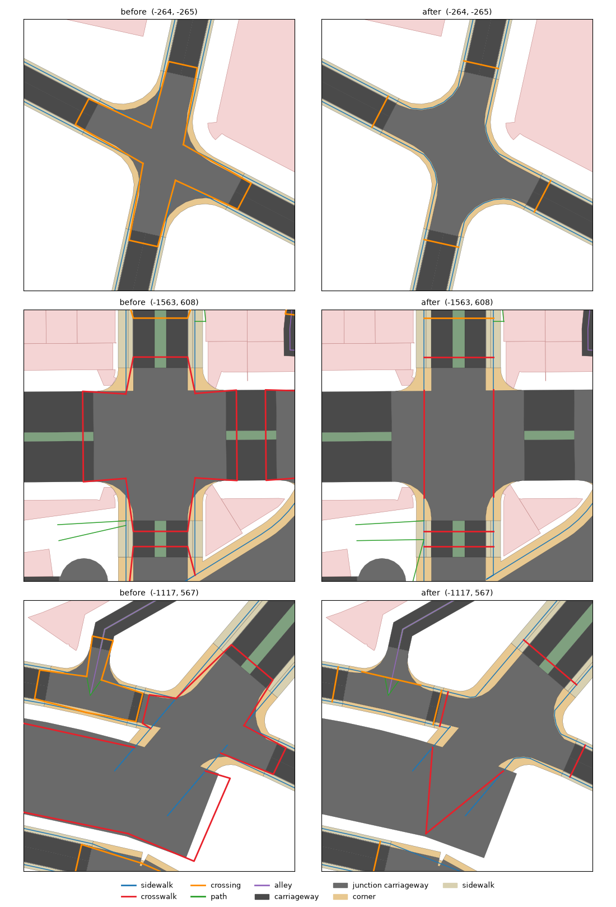
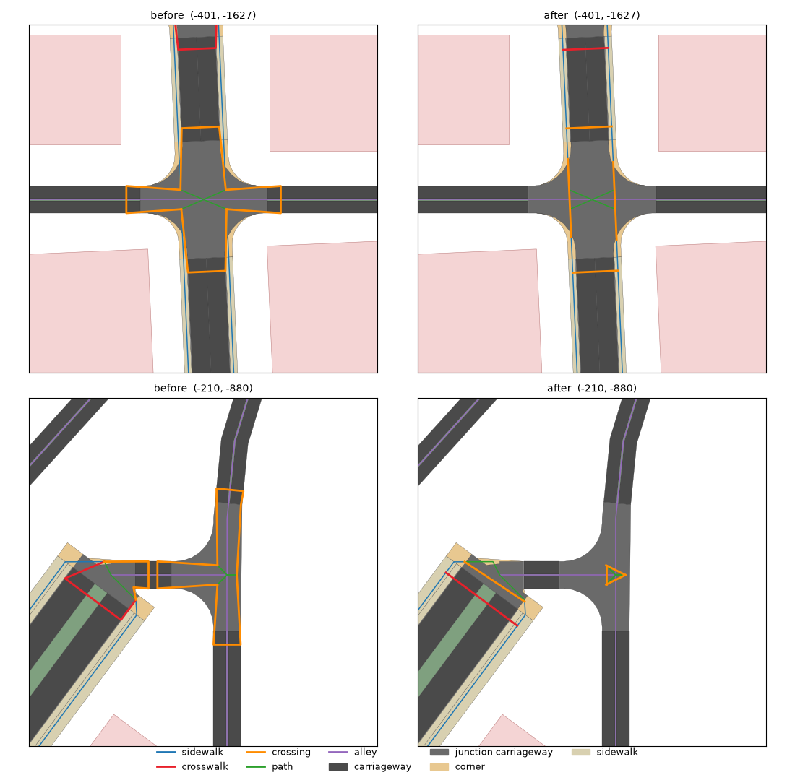

# Crossings fix (walkways off the carriageway)

A fix between milestones, from LG3's and the people fixes' open item: people in the Unreal
crowd walked on the carriageway, because the walkway graph's crosswalks and unmarked
crossings ran their corner tails along the road or diagonally across it.

## The defect

`junctions.build` drew every crossing of a leg as one walkway `[corner, a, b, corner]`: from
the corner where the two neighboring sidewalks' middle lines meet (`_corner_point`, near the
node), to the curb at the crossing's station (`a`), across (`b`), and back to the next corner.
Since M17 and M22 a leg's cut (where its bands, sidewalks and crosswalks end) reaches past
every overlap of the legs' rights of way, often 10 to 60 m from the node, and the crossing
stands past the cut. So each crossing's two tails ran from the node's corner out to the
crossing, along the curb line (half on the junction's carriageway) or diagonally across it.
Three more faults put walkers on the carriageway:
- **Corners in the fillet.** Where a corner's fillet is wider than the sidewalk (a radius over
  about 1.7 times the sidewalk's width), the point where the two sidewalks' lines meet lies
  on the junction's carriageway, and both sidewalks ran into it.
- **Clusters and big junction faces.** A sidewalk of a road inside an M22 cluster runs on its
  line end to end, often across the cluster's carriageway.
- **Dead ends and bulbs.** Both sidewalks of a dead end met at its node, on the road's middle
  (a cul-de-sac's bulb, or the road's end).

## The fix (`citygen/junctions.py`)

- **Crossings straight across, from sidewalk to sidewalk.** A crosswalk or crossing of a leg
  with sidewalks is `[sidewalk, curb, curb, sidewalk]` square across the road at its station,
  each end on the sidewalk's middle line where it is square across from the curb; the
  sidewalk walkway is split there (`_split_at`), so the crossing joins it. A crosswalk walkway
  is still four points, its middle stretch the crosswalk record's line (LG3's `signals` reads
  it so). Where a sidewalk does not reach the crossing's station within 2 m
  (`ATTACH_MAX_M`), the crossing goes between the leg's corners.
- **A road with no sidewalk** (a highway, an alley, a service road) is crossed between its two
  corners, where the neighbors' sidewalks reach its curb; a highway's crosswalk record stands
  there (wholly on one face, M22's rule).
- **Corners off the carriageway** (`_corner_walk`, `_Carriage`): the junction's carriageway is
  its unit's region less its corner pads (M22's `Plan.regions`) and less its pedestrian legs'
  stubs, taken out by `CURB_OFF_M` (0.3 m). A corner whose sidewalks' way to it runs onto the
  carriageway is led round its edge on the corner pad (`_round`: the shorter way round that
  crosses no leg's port and stays on the right of way; a bulb's way round its rim), the
  corner node the middle of that walk; beside a road with no sidewalk the corner is where the
  sidewalk reaches the curb. With no pad to walk round on, each sidewalk ends at its port and
  a crossing joins the two (a crossing of the junction's corner, one straight span). Where no
  such walk stays on the right of way, the corner is M2's, as before (the lots' ways round
  then lead it round, `parkpaths.keep_off`).
- **Sidewalks led round** every junction's carriageway they cross at their ends; a road
  going on as one of another cross-section with no junction between gets the same corner
  walk over the two roads' carriageways (`OFFSET_STEP_M`).
- **Dead ends with no junction**: the two sidewalks end where they are, joined by a crossing
  of the road's end.
- **Links** from an alley's or path's centerline end to its corners go by M2's corner point
  (`corner_x`), on the road's own strip, not across a corner lot.

## The check (`citygen/network_checks.py`, `walkway_carriageway`)

`walk_on_roads` measures each ground or deck walkway's length on the carriageway faces of
M22's pavement map at its level and height (a road's carriageway, a junction's, a bulb; not a
junction of pedestrian streets, nor its pedestrian legs' stubs), and for a crosswalk or
crossing the most of it on one stretch (its straight span). `walkway_carriageway` (with the
finished checks, on the final walkways; 108 on a flat sample, 113 with decks) fails a
crosswalk or crossing that runs more than 5 m on a carriageway past its span, and a city
whose sidewalk walkways run more than
0.5% of their length on a road's carriageway; it notes the sidewalks on a junction's face
(cluster roads, junction faces over a road's sidewalk bands, no pad), and the alleys' and
links' length on their own shared carriageway.

## The measure, before and after

`network_checks.walk_road_stats` on main's builds (before) and this branch's (after): each
kind's length, its length on a carriageway face, and what runs on one past a crossing's
straight span (for sidewalks, all of it). Delta Megacity:

| Kind | Walkways | Length | On a carriageway | Past the span | Walkways past 1 m |
|---|---|---|---|---|---|
| crossing, before | 3,235 | 89.0 km | 43.2 km (48.5%) | 15.4 km (17.3%) | 1,131 |
| crossing, after | 3,298 | 31.2 km | 22.7 km (72.7%) | 8 m (0.0%) | 0 |
| crosswalk, before | 564 | 25.0 km | 8.9 km (35.6%) | 2.0 km (8.0%) | 90 |
| crosswalk, after | 560 | 11.3 km | 6.7 km (59.4%) | 4 m (0.0%) | 0 |
| sidewalk, before | 4,014 | 176.1 km | 10.0 km (5.7%) | | 487 |
| sidewalk, after | 9,685 | 170.6 km | 1.8 km (1.0%) | | 75 |

A crossing is now mostly its span across the road (so its share on a carriageway rose as its
tails went); what ran past the span went from 17.3% to nothing. Crossings over 30 m long:
922 to 9 (the longest 179 m to 46 m); crosswalks 403 to 56 (the longest 172 m to 78 m: the
ones left are across wide avenues and highways with medians). The sidewalk walkways are split
where crossings join them (4,014 to 9,685). The 1.8 km of sidewalk left on a carriageway is
mostly on junction faces (roads inside M22's clusters, junction faces over a road's sidewalk
bands; the check notes them), about 0.2 km on roads' carriageways (no sidewalk walkway more
than 5 m).

Past the span (crossings and crosswalks together) and sidewalks on a carriageway, before and
after:

| City | Crossings past the span | Crosswalks past the span | Sidewalks on a carriageway |
|---|---|---|---|
| Delta Megacity | 15,385 to 8 m | 2,006 to 4 m | 10,016 to 1,787 m (5.7 to 1.0%) |
| Vesper Bay | 17,774 to 9 m | 1,518 to 3 m | 10,020 to 1,792 m (5.5 to 1.0%) |
| Nexus City | 16,179 to 11 m | 1,714 to 5 m | 12,063 to 2,752 m (5.9 to 1.4%) |
| Greyhook | 7,004 to 5 m | 1,035 to 1 m | 5,494 to 957 m (4.5 to 0.8%) |
| Saltreach Free Port | 8,747 to 10 m | 600 to 2 m | 5,911 to 1,274 m (6.3 to 1.4%) |
| Vesper Bay Decks | 18,226 to 10 m | 1,518 to 3 m | 10,031 to 1,807 m (5.5 to 1.0%) |
| Cragmouth | 22,997 to 9 m | 1,976 to 3 m | 10,796 to 1,584 m (5.3 to 0.8%) |

Unchanged: alleys and service roads (no sidewalk: their walkway is their carriageway, 64 to
80% of an alley walkway's length), pedestrian streets and promenades. The `path` walkways
that link an alley's or path's centerline end (its node, in the junction) to its corners grew
by 1 to 3 km a city: they now go by M2's corner point to the corner on the sidewalk (Delta's
paths on a carriageway 8.7 to 10.6 km, nearly all of it on alleys' stubs).

LG3's derived signal phases (`lifegen.plan.signals`, read only) on Delta: 150 signals, 552
signalized crosswalks, 544 crosswalk walkways found in their phases before, 543 after.

## Junctions before and after

The walkways over M22's pavement map (gray: carriageways, darker the junction's; tan: corner
pads; beige: sidewalks). Delta: a street crossing (crossings straight across, joined to the
sidewalks), an avenue crossing two streets (the avenue has no sidewalk: crossed between its
corners, along the streets' sidewalk lines; the streets' crosswalks square), and a junction
of highways, an avenue and an alley (its highway crosswalks between corners, open item):

Vesper Bay: a street crossing two alleys (the alleys crossed along the street's sidewalk
lines) and a T of alleys and a road with no sidewalks:

## Validation

- **Builds** (Windows PC, `CITYGEN_WORKERS=2`): every sample and demo (Delta Megacity,
  Vesper Bay, Nexus City, Greyhook, Saltreach Free Port, Vesper Bay Decks, Cragmouth, the
  pinned and the stack demo) builds on the same try as on main with every check passing (108
  on a flat sample, 113 with decks). Two layouts the builds discard failed the walkway clash
  on the way (Vesper Bay Stacks' second, Cragmouth's first, which fails `junction_levels` and
  `road_overlaps` on main too); the first was fixed (ways round kept 0.2 m inside the right
  of way, M2's walk offsets kept), the stack demo's second layout now passes, as on main.
- **Goldens:** every sample's model and blockout plan (`tests/data/golden_hashes.json`), and
  assetgen's: the samples' and the small city's briefs, the small city's asset files and
  materials (`golden_hashes.json`), the streets (`golden_streets.json`), props
  (`golden_props.json`) and ground (`golden_ground.json`); the water goldens keep their bytes.
  The props golden is known to differ between Windows and the Mac (it was made on the Mac):
  this one is Windows', to be rewritten on the Mac.
- **Tests:** `tests/test_crossings.py` (new: the helpers on small shapes, the sample, the
  check's failing case), and the test files of the modules touched and the tests that run the
  code: `test_streets`, `test_park_paths`, `test_road_repair`, `test_pavement`,
  `test_junctions_ramps`, `test_buildings`, `test_decks`, `test_roads`, `test_blockout`,
  `test_terrain`, `test_edit` (211: 209 passed; the 2 failures, the check's failing case on
  an avenue's median and the check run on the M2 model differing from a fresh run on the
  final one, were fixed: the check runs with the finished checks; `test_crossings`,
  `test_buildings` and `test_streets` again: 62 passed; Saltreach built again, the same
  model); `tests/lifegen/test_lg_plan.py` (19 passed: signal phases and crowd walks);
  `tests/assetgen/test_ag_streets.py` and `test_ag_junctions.py` (18 passed, the new street
  goldens). Logs in `C:/Users/swagn/CityGen/builds/fix_crossings/` (`tests_citygen2.log`,
  `tests_citygen3.log`, `tests_lifegen.log`, `tests_assetgen.log`).
- **LG3's signals** (`lifegen.plan.signals`, read only): on Delta 543 of 552 signalized
  crosswalks' walkways found in their phases (544 on main), on Vesper Bay 407 of 415 (411):
  the ones missed are highways' crosswalks between far corners (open items).

The Unreal check (Delta from main imported and checked, the crowd crossing by night, the
benchmark, the package, and three faults it exposed in AG7's junction barriers and atmosgen's
road lights, fixed): `unreal/README.md`.

## Open items

- **A highway's crosswalks** (a highway has no sidewalk) run between the leg's two corners,
  which at a big junction of highways can lie far apart: the crosswalk walkway then crosses
  the junction diagonally (one straight span, so the check lets it pass), and LG3's
  `signals` does not find the few whose middle lies over 6 m from their record's (Delta 9 of
  552 signalized crosswalks, 8 on main; Vesper Bay 8 of 415, 4 on main). A walkway
  `[corner, curb, curb, corner]` with the record's line as its middle would match them, at the
  cost of tails along the highway's curb.
- **Sidewalks on junction faces:** the sidewalks of roads inside an M22 cluster run on the
  cluster's carriageway where its corner pads are cut, and a few junction faces cover a
  road's sidewalk bands (Delta 1.6 km, noted by the check). A walk round the cluster on its
  pads, from outer leg to outer leg, would replace them.
- **Sidewalk lines across their own road:** a sidewalk's offset line folding across a tight
  bend, and two roads of different cross-sections meeting with no junction, still put a
  few meters of sidewalk on a carriageway (a handful a city).
- **Alleys and links into them** share their carriageway by design; the links from an
  alley's centerline end (its node, in the junction) to its corners go by M2's corner point
  and so grew a little.
