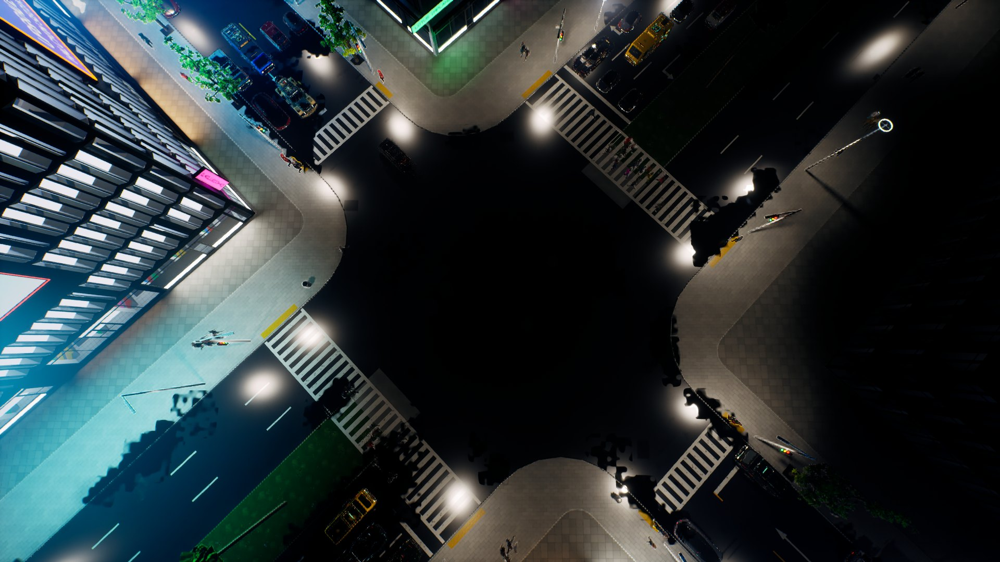
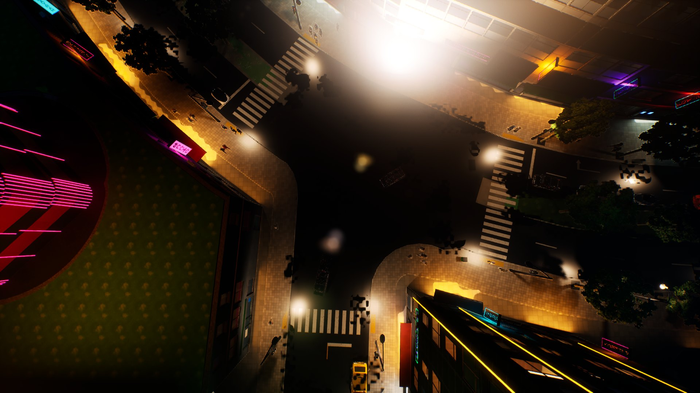
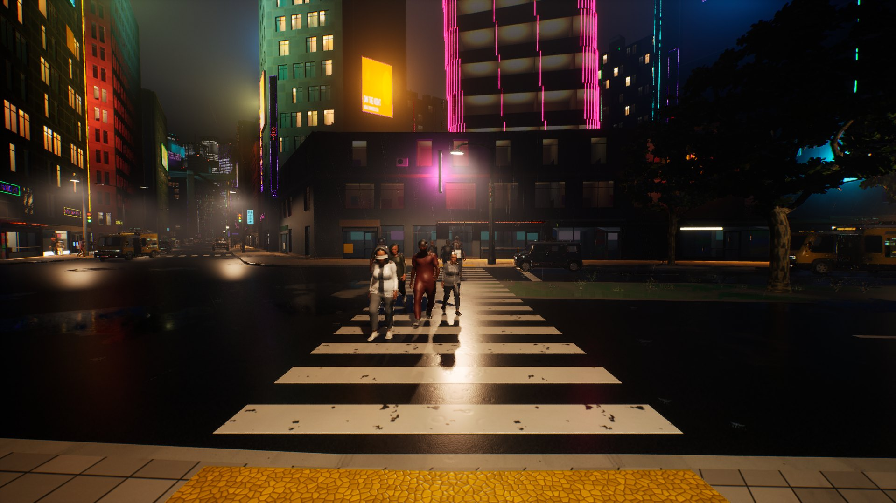
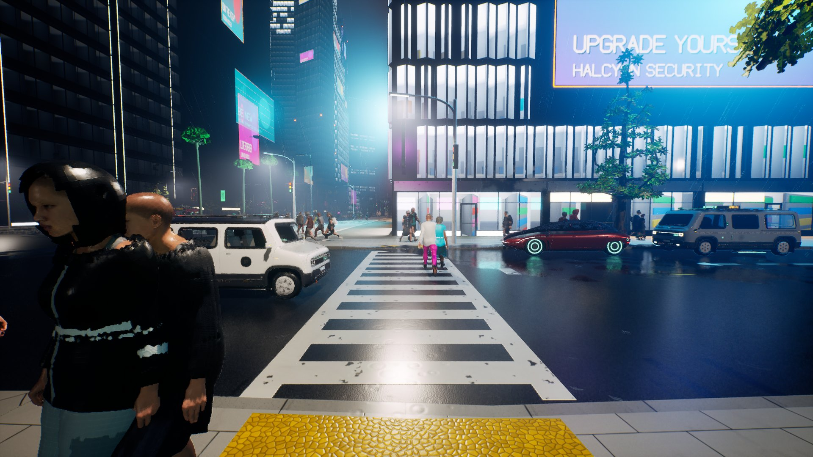
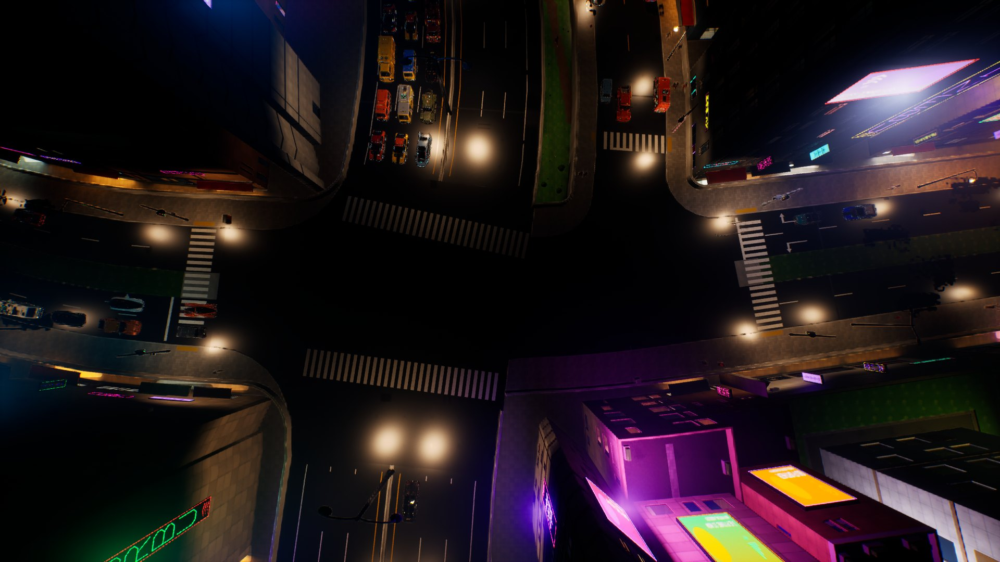
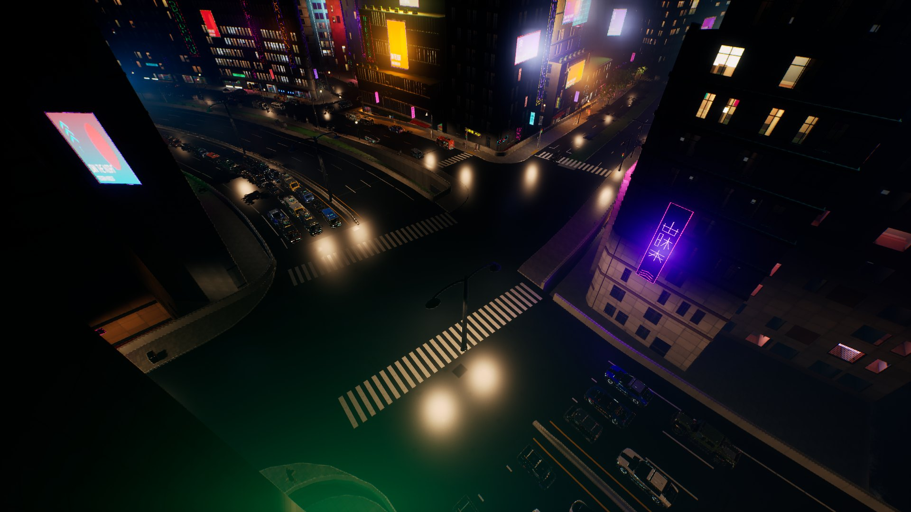
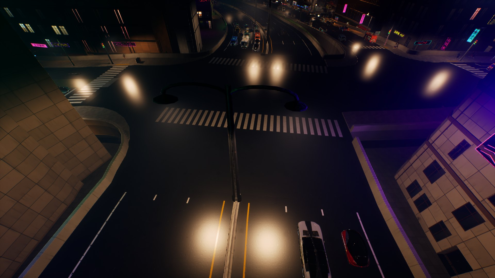
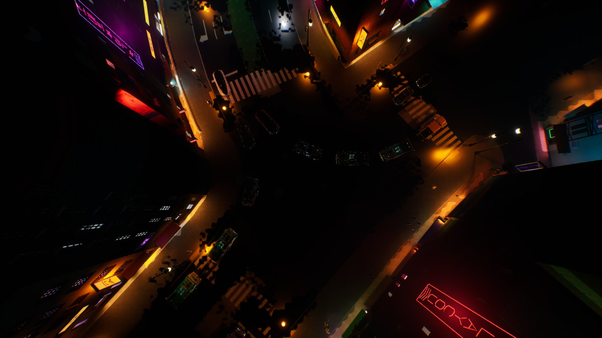
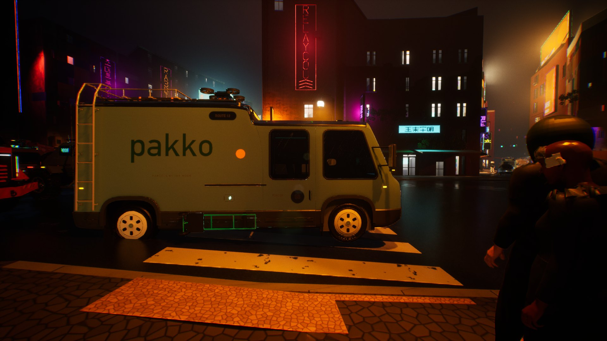

# The crossings fix in Unreal (Delta from main)

The coordinating session's Unreal check of the crossings fix (#232): Delta Megacity built
from main (#232 and LG4's #233), imported over its import in `CityAG16` with its atmos and
life plans, checked with shots at signalized junctions by night, benchmarked and packaged.
The new build is the live Delta: `C:/Users/swagn/CityGen/builds/delta_main/` (`delta_megacity`,
`delta_megacity_atmos`, `delta_life`; the scripts beside them), replacing
`builds/fix_play_cars`.

## The build

| Stage | Result |
|---|---|
| `citygen build ... --blockout --no-render` | 6 min, every check passes (108), the model at its golden sha256 |
| `assetgen build --workers 2` | 12 min; AG14's `asset_clash` failed: 33 junction guard walls on crosswalks (fixed below, then every check passes) |
| `atmosgen plan` | the fixtures check failed: 1 alley fill pole on a carriageway (fixed below); a highway's twin median column stood on a crosswalk (seen in the shots, fixed below); then every check passes, lux included |
| `lifegen plan` | every check passes (23): 150 signals, 543 crosswalk walkways served, 150 of 150 signals with lanes stopping short of their crosswalks |

## Faults the crossings fix exposed, and their fixes

The fix stands a highway's crosswalk (a highway has no sidewalk) between its leg's two
corners, on the junction's faces, often across the median's last stretch. Two generators
had assumed a crosswalk lies on its road past the cut:

- **AG7's junction barriers** (`assetgen/streets/barriers.py`): a junction's guard walls,
  corner parapets and median across kept out of its connector lanes but not its crosswalks
  (a road's runs kept `XWALK_CLEAR_M` off them). On Delta 33 guard walls stood on highway
  crosswalks (AG14's `barrier_on_crosswalk`). They now keep `XWALK_CLEAR_M` (1 m) off every
  crosswalk that reaches the junction (`_keepout`: the lanes' corridors and the crosswalks,
  cut and capped as at a lane), and a median across that a crosswalk crosses is left out.
  Delta: 0 clashes. The street goldens' `all` moved with the code hash; every named tile kept
  its bytes (the small city's and Vesper Bay's).
- **atmosgen's highway median columns** (`atmosgen/plan.py`, `roads`): a twin column in a
  highway's median stands every spacing along the whole centerline and is a free fixture
  (no clearance test follows), so one stood on `cw.e670n661` at `jn.e671n673` (the shot
  `night_xing_hwy_d02_column_before.jpg`). A median column on a junction or within
  `XWALK_CLEAR_M` of a crosswalk now moves along its road, 2 m at a time up to half a
  spacing, else is left out; a raised road's parapet column on one is left out. Delta: 52
  columns met one, 27 moved, 25 (on short stretches inside junctions) left out; the lux
  check passes (corner poles 532 to 582, junctions still dark 30 to 35, all within the
  check's rules).
- **atmosgen's fixtures check** (`atmosgen/fixtures.py`): an edge pole was tested for
  clearance unrounded and checked rounded (its record's millimeters, its yaw's hundredths),
  so a pole at the very edge of a carriageway passed the one and failed the other (Delta's
  `wk.w702n1670.fill0`, a fill light on an alley's link to its corners, which the crossings
  fix moved). The pole is now tested as the record holds it.

## In Unreal

`citygen unreal` imported the build over the old Delta in `CityAG16` (22 min with the HLODs;
5,564 actors updated, 6 created, 10 deleted), then again after the atmos fixes (84 actors
updated). The check (`--check-only --check`, every check) passes, with shots: at four
signalized junctions (Old Town `jn.w918n984`, Corporate Core `jn.e908n99`, Midtown
`jn.e854n1105`, a highway junction `jn.e671n673` between Midtown and the Corporate Core),
from overhead (three frames a second apart, `_seq3`) and from a curb, after 30 s of waiting
(`*_wait`), the crowd set to 18:00 for a busy street (`CityGenLife.Hour 18`) under the
night's light.

**People cross square on the crosswalks, between the sidewalks.** In every overhead frame
the people are on the sidewalks, waiting at a crosswalk's curb or on its stripes, crossing
straight across; none walks along a carriageway or cuts across a junction's middle (before
the fix the crossings' tails ran along the curb line and across the junction's corners):

From the curb, groups cross on the stripes:

**Cars stop at the stop lines.** Queues wait short of the crosswalks on red (Corporate Core's
and Midtown's legs, the highway junction's four legs), turning cars pass the crosswalks
behind the walkers. The lifegen status at the views: 1 to 12 cars stopped for a person of
about 1,600 live cars at 18:00.

The highway's crosswalks run between the corners (the fix's rule for a road with no
sidewalk), so they cross the junction at a slant where its corners do. The median column
that stood on one before the atmos fix, and where it stands now:

**Old Town's junction jams** (not from the crossings fix): `jn.w918n984`'s east leg
`rs.w902n996` leaves it on a 5.8 m lane into the next junction, too short for LG5's "room past
the junction" test (`Len[Exit] > 2 (car + gap)`), so at 18:00 cars stop on its crosswalk and
in the box until LG5's 25 s release; the lanes and stop points are as before the fix. Left as
an open item for the traffic (a test of room on the lane after a short exit).

## The benchmark

The lean route, `night_plan_all` only, one run at 2560 x 1440 native, no DLSS
(`bench/bench.md`): **21.5 ms p95** over the route (walk 25.9, drive 21.1, flight 20.6), game
thread bound, against LG5's 21.2 (walk 25.5) and the 20 ms budget: over it by about 1.5 ms,
as known (left for the performance pass, no tuning here). The run waited about two minutes
for the other session's builds to finish (`bench.busy`); during it the other processes took 2
cores on average (3.7 at most, 1.6 of them the other session's Python), so it may read a
little high.

## The package

`CityAG16` mirrored into `CityPackaged` (16.1 GB, without `Saved`, `Intermediate`,
`DerivedDataCache`, the MetaHuman Character sources and the plugins' `Intermediate` and built
binaries), packaged (Development, Win64) by `builds/packaged/package_main.cmd` into
`C:/Users/swagn/CityGen/builds/packaged/Delta_main` in 20 min (5.1 GB). A 60 s smoke launch
with `-userdir` outside the package loads the map in 16 s, lifegen ready (35,445 lanes, 2,400
people, 1,800 cars), no error in the log, and leaves no `Saved` folder in the package (the
launcher's game process outlived the script's stop and was ended by hand). `CityPackaged` and
the superseded `Delta_lg4` are deleted. The disk fell to 3 GB free during the cook, with the
other session's builds; 35 GB free after.

## Validation

- Delta built from main, every stage's checks passing (above); the Unreal import and check
  pass.
- Tests (logs in `C:/Users/swagn/CityGen/builds/delta_main/`): `tests/assetgen/test_ag_barriers.py`
  (a new test: a junction barrier keeps off a crosswalk, unit and on the small city),
  `test_ag_streets.py` (the rewritten goldens), `test_ag_fit.py` and
  `tests/atmosgen/test_at_streets.py` (after the fixtures fix): 35 passed (`tests.log`); then,
  after the median column fix, `tests/atmosgen/test_at_streets.py` (a new test: a highway's
  median column moves off a crosswalk, keeping its count), `test_at_plan.py` and
  `test_at_far.py`: 27 passed (`tests_atmos.log`).
- Other cities: not built (the small fixes' rule); every city with a highway crosswalk at a
  junction with guard walls or median columns moves (their streets and atmos plans), to be
  seen on their next builds.
