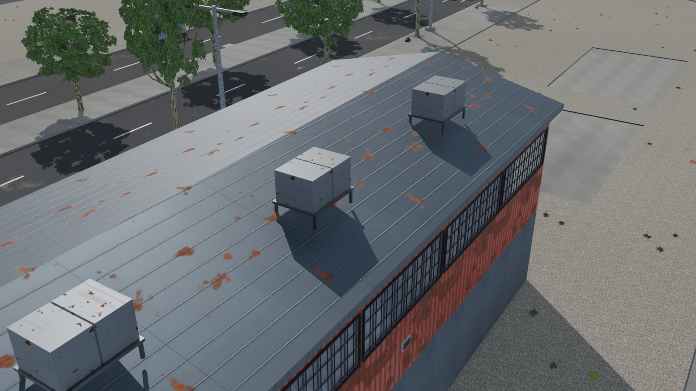
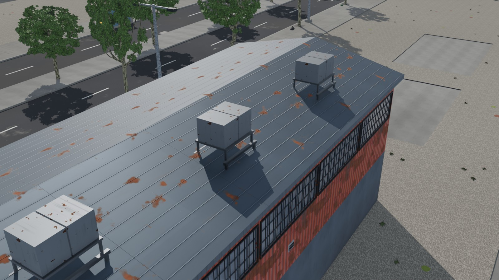
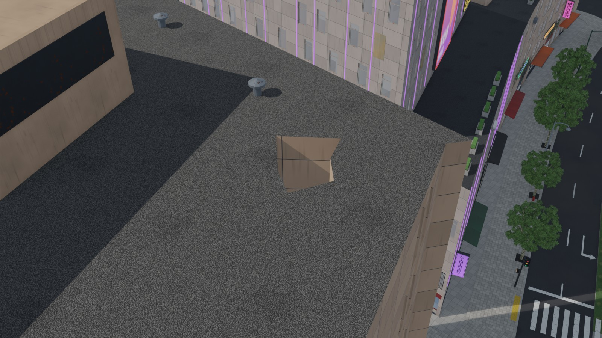

# AG14's grounded rule (#105)

The last item of #105. AG14's `asset_grounded` says a thing rests when three of its five feet
(its middle and the corners of its lowest vertices' box, pulled 10% in) are within 2 cm of a
surface, but where fewer than three were it took the smallest gap, so one foot on a surface
held the other four up. It now takes the third smallest (`fit.build.rest_gaps`), and a
dunnage frame's own top no longer holds the frame up (each frame is its own owner).

The stricter rule found roof items AG4 had left with feet in the air, so AG4 now seats every
roof part on all its feet:

- **`roofs.Stand`**: the faces facing up of what the shell has drawn so far (its roofs,
  forms, finishes, fronts) and the tops of the dunnage frames placed so far, read as AG14
  reads the packs; a part stands when each of its five feet is within 2 cm over the highest
  surface at most 0.6 m over it (a frame its own height).
- **Roof items** (`items`, `_lay`): each item is laid out (seat, frame, size) and tested,
  frame and item; where it does not stand it is moved toward the middle of its roof 0.25 m at
  a time, up to 6 m, and laid out again there. On a roof form an item sits at the lowest of
  its feet where the drawn roof under it rises less than 0.15 m (the high side set into the
  form; at the slope's middle two feet hung over it), else at the form's highest point on a
  frame whose legs reach the drawn roof under each foot.
- **Huts, vents and skylights** (`extras`) take only spots where they stand on all feet.

On main's AG4, 56 of Delta Megacity's roof parts did not stand on all their feet (35 AC units,
15 frames, 4 water tanks, 2 vents); now none. `GEN_VERSION` fix105.1.

AC units on a warehouse's gable roof (Delta, `d05.lot.w1660n130.bld`): before, at the slope's
middle on their own short legs, the downhill pair over the roof; after, on frames down to it.

 

The roof vent of #144 (Delta, `d02.lot.e1036n718.bld`): before, standing in an opening of the
perimeter block's roof, over nothing; after, that spot is not used.

 

## Props and plants on a hillside

On Cragmouth the stricter rule finds 2,406 props and plants resting on fewer than three feet,
2,060 of them shrubs: a shrub's foot is about 1.4 m wide and #89 seats its middle 5 cm into
the ground, so on a retaining wall's or a cliff's edge one side is buried 1 to 7 m and the
other hangs a metre or more over the drop. Props and plants stand at the model's heights and
are reported, not failed; #89's quay railings and shrubs still fail where #89's seat itself is
off (no foot on its surface). Keeping shrubs off those edges is AG8's, left open.

## Builds (main at 6e4624f, citygen models at their goldens)

| City | Fit before (main's AG4, the new rule) | Fit after | Other checks |
|---|---|---|---|
| Delta Megacity | 3 roof parts fail (2 vents, an AC unit) | pass, 0 not resting | `asset_envelope`, `asset_unique` fail as on main (#144) |
| Cragmouth | (built after only) | pass, 0 failing, 2,406 props and plants reported | `asset_clearance`, `asset_landings` fail as on main (#144) |
| Vesper Bay | (built after only) | pass, 0 not resting | all pass |

Reports: `reports/`.
